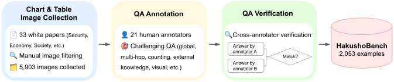
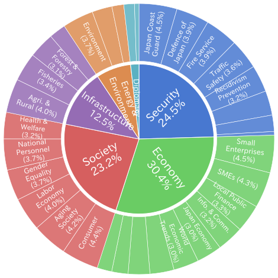
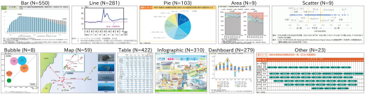
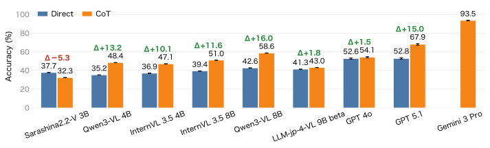
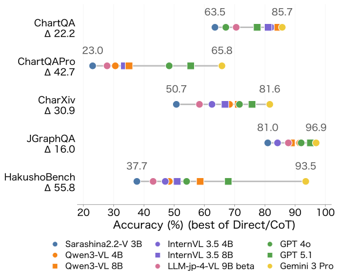

## Introduction

Vision-language models (VLMs) perform well on a wide range of tasks, such as image captioning and visual question answering (VQA).
Understanding chart images is particularly important for understanding documents that contain charts alongside text, such as financial reports and scientific papers.

For English, a wide range of benchmarks has been built to evaluate the chart understanding of VLMs, from foundational ones like [ChartQA](https://arxiv.org/abs/2203.10244) to diverse and challenging ones like [ChartQAPro](https://arxiv.org/abs/2504.05506) and [CharXiv](https://arxiv.org/abs/2406.18521).

For Japanese, on the other hand, although pioneering benchmarks such as [JGraphQA](https://huggingface.co/datasets/r-g2-2024/JGraphQA) exist, no benchmark is yet sufficient in terms of both the variety of chart types and the number of examples.

We therefore turned to the [white papers](https://www.e-gov.go.jp/about-government/white-papers.html) that Japanese government agencies publish every year. By collecting the chart images in these white papers and annotating QA pairs for them, we built [HakushoBench](https://huggingface.co/datasets/llm-jp/HakushoBench), a benchmark for evaluating Japanese chart understanding.

## The HakushoBench Construction Pipeline

The figure below shows the pipeline we used to build HakushoBench.

<figure>
  
  <figcaption>The HakushoBench construction pipeline.</figcaption>
</figure>

### Collecting Chart Images

As our source of chart images, we used 33 white papers, such as the Defense White Paper and the Energy White Paper, chosen from the more than 50 white papers accessible through the [e-Gov portal](https://www.e-gov.go.jp/about-government/white-papers.html) because they also come in an HTML version.
We used the HTML versions because they publish each chart as a separate image on the web, which makes chart images easy to collect. For example, the National Personnel Authority's white paper is also available in HTML, and it publishes images such as [this one](https://www.jinji.go.jp/kouho_houdo/koumuinhakusyo/hakusho/R6/files/1-3-01-6-18.png).
By gathering and downloading image URLs like this, we collected chart images efficiently.

From the 8,539 images collected this way, we manually removed low-resolution images and images unsuitable for chart understanding tasks, such as group photos, ending up with 5,903 chart images.

### Annotating QA Pairs

For the collected chart images, 21 external annotators each wrote one question and answer per image.
We set guidelines for writing QA pairs, such as requiring an understanding of the whole image or multi-step reasoning, so that annotators would not write QA pairs that are easy for VLMs.
We also allowed annotators to skip images for which writing a QA pair was difficult, so that the benchmark would not contain unnatural, forced QA pairs.

### Verifying QA Pair Quality

The written QA pairs may contain quality problems, such as ambiguous questions or incorrect answers.
To ensure quality, a different annotator wrote an answer for each image and question, and we compared it with the original answer: pairs whose answers matched were accepted, and those that did not match were corrected.

Through this process, we built HakushoBench, which consists of 2,053 VQA pairs.

## Analysis of HakushoBench

To show the diversity of HakushoBench, the figure below shows the topic distribution of its QA pairs. The QA pairs cover a wide range of topics across 33 white papers. Another characteristic is that many images contain expressions and cultural context specific to Japan that English benchmarks lack, such as Japanese text and maps of Japan.

<figure>
  
  <figcaption>Topic distribution of HakushoBench.</figcaption>
</figure>

The table below shows the distribution of image types in each benchmark, including existing ones.
Compared with JGraphQA, an existing Japanese benchmark, HakushoBench is better in both the number of examples and the variety of image types.

| Image type  | HakushoBench | JGraphQA | ChartQA | ChartQAPro | CharXiv |
| ----------- | -----------: | -------: | ------: | ---------: | ------: |
| Bar         |          550 |       50 |   1,220 |        380 |     108 |
| Line        |          281 |       30 |     211 |        317 |     443 |
| Pie         |          103 |       44 |      78 |         22 |       5 |
| Area        |            9 |        0 |       0 |         39 |      18 |
| Scatter     |            9 |        0 |       0 |         18 |     126 |
| Bubble      |            8 |        0 |       0 |         12 |       6 |
| Map         |           59 |        0 |       0 |          9 |       9 |
| Table       |          422 |       50 |       0 |          1 |       5 |
| Infographic |          310 |        0 |       0 |         33 |       1 |
| Dashboard   |          279 |       22 |       0 |        416 |     105 |
| Other       |           23 |        0 |       0 |          5 |     153 |
| Total       |        2,053 |      196 |   1,509 |      1,252 |     979 |

The figure below shows one randomly selected HakushoBench example for each image type. HakushoBench contains a wide variety of charts, from basic ones such as bar and pie charts to complex ones that include maps of Japan.

<figure>
  
  <figcaption>Example images from HakushoBench. One example was randomly selected from each image type.</figcaption>
</figure>

## Evaluating Models on HakushoBench

Using HakushoBench, we evaluated the Japanese chart understanding of a variety of VLMs, including both open and closed models.
The results are shown below.

<figure>
  
  <figcaption>Performance of each model on HakushoBench.</figcaption>
</figure>

Gemini 3 Pro achieved the highest performance at 93.5%. Among open models, Qwen3-VL 8B performed best at 58.6%.
The 34.9-point gap between Gemini 3 Pro and Qwen3-VL 8B, the best open model, shows that HakushoBench remains a challenging benchmark for open models.

To compare HakushoBench with other chart benchmarks, we also evaluated the same models on ChartQA, ChartQAPro, CharXiv, and JGraphQA.

<figure>
  
  <figcaption>Performance of each model on ChartQA, ChartQAPro, CharXiv, JGraphQA, and HakushoBench.</figcaption>
</figure>

On JGraphQA, the existing Japanese benchmark, even the weakest model exceeds 80% accuracy, whereas on HakushoBench Qwen3-VL 8B reaches only 58.6%, showing that HakushoBench is a more challenging benchmark.

## Conclusion

By collecting chart images from Japanese government white papers and annotating QA pairs for them, we built HakushoBench, a benchmark for evaluating Japanese chart understanding.

The benchmark is available on [Hugging Face](https://huggingface.co/datasets/llm-jp/HakushoBench), so please give it a try.
You can also evaluate models on HakushoBench with [simple-evals-mm](https://github.com/llm-jp/simple-evals-mm).

For more details, please see our paper, "[HakushoBench: A Japanese Chart and Table VQA Benchmark from Governmental White Papers](https://arxiv.org/abs/2606.01132)".
