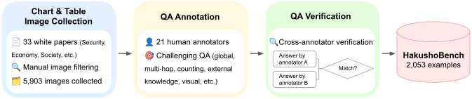
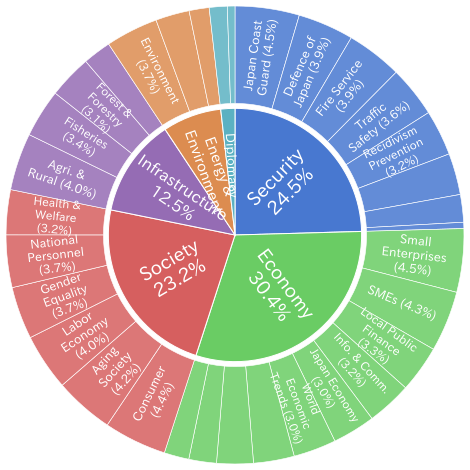
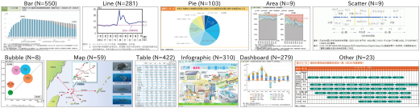
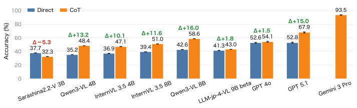
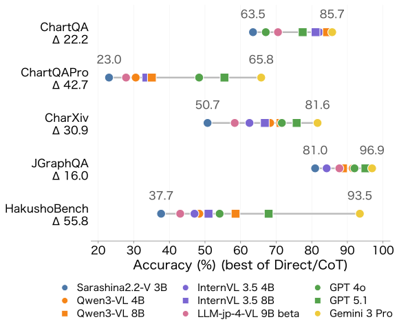

## はじめに

視覚言語モデル（VLM）は、画像のキャプション生成や画像質問応答（VQA）など様々なタスクで優れた性能を発揮しています。
とくに、図表画像の理解は、金融レポートや科学論文など、テキストに加えて図表画像が含まれるドキュメントを理解する上で重要なタスクの一つです。

VLMの図表理解能力を評価するためのベンチマークは、英語では[ChartQA](https://arxiv.org/abs/2203.10244)のような基礎的なベンチマークから、[ChartQAPro](https://arxiv.org/abs/2504.05506)や[CharXiv](https://arxiv.org/abs/2406.18521)のような多様かつ難易度の高いベンチマークまで、幅広く構築されています。

一方で、日本語の図表理解能力を評価するためのベンチマークは、[JGraphQA](https://huggingface.co/datasets/r-g2-2024/JGraphQA)のような先駆的な例は存在するものの、図表の種類や事例数の両面で十分なベンチマークが存在しません。

そこで我々は、日本の政府機関が毎年公開する[白書](https://www.e-gov.go.jp/about-government/white-papers.html)に着目し、これらの白書に含まれる図表画像を収集し、それらに対するQAペアをアノテーションすることで、日本語の図表理解能力を評価するためのベンチマーク[HakushoBench](https://huggingface.co/datasets/llm-jp/HakushoBench)を構築しました。

## HakushoBenchの構築パイプライン

以下にHakushoBenchの構築パイプラインを示します。

<figure>
  
  <figcaption>HakushoBenchの構築パイプライン。</figcaption>
</figure>

### 図表画像の収集

我々は、図表画像の収集源として、[e-Govポータル](https://www.e-gov.go.jp/about-government/white-papers.html)からアクセスできる50以上の白書のうち、HTML版も用意されている防衛白書やエネルギー白書など、合計33の白書を用いました。
HTML版を利用した理由は、白書中の図表が個別画像としてWeb上で公開されており、図表画像の収集が容易なためです。例えば人事院白書もHTML版が利用可能で、例として[こちらの画像](https://www.jinji.go.jp/kouho_houdo/koumuinhakusyo/hakusho/R6/files/1-3-01-6-18.png)が公開されています。
我々は、このような画像URLを集めてダウンロードすることで、効率的に図表画像を収集しました。

このようにして収集された8,539枚の画像から、我々はさらに低解像度の画像や、集合写真など図表理解タスクに適さない画像を目視で除外し、最終的に5,903枚の図表画像を用意しました。

### QAペアのアノテーション

収集された図表画像に対して、21人の外部アノテーターが、画像1枚につき1つの質問と回答を作成しました。
QAペアの作成にあたっては、画像全体の理解や複数ステップの推論を必要とするなど、VLMにとって簡単なQAペアが作成されないように、ガイドラインを設けました。
また、QAの作成が難しい画像についてはスキップを許可することで、無理に作成された不自然なQAが含まれないよう配慮しました。

### QAペアの品質検証

作成されたQAには、質問の曖昧さや回答の誤りなどの品質上の問題が含まれる可能性があります。
そこで、別のアノテーターが画像と質問に対して回答を作成し、元の回答と比較して、一致したものは採用、一致しなかったものは修正を行うことで、QAペアの品質を担保しました。

以上のプロセスを経て、最終的に2,053事例のVQAペアからなるHakushoBenchを構築しました。

## HakushoBenchの分析

HakushoBenchの多様性を示すために、以下にHakushoBenchのQAのトピック分布を示します。33種類の白書にまたがって、幅広いトピックのQAが含まれていることがわかります。テキストが日本語であったり、地図が日本地図であったりなど、英語ベンチマークには含まれない日本固有の表現や文化的背景を含む画像が多いことも特徴の一つです。

<figure>
  
  <figcaption>HakushoBenchのトピック分布。</figcaption>
</figure>

以下は、既存ベンチマークを含む各ベンチマークに含まれる画像のタイプ別分布を示した表です。
HakushoBenchは、既存日本語ベンチマークのJGraphQAと比較して、事例数、画像のタイプの多様性の両面で優れていることがわかります。

| 画像タイプ  | HakushoBench | JGraphQA | ChartQA | ChartQAPro | CharXiv |
| ----------- | -----------: | -------: | ------: | ---------: | ------: |
| Bar         |          550 |       50 |   1,220 |        380 |     108 |
| Line        |          281 |       30 |     211 |        317 |     443 |
| Pie         |          103 |       44 |      78 |         22 |       5 |
| Area        |            9 |        0 |       0 |         39 |      18 |
| Scatter     |            9 |        0 |       0 |         18 |     126 |
| Bubble      |            8 |        0 |       0 |         12 |       6 |
| Map         |           59 |        0 |       0 |          9 |       9 |
| Table       |          422 |       50 |       0 |          1 |       5 |
| Infographic |          310 |        0 |       0 |         33 |       1 |
| Dashboard   |          279 |       22 |       0 |        416 |     105 |
| Other       |           23 |        0 |       0 |          5 |     153 |
| 合計        |        2,053 |      196 |   1,509 |      1,252 |     979 |

下の図は、HakushoBenchに含まれる画像のうち、画像タイプごとにランダムに1事例選択したものです。棒グラフや円グラフなどの基本的な図から、日本地図を含んだ複雑な図まで、様々な種類の図表が含まれていることがわかります。

<figure>
  
  <figcaption>HakushoBenchに含まれる画像の例。各画像タイプからランダムに1事例選択した。</figcaption>
</figure>

## HakushoBenchを用いたモデル評価

我々は、HakushoBenchを用いて、オープンモデル・クローズドモデルの双方を含む様々なVLMの日本語図表理解能力を評価しました。
以下に評価結果を示します。

<figure>
  
  <figcaption>HakushoBenchにおける各モデルの性能。</figcaption>
</figure>

評価の結果、Gemini 3 Proが93.5%と最も高い性能を示しました。また、オープンモデルの中では、Qwen3-VL 8Bが58.6%で最も高い性能を示しました。
また、Gemini 3 Proと最も性能の高いオープンモデルであるQwen3-VL 8Bとの間には34.9ポイントの差があり、オープンモデルにとって、HakushoBenchは依然として難しいベンチマークであることがわかります。

我々は、さらに他の図表ベンチマークとHakushoBenchを比較するために、ChartQA, ChartQAPro, CharXiv, JGraphQAにおいても、同様のモデルを評価しました。

<figure>
  
  <figcaption>各モデルのChartQA, ChartQAPro, CharXiv, JGraphQA, HakushoBenchにおける性能。</figcaption>
</figure>

既存日本語ベンチマークのJGraphQAは、最も性能の低いモデルでも正解率80%を超えている一方、HakushoBenchはQwen3-VL 8Bで正解率58.6%と、より難しいベンチマークであることがわかります。

## おわりに

我々は、日本の白書に含まれる図表画像を収集し、QAペアをアノテーションすることで、日本語の図表理解能力を評価するためのベンチマークHakushoBenchを構築しました。

ベンチマークは[Hugging Face](https://huggingface.co/datasets/llm-jp/HakushoBench)で公開しておりますので、ぜひご活用ください。
HakushoBenchを用いたモデルの評価は、[simple-evals-mm](https://github.com/llm-jp/simple-evals-mm)を用いて行うことができますので、合わせてご活用ください。

より詳細な内容については、我々の論文「[HakushoBench: A Japanese Chart and Table VQA Benchmark from Governmental White Papers](https://arxiv.org/abs/2606.01132)」をご覧ください。
