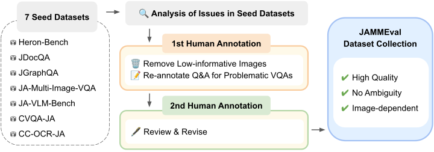
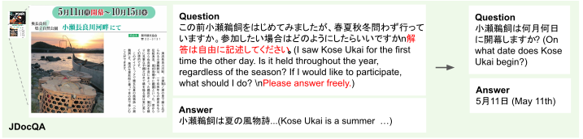
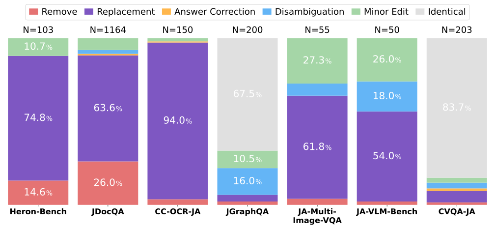
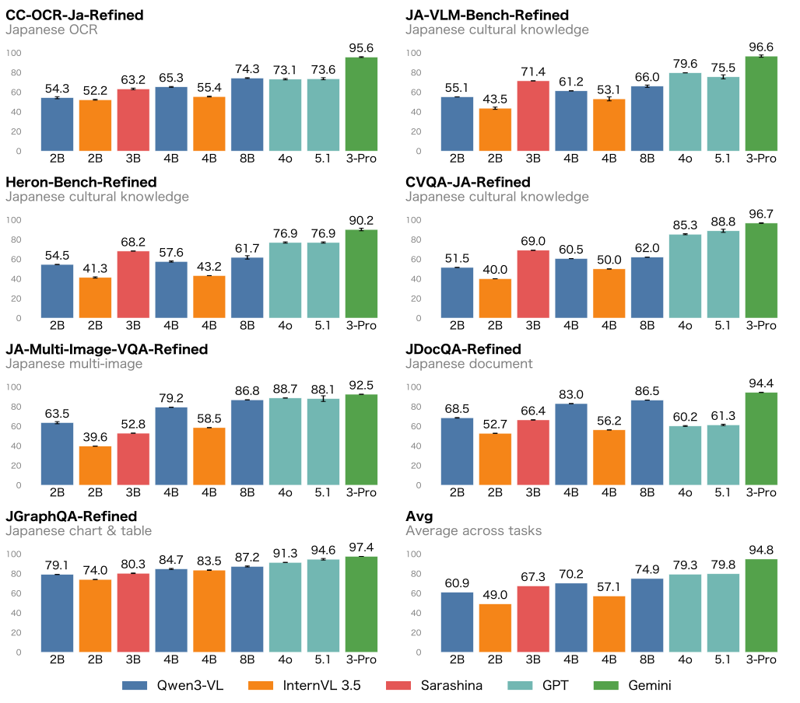
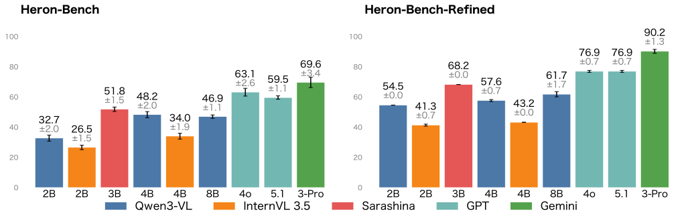

This post introduces JAMMEval, a benchmark collection we built by carefully reviewing and correcting existing Japanese VQA benchmarks.

## Introduction

Vision-language models (VLMs), which add image input to LLMs, have been under active development in recent years.

Evaluation is one of the most important parts of developing such models. Model developers base many decisions on evaluation results, from tuning hyperparameters to optimizing dataset mixture ratios. An evaluation infrastructure that can measure model performance accurately is therefore essential.

However, building a high-quality benchmark dataset requires careful design and human annotation, which is very costly. Such efforts are active in the English-speaking community, and many studies, such as [MMStar](https://mmstar-benchmark.github.io) and [DatBench](https://www.datologyai.com/blog/datbench-discriminative-faithful-and-efficient-vision-language-model-evaluations), have analyzed and fixed problems in existing benchmarks.

Benchmark development for Japanese, on the other hand, lags behind English, and there has been almost no systematic effort to refine existing datasets. As a result, existing Japanese VLM benchmarks often contain flawed instances, such as ambiguous questions and incorrect reference answers.

In fact, we manually inspected every instance in seven existing Japanese VLM benchmark datasets and found that they contain many flawed instances like the ones below.

<figure>
  
  <figcaption>Flawed instances in existing benchmarks.</figcaption>
</figure>

Specifically, we found the following types of flawed instances:

- Ambiguous questions
- Incorrect reference answers
- Questions that can be answered without the image

Such flawed instances prevent a fair evaluation of model performance.

We built JAMMEval by manually correcting these flawed instances.

## Building JAMMEval

We built JAMMEval by refining seven existing Japanese VLM benchmark datasets ([CC-OCR](https://arxiv.org/abs/2412.02210), [CVQA](https://arxiv.org/abs/2406.05967), [Heron-Bench](https://arxiv.org/abs/2404.07824), [JA-Multi-Image-VQA](https://huggingface.co/datasets/SakanaAI/JA-Multi-Image-VQA), [JA-VLM-Bench](https://huggingface.co/datasets/SakanaAI/JA-VLM-Bench-In-the-Wild), [JDocQA](https://arxiv.org/abs/2403.19454), [JGraphQA](https://huggingface.co/datasets/r-g2-2024/JGraphQA)) through two rounds of human annotation.

Before making corrections, we unified the answer format: CVQA keeps its original multiple-choice format, and all the other datasets use a short-answer format. Previously, each dataset used its own scoring method; unifying the datasets on a short-answer format lets us use a single scoring method and makes evaluation easier.

<figure>
  
  <figcaption>The JAMMEval construction pipeline.</figcaption>
</figure>

Below is an example of a correction.

<figure>
  
  <figcaption>An example of a VQA correction.</figcaption>
</figure>

The original question is open-ended. Because such a question has no single correct answer and is ambiguous, it is hard to score model outputs objectively and fairly.
For instances like this, we fixed the problem by assigning a new, unambiguous QA pair.

Below are statistics on the corrections we made to each dataset.

<figure>
  
  <figcaption>Statistics on the corrections.</figcaption>
</figure>

JGraphQA and CVQA-JA have a high proportion of "Identical" instances, meaning no correction was made. This is likely because both datasets included a verification process during benchmark construction, which ensured a certain level of quality. This suggests the importance of a verification process when building a benchmark. Note that CC-OCR has a large proportion of "Replacement" instances; this does not mean that CC-OCR is of low quality, but reflects the change in task format (from text extraction to QA).

## Evaluating Existing Models with JAMMEval

To assess the Japanese performance of currently available models, we evaluated them with JAMMEval.

For the evaluation, we used [simple-evals-mm](https://github.com/llm-jp/simple-evals-mm), an evaluation framework we newly built for this work. simple-evals-mm extends [simple-evals](https://github.com/openai/simple-evals), the LLM evaluation framework developed by OpenAI, to multimodal tasks, and it can evaluate more than 20 diverse Japanese and English tasks through a unified interface. For an introduction to simple-evals-mm, see [this post](https://speed1313.github.io/en/posts/simple-evals-mm/).

The evaluation results are shown below.

<figure>
  
  <figcaption>Evaluation results of existing models on JAMMEval. Note that only Gemini 3 Pro was evaluated with reasoning enabled.</figcaption>
</figure>

Gemini 3 Pro achieved the best overall performance, showing the benefit of reasoning.
Among open models, Qwen3-VL-8B achieved the highest average score.
Sarashina-2.2-Vision-3B, a Japanese-specialized model released by SB Intuitions, outperformed models of similar size on the Japanese culture tasks Heron-Bench-Refined and CVQA-JA-Refined, suggesting the effectiveness of Japanese specialization.

## Measuring the Effect of Refinement

To measure the effect of benchmark refinement, we evaluated models on both the original and refined versions of each benchmark and compared the results.

Here, we show the results before and after refinement for Heron-Bench as a representative example.

<figure>
  
  <figcaption>Performance of existing models on Heron-Bench before and after refinement.</figcaption>
</figure>

Scores improve across the board after refinement. This suggests that the flawed instances in the original version were causing model performance to be underestimated. Indeed, our paper shows that many of the errors before refinement were scoring errors caused by ambiguity, and that these errors led to underestimating model performance.
The run-to-run variance in scores also decreases. This suggests that the ambiguous questions in the original version were increasing score variance.

The score gaps between models are also larger after refinement than before. This shows that refining the benchmark makes it easier to distinguish small performance differences between models.
We expect this to make subtle performance differences easier to detect when comparing methods, for example in ablation studies.

## Conclusion

We built JAMMEval by manually refining Japanese benchmark datasets.
The JAMMEval dataset is available on [Hugging Face](https://huggingface.co/datasets/llm-jp/JAMMEval), and the evaluation framework is available as [simple-evals-mm](https://github.com/llm-jp/simple-evals-mm). We hope you find them useful.

For details, see our paper, [JAMMEval: A Refined Collection of Japanese Benchmarks for Reliable VLM Evaluation](https://arxiv.org/abs/2604.00909).

## Acknowledgments

We thank the developers of the seven existing datasets used to build JAMMEval:
[CC-OCR](https://arxiv.org/abs/2412.02210), [CVQA](https://arxiv.org/abs/2406.05967), [Heron-Bench](https://arxiv.org/abs/2404.07824), [JA-Multi-Image-VQA](https://huggingface.co/datasets/SakanaAI/JA-Multi-Image-VQA), [JA-VLM-Bench](https://huggingface.co/datasets/SakanaAI/JA-VLM-Bench-In-the-Wild), [JDocQA](https://arxiv.org/abs/2403.19454), [JGraphQA](https://huggingface.co/datasets/r-g2-2024/JGraphQA)
