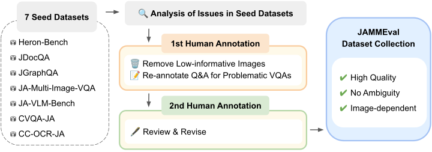
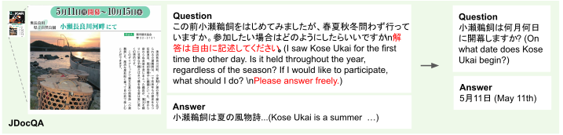
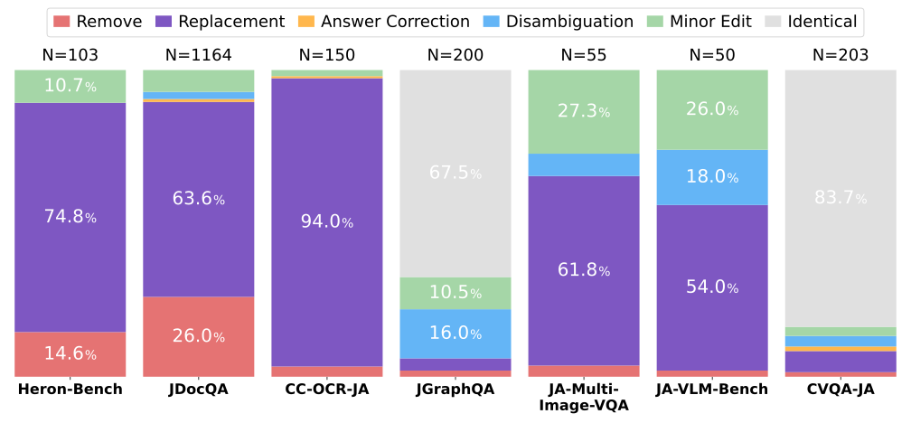
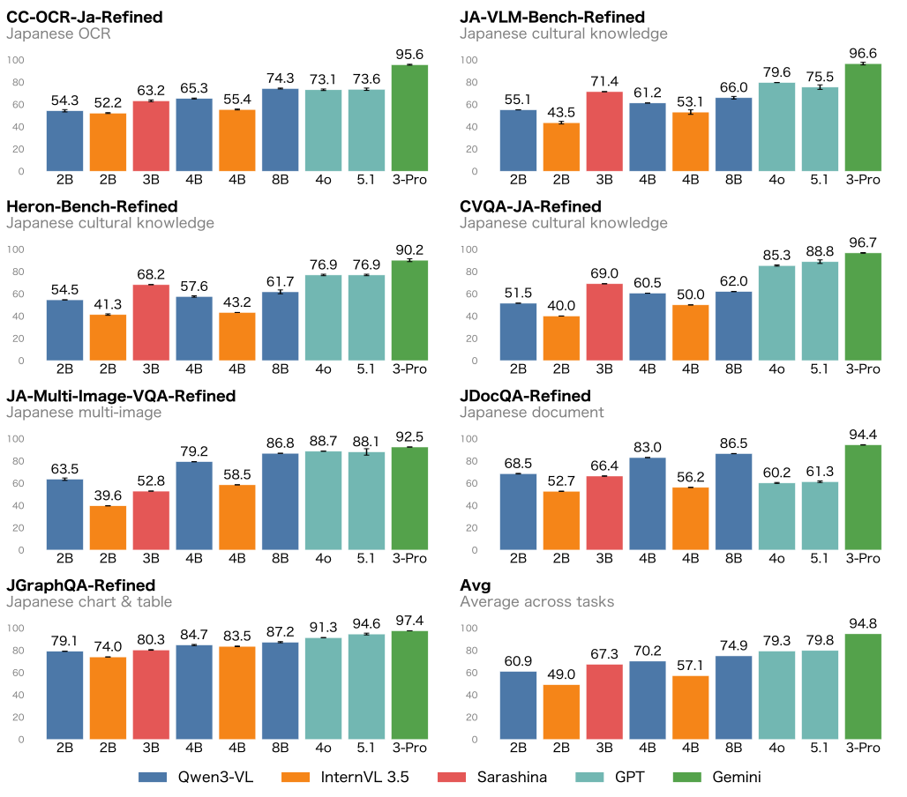
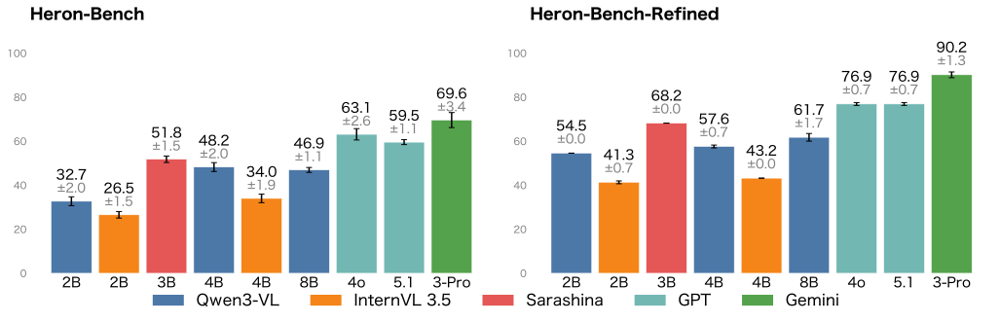

本稿では、既存の日本語VQAベンチマークを精査・修正することで構築したベンチマークコレクション JAMMEval を紹介します。

## はじめに

近年、LLMに画像入力を組み合わせた視覚言語モデル（VLM）の開発が活発に進められています。

こうしたモデル開発において、評価は極めて重要な要素の一つです。モデル開発者は、ハイパーパラメータの調整やデータセットの混合比の最適化など、さまざまな意思決定を評価結果に基づいて行います。そのため、モデルの性能を正確に測定できる評価基盤の整備は不可欠です。

しかし、質の高いベンチマークデータセットの構築には、慎重な設計と人手によるアノテーションが必要であり、多大なコストを伴います。英語圏ではこうした取り組みが活発であり、[MMStar](https://mmstar-benchmark.github.io) や [DatBench](https://www.datologyai.com/blog/datbench-discriminative-faithful-and-efficient-vision-language-model-evaluations) のように、既存ベンチマークの問題点を分析・改善する研究も数多く報告されています。

一方で、日本語におけるベンチマーク整備は英語に比べて遅れており、既存データセットの精緻化に関する体系的な取り組みはほとんど行われていません。その結果、既存の日本語VLMベンチマークには、曖昧な問題文や誤った正答といった不良事例が含まれているケースが少なくありません。

実際に、我々は既存の7つの日本語VLMベンチマークデータセットを対象に全件の目視確認を行い、以下のような不良事例が多数含まれていることを確認しました。

<figure>
  
  <figcaption>既存ベンチマークに含まれる不良事例。</figcaption>
</figure>

具体的には、以下のようなタイプの不良事例が含まれていました。

- 曖昧性のある問題文
- 誤った正答例
- 画像を用いずに解けてしまう問題

このような不良事例は、モデルの性能を公平に評価することを妨げます。

我々は、これらの不良事例を人手で修正することで、JAMMEvalを構築しました。

## JAMMEvalの構築

我々は既存の7つの日本語VLMベンチマークデータセット ([CC-OCR](https://arxiv.org/abs/2412.02210)、[CVQA](https://arxiv.org/abs/2406.05967), [Heron-Bench](https://arxiv.org/abs/2404.07824), [JA-Multi-Image-VQA](https://huggingface.co/datasets/SakanaAI/JA-Multi-Image-VQA), [JA-VLM-Bench](https://huggingface.co/datasets/SakanaAI/JA-VLM-Bench-In-the-Wild), [JDocQA](https://arxiv.org/abs/2403.19454)、[JGraphQA](https://huggingface.co/datasets/r-g2-2024/JGraphQA)) を2ラウンドにわたる人手によるアノテーションによって精緻化することで、JAMMEvalを構築しました。

なお、修正に先立ち、回答形式はCVQAは元の形式を引き継ぎ多肢選択式、それ以外は全て簡潔回答式に統一しています。今までは各データセットごとに異なる採点方法が用いられていましたが、全てのデータセットを簡潔回答式に統一することで、採点方法を統一し、評価しやすくしています。

<figure>
  
  <figcaption>JAMMEvalの構築パイプライン。</figcaption>
</figure>

以下に修正の例を示します。

<figure>
  
  <figcaption>VQAの修正例。</figcaption>
</figure>

元の問題文は自由記述式です。このような質問は、答えが一意に定まらず曖昧性があるため、モデル出力の客観的かつ公平な採点が困難です。
このような事例に対しては、曖昧性の無いQAを新たに付与することで、問題を修正しています。

以下は各データセットに対して施した修正処理の統計です。

<figure>
  
  <figcaption>修正処理の統計。</figcaption>
</figure>

JGraphQAとCVQA-JAは修正を行なっていないことを表す"Identical"の割合が高いことがわかります。この理由として、この2つのデータセットはベンチマーク構築時に検証プロセスを設けており、一定の品質が担保されていたことが挙げられます。このことから、ベンチマーク構築時の検証プロセスの重要性が示唆されます。なお、CC-OCRは"Replacement"の割合が多くなっていますが、これはCC-OCRの品質が低いことを示すものではなく、問題形式の変更 (文字抽出形式からQA形式) によるものであることに注意してください。

## JAMMEvalを用いた既存モデルの評価

現時点で公開されているモデルの日本語性能を評価するため、構築したJAMMEvalを用いてモデル評価を行いました。

評価には我々が今回新たに構築した評価フレームワーク[simple-evals-mm](https://github.com/llm-jp/simple-evals-mm)を用いました。simple-evals-mmは、OpenAIが開発したLLM評価フレームワーク[simple-evals](https://github.com/openai/simple-evals)をマルチモーダルタスクに拡張したもので、日英20以上のさまざまなタスクを統一的なインターフェースで評価することができます。simple-evals-mmの紹介記事は[こちら](https://speed1313.github.io/posts/simple-evals-mm/)をご覧ください。

以下に評価の結果を示します。

<figure>
  
  <figcaption>JAMMEvalを用いた既存モデルの評価結果。Gemini 3 Proのみ推論機能を有効にして評価していることに注意。</figcaption>
</figure>

評価の結果、Gemini 3 Proが全体的に最も高い性能を示し、推論機能の効果が示されました。
また、オープンモデルではQwen3-VL-8Bが平均スコアで最も高い性能を示しました。
SB Intuitionsが公開した日本語特化モデルSarashina-2.2-Vision-3Bは日本文化タスクのHeron-Bench-RefinedやCVQA-JA-Refinedで同程度のモデルサイズのモデルと比較して高い性能を示し、日本語特化の有効性が示唆されました。

## 精緻化の効果検証

ベンチマーク精緻化の効果を検証するため、ここでは各ベンチマークの修正前と修正後の両方で評価を行い、評価結果を比較しました。

ここでは、代表例としてHeron-Benchの修正前後の評価結果をそれぞれ示します。

<figure>
  
  <figcaption>Heron-Benchの修正前後の既存モデルの性能結果。</figcaption>
</figure>

修正によって、全体的にスコアが向上していることがわかります。これは、修正前に含まれていた不良事例が、モデルの性能を過小評価していたことを示唆しています。実際、我々の論文では、修正前のエラーの多くが曖昧性による採点エラーであったことを示しており、これらのエラーがモデルの性能を過小評価していたことを示しています。
また、実行ごとのスコアのばらつきも減少していることがわかります。これは、修正前に含まれていた曖昧な問題が、スコアのばらつきを増加させていたことを示唆しています。

モデル同士のスコア差も、修正前に比べて修正後の方が大きくなっています。このことから、ベンチマークの精緻化により、モデルの軽微な性能差を識別しやすくなったことがわかります。
アブレーション実験などで手法の比較を行う際に、微妙な性能差を捉えやすくなることが期待されます。

## おわりに

我々は人手による日本語ベンチマークデータセットの精緻化を施し、JAMMEvalを構築しました。
今回構築したJAMMEvalデータセットは[Hugging Face](https://huggingface.co/datasets/llm-jp/JAMMEval)、評価フレームワークは[simple-evals-mm](https://github.com/llm-jp/simple-evals-mm)で公開していますので、ぜひご活用ください。

詳細は我々の論文 [JAMMEval: A Refined Collection of Japanese Benchmarks for Reliable VLM Evaluation](https://arxiv.org/abs/2604.00909) をご覧ください。

## 謝辞

JAMMEvalの構築に用いた既存の7つのデータセットの開発者に感謝を示します:
[CC-OCR](https://arxiv.org/abs/2412.02210)、[CVQA](https://arxiv.org/abs/2406.05967), [Heron-Bench](https://arxiv.org/abs/2404.07824), [JA-Multi-Image-VQA](https://huggingface.co/datasets/SakanaAI/JA-Multi-Image-VQA), [JA-VLM-Bench](https://huggingface.co/datasets/SakanaAI/JA-VLM-Bench-In-the-Wild), [JDocQA](https://arxiv.org/abs/2403.19454), [JGraphQA](https://huggingface.co/datasets/r-g2-2024/JGraphQA)
