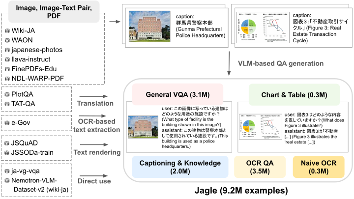
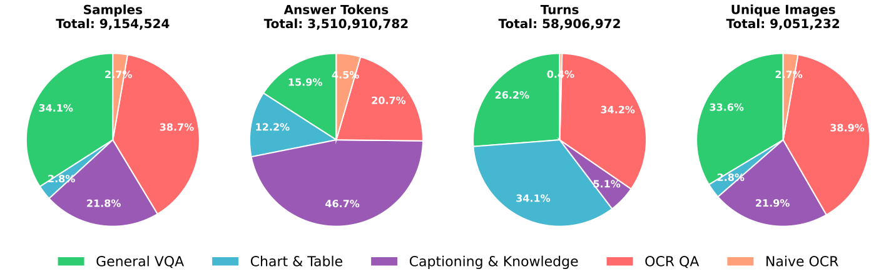
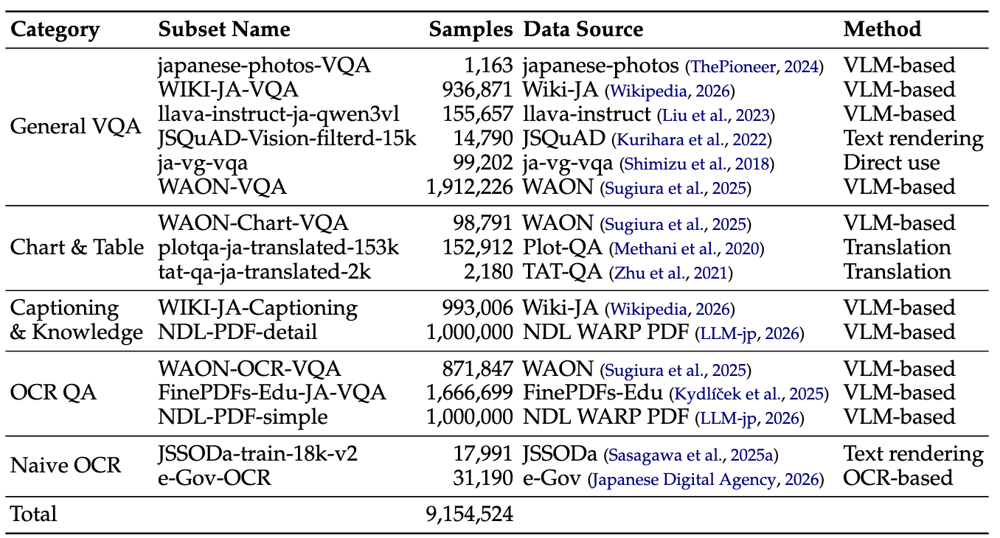
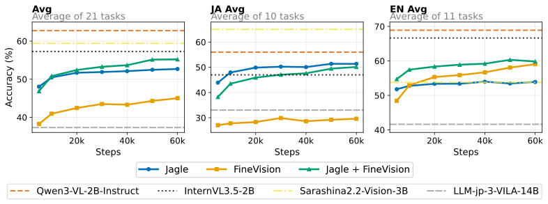

## Introduction

Vision-language models (VLMs), which extend LLMs to handle images as well, are expected to find applications in a wide range of fields such as medicine, autonomous driving, and physical AI, and their development has advanced rapidly in recent years.

One of the key ingredients in developing a VLM is the training dataset.
For a model to understand images in diverse formats, such as natural images, chart and table images, and document images, it needs to be trained on a large and diverse dataset.

Training datasets for English are being developed very actively, and large datasets spanning diverse domains, such as [FineVision](https://huggingface.co/datasets/HuggingFaceM4/FineVision), have been built.

For Japanese, on the other hand, dataset development lags behind English, and no existing dataset is sufficient in both scale and diversity.
We therefore built Jagle, a Japanese multimodal post-training dataset of about 9.2M examples covering diverse domains.
Jagle far exceeds existing Japanese datasets in both the number of categories and the number of examples, and training a model on it improves performance on Japanese tasks efficiently.

Jagle was also used to train [LLM-jp-4-VL 9B beta](https://huggingface.co/llm-jp/llm-jp-4-vl-9b-beta).

| Dataset          | Language | Categories | Subsets | Examples |
| ---------------- | -------- | ---------- | ------- | -------- |
| Cambrian-7B      | English  | 9          | 70      | 7.1M     |
| FineVision       | English  | 9          | 185     | 24.2M    |
| DEJIMA           | Japanese | 2          | 2       | 3.9M     |
| LLM-jp-3 VILA    | Japanese | 3          | 4       | 0.4M     |
| **Jagle (Ours)** | Japanese | **5**      | **16**  | **9.2M** |

## Building Jagle

The figure below shows the pipeline we used to build Jagle.

<figure>
  
  <figcaption>The Jagle construction pipeline.</figcaption>
</figure>

To build a large and diverse VQA dataset, we used a variety of data sources, including the image-text pair corpus [WAON](https://arxiv.org/abs/2510.22276) and PDF corpora ([FinePDFs-Edu](https://huggingface.co/datasets/HuggingFaceFW/finepdfs-edu) and [NDL WARP PDF](https://gitlab.llm-jp.nii.ac.jp/datasets/ndl-warp-pdf)).
From these data sources, we created QA pairs through methods such as QA synthesis with VLMs, translation, and text extraction with OCR tools, and ultimately built the Jagle dataset of about 9.2M examples.

The figure below shows some of the VQA examples in Jagle.

<figure>
  
  <figcaption>Some of the examples in Jagle.</figcaption>
</figure>

As you can see, Jagle contains images in diverse formats, such as natural images, chart and table images, document images, and slide images.

## Jagle Statistics

The figure below shows the distribution of Jagle by category.

<figure>
  
  <figcaption>Distribution of Jagle by category.</figcaption>
</figure>

The following are the statistics for each subset of Jagle.

<figure>
  
  <figcaption>Statistics for each subset of Jagle.</figcaption>
</figure>

## Evaluating Jagle

To verify the effectiveness of Jagle, we trained an approximately 2.2B VLM composed of [Qwen3-1.7B](https://huggingface.co/Qwen/Qwen3-1.7B) and [SigLIP2-So400M](https://huggingface.co/google/siglip2-so400m-patch16-512) in three settings:

1.  Jagle only
2.  FineVision only
3.  A mixture of Jagle and FineVision

and evaluated the trained models on 20 Japanese and English benchmarks.
For evaluation, we used [simple-evals-mm](https://github.com/llm-jp/simple-evals-mm), a VLM evaluation framework that we recently released.

The graph below shows how performance changed during training.

<figure>
  
  <figcaption>Performance during training with each dataset.</figcaption>
</figure>

On the Japanese task average, Jagle scores more than 20 points higher than FineVision, which shows that using Jagle improves performance on Japanese tasks efficiently.
It also outperforms InternVL3.5-2B, which we used as a baseline model, demonstrating the usefulness of Jagle.

The model trained on Jagle also outperforms LLM-jp-3-VILA-14B, which was trained on the existing Japanese dataset LLM-jp-3 VILA, despite being smaller, further demonstrating the usefulness of Jagle.

Interestingly, on the English task average, adding Jagle to FineVision improves performance over FineVision alone. We attribute this to the increased diversity of the dataset. In fact, the FineVision paper also shows that adding Chinese data to English data improves performance on English tasks, which suggests the importance of dataset diversity.

## Conclusion

The Jagle dataset we built is publicly available [here](https://huggingface.co/datasets/llm-jp/Jagle), so please feel free to use it in your model development.

For more details, please see our paper, [Jagle: Building a Large-Scale Japanese Multimodal Post-Training Dataset for Vision-Language Models](https://arxiv.org/abs/2604.02048).

## References

- https://arxiv.org/abs/2604.02048
  - The Jagle paper introduced in this post.
- https://huggingface.co/datasets/llm-jp/Jagle
  - The Jagle dataset introduced in this post.
- https://huggingface.co/llm-jp/llm-jp-4-vl-9b-beta
  - A model that turns llm-jp-4 into a VLM using Jagle and FineVision.
