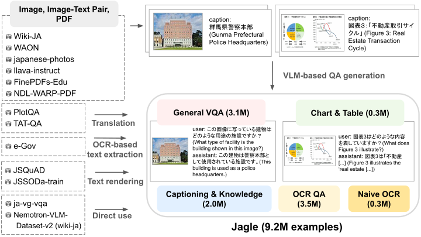
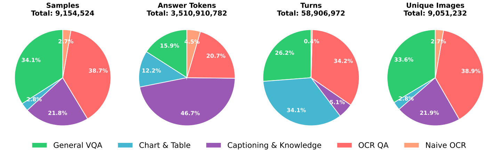
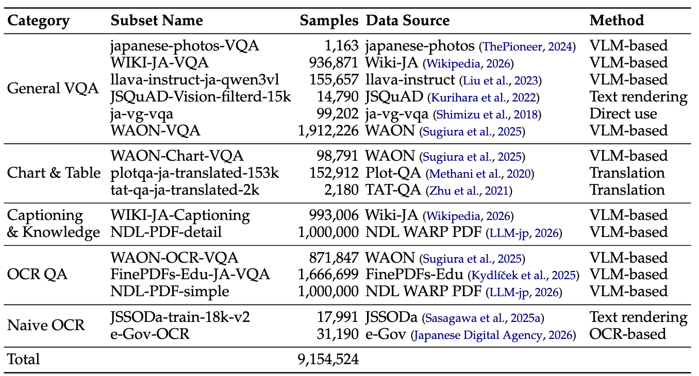
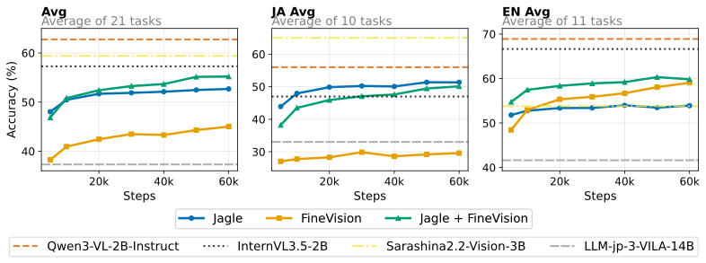

## はじめに

LLMに画像も扱えるようにした視覚言語モデル (VLM)は、医療や自動運転、フィジカルAIなどの幅広い分野での応用が期待されており、近年急速に開発が進められています。

VLMの開発において重要な要素の一つが学習データセットです。
モデルが自然画像や図表画像、ドキュメント画像など多様な形式の画像を理解するには、大規模かつ多様な学習データセットでモデルを学習する必要があります。

英語の学習データセットの開発は非常に活発に行われており、[FineVision](https://huggingface.co/datasets/HuggingFaceM4/FineVision)など、大規模かつ多様なドメインのデータセットが構築されています。

一方で、日本語の学習データセットの開発は英語に比べて遅れており、規模と多様性の両面で十分なデータセットが存在しません。
そこで我々は、約9.2M事例・多様なドメインで構成される日本語マルチモーダル事後学習データセットJagleを構築しました。
Jagleはカテゴリ数、事例数の両面で既存の日本語データセットを大きく上回っており、モデルの学習に用いることで、効率的に日本語タスクの性能を向上させることができます。

なお、Jagleは[LLM-jp-4-VL 9B beta](https://huggingface.co/llm-jp/llm-jp-4-vl-9b-beta)の学習にも用いられています。

| データセット     | 言語     | カテゴリ | サブセット | 事例数   |
| ---------------- | -------- | -------- | ---------- | -------- |
| Cambrian-7B      | English  | 9        | 70         | 7.1M     |
| FineVision       | English  | 9        | 185        | 24.2M    |
| DEJIMA           | Japanese | 2        | 2          | 3.9M     |
| LLM-jp-3 VILA    | Japanese | 3        | 4          | 0.4M     |
| **Jagle (Ours)** | Japanese | **5**    | **16**     | **9.2M** |

## Jagleの構築

以下にJagleの構築パイプラインを示します。

<figure>
  
  <figcaption>Jagleの構築パイプライン。</figcaption>
</figure>

我々は、大規模かつ多様なVQAデータセットの構築のために、画像・テキスト対コーパス[WAON](https://arxiv.org/abs/2510.22276)、PDFコーパス ([FinePDFs-Edu](https://huggingface.co/datasets/HuggingFaceFW/finepdfs-edu)、[NDL WARP PDF](https://gitlab.llm-jp.nii.ac.jp/datasets/ndl-warp-pdf))など、多様なデータソースを用いました。
これらのデータソースをもとに、VLMによるQA合成、翻訳、OCRツールによるテキスト抽出などによってQAペアを作成し、最終的に約9.2Mの事例からなるJagleデータセットを構築しました。

以下にJagleに含まれるVQA事例の一部を示します。

<figure>
  
  <figcaption>Jagleに含まれる事例の一部。</figcaption>
</figure>

自然画像や図表画像、ドキュメント画像、スライド画像など、多様な形式の画像が含まれていることがわかります。

## Jagleの統計

以下にJagleのカテゴリ別分布を示します。

<figure>
  
  <figcaption>Jagleのカテゴリ別分布。</figcaption>
</figure>

以下は、Jagleの各サブセットの統計です。

<figure>
  
  <figcaption>Jagleの各サブセットの統計。</figcaption>
</figure>

## Jagleの評価

Jagleの有効性を検証するため、[Qwen3-1.7B](https://huggingface.co/Qwen/Qwen3-1.7B)、[SigLIP2-So400M](https://huggingface.co/google/siglip2-so400m-patch16-512)で構成された約2.2BのVLMを、

1.  Jagleのみ
2.  FineVisionのみ
3.  JagleとFineVisionの混合

の3つの設定で学習し、学習済みモデルを日英20のベンチマークで評価しました。
評価には我々が最近公開したVLM評価フレームワーク[simple-evals-mm](https://github.com/llm-jp/simple-evals-mm)を用いました。

以下が学習中の性能推移のグラフです。

<figure>
  
  <figcaption>各データセットを用いて学習した場合の学習中の性能推移。</figcaption>
</figure>

日本語タスク平均において、JagleはFineVisionと比較して20ポイント以上高い性能を示しており、Jagleを用いることで効率的に日本語タスクの性能が向上することがわかります。
また、ベースラインモデルとして用いたInternVL3.5-2Bにも優っており、Jagleの有用性が示されました。

既存日本語データセットのLLM-jp-3 VILAを用いて学習されたLLM-jp-3-VILA-14Bに対しても、モデルサイズが小さいにもかかわらず、Jagleを用いて学習したモデルが優っており、Jagleの有用性が示されました。

興味深いことに、英語タスク平均において、FineVisionにJagleを加えると、FineVision単独よりも性能が向上することがわかります。これは、データセットの多様性が向上したことが原因と考えられます。実際、FineVisionの論文においても中国語データを英語データに加えることで英語タスクの性能が向上することが示されており、データセットの多様性の重要性が示唆されます。

## おわりに

我々が構築したJagleデータセットは[こちら](https://huggingface.co/datasets/llm-jp/Jagle)で公開しておりますので、モデル開発にぜひご活用ください。

また、詳細については我々の論文 [Jagle: Building a Large-Scale Japanese Multimodal Post-Training Dataset for Vision-Language Models](https://arxiv.org/abs/2604.02048) をご覧ください。

## 参考文献

- https://arxiv.org/abs/2604.02048
  - 今回紹介したJagleの論文です。
- https://huggingface.co/datasets/llm-jp/Jagle
  - 今回紹介したJagleのデータセットです。
- https://huggingface.co/llm-jp/llm-jp-4-vl-9b-beta
  - llm-jp-4を、JagleとFineVisionでVLM化したモデルです。
