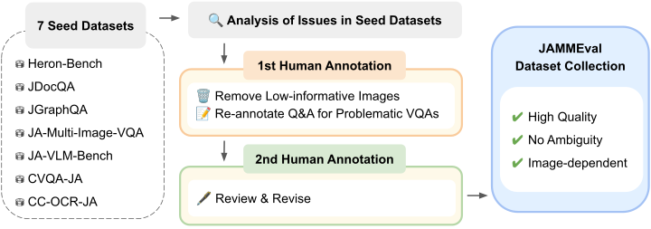
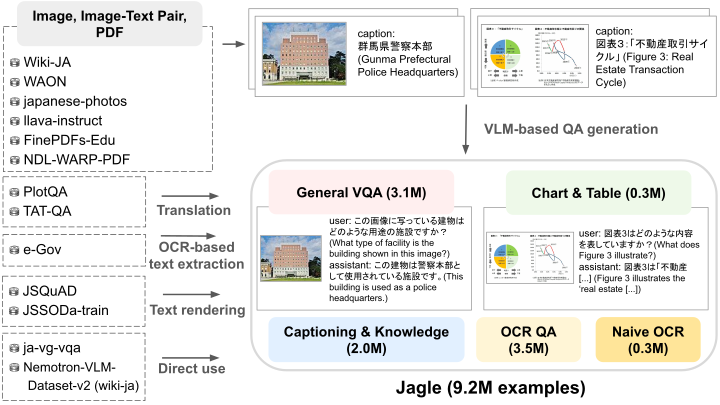
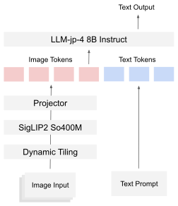
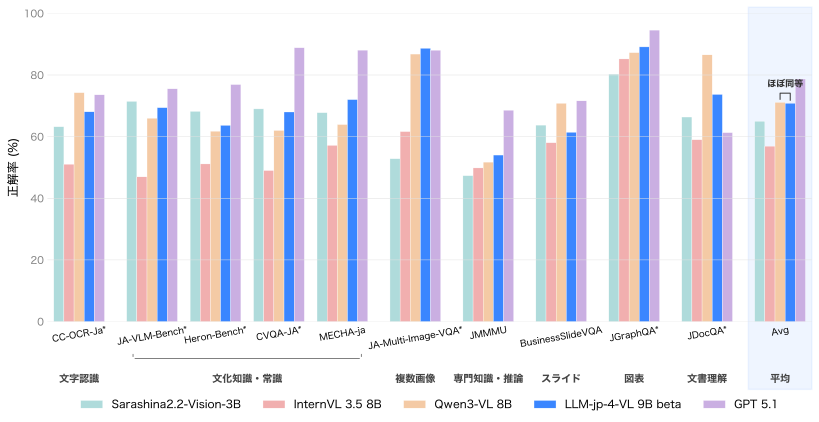
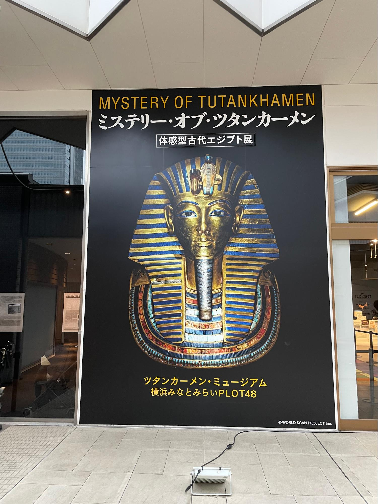

This post introduces [LLM-jp-4-VL-9B-beta](https://huggingface.co/llm-jp/llm-jp-4-vl-9b-beta), a vision-language model developed by LLM-jp.

Starting from [llm-jp/llm-jp-4-8b-instruct](https://huggingface.co/llm-jp/llm-jp-4-8b-instruct), we post-trained the model on about 180B tokens of Japanese and English multimodal data. As a result, it achieves average performance on par with Qwen3-VL-8B on Japanese tasks.

Below is an overview of the main efforts behind the model's development.

## Overview

In developing LLM-jp-4-VL-9B-beta, we focused on two things:

- Building a reliable evaluation infrastructure
- Constructing a large-scale, diverse training dataset

## JAMMEval: Refining Japanese Benchmarks

In model development, the reliability of evaluation strongly affects the quality of decision-making.

When we examined existing Japanese benchmarks closely, we found problems such as:

- Ambiguous questions
- Annotation errors (e.g., incorrect labels)
- Questions that can be answered without looking at the image

We therefore carried out two rounds of manual verification and correction on seven existing Japanese benchmarks and built [JAMMEval](https://speed1313.github.io/JAMMEval/), a collection of reliable evaluation datasets.

<figure>
  
  <figcaption>The JAMMEval construction pipeline.</figcaption>
</figure>

This allows us to base development decisions, such as dataset ablations and hyperparameter tuning, on more reliable evaluations.

## Jagle: A Large-Scale Japanese Multimodal Dataset

Large-scale, diverse data is essential for building a high-performing vision-language model. For Japanese, however, such post-training datasets had not been sufficiently developed.

We therefore built [Jagle](https://speed1313.github.io/Jagle/), the largest Japanese multimodal post-training dataset, with about 9.2 million examples.

Jagle integrates diverse data sources such as the following and converts them into VQA format:

- Image-text pair data
- Single-image data
- PDF documents

<figure>
  
  <figcaption>The Jagle construction pipeline.</figcaption>
</figure>

For example, we use data sources such as:

- [WAON](https://speed1313.github.io/WAON/), a Japanese image-text pair dataset
- [FinePDFs-Edu](https://huggingface.co/datasets/HuggingFaceFW/finepdfs-edu), a large-scale PDF corpus

## Model Training

Building on these results, we trained LLM-jp-4-VL-9B-beta.

### Model Architecture

The model consists of the following components:

- LLM: [llm-jp/llm-jp-4-8b-instruct](https://huggingface.co/llm-jp/llm-jp-4-8b-instruct) (8.6B)
- Image encoder: [google/siglip2-so400m-patch16-512](https://huggingface.co/google/siglip2-so400m-patch16-512) (0.4B)
- Projector: 2-layer MLP

<figure>
  
  <figcaption>The architecture of LLM-jp-4-VL-9B-beta.</figcaption>
</figure>

### Training Datasets

For training, we used the following data, about 33.4M examples in total across Japanese and English:

- Japanese: [llm-jp/Jagle](https://huggingface.co/datasets/llm-jp/Jagle) (9.2M examples)
- English: [HuggingFaceM4/FineVision](https://huggingface.co/datasets/HuggingFaceM4/FineVision) (24.2M examples)

## Evaluation

The results on Japanese tasks are shown below. For evaluation, we used [simple-evals-mm](https://github.com/llm-jp/simple-evals-mm), a VLM evaluation library we developed.

<figure>
  
  <figcaption>Benchmark results on Japanese tasks.</figcaption>
</figure>

With about 180B tokens of multimodal post-training, LLM-jp-4-VL-9B-beta achieves **average performance on par with Qwen3-VL-8B (about 2T tokens) using less than one-tenth of the training data**.

## Example Model Outputs

Here are some example outputs from LLM-jp-4-VL-9B-beta.

<figure>
  
  <figcaption>A poster for an Egyptian exhibition (photo by the author).</figcaption>
</figure>

Question: 画像に含まれる文字を全て抽出してください (Extract all the text in the image.)

<strong>Model output:</strong>

    "MYSTERY OF TUTANKHAMEN 
    ミステリー・オブ・ツタンカーメン 
    体感型古代エジプト展 
    ツタンカーメン・ミュージアム 
    横浜みなとみらいPLOT48 
    ©WORLD SCAN PROJECT Inc."

The model accurately extracts the text in the image.

## Conclusion

LLM-jp-4-VL-9B-beta is available on Hugging Face. Please give it a try.

- [LLM-jp-4-VL-9B-beta](https://huggingface.co/llm-jp/llm-jp-4-vl-9b-beta)

For detailed experimental settings and analyses of the model, see the official LLM-jp tech blog.

- [Tech blog post](https://llm-jp.nii.ac.jp/blog/20260414_llm-jp-4-vl-9b-beta/)

## References

- [LLM-jp-4-VL-9B-beta](https://huggingface.co/llm-jp/llm-jp-4-vl-9b-beta)
- [LLM-jp-4-VL-9B-beta tech blog post](https://llm-jp.nii.ac.jp/blog/20260414_llm-jp-4-vl-9b-beta/)
- [JAMMEval](https://speed1313.github.io/JAMMEval/)
- [Jagle](https://speed1313.github.io/Jagle/)
- [simple-evals-mm](https://github.com/llm-jp/simple-evals-mm)
