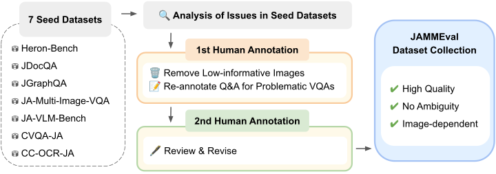
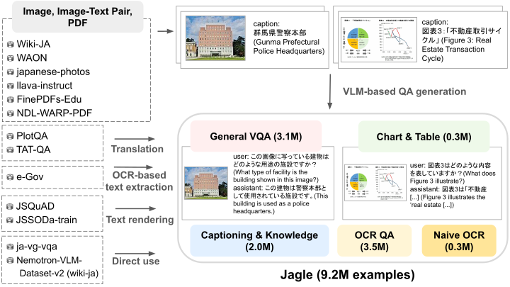
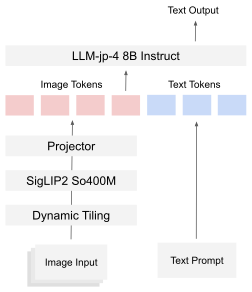
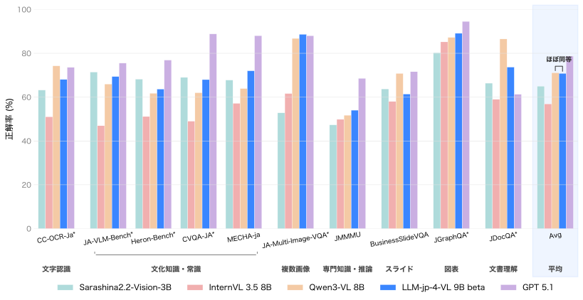
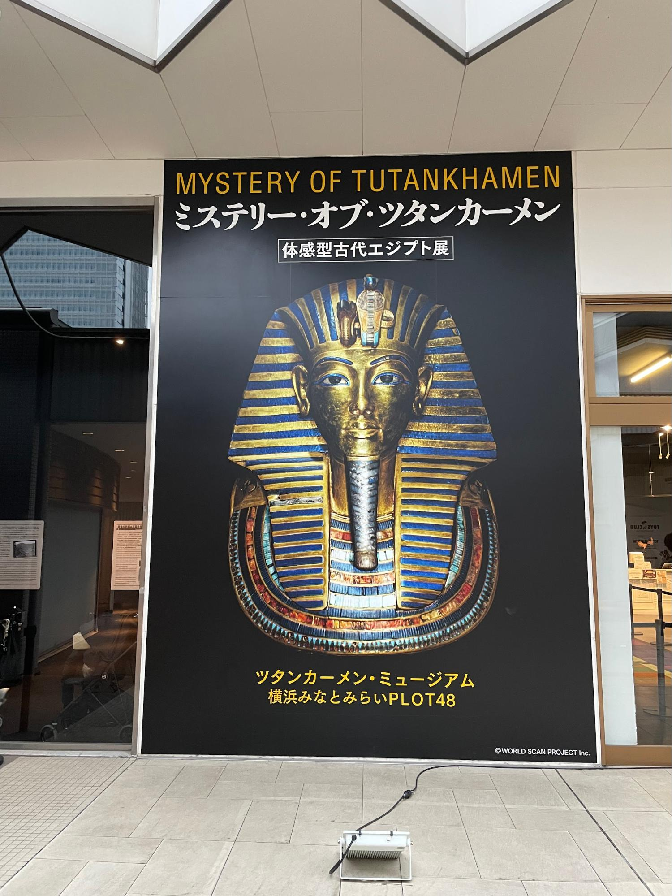

本記事では、LLM勉強会にて開発した視覚言語モデル「[LLM-jp-4-VL-9B-beta](https://huggingface.co/llm-jp/llm-jp-4-vl-9b-beta)」を紹介します。

本モデルは、[llm-jp/llm-jp-4-8b-instruct](https://huggingface.co/llm-jp/llm-jp-4-8b-instruct)をベースに、日英あわせて約180Bトークンのマルチモーダルデータで事後学習を行いました。その結果、日本語タスクにおいてはQwen3-VL-8Bと同程度の平均性能を達成しています。

本稿では、モデル開発の主要な取り組みについて概要を紹介します。

## 概要

LLM-jp-4-VL-9B-betaの開発では、以下の2点を重視しました。

- 信頼性の高い評価基盤の整備
- 大規模かつ多様な学習データセットの構築

## JAMMEval: 日本語ベンチマークの精緻化

モデル開発において、評価の信頼性は意思決定の質を大きく左右します。

既存の日本語ベンチマークを精査したところ、以下のような問題が確認されました：

- 問題文の曖昧性
- アノテーションミス（例：誤ったラベル）
- 画像を見ずに解答可能な問題の存在

そこで我々は、既存の日本語ベンチマーク7種類に対して2ラウンドにわたる人手による検証・修正を行い、信頼性の高い評価データセットコレクション[JAMMEval](https://speed1313.github.io/JAMMEval/)を構築しました。

<figure>
  
  <figcaption>JAMMEvalの構築パイプライン。</figcaption>
</figure>

これにより、データセットアブレーションやハイパーパラメータ調整といった開発上の意思決定を、より信頼性の高い評価に基づいて行うことが可能になりました。

## Jagle: 日本語大規模マルチモーダルデータセット

高性能な視覚言語モデルの実現には、大規模かつ多様なデータが不可欠です。しかし、日本語においてはそのような事後学習用データセットが十分に整備されていませんでした。

そこで我々は、約920万事例からなる日本語最大規模のマルチモーダル事後学習データセット[Jagle](https://speed1313.github.io/Jagle/)を構築しました。

Jagleでは、以下のような多様なデータソースを統合し、VQA形式へ変換しています：

- 画像・テキスト対データ
- 単一画像データ
- PDF文書

<figure>
  
  <figcaption>Jagleの構築パイプライン。</figcaption>
</figure>

例えば以下のようなデータソースを利用しています：

- 日本語画像・テキスト対データセット[WAON](https://speed1313.github.io/WAON/)
- 大規模PDFコーパス[FinePDFs-Edu](https://huggingface.co/datasets/HuggingFaceFW/finepdfs-edu)

## モデル学習

上記の成果をもとに、LLM-jp-4-VL-9B-betaを学習しました。

### モデルアーキテクチャ

本モデルは以下のコンポーネントで構成されています。

- LLM: [llm-jp/llm-jp-4-8b-instruct](https://huggingface.co/llm-jp/llm-jp-4-8b-instruct) (8.6B)
- 画像エンコーダ: [google/siglip2-so400m-patch16-512](https://huggingface.co/google/siglip2-so400m-patch16-512) (0.4B)
- プロジェクタ: 2層MLP

<figure>
  
  <figcaption>LLM-jp-4-VL-9B-betaのアーキテクチャ。</figcaption>
</figure>

### 学習データセット

学習には、以下の日英合計約33.4M事例のデータを用いました。

- 日本語: [llm-jp/Jagle](https://huggingface.co/datasets/llm-jp/Jagle) (9.2M事例)
- 英語: [HuggingFaceM4/FineVision](https://huggingface.co/datasets/HuggingFaceM4/FineVision) (24.2M事例)

## 評価

日本語タスクにおける評価結果を以下に示します。評価には、我々が開発したVLM評価ライブラリ[simple-evals-mm](https://github.com/llm-jp/simple-evals-mm)を用いました。

<figure>
  
  <figcaption>日本語タスクにおけるベンチマーク結果。</figcaption>
</figure>

LLM-jp-4-VL-9B-betaは、約180Bトークンのマルチモーダル事後学習により、Qwen3-VL-8B（約2Tトークン）と比較して**10分の1以下の学習量で同程度の平均性能**を達成しました。

## モデル出力の例

ここでは、LLM-jp-4-VL-9B-betaのモデル出力の例を紹介します。

<figure>
  
  <figcaption>エジプト展のポスター（著者撮影）。</figcaption>
</figure>

質問: 画像に含まれる文字を全て抽出してください

<strong>モデル出力:</strong>

    "MYSTERY OF TUTANKHAMEN 
    ミステリー・オブ・ツタンカーメン 
    体感型古代エジプト展 
    ツタンカーメン・ミュージアム 
    横浜みなとみらいPLOT48 
    ©WORLD SCAN PROJECT Inc."

画像中の文字を正確に抽出できていることがわかります。

## おわりに

LLM-jp-4-VL-9B-betaはHugging Faceで公開されています。ぜひお試しください。

- [LLM-jp-4-VL-9B-beta](https://huggingface.co/llm-jp/llm-jp-4-vl-9b-beta)

今回紹介したモデルの詳細な実験設定や分析については、LLM勉強会の公式技術ブログをご参照ください。

- [技術ブログ記事](https://llm-jp.nii.ac.jp/blog/20260414_llm-jp-4-vl-9b-beta/)

## 参考文献

- [LLM-jp-4-VL-9B-beta](https://huggingface.co/llm-jp/llm-jp-4-vl-9b-beta)
- [LLM-jp-4-VL-9B-beta 技術ブログ記事](https://llm-jp.nii.ac.jp/blog/20260414_llm-jp-4-vl-9b-beta/)
- [JAMMEval](https://speed1313.github.io/JAMMEval/)
- [Jagle](https://speed1313.github.io/Jagle/)
- [simple-evals-mm](https://github.com/llm-jp/simple-evals-mm)
