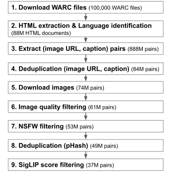
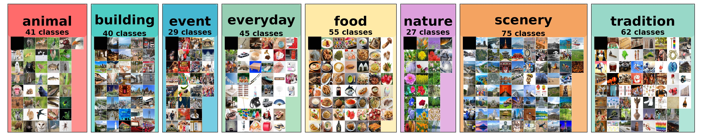
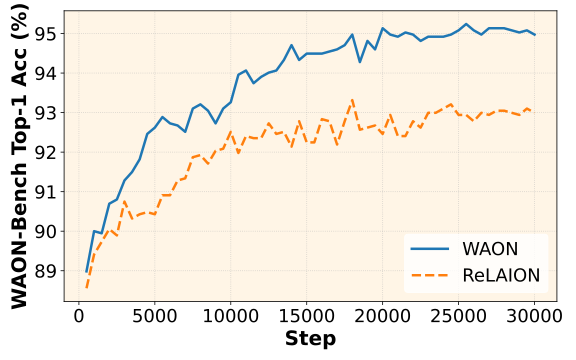

## Introduction

Vision-Language Models (VLMs), which process two modalities (images and text), have been attracting attention in recent years.
Datasets of images paired with their corresponding captions (image-text pair datasets) play an important role in VLM development. For example, [CLIP](https://arxiv.org/abs/2103.00020), which trains its model with contrastive learning, uses an image-text pair dataset of about 400M pairs.
Given the importance of image-text pair datasets, large-scale ones such as [LAION-5B](https://arxiv.org/abs/2210.08402) are being actively built.

However, existing datasets are skewed toward languages such as English and Chinese, and Japanese image-text pair datasets are insufficient in both scale and quality.

We therefore built [WAON](https://huggingface.co/datasets/llm-jp/WAON) (Web-scale image text Aligned Open Nihongo), a large-scale, high-quality Japanese image-text pair dataset.

## Overview of WAON

WAON is a Japanese image-text pair dataset consisting of about 155M examples.
WAON is built from Japanese web pages collected from Common Crawl, using the following six snapshots: {2025-18, 2025-08, 2024-51, 2024-42, 2024-33, 2024-26}

The data construction pipeline is shown below. To ensure high quality, we carefully performed filtering and deduplication.

<figcaption>The WAON construction pipeline. The numbers in parentheses are the number of examples remaining after each step for the 2025-18 snapshot. </figcaption>

## Evaluating WAON

One way to evaluate the quality of a training dataset itself is to train a model on it and measure the performance of the resulting model.
We evaluated the usefulness of WAON by fine-tuning the multilingual CLIP model [google/siglip2-base-patch16-256](https://huggingface.co/google/siglip2-base-patch16-256) on WAON and evaluating it on several benchmarks, including Japanese cultural image classification datasets.

### WAON-Bench

The [Recruit dataset](https://huggingface.co/datasets/recruit-jp/japanese-image-classification-evaluation-dataset) is an existing Japanese cultural image classification dataset, but it has problems: it contains mislabeled examples, and 101 of its 161 classes belong to the food category, so its category distribution is heavily skewed.

We therefore built [WAON-Bench](https://huggingface.co/datasets/llm-jp/WAON-Bench), a new benchmark for Japanese cultural understanding. WAON-Bench consists of 1,870 images in total (8 categories, 374 classes, 5 images per class), and each image is annotated with the correct class label.

<figcaption>Overview of WAON-Bench.</figcaption>

### Results

The figure below compares Top-1 Accuracy on WAON-Bench when fine-tuning on WAON and on the Japanese subset of ReLAION. Using WAON improves performance efficiently.

<figcaption>Comparison of Top-1 Accuracy on WAON-Bench.</figcaption>

The table below shows the results of each model on several benchmarks.
The model fine-tuned on WAON achieves SoTA performance on the Recruit dataset and WAON-Bench.
WAON also outperforms the Japanese subset of ReLAION on all benchmarks.

| Model                                                                                                            | Params | XM3600    | ImageNet  | Recruit   | WAON-Bench | Avg       |
| ---------------------------------------------------------------------------------------------------------------- | ------ | --------- | --------- | --------- | ---------- | --------- |
| [**siglip2-base-patch16-256 (fine-tuned on WAON)**](https://huggingface.co/llm-jp/waon-siglip2-base-patch16-256) | 375M   | 73.75     | 49.61     | **83.14** | **94.97**  | **75.37** |
| siglip2-base-patch16-256 (fine-tuned on ReLAION)                                                                 | 375M   | 72.39     | 47.38     | 81.65     | 92.99      | 73.60     |
| [siglip2-base-patch16-256](https://huggingface.co/google/siglip2-base-patch16-256)                               | 375M   | 38.28     | 48.12     | 76.98     | 87.81      | 62.80     |
| [clip-japanese-base](https://huggingface.co/line-corporation/clip-japanese-base)                                 | 196M   | **78.00** | 48.90     | 81.65     | 90.05      | 74.65     |
| [siglip-base-patch16-256-mult](https://huggingface.co/google/siglip-base-patch16-256-multilingual)               | 371M   | 43.22     | 53.26     | 75.10     | 89.25      | 65.21     |
| [Japanese Stable CLIP ViT-L-16](https://huggingface.co/stabilityai/japanese-stable-clip-vit-l-16)                | 414M   | 66.03     | **55.97** | 71.29     | 82.03      | 68.83     |
| [LAION-CLIP-ViT-H-14](https://huggingface.co/laion/CLIP-ViT-H-14-frozen-xlm-roberta-large-laion5B-s13B-b90k)     | 1193M  | 72.64     | 47.67     | 70.62     | 85.88      | 69.20     |

These results show that WAON is a high-quality Japanese image-text pair dataset that efficiently improves model performance.

## Conclusion

In this post, we introduced WAON, a large-scale, high-quality Japanese image-text pair dataset. Our experiments showed that using WAON efficiently improves a model's understanding of Japanese culture. For details, see [our paper, "WAON: Large-Scale Japanese Image-Text Dataset for Cultural Adaptation in Contrastive Vision-Language Models"](https://arxiv.org/abs/2510.22276).

If you are developing a vision-language model, give WAON a try!

## Links

- Paper: [https://arxiv.org/abs/2510.22276](https://arxiv.org/abs/2510.22276)
- WAON: [https://huggingface.co/datasets/llm-jp/WAON](https://huggingface.co/datasets/llm-jp/WAON)
- WAON-Bench: [https://huggingface.co/datasets/llm-jp/WAON-Bench](https://huggingface.co/datasets/llm-jp/WAON-Bench)
- waon-siglip2-base-patch16-256: [https://huggingface.co/llm-jp/waon-siglip2-base-patch16-256](https://huggingface.co/llm-jp/waon-siglip2-base-patch16-256)
- Code: [https://github.com/llm-jp/WAON](https://github.com/llm-jp/WAON)
