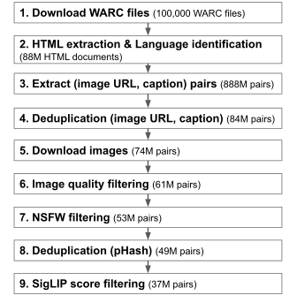
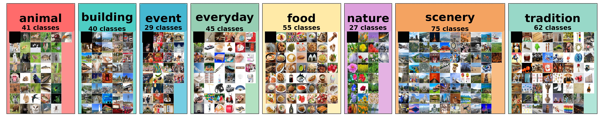
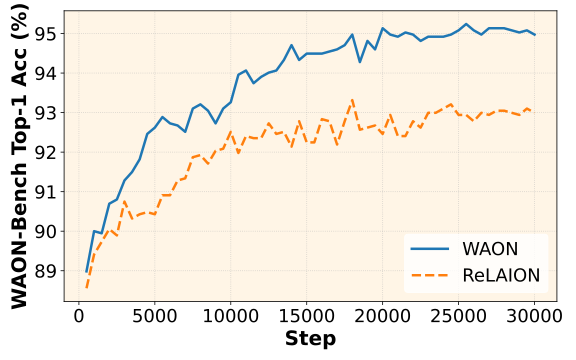

## はじめに

近年、画像とテキストの2つのモダリティを処理するVision-Language Model (VLM) が注目を集めています。
VLMの開発において、画像とそれに対応するキャプションのペアデータセット (画像・テキスト対データセット) は重要な役割を果たしています。例えば、Contrastive Learningによってモデルを学習する[CLIP](https://arxiv.org/abs/2103.00020)は約400Mの画像・テキスト対データセットを用いています。
画像・テキスト対データセットの重要性から、[LAION-5B](https://arxiv.org/abs/2210.08402)のような、大規模な画像・テキスト対データセットの構築が活発に行われています。

しかし、既存のデータセットは、英語や中国語などの言語に偏っており、日本語の画像・テキスト対データセットは、規模や品質の面で十分ではありません。

そこで、我々は、大規模かつ高品質な日本語画像・テキスト対データセットである[WAON](https://huggingface.co/datasets/llm-jp/WAON) (Web-scale image text Aligned Open Nihongo)を構築しました。

## WAONの概要

WAONは、約155Mの事例で構成された日本語画像・テキスト対データセットです。
WAONはCommon Crawlから収集した日本語Webページをもとに構築しており、使用したスナップショットは以下の6つです: {2025-18, 2025-08, 2024-51, 2024-42, 2024-33, 2024-26}

データ構築パイプラインは以下の通りです。高品質化のために、フィルタリングや重複除去を丁寧に行っています。

<figcaption>WAONの構築パイプライン。括弧内の数字は、2025-18 snapshotにおける、各ステップの処理後に残った事例数。</figcaption>

## WAONの評価

学習データセット自体の品質を評価する方法として、そのデータセットでモデルを学習し、得られたモデルの性能を測定する手法があります。
我々は、多言語CLIPである[google/siglip2-base-patch16-256](https://huggingface.co/google/siglip2-base-patch16-256)をWAONを用いてfine-tuningし、日本文化画像分類データセットを含む複数のベンチマークで評価することで、WAONの有用性を評価しました。

### WAON-Bench

既存の日本文化画像分類データセットとして[Recruitデータセット](https://huggingface.co/datasets/recruit-jp/japanese-image-classification-evaluation-dataset)が存在しますが、ミスラベルが含まれているほか、全161クラスのうち101クラスがfoodカテゴリに属しており、カテゴリ分布に大きな偏りがみられるといった問題がありました。

そこで、我々は[WAON-Bench](https://huggingface.co/datasets/llm-jp/WAON-Bench)という日本文化理解ベンチマークを新たに構築しました。WAON-Benchは8カテゴリ、374クラス、各クラス5枚の合計1870枚の画像から構成されており、各画像には正しいクラスラベルが付与されています。

<figcaption>WAON-Benchの概要。</figcaption>

### 評価結果

以下の図は、WAONおよびReLAIONの日本語サブセットを用いてfine-tuningした時のWAON-BenchでのTop-1 Accuracyの比較です。WAONを用いることで、効率的に性能が向上することがわかります。

<figcaption>WAON-BenchにおけるTop-1 Accuracyの比較。</figcaption>

以下の表は、各モデルの複数ベンチマークにおける評価結果です。
WAONを用いてfine-tuningしたモデルが、RecruitデータセットおよびWAON-BenchでSoTAの性能を達成していることがわかります。
また、ReLAIONの日本語サブセットよりもWAONが全てのベンチマークで優れた性能を示していることがわかります。

| Model                                                                                                            | Params | XM3600    | ImageNet  | Recruit   | WAON-Bench | Avg       |
| ---------------------------------------------------------------------------------------------------------------- | ------ | --------- | --------- | --------- | ---------- | --------- |
| [**siglip2-base-patch16-256 (fine-tuned on WAON)**](https://huggingface.co/llm-jp/waon-siglip2-base-patch16-256) | 375M   | 73.75     | 49.61     | **83.14** | **94.97**  | **75.37** |
| siglip2-base-patch16-256 (fine-tuned on ReLAION)                                                                 | 375M   | 72.39     | 47.38     | 81.65     | 92.99      | 73.60     |
| [siglip2-base-patch16-256](https://huggingface.co/google/siglip2-base-patch16-256)                               | 375M   | 38.28     | 48.12     | 76.98     | 87.81      | 62.80     |
| [clip-japanese-base](https://huggingface.co/line-corporation/clip-japanese-base)                                 | 196M   | **78.00** | 48.90     | 81.65     | 90.05      | 74.65     |
| [siglip-base-patch16-256-mult](https://huggingface.co/google/siglip-base-patch16-256-multilingual)               | 371M   | 43.22     | 53.26     | 75.10     | 89.25      | 65.21     |
| [Japanese Stable CLIP ViT-L-16](https://huggingface.co/stabilityai/japanese-stable-clip-vit-l-16)                | 414M   | 66.03     | **55.97** | 71.29     | 82.03      | 68.83     |
| [LAION-CLIP-ViT-H-14](https://huggingface.co/laion/CLIP-ViT-H-14-frozen-xlm-roberta-large-laion5B-s13B-b90k)     | 1193M  | 72.64     | 47.67     | 70.62     | 85.88      | 69.20     |

以上の結果から、WAONはモデルの性能を効率的に向上させる高品質な日本語画像・テキスト対データセットであることが示されました。

## おわりに

本稿では、大規模かつ高品質な日本語画像・テキスト対データセットであるWAONを紹介しました。実験では、WAONを用いることで、モデルの日本文化理解能力を効率的に向上させることを示しました。詳細は[我々の論文](https://arxiv.org/abs/2510.22276)をご覧ください。

Vision-Language Modelを開発する際は、ぜひWAONを試してみてください!

## リンク

- Paper: [https://arxiv.org/abs/2510.22276](https://arxiv.org/abs/2510.22276)
- WAON: [https://huggingface.co/datasets/llm-jp/WAON](https://huggingface.co/datasets/llm-jp/WAON)
- WAON-Bench: [https://huggingface.co/datasets/llm-jp/WAON-Bench](https://huggingface.co/datasets/llm-jp/WAON-Bench)
- waon-siglip2-base-patch16-256: [https://huggingface.co/llm-jp/waon-siglip2-base-patch16-256](https://huggingface.co/llm-jp/waon-siglip2-base-patch16-256)
- Code: [https://github.com/llm-jp/WAON](https://github.com/llm-jp/WAON)
