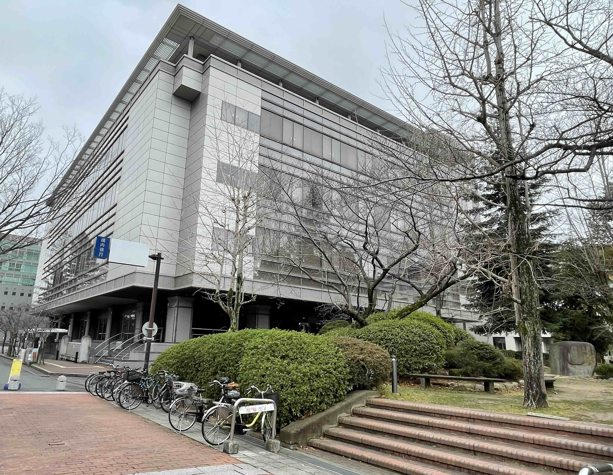
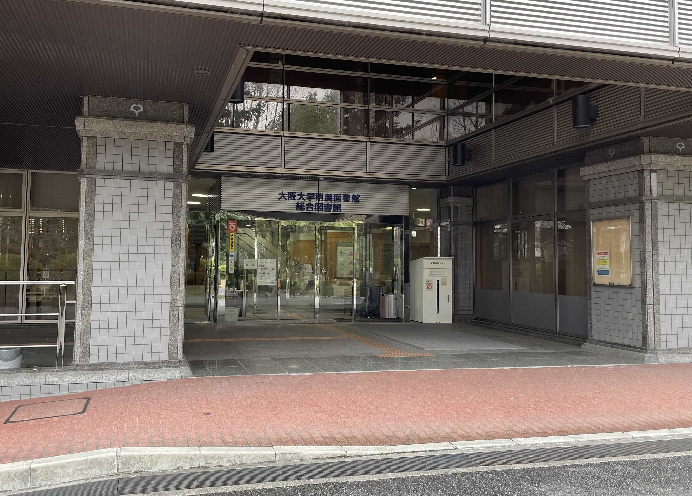
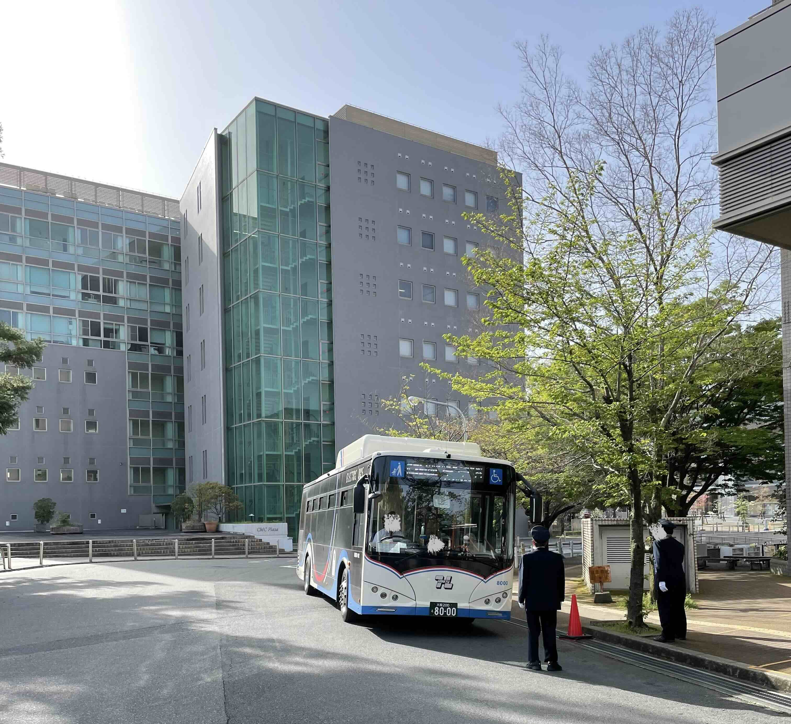

## About the Osaka University Main Library

Hi, I'm speed.

During my undergraduate years, the Main Library on the Toyonaka Campus was where I lived (not literally).

The Main Library is a truly wonderful place.

In this post, I introduce the appeal of the Osaka University Main Library that I discovered during my undergraduate years.

## What Makes Osaka University Library Great

<figure>
  
  <figcaption>Osaka University Main Library</figcaption>
</figure>

### You Can Spend the Whole Day at the Main Library

The Main Library sits on prime real estate on the Toyonaka Campus.

<iframe title="Map of the Osaka University Main Library" src="https://www.google.com/maps/embed?pb=!1m18!1m12!1m3!1d3276.0337210740786!2d135.45248097589123!3d34.80509347288277!2m3!1f0!2f0!3f0!3m2!1i1024!2i768!4f13.1!3m3!1m2!1s0x6000fa875a91ee5f%3A0xd1db41e5fe097c29!2sOsaka%20University%20Main%20Library!5e0!3m2!1sen!2sjp!4v1708679791782!5m2!1sen!2sjp" width="400" height="350" style="border:0;" allowfullscreen="" loading="lazy" referrerpolicy="no-referrer-when-downgrade"></iframe>

Right below the library are the cafeteria under the library (館下食堂), open until around 7 p.m., and a co-op convenience store.

On top of that, right in front of the library there are lush trees and a quiet pond. There are tables and chairs there, so you can take a relaxing break.

There are plenty of restrooms, too.

In short, everything you need for daily life is right there, so you can stay at the library all day, from morning to night.

### Vast Study Spaces

The Main Library is huge, and there are study spaces everywhere.

During exam periods, the study spaces on the 1st and 2nd floors often fill up, but if you go up to the 3rd or 4th floor, you will always find an empty seat somewhere.

I lived in a room without air conditioning, so I also used the study spaces to escape the summer heat and the winter cold. As a result, I spent most of my university life in the study spaces. Not so much a third place as my first home.

Study space is one of the greatest services a university offers, so please make good use of it.

### Roomy Aisles Between Bookshelves

Have you ever paid attention to the distance between bookshelves?

In libraries where the collection keeps growing, the space between shelves tends to shrink as the number of books increases.

Then, when you look for books, you can't take in the shelves at a glance and end up choosing books only from a narrow area.

To come across books by chance, I think it is very important to be able to choose books with a broad view, thanks to roomy shelving.

The Main Library is very large, and the aisles between the shelves are spacious, which makes it very easy to look for books.

I hope you'll come across all kinds of books there.

<figure>
  
  <figcaption>Front entrance of the Osaka University Main Library</figcaption>
</figure>

### Visit Other Libraries by "Sairi Bus"

Osaka University has three campuses: Toyonaka, Minoh, and Suita. Because students need to travel between campuses for classes, extracurricular activities, and so on, an intercampus shuttle bus, nicknamed the "Sairi Bus" (再履バス), runs between them.

<figure>
  
  <figcaption>The Sairi Bus running on campus</figcaption>
</figure>

Osaka University members can ride the Sairi Bus for free.

This makes it easy to visit the libraries on each campus.

Most importantly, there is a bus stop right in front of the Main Library. This means you can go door to door from the Main Library to another campus.

The spot I recommend visiting by Sairi Bus is the [Minoh City Semba Library](https://www.library.osaka-u.ac.jp/minohsemba/) (箕面市立船場図書館) on the Minoh Campus. It opened just recently, in 2021, and is a trendy, stylish library with a café and a theater attached.

If you've been holed up in the Main Library and feel like a change of air, take the Sairi Bus and visit it!

By the way, Minoh-Semba-Handai-mae Station is scheduled to open near the Minoh Campus in March 2024 with the extension of the Kita-Osaka Kyuko Line.

I have high hopes for the Minoh City Semba Library, which will be directly connected by train from Umeda and by Sairi Bus from the Main Library!

The Sairi Bus, dashing across campuses, is also loved by many students, so much so that there is even a student club for it, the [Sairi Bus Club](https://sairibus.com/) (再履バス同好会).

This club is quite serious: it has even been involved in creating the Sairi Bus timetable. They do all sorts of interesting activities, so check out the [Sairi Bus Club's official X account](https://twitter.com/sairi_doukoukai).

### Use Extended Loans During Long Breaks

During long breaks, the Main Library extends its loan periods, so you can borrow books for two or three months.

With this system, you can take books home when you visit your family and read plenty of them.

Just be warned: carrying the books is a real hassle…

## Checking New Arrivals

The Main Library adds lots of books to its collection every day.

If you want to check recently added books, I recommend the [New Arrivals list on the official OPAC site](https://opac.library.osaka-u.ac.jp/opac/newbook/?lang=0&codeno=1).

On that site, you can see the new arrivals at each library.

Since the new arrivals list shows the titles of books in many different fields, you can not only find books you like but also see what is trending in each field.

## Due-Date-Driven Reading

The Main Library's standard loan period is two weeks (as of February 2024).

During the COVID-19 pandemic, loans could be renewed an unlimited number of times, but now only one renewal is allowed.

Having to return books when they are due is a bit of a nuisance (though that's obviously how libraries work...), but you can use the fear of an approaching due date to push yourself to read.

When you buy a book, it's always there, so you often end up letting it pile up unread. With library books, though, you have to return them when they are due, so you start to feel that you need to read them before then.

I call this due-date-driven reading (a name I just made up).

If a book catches your eye, borrow it and try practicing due-date-driven reading.

## The Book I Want Isn't There! What Then?

Even a university library can't hold every book, both financially and in terms of space.

However, there are several ways to get the books you want.

### Book Purchase Requests

The library has a book purchase request system, through which students can request books they want.

There is a delay of about a month after you apply, but the library will add the book to its collection.

### Student Book Selection: Developing an Eye for Choosing Books

Once a year, the Main Library holds Student Book Selection (学生選書), and by applying you can take part in choosing books for the library.

You rarely get the chance to choose books for other students. Through the selection process, you can develop an eye for what kinds of books a library should hold.

Just by choosing books you like from a student's point of view, you can make a big contribution by bringing students' tastes into the library.

### The Co-op Bookstore

As a last resort, head to the co-op bookstore, which is very close to the Main Library.

Books bought there are 10% off the list price, which is a shockingly good deal. You can also order books.

The co-op bookstore has a large selection of academic books. It can't compete in sheer volume with the many big bookstores in Umeda, but because academic books are concentrated in a small space, you can easily browse books across many fields, which is fun.

## Crises the Library Faced

Over the long time I spent at the library as my first home, there were several crises.

### Shorter Opening Hours Due to Soaring Electricity Costs

The biggest crisis was the shortening of opening hours due to soaring electricity costs.

Normally, the library was open from 8:00 a.m. to 10:00 p.m. on weekdays, so you could spend the whole day there.

However, from around the winter of 2022, electricity costs soared, the library's operating budget fell short, and the opening hours were cut drastically. This was even reported in the news.

Ref. [Asahi Shimbun Digital, "大阪大が図書館の開館時間を短縮 電気代が高騰、今年度27億円増" (Osaka University shortens library opening hours as electricity costs soar, up 2.7 billion yen this fiscal year)](https://www.asahi.com/articles/ASQCQ65F0QCQPTIL01H.html) (Accessed 2024/2/23).

The reduced opening hours continued into 2023, and I could no longer make the library my first home.

Recently, the library seems to be taking measures such as extending the opening hours for only part of the building.

It made me keenly aware that keeping a large facility and service like a university library running is very difficult, and that it should not be taken for granted.

### The New Arrivals Corner Was Removed, Then Restored After a Request

In March 2022, the library's New Arrivals corner was suddenly removed and turned into a space for picking up reserved books.

I consider the New Arrivals corner a very important space for easily keeping up with trends in many fields, and I always checked it, so this came as a shock.

After I made a request to the library staff, the New Arrivals corner was restored.

Thank goodness!

### The Drink Vending Machine Was Removed

Until around 2022, the Main Library had a cup-style vending machine in the lounge area next to the 1st-floor entrance. But at some point it was quietly removed.

It was nice to be able to enjoy a little café-like atmosphere inside the library, so it's a shame.

As you can see, the library has faced many crises. I hope it keeps getting better.

If something bothers you, try submitting a request through surveys and the like.

## Conclusion

The Osaka University libraries are wonderful places: comfortable and convenient. Please make good use of them!

This time I introduced the Osaka University Main Library, but I'd like to discover many other libraries as well.

If you have a library you recommend, please let me know on Twitter or elsewhere!

My recommendation is a library called [Anforet](https://anforet.city.anjo.aichi.jp/) in Anjo City, Aichi Prefecture.
Anforet received the Excellence Award at Library of the Year 2020, and there is even a book about it.

Reference:

- [Anjo City Library, "アンフォーレが「Library of the Year 2020」優秀賞に輝きました" (Anforet wins the Excellence Award at Library of the Year 2020)](https://www.library.city.anjo.aichi.jp/oshirase/loy2020.html)
- ["アンフォーレのつくりかた" (How Anforet Was Made), Yukinori Okabe (ed.), Jusonbo](https://amzn.to/49qpEFN)

It offers a very open, airy space.

Right now, I'm curious about the recently opened [Ishikawa Prefectural Library](https://www.library.pref.ishikawa.lg.jp/).

Until next time,

## Make the Most of the Library and Enjoy a Wonderful Campus Life!
