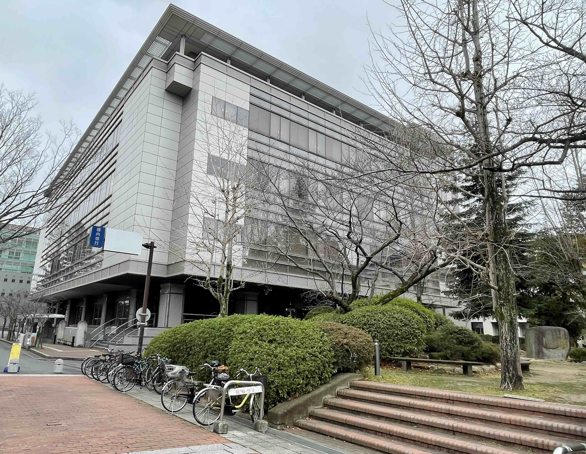
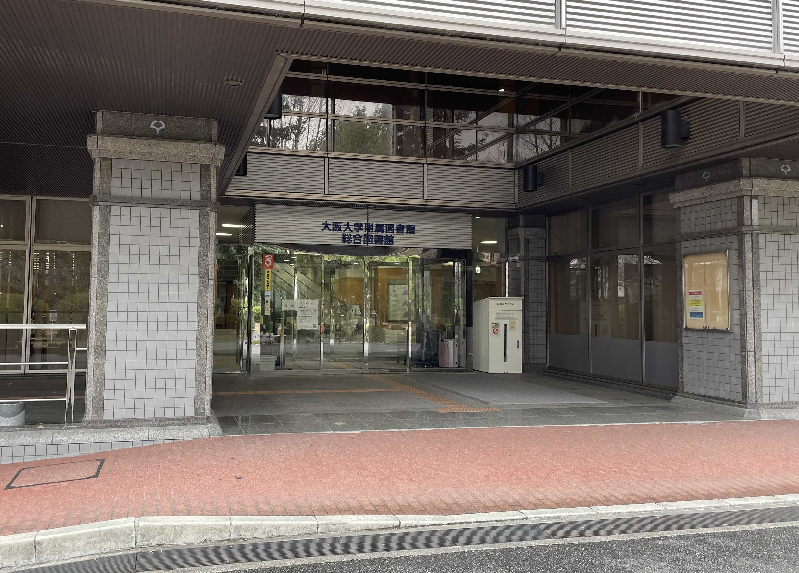
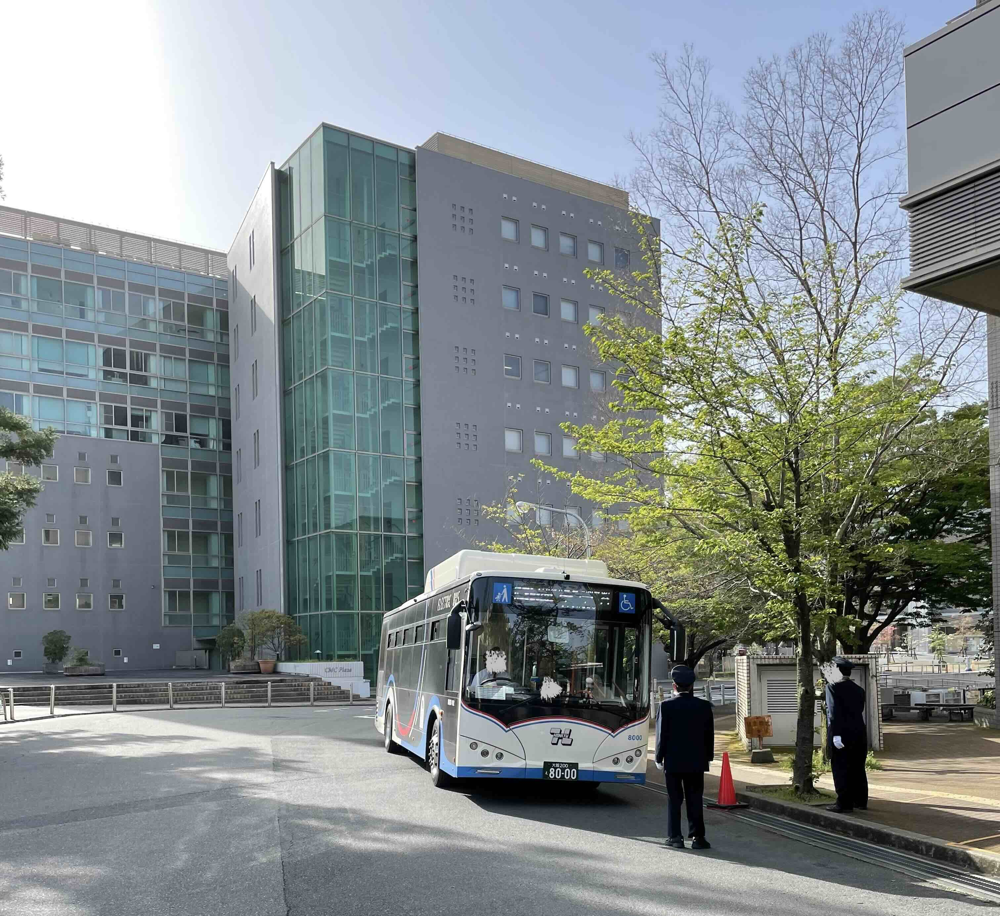

## 阪大総合図書館の紹介

こんにちは、speedです。

私は学部在籍中、豊中キャンパスの総合図書館を住処としていました(住んではないです)。

総合図書館は、とても素晴らしい場所です。

本稿では学部時代を通して気付いた大阪大学総合図書館の魅力を紹介します。

## 大阪大学附属図書館の素晴らしさ

<figure>
  
  <figcaption>大阪大学総合図書館</figcaption>
</figure>

### 総合図書館で1日が完結

総合図書館は、豊中キャンパスの一等地に置かれています。

<iframe title="大阪大学総合図書館の地図" src="https://www.google.com/maps/embed?pb=!1m18!1m12!1m3!1d3276.0337210740786!2d135.45248097589123!3d34.80509347288277!2m3!1f0!2f0!3f0!3m2!1i1024!2i768!4f13.1!3m3!1m2!1s0x6000fa875a91ee5f%3A0xd1db41e5fe097c29!2sOsaka%20University%20Main%20Library!5e0!3m2!1sen!2sjp!4v1708679791782!5m2!1sen!2sjp" width="400" height="350" style="border:0;" allowfullscreen="" loading="lazy" referrerpolicy="no-referrer-when-downgrade"></iframe>

図書館のすぐ下には夜7時ごろまで営業している館下食堂と、生協コンビニがあります。

さらに、図書館の目の前には木々が生い茂っており、池が佇んでいます。そこにはテーブルと椅子があり、憩いの一時を過ごすことができます。

トイレもたくさんあります。

このように1日の生活に必要なもの全てが揃っており、朝から晩まで一日中図書館にいることができます。

### 広大な学習スペース

総合図書館はとても広大で、至る所に学習スペースがあります。

試験期間になると1階、2階の学習スペースが埋まってしまうことも多々あるのですが、3, 4階までいくとどこかに必ず席が空いています。

私はエアコンがない部屋に住んでいたため、避暑地、避寒地としても学習スペースを使っていました。その結果大学生活のほとんどを学習スペースで過ごしました。第三の家ならぬ第一の家です。

大学が提供する最大のサービスの一つである学習スペースをぜひ活用してみてください。

### ゆとりのある本棚の間

本棚の間の距離を気にしたことはありますか?

本が大量に増えていく図書館では、本棚の距離が蔵書数とともに小さくなっていく傾向にあります。

すると、本を探すときに本棚を見渡すことができず、局所的に本を選ばざるを得ません。

ふとした本との出会いを得るため、ゆとりのある本棚で大局的に本を選ぶことはとても重要だと思います。

総合図書館はとても大きく、本棚の間の距離にゆとりがあり、とても本を探しやすいです。

みなさんもぜひいろんな本と出会ってみてください。

<figure>
  
  <figcaption>大阪大学総合図書館正面出入り口</figcaption>
</figure>

### 再履バスで別の図書館にお出かけ

大阪大学は、豊中、箕面、吹田の3つのキャンパスで構成されています。学生は授業や課外活動等でキャンパス間を移動する必要があるため、学内連絡バス、通称“再履バス”が運行されています。

<figure>
  
  <figcaption>学内を走る再履バス</figcaption>
</figure>

阪大関係者は再履バスに無料で乗降することができます。

これを活用することで、各キャンパスの図書館に気軽に行くことができます。

特に重要なのは、バス停が総合図書館の目の前にあるということです。これにより、総合図書館からDoor to Doorで別のキャンパスに行けます。

私がおすすめする再履バスで行けるスポットは、箕面キャンパスにある[箕面市立船場図書館](https://www.library.osaka-u.ac.jp/minohsemba/)です。この図書館は2021年にできたばかりの図書館で、カフェや劇場が併設されたナウでおしゃれな図書館です。

総合図書館に篭りがちでちょっと違う空気を味わいたい!と思った時は再履バスで訪れてみましょう。

なお、箕面キャンパスには2024年3月に北大阪急行延伸に伴い箕面船場阪大前駅ができる予定です。

電車で梅田から、再履バスで総合図書館からダイレクトにつながる箕面市立船場図書館に期待大です!

また、再履バスはキャンパスを駆け抜ける姿から多くの学生から愛されており、[再履バス同好会](https://sairibus.com/)というサークルまでできています。

当団体は再履バスのダイヤの作成に関与するなど、とても本格的な団体です。面白い活動がいろいろ行われているので、[再履バス公式Xアカウント](https://twitter.com/sairi_doukoukai)をチェックしてみてください。

### 長期休暇は長期貸出を使う

総合図書館では、長期休暇に貸出期限が長引き、2,3ヶ月本を借りられます。

この制度を利用することで、帰省中も本を持ち帰ってたくさん本を読むことができます。

ただ本の運搬がとても大変なので気をつけましょう…

## 図書新着案内のチェック

総合図書館はたくさんの本が毎日蔵書されていきます。

最近入ってきた本をチェックしたい場合は、[公式サイトOPACの図書新着案内](https://opac.library.osaka-u.ac.jp/opac/newbook/?lang=0&codeno=1)をおすすめします。

当サイトでは、各図書館の新着案内を見ることができます。

新着案内はいろいろな分野の本のタイトルを見ることができるため、自分の好きな本を探すだけでなく、各分野のブームを知ることができます。

## 貸出期限駆動読書

総合図書館は通常貸出期限が2週間です(2024年2月現在)。

コロナ禍は延長を無限に行うことができましたが、現在は1度のみとなっています。

この貸出期限は期限が来たら返却しなければならない煩わしさがあるのですが(図書館なので当たり前ですが..)、期限が迫ってくる恐怖を活用して読書を促進することができます。

本を買うと、常に本がそこにあるため積読してしまうことが多々あるのですが、図書館の本は期限が来たら返さないといけないため、それまでに読まなければという意識が芽生えます。

これを貸出期限駆動読書といいます(適当)。

気になった本があったら一旦借りてみて、貸出期限駆動読書を実践してみてください。

## 欲しい本がない! そんな時は…。

大学図書館といえど、全ての本を蔵書することは、金銭的にも、スペース的にもできません。

しかし、本を手に入れるいくつかの方法があります。

### 図書の購入要請

図書館は図書の購入要請という制度があり、学生は欲しい本を購入要請することができます。

申請後1ヶ月ほどのdelayがあるのですが、本を蔵書してもらえます。

### 学生選書 ~選書の目を養う~

総合図書館では年に一度学生選書という制度があり、これに応募することで選書に参加することができます。

学生に向けた本を選ぶという体験はなかなかする機会がありません。選書の過程でどのような本が蔵書されるべきかという選書の目を養うことができます。

学生目線で好きな本を選ぶだけで学生の嗜好を図書館に取り入れるという大きな貢献をすることができます。

### 生協の本屋

最後の手段として、総合図書館から程近い生協の書店に行きましょう。

ここで本を買うと定価の10%引きという衝撃価格で本を買うことができます。取り寄せも可能です。

生協の書店は専門書が多く揃っています。梅田にある数多のBigな本屋には蔵書数でかないませんが、小さなスペースに専門書が集積しているため、簡単にいろいろな分野の本を見回すことができて楽しいです。

## 図書館に迫った危機

図書館を第一の家として長いこと過ごしている中で、数々の危機がありました。

### 電気代の高騰による開館時間の短縮

最も大きな危機は、電気代の高騰による開館時間の短縮です。

通常では平日午前8:00 ~ 午後10:00まで開館しており、1日中過ごすことができました。

しかし2022年冬ごろから、電気代が高騰し、図書館の運営にかかる予算が足りなくなり、開館時間が大幅に短縮されました。それはニュースにも報じられました。

Ref. [朝日新聞DIGITAL, "大阪大が図書館の開館時間を短縮 電気代が高騰、今年度27億円増"](https://www.asahi.com/articles/ASQCQ65F0QCQPTIL01H.html) (Accessed 2024/2/23)。

2023年になっても開館時間の削減は続き、図書館を第一の家とすることはできなくなりました。

最近は館内の一部のみ開館時間を延長するなどの施策を取るなどして、対策を講じているようです。

大学図書館という大きな施設・サービスを継続していくことはとても難しいことであり、あって当たり前ではないのだということを身をもって痛感しました。

### 新着図書コーナーの撤去→要望により復活

2022年3月に図書館の新着図書コーナーが突然撤去され、予約本取り寄せスペースに変わっていました。

新着図書コーナーはいろいろな分野のトレンドを手軽に知ることができる非常に重要なスペースだと思っており、常に見ていたため衝撃でした。

その後図書館の職員の方に要望したところ、新着図書コーナーが復活しました。

ありがたやー

### ドリンク販売機の撤去

総合図書館には2022年頃まで1階出入り口横のくつろぎスペースにカップ式自動販売機が設置されていました。しかしいつの間にか撤去されてしまいました。

ちょっとしたカフェのような雰囲気を館内で味わうことができてよかったのですが、残念です。

このように、図書館は多くの危機と共にあります。より良い図書館になっていって欲しいです。

何か不満を感じたらアンケート等で要望を出してみましょう。

## おわりに

阪大の図書館はとても居心地が良く便利な素晴らしいところです。ぜひ活用してみてください!

今回は阪大総合図書館を紹介しましたが、他にもいろいろな図書館に出会いたいです。

おすすめの図書館がありましたらぜひTwitter等で教えてください!

私のおすすめは愛知県安城市にある[アンフォーレ](https://anforet.city.anjo.aichi.jp/)という図書館です。
アンフォーレはLibrary of the Year 2020 優秀賞に選ばれ、本にもなっています。

参考:

- [安城市図書情報館、"アンフォーレが「Library of the Year 2020」優秀賞に輝きました"](https://www.library.city.anjo.aichi.jp/oshirase/loy2020.html)
- ["アンフォーレのつくりかた"、岡部 晋典 (編)、樹村房](https://amzn.to/49qpEFN)

とても開放的な空間が広がっています。

今は最近新しくできた[石川県立図書館](https://www.library.pref.ishikawa.lg.jp/)が気になっています。

それでは、

## 図書館を活用して素晴らしい館パスライフを!
