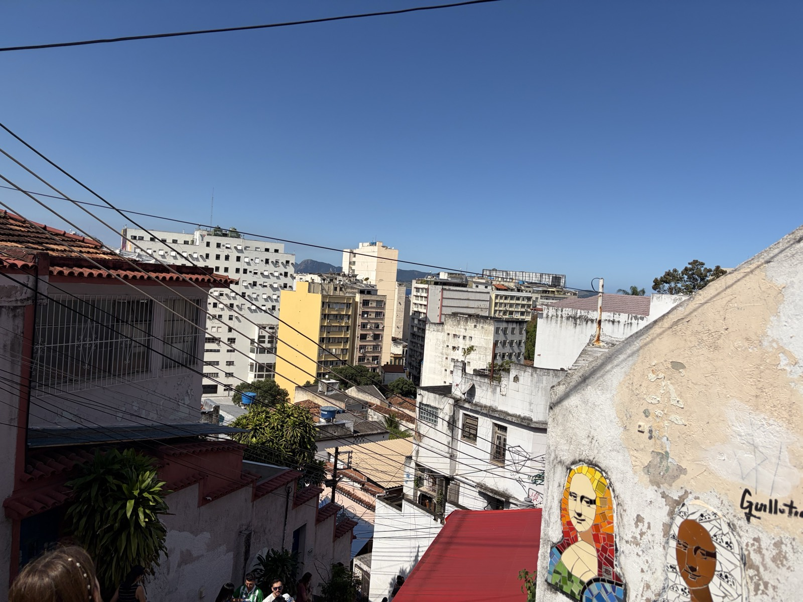
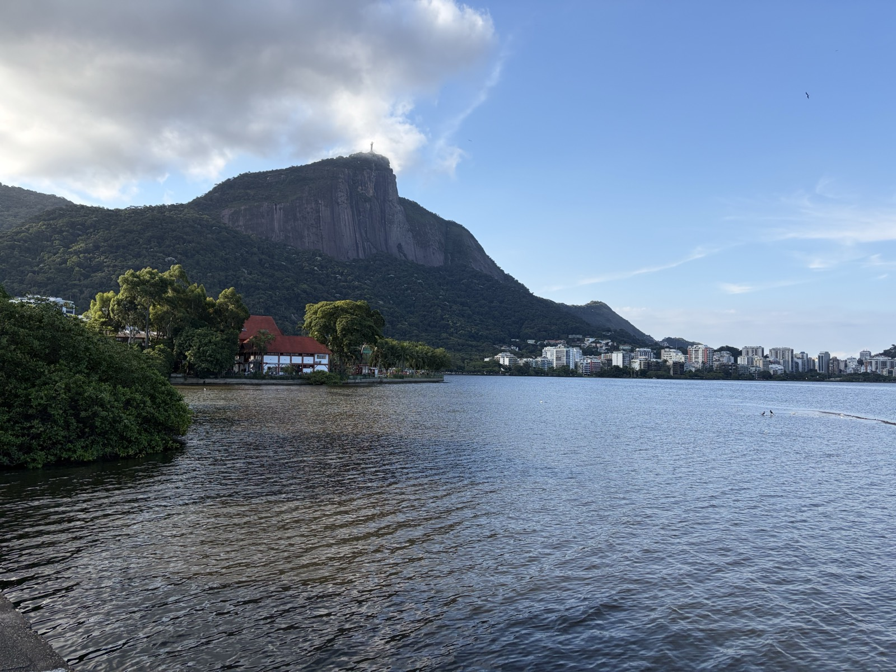
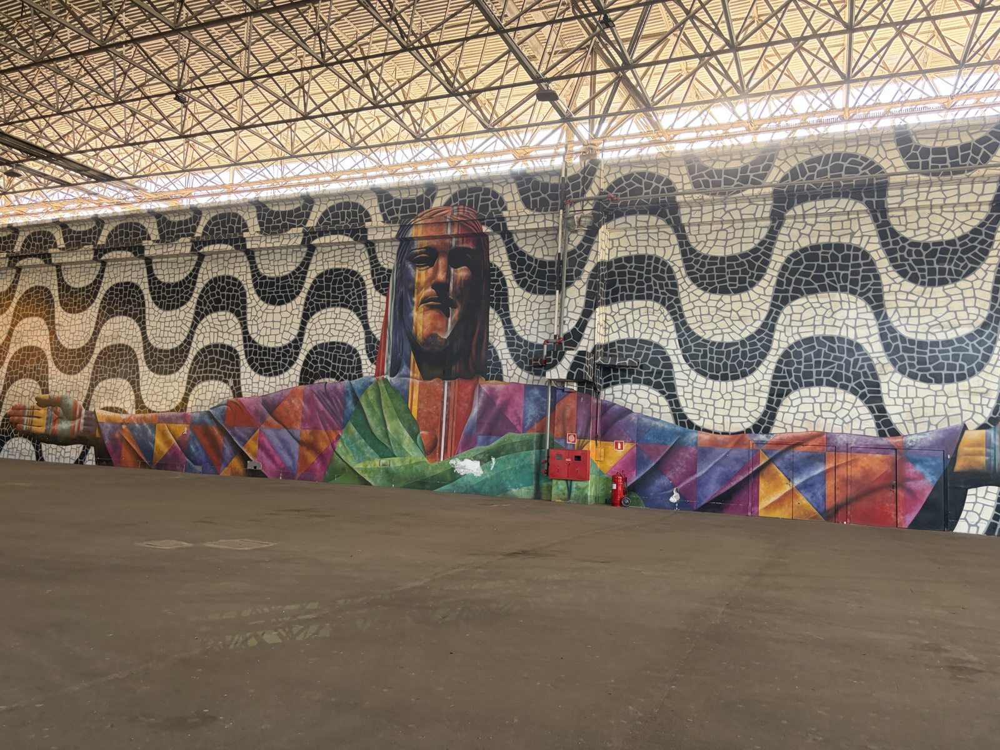
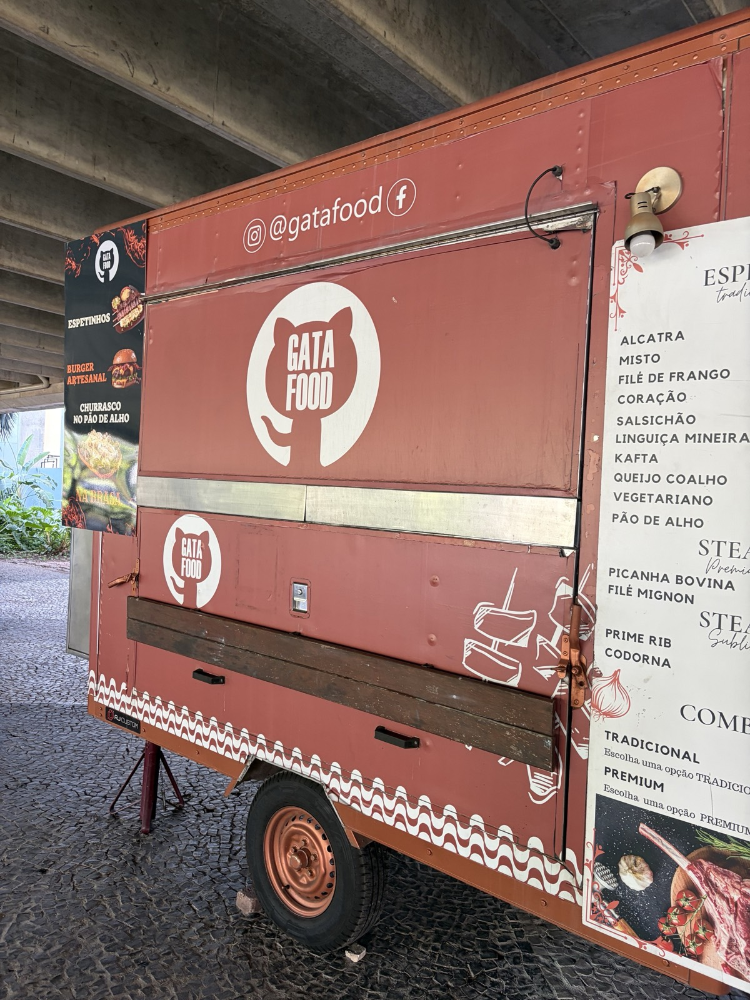
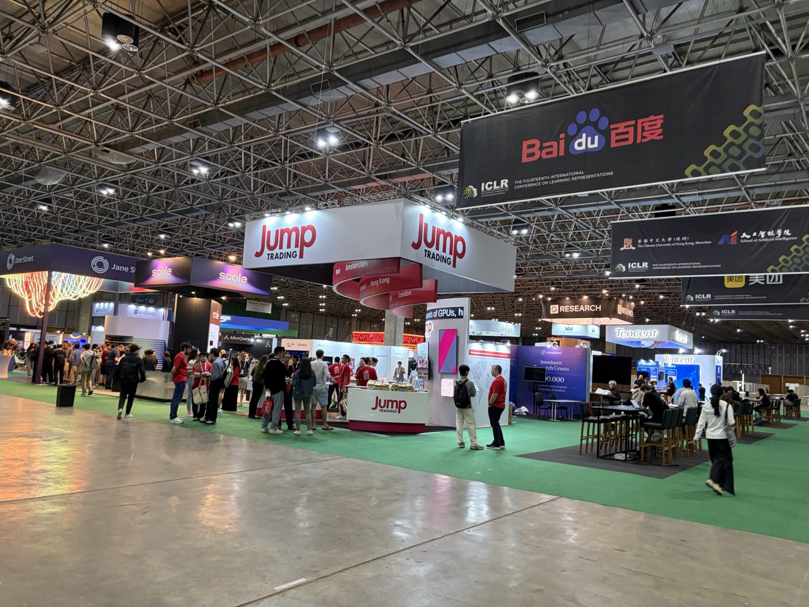

Hello.

From April 23 to April 27, 2026, I attended ICLR 2026, one of the top international conferences in machine learning, held in Rio de Janeiro, Brazil. In this post, I'll share a record of the trip.

Please also check out my [report on NAACL 2025](https://speed1313.github.io/en/posts/naacl2025/), which was held last year in Albuquerque, USA.

At the conference, I presented "[EDINET-Bench](https://speed1313.github.io/about/#:~:text=Nakago%2C%20David%20Ha.-,%5BPaper%5D,-%7C%20%5BDataset%5D)", a paper on building a financial benchmark that I worked on during my internship at Sakana AI.

## About Rio

Rio is a city on the southeastern coast of South America, almost exactly on the opposite side of the globe from Japan. The time difference with Japan is 12 hours.

Many of you have probably heard of it from the Rio Olympics. It is also relatively close to São Paulo (a city with a population comparable to Tokyo's).

## Getting to Rio

There are no direct flights from Japan to Rio, so I went via London.

Because flights can't pass over Russia, we had to take a route through the Arctic, and I also had a long layover in London, so the whole journey took about 40 hours from departure to arrival. Still, when you think about it, being able to get to the other side of the planet in 40 hours is pretty convenient.

<figure>
  
  <figcaption>The Arctic</figcaption>
</figure>

On the London->Rio flight, I spotted a few people carrying poster tubes who looked like conference attendees, and I gradually started to get excited.

## Arriving in Rio

I arrived at Rio's Antonio Carlos Jobim International Airport.

The moment I got to the airport, I was swarmed by shoe shiners and taxi drivers trying to get my business.
I escaped by ignoring them, but some people did end up getting their shoes shined.

## The City

I took an Uber from the airport into the city. Looking out the car window, I saw a chaotic cityscape where slums called favelas sat side by side with modern streets.

The driving was really rough, with speeds that felt almost like a car chase. I was surprised to see people selling food on the road on the highway. In congested areas, horns blared nonstop, which was overwhelming.

## Sightseeing in Rio

I visited a few of Rio's sights in my free time before the conference.

There were favelas scattered around the Selarón Steps, and I saw many people sleeping on the street and digging through trash cans. There was even someone throwing clothes at cars from a pedestrian bridge, a sight you rarely see in Japan.

<figure>
  
  <figcaption>The view from the top of the Selarón Steps</figcaption>
</figure>

I also visited the lake at the foot of Christ the Redeemer on Corcovado, the symbol of Rio. Seeing the statue towering on the mountaintop through gaps in the clouds was truly mystical.

<figure>
  
  <figcaption>The lake at the foot of Christ the Redeemer</figcaption>
</figure>

## The ICLR Main Conference

Before I knew it, ICLR had begun.

The venue was very large and spaciously designed.

<figure>
  
  <figcaption>The venue entrance</figcaption>
</figure>

There were food trucks inside the venue.
Among them, I found one with a design that looked like GitHub's Octocat, which I found amusing.

<figure>
  
  <figcaption>An Octocat-like design</figcaption>
</figure>

### Sponsor Booths

Many American and Chinese companies had booths.

A Chinese robotics company exhibited dog-shaped robots and humanoid robots, and I was amazed by how agile and stable their movements were.

<figure>
  
  <figcaption>Sponsor booths</figcaption>
</figure>

## The Poster Sessions

During the poster sessions, I mainly visited posters on multimodal models and benchmarks.

For example, I saw posters like the ones below. All of them had been popular on Twitter, so being able to talk with the authors directly was really worthwhile.

- [Can Speech LLMs Think while Listening?](https://arxiv.org/abs/2510.07497)
- [GDPval](https://arxiv.org/abs/2510.04374) from OpenAI
- [Gaia2](https://arxiv.org/abs/2602.11964) from Meta

[Terminal-Bench](https://arxiv.org/abs/2601.11868), which I introduced in a previous [blog post](https://speed1313.github.io/en/posts/terminal-bench/), was also presented, by its first author, Mike.

At this year's poster sessions, I had already read many more of the papers than at NAACL 2025 last year, which was exciting.

## The Test of Time Award Session

The [Test of Time Award](https://blog.iclr.cc/2026/04/22/announcing-the-test-of-time-awards-from-iclr-2016/), which honors papers from ten years ago, went to the following two papers, and each gave a talk.

- [Unsupervised Representation Learning with Deep Convolutional Generative Adversarial Networks](https://arxiv.org/abs/1511.06434)
- [Continuous control with deep reinforcement learning](https://arxiv.org/abs/1509.02971)

The talk by Alec Radford was especially memorable. He said the award-winning paper was his very first research project, which is surprising in itself, but the way he developed the research through

- steady performance improvements,
- sharing progress on Twitter, and
- building a community by releasing the code

was a model of how research should be done. These efforts are the kind of thing that never makes it into a paper, so I was really glad to hear the talk.

## My Poster Presentation

On the last day of the main conference, I presented my own poster.

Many people came by, especially people working in finance, and we had lively discussions.

The poster hall was large and never too crowded overall, so I think it was an environment where we could have more in-depth discussions.

## Miscellaneous Notes

English worked at the hotel, but hardly at all in restaurants or Ubers.
Even so, I managed to get by with just these two words:

- Good morning: Bom dia
- Thank you: Obrigado

Also, restaurants and airports sometimes had TVs, and they were almost always showing soccer matches, which made me feel how much the locals love soccer.

## Conclusion

Before going to Rio, I had heard about how unsafe it was, so I was a little worried, but I didn't run into any trouble and had a safe stay.
More than that, it was really fun to experience the chaotic atmosphere of a city so completely different from Japan.
At the conference, I listened to talks by well-known researchers, had discussions with people with similar interests, and made new connections. It was a very fulfilling time.

Obrigado!
