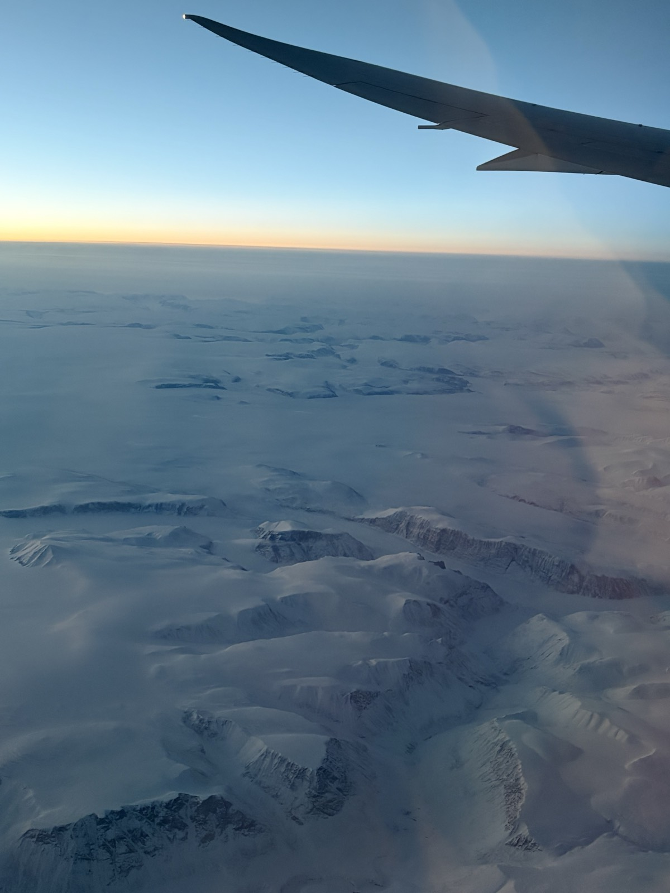
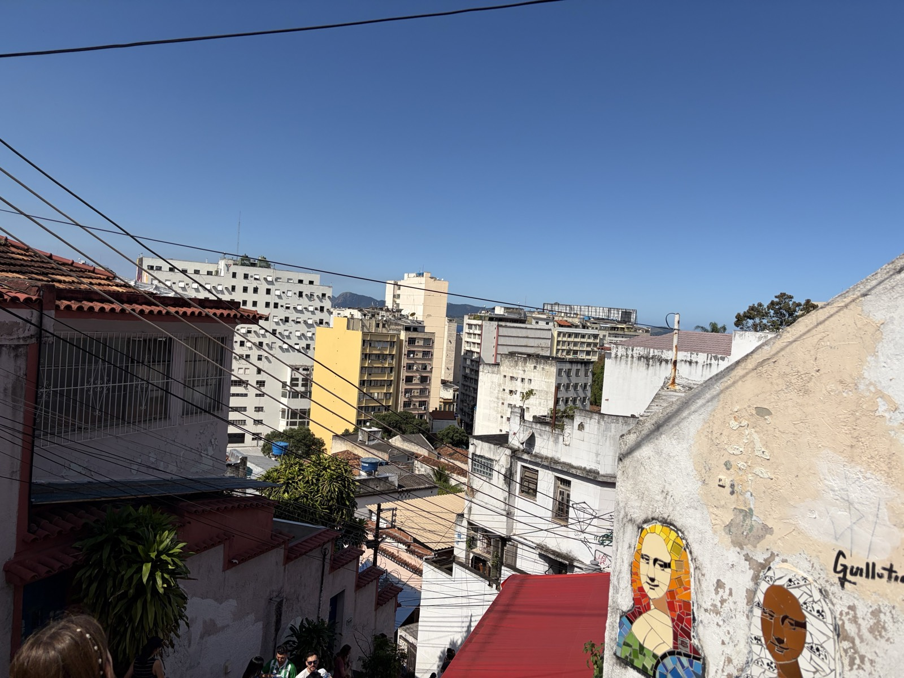
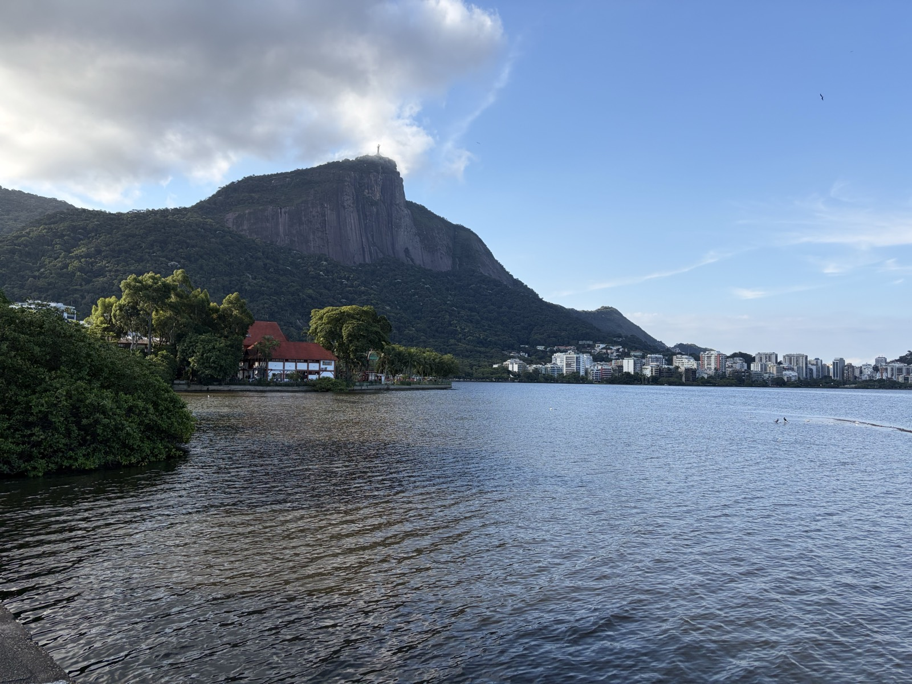
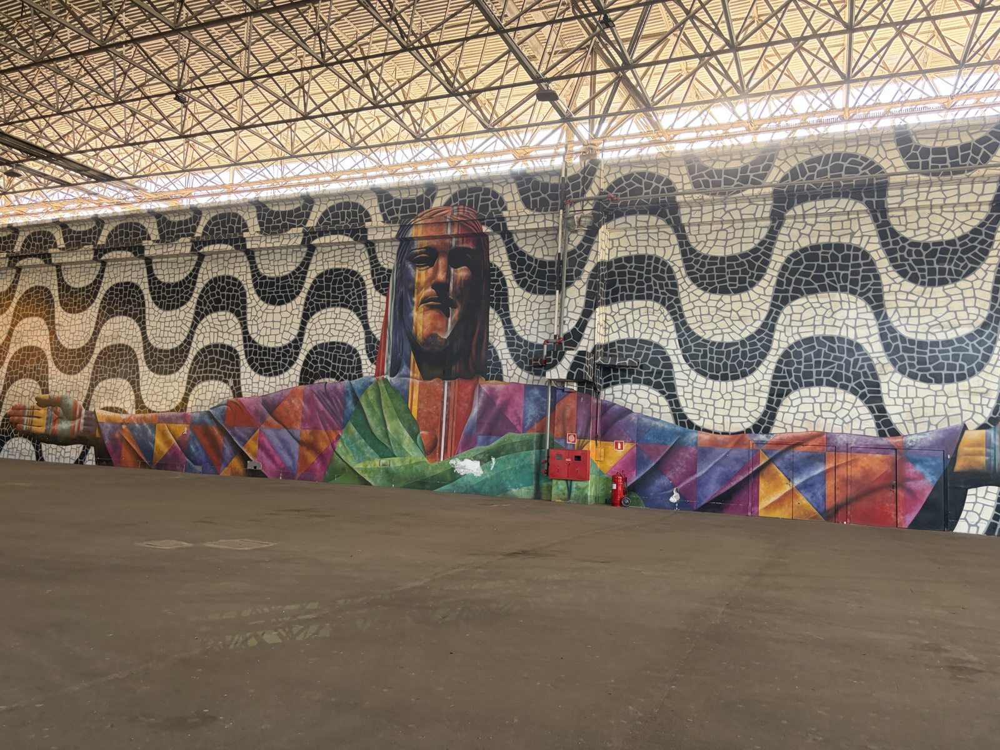
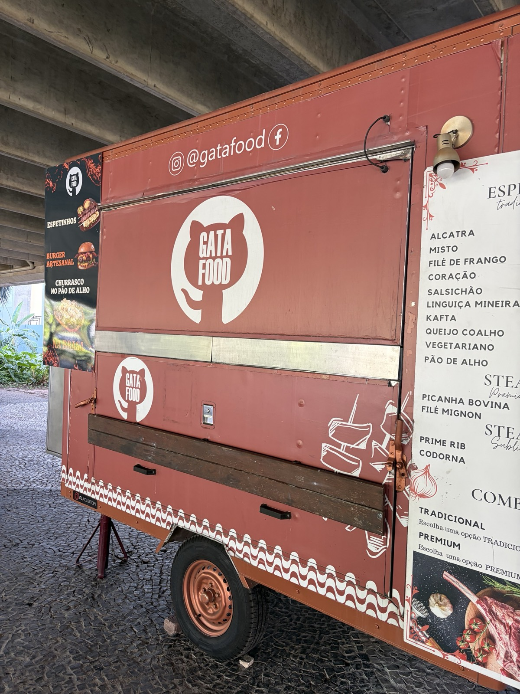
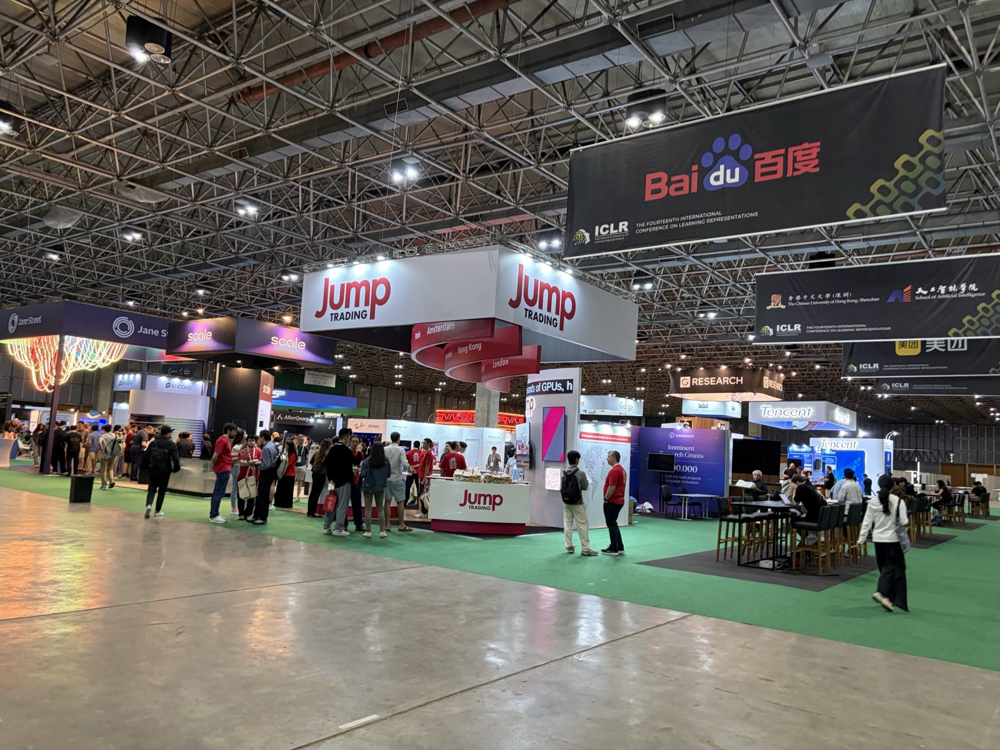

こんにちは。

このたび、2026/4/23~2026/4/27にかけて、ブラジル・リオで開催された機械学習分野のトップ国際会議の一つであるICLR2026に参加しました。本稿ではその参加記録を綴ります。

昨年アメリカ・アルバカーキで開催された[NAACL2025の参加記](https://speed1313.github.io/posts/naacl2025/)もぜひご覧ください。

なお、私はSakana AIのインターンで取り組んだ金融ベンチマーク構築論文「[EDINET-Bench](https://speed1313.github.io/about/#:~:text=Nakago%2C%20David%20Ha.-,%5BPaper%5D,-%7C%20%5BDataset%5D)」を発表しました。

## リオについて

リオは南アメリカ大陸南東部の海岸に位置する都市で、日本から見て地球のほぼ裏側にあります。日本との時差は12時間です。

リオ五輪で名前を聞いたことがある方も多いと思います。サンパウロ（東京に匹敵する人口規模の都市）にも比較的近い場所にあります。

## リオまでの道のり

日本からリオへの直行便はないため、ロンドン経由で向かいました。

ロシア上空を飛べない影響で北極圏ルートを通る必要があり、さらにロンドンでの滞在時間も長かったため、出発から到着まではなんと約40時間。とはいえ、地球の裏側に40時間で行けると考えると便利ですね。

<figure>
  
  <figcaption>北極</figcaption>
</figure>

ロンドン->リオの便では、ポスター筒を持った会議参加者と思しき人がちらほら見られ、徐々にワクワク感が高まってきました。

## リオに到着

リオのアントニオ・カルロス・ジョビン国際空港に到着しました。

空港につくや否や、靴磨きやタクシー運転手の勧誘が襲来してきました。
私は無視することで難を逃れましたが、靴を磨かれている人もいました。

## 街の様子

空港から街へは、Uberを用いました。車窓から街を眺めると、ファベーラと呼ばれるスラム街と近代的な街並みが混在するカオスな都市景観が広がっていました。

運転はかなり荒く、ほぼカーチェイスのようなスピード感。高速道路では車道で食べ物を売っている人もいて驚きました。混雑エリアではクラクションが鳴り続けており、圧倒されます。

## リオの観光地

会議前の空き時間には、リオの観光地をいくつか訪れました。

セラロン階段周辺ではファベーラが点在しており、路上で寝ている人やゴミ箱を漁る人も多く見かけました。歩道橋から車に向かって服を投げる人もいて、日本ではなかなか見られない光景でした。

<figure>
  
  <figcaption>セラロン階段頂上からの景色</figcaption>
</figure>

リオの象徴となっている、コルコバードのキリスト像の麓の湖にも訪れました。山頂に聳えるキリスト像が、雲の合間から見える様子はとても神秘的でした。

<figure>
  
  <figcaption>キリスト像の麓にある湖</figcaption>
</figure>

## ICLR本会議

そうこうしているうちに、ICLRが始まりました。

会場は非常に広く、ゆとりのある設計でした。

<figure>
  
  <figcaption>会場入り口</figcaption>
</figure>

会場内にはキッチンカーが出ていました。
その中には、GitHubのOctocatのようなデザインのキッチンカーを発見し、面白かったです。

<figure>
  
  <figcaption>Octocatのようなデザイン</figcaption>
</figure>

### スポンサーブース

アメリカや中国の企業が多数出展していました。

中国のロボット開発企業の出展では、犬型ロボットやヒューマノイドロボットが展示されており、動作の俊敏さと安定性に驚きました。

<figure>
  
  <figcaption>スポンサーブース</figcaption>
</figure>

## ポスターセッションの様子

ポスターセッションでは、マルチモーダルモデルやベンチマーク関連のポスターを中心に回りました。

例えば以下のようなポスターを見かけました。どれもTwitterで話題になっていたものばかりで、著者の方と直接話すことができて、非常に有意義でした。

- [Can Speech LLMs Think while Listening?](https://arxiv.org/abs/2510.07497)
- OpenAIの[GDPval](https://arxiv.org/abs/2510.04374)
- Metaの[Gaia2](https://arxiv.org/abs/2602.11964)

また、以前私の[ブログ記事](https://speed1313.github.io/posts/terminal-bench/)でも紹介した、[Terminal-Bench](https://arxiv.org/abs/2601.11868)の発表も行われており、第一著者のMikeさんが発表されてました。

今回のポスターセッションでは、昨年参加したNAACL2025よりも、読んだことのある論文が多く、興奮しました。

## Test of Time Awardセッション

10年前の論文を表彰する[Test of Time Award](https://blog.iclr.cc/2026/04/22/announcing-the-test-of-time-awards-from-iclr-2016/)では、以下の2本の論文が選出され、それぞれ発表がありました。

- [Unsupervised Representation Learning with Deep Convolutional Generative Adversarial Networks](https://arxiv.org/abs/1511.06434)
- [Continuous control with deep reinforcement learning](https://arxiv.org/abs/1509.02971)

特にAlec Radfordによる発表は非常に印象的でした。受賞論文は彼にとって初めての研究とのことで、それ自体驚きですが、

- 着実な性能改善
- Twitterでの進捗共有
- コード公開によるコミュニティ形成

といった流れで研究を発展させていく過程は、まさに研究のお手本のようでした。このような取り組みは論文には書かれない部分であり、講演を聞くことができてとてもよかったです。

## ポスター発表

本会議の最終日には自身のポスター発表を行いました。

金融関連の方を中心に多くの方に来ていただき、活発な議論ができました。

ポスター会場が広く、全体的に混雑しすぎないので、よりじっくりと議論できる環境だったと思います。

## 雑記

英語はホテルでは通じますが、レストランやUberではほとんど通じませんでした。
とはいえ、今回は以下の2単語でなんとか乗り切れました。

- おはよう: Bom dia
- ありがとう: Obrigado

また、レストランや空港などでテレビが置かれていることがありますが、だいたいサッカーの試合が映っており、地元の人のサッカー愛を感じました。

## おわりに

リオに行く前は治安の悪さを耳にしていたため、やや不安もありましたが、特にトラブルに巻き込まれることはなく、無事に過ごすことができました。
それ以上に、日本とは全く異なるカオスな都市の雰囲気を体験できて非常に楽しかったです。
会場では著名な研究者の話を聞いたり、興味の近い人と議論したり、新しいつながりもでき、非常に充実した時間でした。

Obrigado！
