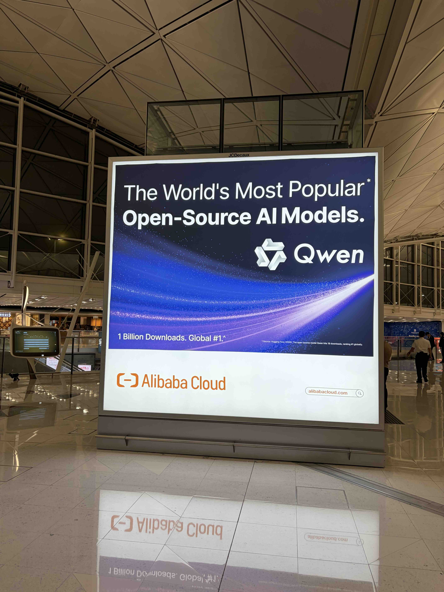
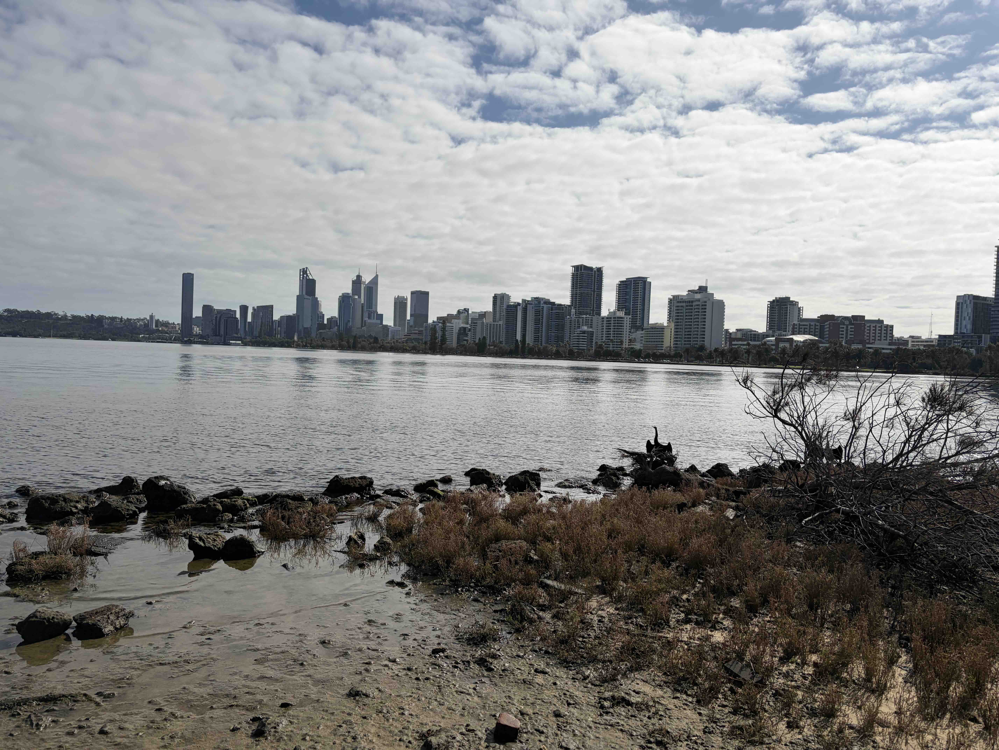
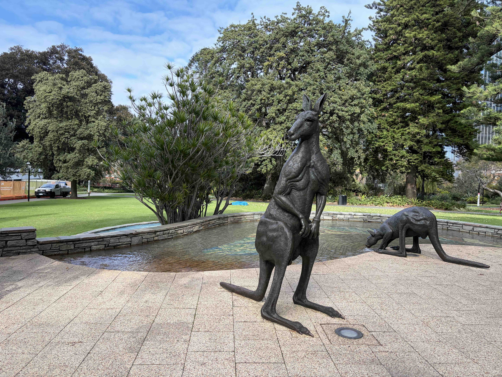
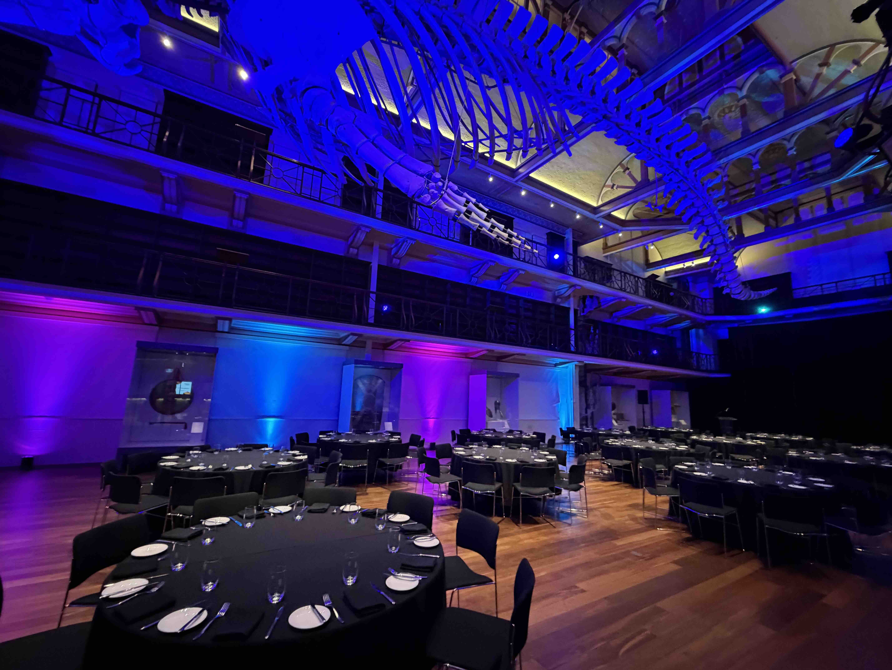

In this post, I write about attending [IHPCSS2026](https://ss26.ihpcss.org/), a summer school on High Performance Computing (HPC) held in Perth, Australia, from July 12 to 17, 2026.

## What Is IHPCSS?

IHPCSS is a summer school on HPC.
It is organized jointly by research institutions from several countries, including RIKEN, and is held in a different country every year.
This was apparently the 16th edition, so it is an event with quite a long history.

The participants include graduate students from all over the world, as well as HPC researchers who serve as lecturers and mentors, making it a truly international event.

Amazingly, the organizers cover all expenses, including travel and accommodation, which makes it a wonderful opportunity for students.

## Traveling to Perth

This year's venue, Perth, is a city on the west coast of Australia.

The participants from Japan flew to Perth via Hong Kong International Airport, so the trip took about half a day each way.

At Hong Kong International Airport, there were large advertisements for Qwen, the AI model developed by China's Alibaba, and I could feel how much excitement there is around AI.

<figure>
  
  <figcaption>A Qwen advertisement at Hong Kong International Airport</figcaption>
</figure>

The time difference between Perth and Japan is only one hour, so there is little need to worry about jet lag.

The seasons are the opposite of Japan's, so July is winter, but temperatures are around 10 to 20 degrees Celsius, which is fairly comfortable.

Perth is a coastal city, and a large river flows through it.

<figure>
  
  <figcaption>The Perth cityscape</figcaption>
</figure>

There were all kinds of statues around the city, including kangaroo statues.

<figure>
  
  <figcaption>Kangaroo statues in a park</figcaption>
</figure>

## The Summer School

The summer school started the day after we arrived in Perth.
An entire floor of a hotel in central Perth was reserved for the summer school, and the lectures, meals, and everything else took place there.

There were about a hundred participants, and all of us attended lectures on the same floor for a week.

Compared with the international conferences I had attended before, the participants were much closer to one another, and the atmosphere was very homey.

There were coffee breaks between lectures, and at mealtimes we sat together around tables, so participants who were meeting for the first time could actively get to know one another.

The participants were researchers from a variety of fields that use HPC, such as fluid dynamics, astrophysics, and computational chemistry. Their backgrounds were diverse, which I found very stimulating.

On the evening before the last day, there was a dinner at the Western Australian Museum.
Here, too, we ate together and talked about our research, our countries' cultures, and our daily lives.

<figure>
  
  <figcaption>Dinner at the Western Australian Museum</figcaption>
</figure>

## Conclusion

At this summer school, spending lectures and meals together allowed us to build close connections with one another.

IHPCSS will be held again next year, so if you are interested, please apply!
