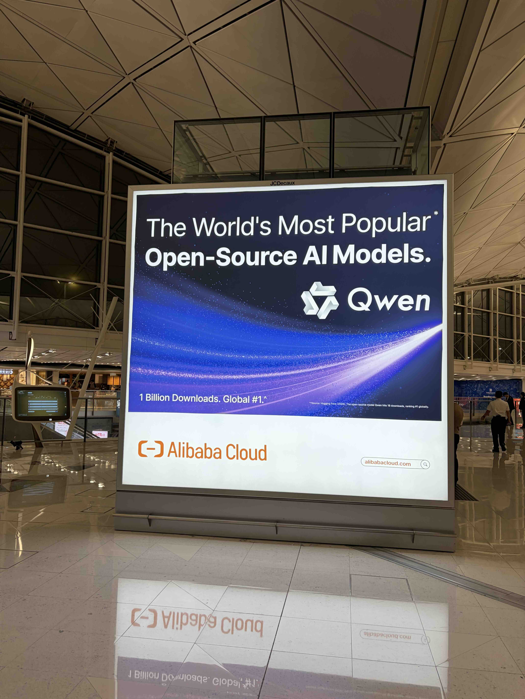
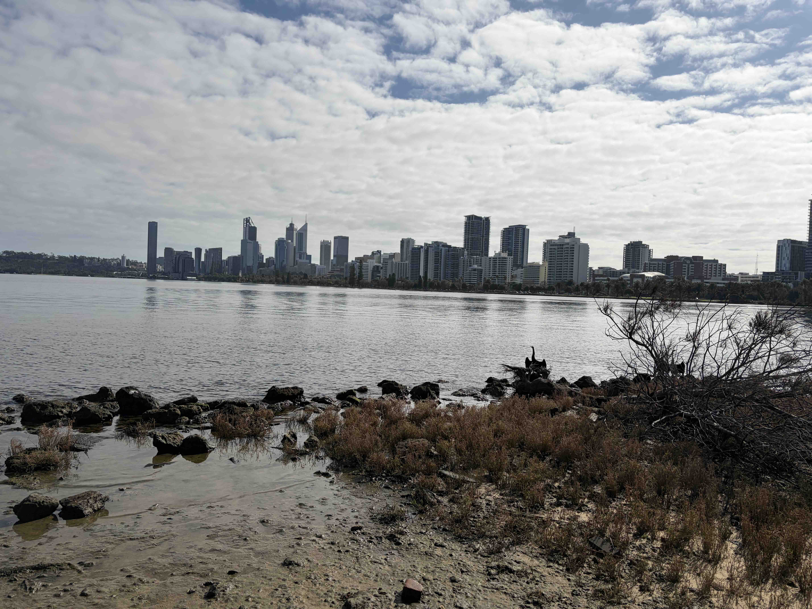
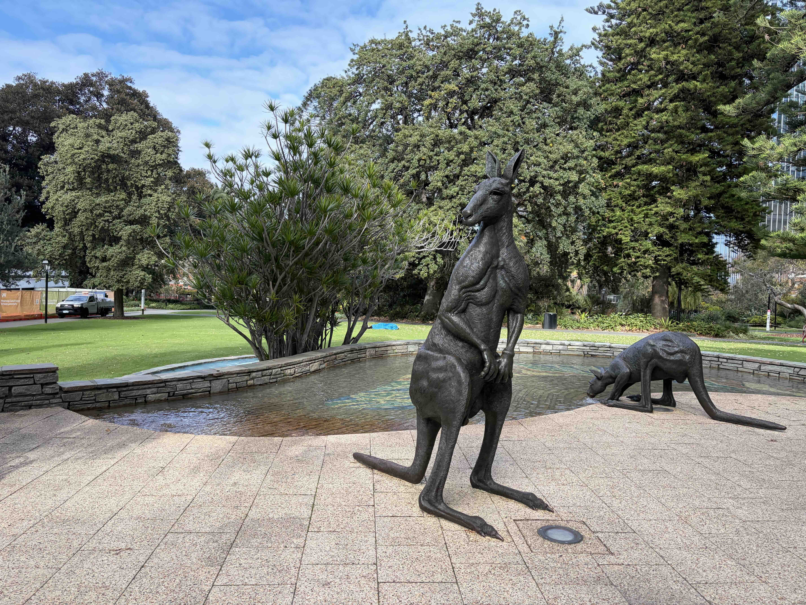
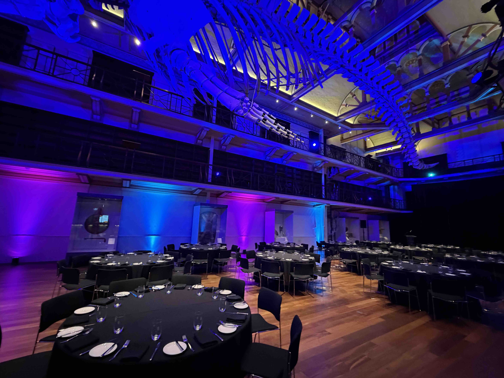

本稿では、2026/7/12~2026/7/17にかけて、オーストラリア・パースで開催されたHPC（High Performance Computing）に関するサマースクール[IHPCSS2026](https://ss26.ihpcss.org/)の参加記録を綴ります。

## IHPCSSとは

IHPCSSは、HPCに関するサマースクールです。
IHPCSSは理研を含む複数の国の研究機関が協力して開催されており、毎年色々な国で開催されています。
今回で16回目の開催とのことで、かなり歴史のあるイベントです。

参加者は、世界中の大学院生に加えて、授業の講師やメンターを担当するHPC関連の研究者も参加しており、非常に国際色豊かなイベントです。

なんと、渡航費や宿泊費などの諸経費は全て主催者側に負担してもらえるため、学生にとっては非常にありがたいイベントです。

## パースへの渡航

今回の開催地パースは、オーストラリアの西海岸に位置する都市です。

日本からの参加者は香港国際空港経由でパースに向かったため、片道約半日程度のフライトでした。

香港国際空港では中国のAlibabaが開発するAIモデルQwenの広告が大きく掲示されており、AIの盛り上がりを感じました。

<figure>
  
  <figcaption>香港国際空港におけるQwenの広告</figcaption>
</figure>

パースは日本との時差が1時間しかないため、時差ぼけの心配が少ないです。

季節は日本と逆で、7月は冬にあたりますが、10度から20度程度の気温で、比較的過ごしやすいです。

パースは海岸沿いの都市で、市内には大きな川が流れていました。

<figure>
  
  <figcaption>パースの街並み</figcaption>
</figure>

街中には色々な像が置かれており、カンガルーの像もありました。

<figure>
  
  <figcaption>公園に置かれたカンガルー像</figcaption>
</figure>

## サマースクールの様子

パースについた翌日から、サマースクールが始まりました。
サマースクールは、パース市内のホテルの1フロアが貸し切りになっており、そこで授業や食事などが行われました。

参加者は百人程度で、参加者全員が同じフロアで1週間授業を受けます。

これまで参加してきた国際会議よりも、参加者同士の距離が近く、非常にアットホームな雰囲気でした。

授業の合間ではCoffee Breakがあったり、食事の時間でテーブルを囲んで話す形になっており、初めて会う参加者同士で、交流を活発に行うことができました。

参加者は、流体力学や宇宙物理学、計算化学など、HPCを活用する様々な分野の研究者が集まっており、バックグラウンドも多様で、とても刺激的でした。

最終日前日は、西オーストラリア州立博物館でのディナーが開催されました。
ここでも参加者同士で一緒にご飯を食べながら、研究や各国の文化や日常について話すことができました。

<figure>
  
  <figcaption>西オーストラリア州立博物館でのディナー</figcaption>
</figure>

## おわりに

今回のサマースクールでは、参加者同士が授業、食事を共にする中で深い交流をすることができました。

来年もIHPCSSが開催されるとのことなので、興味のある方はぜひ応募してみてください！
