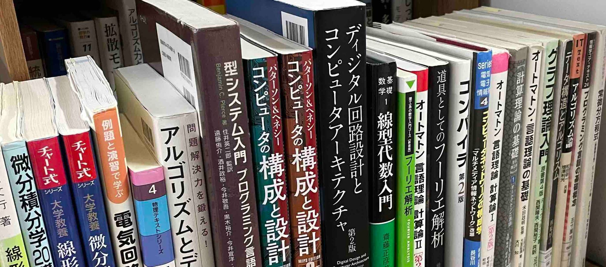

Hi, I'm speed.

In the summer of 2023, which was called "the hottest summer on record" amid relentless heat, I took entrance exams for master's programs.

With computer science so popular, I expected passing a graduate school entrance exam to be hard, so I applied to several schools.

For those who will take graduate school entrance exams in the future, this post covers

- the difficulties specific to graduate school entrance exams, and
- how I prepared for the [Department of Communications and Computer Engineering, Graduate School of Informatics, Kyoto University](https://web.archive.org/web/20240104021421/http://www.cce.i.kyoto-u.ac.jp/), the exam I focused on most.

For me, the Kyoto University exam was an exam at a school other than my own, so there was little information available and preparing was tough, but blog posts by past examinees helped me a lot.

I am writing this in the hope that it will be useful to the next examinees.

> [!NOTE]
> As the word "experience" suggests, what I describe here is just one person's impressions.
> How graduate school admissions work varies greatly from department to department. If you are going to apply to graduate school, read the latest application guidelines and lab websites of the schools you are aiming for carefully, and don't be misled by outdated information.

## Difficulties Specific to Graduate School Entrance Exams

First, I'll describe the difficulties specific to graduate school entrance exams that I felt when I took them.

### Exam Subjects Differ by Department

In graduate school entrance exams, the subjects on the exam differ quite a bit from department to department.

In particular, when you apply to a school other than the one you studied at as an undergraduate (so-called external applicants), you may have to study subjects you have never learned from scratch.

If you apply to several schools, be careful, since the number of fields you need to prepare for increases.

### Question Styles Differ by Department

In computer science graduate school exams, subjects with a fairly long history, such as operating systems and automata, appear at many graduate schools.

However, the style of the questions varies considerably.

Some universities like to set complex questions with step-by-step guidance, while others prefer simple questions like textbook examples, and so on.

That said, questions are often similar to past exams.

It is important to collect several years of past exams and learn their tendencies.

### Answers Are Not Published

In graduate school entrance exams, it is important to collect past exams and learn their tendencies, but answers to past exams are often not published, and getting them is difficult (especially for external applicants).

In my own experience, even though the past exams were quite similar in style, there were no answers, so I couldn't tell how best to solve them, and researching and working out solution methods was hard work.

### You Don't Know the Passing Line

For undergraduate entrance exams, practice exams and the like tell you your own ability and where you stand compared with other examinees, but a graduate school entrance exam is a one-shot affair.

Since you don't know the passing line, you keep studying in the dark.

My stomach literally hurt.

### Application and Exam Dates Vary

Unlike undergraduate entrance exams, which have fixed schedules such as the first and middle rounds, graduate school application and exam dates are all over the place.

Collect the application guidelines for graduate schools early.

I think most universities post the application guidelines for that year's exams on the web around April.

## Preparing for the Department of Communications and Computer Engineering, Kyoto University

As for the exam subjects of the Department of Communications and Computer Engineering at Kyoto University, the exam format changed starting the year I took it, and the exam became as follows (quoted from the [application guidelines for April 2024 admission](http://www.i.kyoto-u.ac.jp/admission/application.html)).

- Specialized Fundamentals A

"Mathematics (Calculus, Linear Algebra)", "Logic Circuits", "Information Theory", and "Computer Architecture". All questions must be answered.

- Specialized Fundamentals B

"Mathematics (Complex Analysis, Fourier Analysis, Differential Equations)", "Electromagnetics (Electrostatics and Magnetostatics)", "Electrical and Electronic Circuits", "Data Structures and Algorithms", "Programming Languages", "Graph Theory", "Information and Communication Engineering (Information Transmission, Communication Networks)", "Fundamentals of Communication Theory", "Radio Engineering (Electromagnetic Waves, Antennas, Propagation)", "Computer Systems", "Automata and Theory of Algorithms", "Programming Language Processors and OS", and "Computation and Logic"

Six of the above 13 subjects are set, and you answer three.

That is a lot of subjects. Specialized Fundamentals B in particular involves an element of luck, since you don't know which of the 13 subjects will appear.

Below I describe how I prepared.

### How I Collected Past Exams

To collect past exams, I downloaded the ones published on the graduate school's website,

and also used the [Wayback Machine](https://archive.org/web/), a site that collects and stores web pages that were once published on the web, to collect past exams based on the official URLs where they had been published.

With this method, I collected about ten years' worth of past exams in total.

### How I Collected Answers to Past Exams

Answers to past exams are extremely useful for studying for graduate school entrance exams. The feedback that answers give you makes studying go much better. However, past graduate school exams rarely circulate outside the university, and even when they do, they are almost always sold for a fee.

As usual, getting answers was difficult for me too, so I made my own.

### How I Made Answers

When making answers yourself, I think the key is to gather appropriate textbooks and materials.

Graduate school entrance exam questions are often based on the lecture materials and textbooks used in the university's courses.

So, to make answers efficiently, it is important to gather the lecture materials and textbooks used in the courses at the university you are applying to.

Using syllabi and course materials published online as clues, I guessed which lecture materials and textbooks were used in the courses at the university I was applying to, and studied and made answers with them.

### Textbooks I Used

Below, I introduce the textbooks and websites I used for each subject.

- Mathematics (Calculus, Linear Algebra)
  - [詳解と演習大学院入試問題〈数学〉: 大学数学の理解を深めよう (Graduate School Entrance Exam Problems in Mathematics with Detailed Solutions and Exercises), Ebihara et al.](https://www.amazon.co.jp/詳解と演習大学院入試問題〈数学〉―大学数学の理解を深めよう-海老原-円/dp/4864810273/ref=asc_df_4864810273/?tag=jpgo-22&linkCode=df0&hvadid=295720022086&hvpos=&hvnetw=g&hvrand=3808586486877232596&hvpone=&hvptwo=&hvqmt=&hvdev=c&hvdvcmdl=&hvlocint=&hvlocphy=1009507&hvtargid=pla-527247252233&psc=1&th=1&psc=1)

  - [チャート式シリーズ 大学教養 微分積分 (Chart Series, University Liberal Arts: Calculus), Kato](https://amzn.to/3OtlWSm)

  - [チャート式シリーズ 大学教養 線形代数 (Chart Series, University Liberal Arts: Linear Algebra), Kato](https://amzn.to/3KxhbpL)

Calculus and linear algebra questions are often basic ones, such as multivariable calculus and eigenvalue problems. So, to avoid dropping points on basic questions, I used textbooks with many exercises and solutions.

- Logic Circuits
  - [OHM大学テキスト 論理回路 (Ohm University Textbook: Logic Circuits), Imai](https://amzn.to/3OhOIp2)

This textbook covers logic circuits very broadly.

- Information Theory

For information theory, I used Professor Imai's "[情報理論 改訂2版 (Information Theory, Revised 2nd Edition)](https://amzn.to/3DJ5OaD)", a very well-known textbook in this field, and [Professor Nishida's lecture materials](https://sites.google.com/view/toyoakinishida-j/情報符号理論).

- Computer Architecture
  - [コンピュータの構成と設計 MIPS Edition 第6版 (Computer Organization and Design MIPS Edition, 6th Edition), Patterson & Hennessy](https://www.amazon.co.jp/コンピュータの構成と設計-MIPS-第6版-David-Patterson/dp/4296070096?__mk_ja_JP=カタカナ&crid=1JETUFPMP8FRI&keywords=コンピュータの構成と設計+第6版&qid=1691397416&sprefix=コンピュータの構成と設計+第6版,aps,224&sr=8-2&linkCode=sl1&tag=amazon13aff-22&linkId=db893ee0fcf289c706f27c19f1ef3ba1&language=ja_JP&ref_=as_li_ss_tl)

For computer architecture, I used Patterson & Hennessy (both volumes). It is a field that changes quickly, so I recommend using the latest edition.

- Mathematics 2 (Complex Analysis, Fourier Analysis, Differential Equations)
  - [複素関数論の基礎 (Foundations of Complex Function Theory), Yamamoto](https://amzn.to/3QpOQWf)

  - [演習 複素関数キャンパス・ゼミ 改訂2 (Exercises: Complex Functions Campus Seminar, Revised 2nd Edition), Baba](https://amzn.to/43YDSdh)

  - [フーリエ解析 (理工系の数学入門コース) (Fourier Analysis, Introductory Mathematics Course for Science and Engineering), Oishi](https://amzn.to/44UpTqc)

  - [常微分方程式キャンパス・ゼミ 改訂9 (Ordinary Differential Equations Campus Seminar, Revised 9th Edition), Baba](https://amzn.to/44SuaKO)

For Mathematics 2, I read textbooks and did exercises with the Mathema series.

I had avoided the Mathema series out of a prejudice that it didn't seem very rigorous, but for preparing for graduate school entrance exams, which often test computational skill, I think the Mathema series, which explains how to calculate in detail, is well suited.

- Electrical and Electronic Circuits
  - [電気電子回路―アナログ・ディジタル回路 (ロボティクスシリーズ) (Electrical and Electronic Circuits: Analog and Digital Circuits, Robotics Series), Sugiyama et al.](https://amzn.to/3QpKWN7)

  - [例題と演習で学ぶ 電気回路(第2版) (Learning Electric Circuits Through Examples and Exercises, 2nd Edition), Hattori](https://amzn.to/3qeG0jx)

Because electrical and electronic circuits is such an old field, any single book leaves gaps in what it covers, so I used various books. Among them, the two above suited me best.

- Data Structures and Algorithms
  - [問題解決力を鍛える！アルゴリズムとデータ構造 (ＫＳ情報科学専門書) (Algorithms and Data Structures for Building Problem-Solving Skills, KS Information Science Series), Otsuki](https://amzn.to/3QnwiWC)

  - [データ構造とアルゴリズム (Data Structures and Algorithms), Sugihara](https://amzn.to/3Qor7FS)

I used "問題解決力を鍛える！アルゴリズムとデータ構造", commonly known as the "Kenchon book", and Professor Sugihara's book.

- Programming Languages

I used the [lecture materials for the Faculty of Engineering course "Programming Languages"](https://hackmd.io/@aigarashi/r1az0wOHP/%2FpWliU6DiTa2yj8H0V_XUXA) that were available online.

In Programming Languages, questions asking you to write implementations such as interpreters by hand came up often.

- Graph Theory
  - [グラフ理論入門:基本とアルゴリズム (Introduction to Graph Theory: Basics and Algorithms), Miyazaki](https://amzn.to/3rYgmA2)

  - [グラフ理論入門(原書第4版) (Introduction to Graph Theory, 4th Edition), Wilson](https://amzn.to/3Ymaywd)

- Computer Systems
  - [コンピュータの構成と設計 MIPS Edition 第6版 上・下 (Computer Organization and Design MIPS Edition, 6th Edition, Vols. 1 and 2), Patterson & Hennessy](https://amzn.to/47gtTDf)

Patterson & Hennessy makes another appearance.

- Automata and Theory of Algorithms
  - [オートマトン言語理論 計算論〈1〉 (Information & Computing) (Introduction to Automata Theory, Languages, and Computation, Vol. 1), J. Hopcroft et al.](https://amzn.to/450Accy)

  - [計算理論の基礎 [原著第2版] 1-3 (Introduction to the Theory of Computation, 2nd Edition, Vols. 1-3), Michael Sipser](https://amzn.to/44YKoC3)

I mainly used "Introduction to Automata Theory, Languages, and Computation", and read only the parts of "Introduction to the Theory of Computation" on complexity classes carefully, since its explanations of the terminology were rich.

- Programming Language Processors and OS
  - [レクチャー オペレーティングシステム (情報工学レクチャーテキスト QKC 5) (Lecture: Operating Systems, Information Engineering Lecture Text QKC 5), Fukuda](https://amzn.to/44YP1vW)

  - [オペレーティングシステムの概念 (Operating System Concepts), Silberschatz et al.](https://amzn.to/3DK260b)

Operating systems are very large pieces of software and hard to learn, but "Operating System Concepts" explains them very carefully, and I recommend it. However, it is very thick, so if you are short on time, I recommend "レクチャー オペレーティングシステム".

- Computation and Logic
  - [プログラミング言語の基礎概念 (ライブラリ情報学コア・テキスト) (Fundamental Concepts of Programming Languages, Library of Informatics Core Texts), Igarashi](https://amzn.to/45f0ZBx)

  - [型システム入門 プログラミング言語と型の理論 (Types and Programming Languages), Benjamin C. Pierce](https://amzn.to/3OpwSQX)

Computation and Logic requires knowledge of type systems and logic, so I used the two books above.

I also referred to the following sites. I am grateful to the professors who made them public.

[Lecture materials for the Kyoto University Faculty of Engineering course "Programming Language Processors"](https://kuis-isle3sw.github.io/IoPLMaterials/)

[Lecture notes for "Computational Logic", Yukiyoshi Kameyama](https://www.cs.tsukuba.ac.jp/~kam/lecture/complogic2015/main.pdf)

["Computation and Logic", Igarashi](https://www.fos.kuis.kyoto-u.ac.jp/~igarashi/class/cal13w/)

- Others

[工業大学生ももやまのうさぎ塾 (Momoyama's Rabbit School for Engineering Students)](https://www.momoyama-usagi.com/)

This site covers many topics in mathematics and computer science, and it helped me in many subjects.

### My Study Schedule

Here is an example study schedule, though it is only N=1.

- April

Check the application guidelines and lab websites of various graduate schools.

Review major computer science subjects such as operating systems and computer architecture.

- May

Attend admission information sessions and visit labs.

Narrow down the labs I want to apply to.

Based on the application guidelines, gather textbooks by borrowing or buying them.

Read through the textbooks to get the big picture.

- June

Apply.

Solve past exams.

Read textbooks.

Do exercises.

- July

Apply.

Solve past exams.

Read textbooks.

Do exercises.

Take the oral exam at Tokyo Tech.

Take the written and oral exams at Osaka University.

- August

Go back over past exams and review textbooks.

Take the written exam at Kyoto University.

## Results

I was accepted into my first-choice lab at every university.

I think I was blessed with a good study environment and good luck.

I am grateful to everyone who supported me, and to the authors of the textbooks and web articles.

For reference for anyone taking the same graduate school's exam in future years, here are the scores Kyoto University disclosed to me.

- Disclosed scores

  English: 172.78/200

  Specialized A: 306/400

  Specialized B: 322.67/400

  Total: 801.45/1000

  I just barely got over 80%.

## Thoughts After the Exams

> "A reader who has read the book but cannot do the exercises has learned nothing."
>
> J.J Sakurai, _Modern Quantum Mechanics_

As an undergraduate, I read textbooks alongside my classes and felt I understood them, but while solving many problems for the graduate school exams I ran into plenty I couldn't solve, and I experienced the truth of the quote above firsthand.

Graduate school entrance exams tend to be avoided because of the time they take to prepare for and the gap between the exam subjects and one's research field, but studying for them let me learn computer science broadly and get an overview of the whole field, so I think in the long run it was a good thing (thinking so keeps me more motivated).

## Blog Posts by Past Examinees That Helped Me

Records by past examinees were very helpful. Thank you for making them public.

- 院試ネコ (Inshi Neko), [【合格体験談】京都大学大学院通信情報システム専攻に、外部生が合格した話 (How an External Applicant Passed the Exam for the Department of Communications and Computer Engineering, Kyoto University)](https://note.com/inshicat/n/n6ceb974ed6c5)
- Z-diary, [京都大学情報学研究科通信情報システム専攻に合格しました (I Passed the Exam for the Department of Communications and Computer Engineering, Graduate School of Informatics, Kyoto University)](https://web.archive.org/web/20230620012155/https://zaki-joho.hatenablog.com/entry/2019/09/13/011544)
- はなまる (Hanamaru), [京大電電の院試事情〜情報学研究科情報通信システム専攻〜 (The Graduate Entrance Exam for Kyoto University Electrical and Electronic Engineering Students: Department of Communications and Computer Engineering, Graduate School of Informatics)](https://thinkingflower.hatenablog.com/entry/2020/06/21/171048)
- Academaid, [https://academ-aid.com/](https://academ-aid.com/)

With that, I pass the baton to the next examinees and put down my pen.
