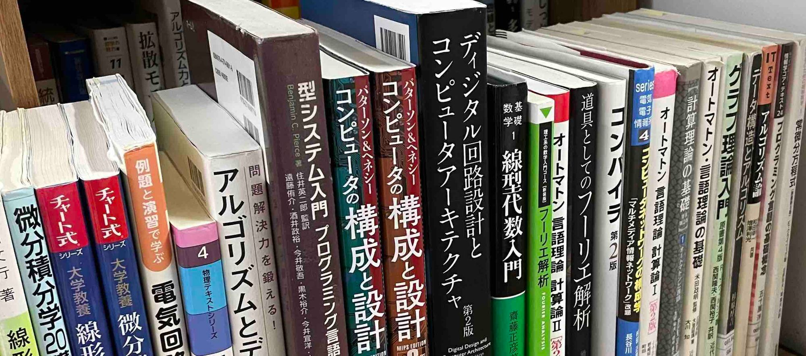

こんにちは、speedです。

猛烈な暑さが続き「最も暑い夏」と言われた2023年の夏、大学院修士課程を受験しました。

情報系人気も相まって大学院受験に合格することは難しいと考え、私は複数校受験しました。

本稿では、今後大学院を受験される方に向けて

- 院試特有の難しさと、
- 特に力を入れて対策した[京都大学大学院情報学研究科通信情報システム専攻](https://web.archive.org/web/20240104021421/http://www.cce.i.kyoto-u.ac.jp/)の対策方法

について述べます。

京大院試は私にとって外部からの受験で、院試情報が少なく対策が大変でしたが、過去の受験者のブログ記事がとても参考になりました。

本稿が次の受験者に参考になることを願って綴ります。

> [!NOTE]
> “体験記”とあるように、ここで述べているのはあくまで一人の感想にすぎません。
> 大学院入試の仕組みは専攻科により大きく異なります。今後大学院を受験する方は、志望する大学院の最新の募集要項や研究室webサイトを注意深く読み、過去の情報に惑わされませんように。

## 院試特有の難しさ

まずはじめに、院試を受験してみて感じた院試特有の難しさを述べます。

### 専攻科ごとに異なる出題分野

院試では出題される科目が専攻科ごとにかなり異なります。

特に学部在籍時と異なるところに出願(いわゆる外部受験)する際は、学んだことのない科目を１から勉強することになる可能性があります。

複数校受験する場合は、対策すべき分野が増えるため注意が必要です。

### 専攻科ごとに異なる問題の傾向

情報系の院試では、ある程度の歴史があるオペレーティングシステムやオートマトンなどの科目が多くの大学院で出題されます。

しかし、問題の傾向はかなり異なります。

誘導付きの複雑な問題を出題するのが好きな大学や、教科書の例題のようなシンプルな問題が好きな大学など、様々です。

とはいえ、問題は過去問に類似することが多いです。

過去問を数年分集め、傾向を知ることが重要です。

### 解答が公開されていない

院試では過去問を集めて傾向を知ることが大切ですが、過去問の解答は公開されていない事が多く、(外部は特に)過去問の解答を得ることは難しいです。

実体験として、過去問の傾向はかなり似ているのに、解答がないためどのように解くのが良いか知ることができず、解答方法を調査したり考えたりするのが大変でした。

### ボーダーがわからない

大学受験であれば模試等で自分の実力や他の受験者と比べた立ち位置がわかるのですが、大学院受験は一発勝負です。

ボーダーがわからないため、暗中模索の勉強が続きます。

私はliterallyに胃が痛くなりました。

### 出願・試験時期が異なる

大学院の出願・試験時期は大学受験のように前期、中期などという決まった期日はなく、バラバラです。

早めに大学院の募集要項を集めましょう。

多くの大学は4月頃に当年度入試の募集要項をweb上にあげると思われます。

## 京都大学大学院通信情報システム専攻の対策

京都大学大学院通信情報システム専攻の試験科目についてですが、私が受けた年度から出題方式が変わり、以下のような試験となりました。([2024年度 4月期入学 募集要項](http://www.i.kyoto-u.ac.jp/admission/application.html)より引用)

- 専門基礎Ａ

「数学(微分積分、線形代数)」、「論理回路」、「情報理論」、「計算機アーキテクチャ」全問必答。

- 専門基礎B

「数学(複素関数論、フーリエ解析、微分方程式)」、「電磁気学(静電磁気)」、「電気電子回路」、「データ構造とアルゴリズム」、「プログラミング言語」、「グラフ理論」、「情報通信工学 (情報伝送、通信ネットワーク)」、「通信基礎論」、「電波工学(電磁波、アンテナ、伝搬)」、「計算機システム」、「オートマトンとアルゴリズム論」、「プログラミング言語処理系とOS」、「計算と論理」

上記13科目より6科目出題され、3科目解答します。

かなりの出題科目があります。特に専門基礎Bは13科目のうちどれが出題されるかわからないという運要素があります。

以下ではどのように対策したか述べていきます。

### 過去問の集め方

過去問の集め方は、大学院のホームページで公開されているものをダウンロードしたり、

[wayback machine](https://archive.org/web/) という、過去にweb上に公開されたwebページを収集、保存するサイトを用いて、公式の過去問公開urlを元に過去問を収集しました。

この方法により、合計十年分ほどの過去問を集めました。

### 過去問の解答の集め方

過去問の解答は院試勉強をする上で非常に有用です。解答というfeedbackにより勉強が捗ります。ただ、院試の過去問が外部に出回ることは少なく、出回っていたとしても有料で販売されていることがほとんどです。

私も例によって解答を得ることは難しかったため、自力で解答を作っていました。

### 解答の作り方

解答を自力で作る上で重要なのは、適切な教科書や資料を集めることだと思います。

院試の問題は、大学の講義で使われた講義資料や教科書をもとに出題されることが多いです。

よって、受験先の大学の講義で使われた講義資料や教科書を集めることが効率的に解答を作るために重要となります。

私はネット上に公開されているシラバスや授業資料を手掛かりに、受験先の大学の講義で使われた講義資料や教科書を推測し、学習および解答作成を行っていきました。

### 私が用いた教科書

以下では各科目ごとに私が使用した教科書やwebサイトを紹介します。

- 数学(微分積分、線形代数)
  - [詳解と演習大学院入試問題〈数学〉: 大学数学の理解を深めよう、海老原+](https://www.amazon.co.jp/詳解と演習大学院入試問題〈数学〉―大学数学の理解を深めよう-海老原-円/dp/4864810273/ref=asc_df_4864810273/?tag=jpgo-22&linkCode=df0&hvadid=295720022086&hvpos=&hvnetw=g&hvrand=3808586486877232596&hvpone=&hvptwo=&hvqmt=&hvdev=c&hvdvcmdl=&hvlocint=&hvlocphy=1009507&hvtargid=pla-527247252233&psc=1&th=1&psc=1)

  - [チャート式シリーズ 大学教養 微分積分 (チャート式・シリーズ)、加藤](https://amzn.to/3OtlWSm)

  - [チャート式シリーズ 大学教養 線形代数 (チャート式・シリーズ)、加藤](https://amzn.to/3KxhbpL)

微積分や線形代数は多変数の微積分や固有問題といった、基本的な問題が出題されることが多いです。そこで、基本的な問題を取りこぼさないよう、演習問題とその解答が多く載っている教科書を用いました。

- 論理回路
  - [OHM大学テキスト 論理回路、今井](https://amzn.to/3OhOIp2)

論理回路について非常に幅広く扱っている教科書です。

- 情報理論

情報理論はこの分野で非常に有名な教科書である今井先生の「[情報理論 改訂2版](https://amzn.to/3DJ5OaD)」や[西田先生の講義資料](https://sites.google.com/view/toyoakinishida-j/情報符号理論)を用いました。

- 計算機アーキテクチャ
  - [コンピュータの構成と設計 MIPS Edition 第6版、パターソン & ヘネシー](https://www.amazon.co.jp/コンピュータの構成と設計-MIPS-第6版-David-Patterson/dp/4296070096?__mk_ja_JP=カタカナ&crid=1JETUFPMP8FRI&keywords=コンピュータの構成と設計+第6版&qid=1691397416&sprefix=コンピュータの構成と設計+第6版,aps,224&sr=8-2&linkCode=sl1&tag=amazon13aff-22&linkId=db893ee0fcf289c706f27c19f1ef3ba1&language=ja_JP&ref_=as_li_ss_tl)

計算機アーキテクチャはパタヘネ(上下)を使いました。情報の移り変わりが早い分野なので、最新版を用いることをお勧めします。

- 数学2(複素関数論、フーリエ解析、微分方程式)
  - [複素関数論の基礎、山本](https://amzn.to/3QpOQWf)

  - [演習 複素関数キャンパス・ゼミ 改訂2、馬場](https://amzn.to/43YDSdh)

  - [フーリエ解析 (理工系の数学入門コース)、大石](https://amzn.to/44UpTqc)

  - [常微分方程式キャンパス・ゼミ 改訂9、馬場](https://amzn.to/44SuaKO)

数学2は、教科書を読んだり、マセマシリーズを使って演習をしました。

マセマシリーズはあまり厳密じゃなさそうという偏見で忌避していたのですが、計算能力が問われることの多い大学院入試問題の対策として、計算の仕方を細かく解説しているマセマシリーズは適しているように思います。

- 電気電子回路
  - [電気電子回路―アナログ・ディジタル回路 (ロボティクスシリーズ)、杉山+](https://amzn.to/3QpKWN7)

  - [例題と演習で学ぶ 電気回路(第2版)、服藤](https://amzn.to/3qeG0jx)

電気電子回路は歴史の深さゆえ一つの本では扱う内容に漏れがあるため、いろいろな本を使いました。その中でも以上の2冊が私には合いました。

- データ構造とアルゴリズム
  - [問題解決力を鍛える！アルゴリズムとデータ構造 (ＫＳ情報科学専門書)、大槻](https://amzn.to/3QnwiWC)

  - [データ構造とアルゴリズム、杉原](https://amzn.to/3Qor7FS)

通称けんちょん本と呼ばれる「問題解決力を鍛える！アルゴリズムとデータ構造」や、杉原先生の本を参考にしました。

- プログラミング言語

ネットに上がっていた[工学部専門科目「プログラミング言語」の講義資料](https://hackmd.io/@aigarashi/r1az0wOHP/%2FpWliU6DiTa2yj8H0V_XUXA)を参考にしました。

プログラミング言語では、インタープリター等の実装を手書きで書かせる問題が頻出でした。

- グラフ理論
  - [グラフ理論入門:基本とアルゴリズム、宮崎](https://amzn.to/3rYgmA2)

  - [グラフ理論入門(原書第4版)、ウィルソン](https://amzn.to/3Ymaywd)

- 計算機システム
  - [コンピュータの構成と設計 MIPS Edition 第6版 上・下、パターソン & ヘネシー](https://amzn.to/47gtTDf)

パタヘネ再び登場です。

- オートマトンとアルゴリズム論
  - [オートマトン言語理論 計算論〈1〉 (Information & Computing), J. ホップクロフト+](https://amzn.to/450Accy)

  - [計算理論の基礎 [原著第2版] 1-3, Michael Sipser](https://amzn.to/44YKoC3)

「オートマトン言語理論 計算論」をメインに、「計算理論の基礎」は計算量複雑性のクラスの用語解説が豊富だったのでその部分のみ重点的に読みました。

- プログラミング言語処理系とOS
  - [レクチャー オペレーティングシステム (情報工学レクチャーテキスト QKC 5)、福田](https://amzn.to/44YP1vW)

  - [オペレーティングシステムの概念、abraham+](https://amzn.to/3DK260b)

オペレーティングシステムはとても大規模なソフトウェアで学ぶのが難しいのですが、「オペレーティングシステムの概念」はとても丁寧に解説していてお勧めです。ただ、非常に分厚いので、時間がない人は「レクチャー オペレーティングシステム」をお勧めします。

- 計算と論理
  - [プログラミング言語の基礎概念 (ライブラリ情報学コア・テキスト)、五十嵐](https://amzn.to/45f0ZBx)

  - [型システム入門 プログラミング言語と型の理論、Benjamin](https://amzn.to/3OpwSQX)

計算と論理では型システムや論理学の知識が必要となるので、以上の2冊を用いました。

また、以下のサイトも参考にしました。公開してくださった先生方に感謝いたします。

[京都大学工学部専門科目「プログラミング言語処理系」講義資料](https://kuis-isle3sw.github.io/IoPLMaterials/)

[『計算論理学』講義資料、亀山幸義](https://www.cs.tsukuba.ac.jp/~kam/lecture/complogic2015/main.pdf)

[計算と論理、五十嵐](https://www.fos.kuis.kyoto-u.ac.jp/~igarashi/class/cal13w/)

- その他

[工業大学生ももやまのうさぎ塾](https://www.momoyama-usagi.com/)

というサイトは数学や情報科学の色々なトピックを扱っており、多くの科目でお世話になりました。

### 院試勉強の日程

N=1に過ぎない院試勉強の日程の例を挙げておきます。

- 4月

色々な大学院の募集要項及び研究室webサイトを確認する。

OSやコンピュータアーキテクチャなど情報科学で主要な科目を復習する。

- 5月

入試説明会、研究室見学に行く。

出願したい研究室をある程度定める。

募集要項をもとに、教科書を借りたり買ったりして集める。

教科書を一通り読んで全体像を把握する。

- 6月

出願する。

過去問を解く。

教科書を読む。

演習する。

- 7月

出願する。

過去問を解く。

教科書を読む。

演習する。

東工大の口頭試験を受ける。

阪大の筆記、口頭試験を受ける。

- 8月

過去問の見直しや教科書をおさらいする。

京大の筆記試験を受ける。

## 結果

全ての大学で第一志望の研究室に合格することができました。

学習環境や運が良かったと思います。

支えてくださった皆様、及び教科書やwebの記事の著者に感謝いたします。

次年度以降同じ大学院を受ける方の参考までに、京大院試の開示結果を残しておきます。

- 開示結果

  英語: 172.78/200

  専門A: 306/400

  専門B: 322.67/400

  合計: 801.45/1000

  でした。ギリギリ8割を超えることができました。

## 院試をおえて思ったこと

> 「本を読んだものの練習問題ができない読者は何も学んでいないのだ」
>
> 「現代の量子力学」 J.J Sakurai 著

学部時代は教科書を授業と並行して読んで理解した気になっていましたが、院試勉強で問題をたくさん解く中で解けない問題にたくさん出会い、上記の名言を身をもって体感しました。

院試は、対策に要する時間や、出題分野と研究分野の乖離などから忌避されがちですが、院試の勉強を通して情報科学を幅広く学習することができ、情報科学の全体像を俯瞰できたため長い目でみると良かったように思います(と思った方がモチベーションが上がります)。

## 参考になった過去の受験者のブログ記事

過去の受験者の記録はとても参考になりました。公開してくださりありがとうございます。

- 院試ネコ、[【合格体験談】京都大学大学院通信情報システム専攻に、外部生が合格した話](https://note.com/inshicat/n/n6ceb974ed6c5)
- Z-diary, [京都大学情報学研究科通信情報システム専攻に合格しました](https://web.archive.org/web/20230620012155/https://zaki-joho.hatenablog.com/entry/2019/09/13/011544)
- はなまる、[京大電電の院試事情〜情報学研究科情報通信システム専攻〜](https://thinkingflower.hatenablog.com/entry/2020/06/21/171048)
- Academaid, [https://academ-aid.com/](https://academ-aid.com/)

次の受験者にバトンを渡し、筆を置きます。
