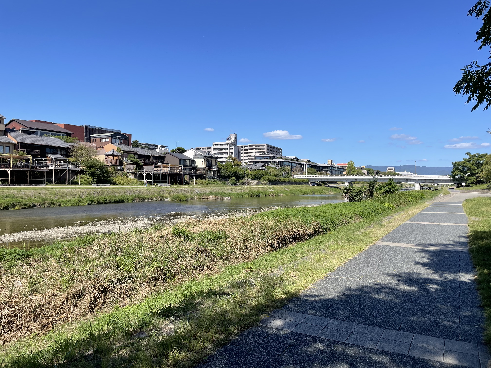

In this post, I introduce some recommended spots and places to eat that I discovered in Kyoto, where I spent two years as a master's student.
Since I mostly got around the area near Kyoto University's Yoshida Campus, this post focuses on that area.

## Recommended Places to Relax

Kyoto has many calming places surrounded by historic buildings and nature. Here are a few that I especially recommend.

### ROHM Theatre Kyoto, Park Plaza 3F (BOOK & ART GALLERIA Exhibition Space)

[ROHM Theatre Kyoto](https://rohmtheatrekyoto.jp/), right in front of Heian Jingu Shrine, is a cultural venue that hosts operas, concerts, and other performances.

In the building's "Park Plaza" area, the third floor has a space that anyone can use freely, furnished with stylish bookshelves, desks, and chairs. Large windows let in plenty of natural light, which makes it a very comfortable place to be.
I often see locals studying or enjoying a book there.

It is a hidden gem that rarely appears in guidebooks, so do stop by.

<figure>
  
  <figcaption>BOOK & ART GALLERIA Exhibition Space (Source: https://rohmtheatrekyoto.jp/floorguide/)</figcaption>
</figure>

### Kamo River

The Kamo River, which flows through the center of Kyoto, is a perfect place to take it easy, whether you are going for a walk or reading a book.
You can spend your time however you like on the riverside benches or grass while feeling the seasons change.

Now and then a skilled saxophonist shows up and plays lovely music, and chance encounters like that are part of the river's charm.

<figure>
  
  <figcaption>The Kamo River (photo by the author)</figcaption>
</figure>

### Kyodai Salon in Kyoto University's Clock Tower Centennial Hall

<figure>
  
  <figcaption>Kyodai Salon (Source: https://www.kyoto-u.ac.jp/ja/about/facilities/campus/clocktower/visitor/detail/salon)</figcaption>
</figure>

The Kyodai Salon (京大サロン), inside Kyoto University's Clock Tower Centennial Hall, is a space open not only to students and staff but also to the general public.
Classical music plays in this calm space, where you can spend a relaxed, unhurried time.

Sitting here, you overhear all sorts of conversations: elderly visitors discussing history and politics, students excitedly talking about their extracurricular activities, and more.
Listening in on these casual exchanges is one of the pleasures of this place.

## Recommended Places to Eat

### Ikazuchi Udon (イカズチうどん)

An udon shop on the way from Hyakumanben (百万遍) to Ginkaku-ji.
It is known for its broth, rich with bonito dashi (a soup stock made from dried bonito flakes), and its chewy noodles, and every bowl is very satisfying. The portions are also bigger than you might expect.

The "Kimagure Udon" ("whim udon") is a daily special, such as curry udon or a set with oyakodon (a chicken and egg rice bowl), so there is something different to enjoy every time you visit.

My personal recommendation is the "nasu-ten" (eggplant tempura).

Be sure to check out their [official Instagram](https://www.instagram.com/ikazuchiudon/) as well.

<figure>
  
  <figcaption>Ikazuchi Udon (Source: https://gcjapan-kyoto.com/ikazuchiudon/) </figcaption>
</figure>

### Kokoraya Gokomachi Main Branch (ここら屋 御幸町本店)

The [Kokoraya](https://kokoraya.moss-co-ltd.com/) Gokomachi Main Branch is an izakaya (a Japanese-style pub) near Sanjo.
It is also open for lunch, when you can enjoy a meat or fish set meal for around 1,000 yen.

Besides rice and the main dish, the set meal comes with miso soup, tempura, a small side dish, and even dessert, and all of it is delicious.
The great value for money is another draw.

<figure>
  
  <figcaption>Kokoraya (Source: https://kokoraya.moss-co-ltd.com/shop)</figcaption>
</figure>

### Nadai Tonkatsu Katsukura (名代とんかつ かつくら)

[Katsukura](https://www.katsukura.jp/) is a popular tonkatsu (breaded, deep-fried pork cutlet) restaurant chain based mainly in Kyoto.

Besides the delicious tonkatsu, a nice bonus is the free refills of shredded cabbage and miso soup.
The miso soup in particular is packed with ingredients and clearly made with care; I could drink bowl after bowl of it.

There are several locations in Kyoto City, so it is easy to get to.

<figure>
  
  <figcaption>Nadai Tonkatsu Katsukura (Source: https://www.katsukura.jp/)</figcaption>
</figure>

## Conclusion

I spent two years in Kyoto, but I feel there is still so much about it that I have yet to discover.
If I get the chance to visit or live in Kyoto again, I would love to explore new spots.

If you have any recommendations of your own, please let me know!
