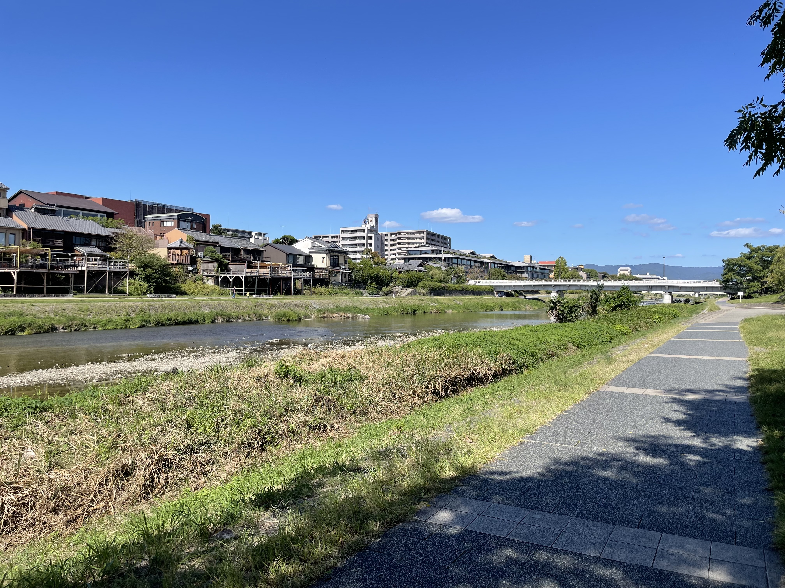

本稿では、修士課程の2年間を過ごした京都で見つけた、おすすめのスポットやグルメを紹介します。
主な行動範囲が京都大学吉田キャンパス周辺だったため、今回はそのエリアを中心に紹介します。

## おすすめのくつろぎスポット

京都には、歴史的な建造物や自然に囲まれた、心落ち着く場所が数多くあります。ここでは、その中でも特におすすめのスポットをいくつか紹介します。

### ロームシアター京都 パークプラザ3階 (BOOK & ART GALLERIA 展示スペース)

平安神宮の目の前にある[ロームシアター京都](https://rohmtheatrekyoto.jp/)は、オペラやライブなどが開催される文化施設です。

館内の「パークプラザ」エリアには、3階に自由に利用できるスペースがあり、おしゃれな本棚や机、椅子が設置されています。大きな窓から自然光がたっぷり入るため、非常に快適な空間です。
地元の人が勉強や読書を楽しんでいる姿もよく見かけます。

ガイドブックにはあまり載っていない穴場スポットなので、ぜひ訪れてみてください。

<figure>
  
  <figcaption>BOOK & ART GALLERIA 展示スペース（出典: https://rohmtheatrekyoto.jp/floorguide/）</figcaption>
</figure>

### 鴨川

京都の中心を流れる鴨川は、散歩や読書など、ゆったりと過ごすのに最適な場所です。
季節の移ろいを感じながら、川沿いのベンチや芝生で思い思いの時間を楽しめます。

ときどき腕の立つサックス奏者が現れ、心地よい音楽を奏でていることもあり、そんな偶然の出会いも魅力のひとつです。

<figure>
  
  <figcaption>鴨川（著者撮影）</figcaption>
</figure>

### 京大の百周年時計台記念館にある京大サロン

<figure>
  
  <figcaption>京大サロン（出典: https://www.kyoto-u.ac.jp/ja/about/facilities/campus/clocktower/visitor/detail/salon）</figcaption>
</figure>

京大の百周年時計台記念館内にある「京大サロン」は、学生や教職員に加えて、一般の人も利用できるスペースです。
クラシック音楽が流れる落ち着いた空間で、ゆったりとした時間を過ごすことができます。

ここに座っていると、ご年配の方が歴史や政治について語っていたり、学生同士が課外活動の話で盛り上がっていたりと、さまざまな会話が耳に入ってきます。
そんな何気ないやりとりに耳を傾けるのも、この場所の楽しみのひとつです。

## おすすめのグルメスポット

### イカズチうどん

百万遍から銀閣寺に向かう途中にあるうどん屋さんです。
鰹出汁の効いたつゆと、もちもちの麺が特徴で、非常に満足度の高い一杯が楽しめます。量も想像以上に多めです。

「きまぐれうどん」は日替わりメニューで、カレーうどんや親子丼付きなど、訪れるたびに違った楽しみがあります。

個人的なおすすめは「なす天」です。

[公式Instagram](https://www.instagram.com/ikazuchiudon/)もぜひチェックしてみてください。

<figure>
  
  <figcaption>イカズチうどん (出典: https://gcjapan-kyoto.com/ikazuchiudon/) </figcaption>
</figure>

### ここら屋 御幸町本店

[ここら屋](https://kokoraya.moss-co-ltd.com/) 御幸町本店は、三条付近にある居酒屋です。
ランチ営業もしており、肉または魚の定食が1,000円前後で楽しめます。

定食には、ご飯・主菜に加えて、味噌汁・天ぷら・小鉢・デザートまで付いており、どれも非常に美味しいです。
コストパフォーマンスの高さも魅力です。

<figure>
  
  <figcaption>ここら屋（出典: https://kokoraya.moss-co-ltd.com/shop）</figcaption>
</figure>

### 名代とんかつ かつくら

[かつくら](https://www.katsukura.jp/)は、京都を中心に展開する人気のとんかつ店です。

とんかつの美味しさはもちろん、キャベツと味噌汁がおかわり自由なのも嬉しいポイントです。
特に味噌汁は具だくさんでこだわりが感じられ、何杯でも飲めてしまいます。

京都市内に複数店舗があるので、アクセスしやすいのも魅力です。

<figure>
  
  <figcaption>名代とんかつ かつくら（出典: https://www.katsukura.jp/）</figcaption>
</figure>

## おわりに

2年間京都で過ごしましたが、まだまだ知らない魅力がたくさんあると感じています。
私もまた京都に訪れる・住む機会があったら、ぜひ新しいスポットを開拓してみたいと思います。

読者の皆さんのおすすめのあれこれがあればぜひ教えてください！
