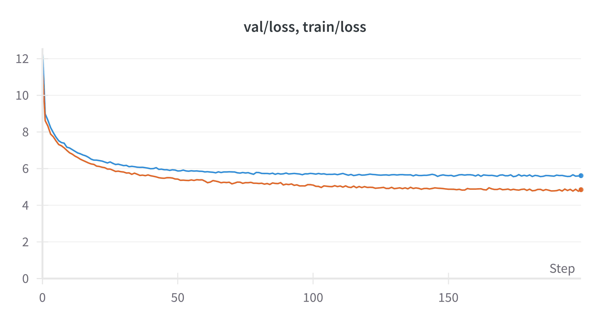
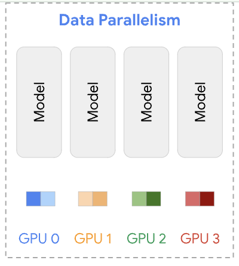
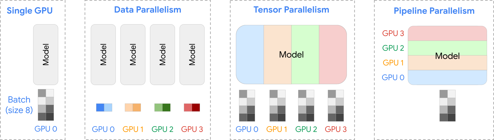

Large language models (LLMs) have attracted enormous attention since the release of ChatGPT. Because they have the potential to reshape existing technologies and industries, many companies and research institutions are developing their own LLMs.
However, most of the available material on the internal structure and training methods of LLMs is conceptual, and even if you feel you understand it, there is a lot you won't really grasp until you implement it yourself.

So this time, with the goal of fully understanding LLM pretraining, I implemented an LLM from scratch in JAX and pretrained it. This post explains how in detail.

Repository: [jax-llm](https://github.com/speed1313/jax-llm)

I carried out pretraining in the following steps:

1. Preparing the training and test data
2. Training the model

I will also cover text generation with the trained model and speeding up training with data parallelism.

Let's go through them in order.

## Preparing the training and test data

This time, I use the [Aozora Bunko dataset](https://huggingface.co/datasets/globis-university/aozorabunko-clean) published on Hugging Face and convert the text of a large number of novels into a single text file.

First, I concatenate the text of 10,246 novels into one text file.

```bash
python3 src/jax_llm/prepare_aozora.py --book_num 10246
```

**data/aozora_10246/input.txt**

```
深いおどろきにうたれて、
名高いウェストミンスターに
...
```

Next, I train a tokenizer and convert the text file into a sequence of tokens.

Here I use the [BPE tokenizer](https://huggingface.co/learn/nlp-course/en/chapter6/5) from the [Tokenizers](https://github.com/huggingface/tokenizers) library.

```bash
python3 src/jax_llm/train_tokenizer.py \
    --data_name "aozora_10246"
```

Training the tokenizer produces tokenizer.json, which contains a mapping between the tokens registered in the vocabulary (vocab) and their token IDs.

**data/aozora_10246/tokenizer.json**

```
{
  "model": {
    ...
    "vocab": {
      "<|endoftext|>": 0,
      "!": 1,
      "\"": 2,
      ...
      "0": 15,
      "1": 16,
      ...
      "a": 62,
      "b": 63,
      ...
      "吾輩は": 28153,
      "きびしく": 28154,
      ...
```

Basic symbols, letters of the alphabet, and words that appear frequently in Aozora Bunko are registered as tokens.

Using the trained tokenizer, I convert the text file into a token sequence. In total, this yielded 80M tokens.

To check how the tokenizer behaves, let's convert the following opening line of Yasunari Kawabata's _Snow Country_ into a token sequence.

```
国境の長いトンネルを抜けると雪国であった
```

Converting this sentence with the trained tokenizer gives the following:

```
トークン列: ['国境', 'の長い', 'トンネル', 'を抜', 'けると', '雪', '国', 'であった']
トークンid列: [19120, 29309, 28527, 30173, 10645, 7726, 1674, 8737]
```

Intuitively, this looks like a good segmentation.

## Training the model

For the model, I use [NanoLM](https://optax.readthedocs.io/en/stable/_collections/examples/nanolm.html), a GPT-2-like model. NanoLM is a decoder-only Transformer: it takes a sequence of past tokens as input and predicts the next token.

$$
P_{\theta}(x_{i+1}|x_{0}\dots x_{i})
$$

For example, given the token sequence "国境の長いトンネルを抜けると" ("Through the long tunnel at the border"), the model can compute the probability of predicting the token "雪" ("snow").
$$P_{\theta}(\text{雪} \mid \text{国境の長いトンネルを抜けると}) = 0.8$$

A key property of the Transformer is that, when the maximum length of the past token sequence it can take into account (the block size) is n, it can compute the following probabilities in parallel:

$$
P_{\theta}(x_1|x_0), P_{\theta}(x_2|x_1x_0),\dots,P_{\theta}(x_n|x_0\dots x_{n-1})
$$

This parallel computation makes next-token prediction efficient.

Using these, we can maximize the predicted probability of the next token by minimizing the negative log-likelihood of the correct labels, as follows:

$$
L_{\theta}(X,Y) = \sum- \log{P_{\theta}(y_i(=x_{i+1})|x_{0:i})}
$$

With that, we have the training data, the model, and the loss function.
All that remains is to train the model by updating its parameters following the usual DNN training procedure.

To prepare the training and test data, I split the whole dataset 9:1. The model has 80M parameters.

```bash
python3 src/jax_llm/train.py --data_name "aozora_10246" --batch_size 256 --n_iterations 20000 --n_freq_eval 100 --dropout_rate 0.0 --learning_rate 0.001 --num_layers 12 --embed_size 512  --head_size 64 --num_heads 8 --block_size 128 --wandb_log True
```

<figure>
  
  <figcaption>Loss dynamics during training</figcaption>
</figure>

As training progresses, the losses on both the training and test data decrease. On the other hand, toward the end the gap between the training loss and the test loss widens, which shows that the model is starting to overfit.

## Model inference

Once training is done, we can generate text by repeatedly choosing the token predicted to be most probable given the past token sequence, as shown below. This method is called greedy decoding.

$$
x_{i+1} = \arg\max_x P_{\theta}(x |x_{i:0})
$$

An LLM generates text by repeatedly appending the token it predicts from the past token sequence.

This means that generating text requires running model inference over and over, which takes time.

Now, let's generate some text with the model pretrained on Aozora Bunko.

_Prompt: "国境の長いトンネルを抜けると雪国であった。"_

> Output: Output: 国境 の長い トンネル を抜 けると 雪 国 であった 。 この あたりは 、 一 冬 に 満た ねばならなかった 。 そして 、 その 冬 枯 の 季節 、 冬の 日は 、 その 季節 、 冬 の間 、 寒 の 季節 に 、 大 気の 冷 える 夜 だった 。 「 あ 、 そうだ 。 たしかに 」 と 、 半七は 笑っていた 。「 だが 、 そんな 訳 でもない 。 あの 時に 、 私は 、 あの 、 お 邸 のお 女中 さん ―― と 、 お 名は 、 若い 妓 と 、 妓 の 吉 次 とが 、 その 枕 元から 取り 交 している 。 しかし 、 彼女は 、 その 母 に向って それを 否定 しようと 努 めなかった 。 そうして 、 その 反 感を 、 どう 解釈 して よいか 、 また 、 自分の 力で それに 従 うべき かを 、 自分で はっきり 知って いながら でも 、 やはり 自分を 信じ なければならない 。 それは 、 自分の 知らない うちに 、 自分の 過去の 記憶 で 、 この 小説 の中に 残っている 「 昔 の人 」 には 一種の ロマン が 含まれている 。 だが 、 そこには 何か こう 神秘的な 力が 潜んでいる 。 それは 、 私が この 眼で 見た 、 最も 純粋な 、 また 同時に 美しい ―― それは 、 その 創造 した 芸術 の美しさ である 。 そして 、 そこに 一つの 現実 への 飛躍 がある

It is hard to call this natural prose, but the model does generate novel-like text that feels typical of Aozora Bunko.

## Distributed training with data parallelism using `shard_map`

Training a large model takes a very long time.
That is why distributed training, which uses multiple GPUs to train a model efficiently, is used.

The data parallelism used here is one form of distributed training, and the simplest one.

**Data parallelism**

In data parallelism, the model is replicated across multiple GPUs, and each GPU processes a different batch. Each GPU computes gradients on its own batch, and the computed gradients are then aggregated.

<figure>
  
  <figcaption>(Source: <a href="https://uvadlc-notebooks.readthedocs.io/en/latest/_images/parallelism_strategies_overview.svg">uvadlc</a>)</figcaption>
</figure>

**Implementation**

I implemented data parallelism following the [UvA Deep Learning Tutorials](https://uvadlc-notebooks.readthedocs.io/en/latest/tutorial_notebooks/scaling/JAX/data_parallel_fsdp.html).

JAX has a handy feature called [shard_map](https://jax.readthedocs.io/en/latest/sharded-computation.html#manual-parallelism-with-shard-map). With it, you just specify how the data should be placed on each device and define the function that processes the data, and data parallelism is taken care of for you.

This kind of design is called SPMD (Single Program Multiple Data).

Thanks to the SPMD design, apart from communication between devices (e.g., gradient aggregation), you can reuse your single-GPU training code as is.

In the code below, `P()` and `P(config.data_axis_name)` specify which data is replicated on each device and which data is split across devices, and `jax.lax.pmean` aggregates the gradients computed on each device.

```python
def train_step_dp(
    state: TrainState, metrics: Metrics | None, x, y
) -> Tuple[TrainState, Metrics]:
    rng, step_rng = jax.random.split(state.rng)
    (loss, step_metrics), grads = jax.value_and_grad(loss_fun, has_aux=True)(
        state.params, state.apply_fn, x, y, step_rng
    )

    # Update parameters. We need to sync the gradients across devices before updating.
    with jax.named_scope("sync_gradients"):
        grads = jax.tree.map(
            lambda g: jax.lax.pmean(g, axis_name=config.data_axis_name), grads
        )
    new_state = state.apply_gradients(grads=grads, rng=rng)
    with jax.named_scope("sync_metrics"):
        step_metrics = jax.tree.map(
            lambda x: jax.lax.pmean(x, axis_name=config.data_axis_name),
            step_metrics,
        )

    return new_state, step_metrics

# In each PartitionSpec, mentioning a mesh axis name at a position expresses sharding the corresponding argument array axis along that positional axis; not mentioning an axis name expresses replication. (https://jax.readthedocs.io/en/latest/_autosummary/jax.experimental.shard_map.shard_map.html#jax.experimental.shard_map.shard_map)
train_step_dp_fn = jax.jit(
    shard_map(
        train_step_dp,
        mesh,
        in_specs=(P(), P(), P(config.data_axis_name), P(config.data_axis_name)),
        out_specs=(P(), P()),
        check_rep=False,
    ),
    donate_argnames=("state", "metrics"),
)
```

**Experiment**

Using 2 GPUs with exactly the same settings as the single-GPU run, I trained the model with data parallelism, giving each GPU half of every batch. Training was about 1.5 times faster (17 min → 11 min). Because of the cost of communicating batches and gradients, it did not reach a 2x speedup, but the speedup was still clear.

Note that data parallelism assumes the entire model fits in the memory of a single GPU, but recent models have grown too large to fit in one GPU's memory. For this reason, more advanced distributed training methods beyond data parallelism, such as tensor parallelism, pipeline parallelism, and combinations of them, have been proposed and are used in practice.

<figure>
  
  <figcaption>(Source: <a href="https://uvadlc-notebooks.readthedocs.io/en/latest/_images/parallelism_strategies_overview.svg">uvadlc</a>)</figcaption>
</figure>

## Summary

It turns out that LLM pretraining is a very simple process: prepare training data and maximize the predicted probability of the next token.
That said, this post did not go into the internals of the tokenizer or the Transformer. Also, beyond pretraining, later training stages such as fine-tuning and RLHF are important for LLMs as well.

Furthermore, once you start caring about the details, there is no end to the points to consider: tokenizer and model design, building the training data, speeding things up, and more.

This field is really fun!

## References

- [jax-llm](https://github.com/speed1313/jax-llm)

This is the code I implemented for this post. You can train a language model on any text file you like. With a small model size, you can even train it on your own PC.

- rasbt, [Build a Large Language Model (From Scratch)](https://github.com/rasbt/LLMs-from-scratch)

This is the repository for a book that walks through implementing an LLM entirely from scratch, including the tokenizer and the Transformer model. The Jupyter notebooks are explained carefully, so you can learn from them without buying the book.

- karpathy, [nanoGPT](https://github.com/karpathy/nanoGPT)

This is a GPT-like LLM implementation by Andrej Karpathy. There is also a YouTube video series ([Neural Networks: Zero to Hero](https://youtube.com/playlist?list=PLAqhIrjkxbuWI23v9cThsA9GvCAUhRvKZ&si=jKwpJqDK76Hsgk5H)) that explains automatic differentiation, language models, tokenizers, and more while implementing them from scratch.

- [UvA Deep Learning Tutorials](https://uvadlc-notebooks.readthedocs.io/en/latest/tutorial_notebooks/scaling/JAX/data_parallel_fsdp.html)

These tutorials cover a wide range of deep learning topics, with implementations in PyTorch and JAX. Their explanation of distributed training is also thorough.

- [(Google) JAX: Low-level control with shard_map and Pallas](https://youtu.be/5ilr4gcenaA?si=VDGR4ODhn4JsdtY4)

An easy-to-follow video about shard_map.

- [shard_map](https://jax.readthedocs.io/en/latest/notebooks/shard_map.html)

The explanation of shard_map in the JAX documentation. The [shard_map/neural-networks](https://jax.readthedocs.io/en/latest/notebooks/shard_map.html#neural-networks) section includes code examples for data parallelism, FSDP, tensor parallelism, and pipeline parallelism.

- Naoaki Okazaki, [Development of Large Language Models (in Japanese)](https://speakerdeck.com/chokkan/jsai2024-tutorial-llm), 2024

These slides give a clear overview of how large language models were developed as of June 2024.

- Radford et al., Language Models are Unsupervised Multitask Learners, 2018

The GPT-2 paper, on which the NanoLM model used in this post is based.
