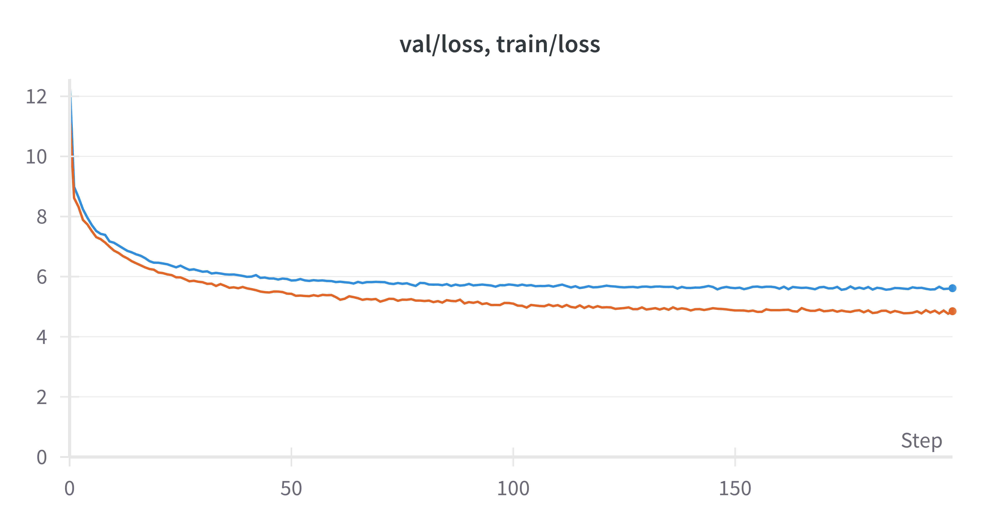
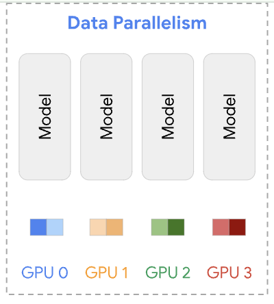
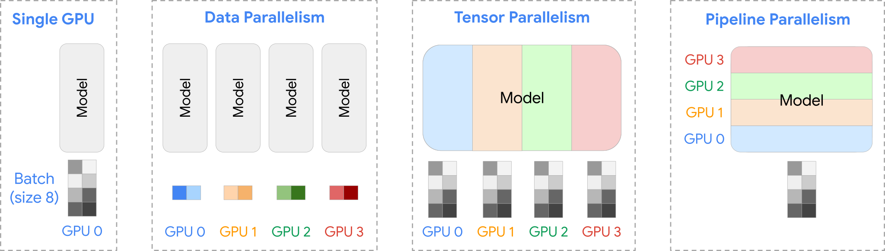

大規模言語モデル(LLM)は、ChatGPTの登場をきっかけに大きな注目を集めています。既存の技術や産業構造を大きく変える可能性があることから、多くの企業や研究機関がLLMの開発を進めています。
しかし、LLMの内部構造や学習手法についての情報は概念的な説明が中心で、理解したつもりになれても、実際に自分で実装してみないと分からない部分が多くあります。

そこで今回は、LLMの事前学習を完全に理解することを目的に、JAXを用いてゼロから実装し、事前学習を行いました。本稿では、その方法について詳しく解説します。

リポジトリはこちら: [jax-llm](https://github.com/speed1313/jax-llm)

今回は以下のような流れで事前学習を行いました。

1. 学習データ、テストデータの用意
2. モデルの学習

また、学習したモデルを用いた文章生成、データ並列による学習高速化についても紹介します。

それでは順番に見ていきます。

## 学習データ、テストデータの用意

今回は、HuggingFaceで公開されている[青空文庫データセット](https://huggingface.co/datasets/globis-university/aozorabunko-clean)を用いて、大量の小説の文章を、1つのテキストファイルに変換します。

まず小説10246冊分の文章をつなげて1つのテキストファイルにします。

```bash
python3 src/jax_llm/prepare_aozora.py --book_num 10246
```

**data/aozora_10246/input.txt**

```
深いおどろきにうたれて、
名高いウェストミンスターに
...
```

続いて、トークナイザを学習し、テキストファイルをトークン列に変換します。

今回は、[Tokenizers](https://github.com/huggingface/tokenizers)ライブラリの[BPE Tokenizer](https://huggingface.co/learn/nlp-course/en/chapter6/5) を用います。

```bash
python3 src/jax_llm/train_tokenizer.py \
    --data_name "aozora_10246"
```

トークナイザを学習すると、tokenizer.jsonが生成され、語彙(vocab)として登録されたトークンと、トークンに対応するトークンidの対応表が得られます。

**data/aozora_10246/tokenizer.json**

```
{
  "model": {
    ...
    "vocab": {
      "<|endoftext|>": 0,
      "!": 1,
      "\"": 2,
      ...
      "0": 15,
      "1": 16,
      ...
      "a": 62,
      "b": 63,
      ...
      "吾輩は": 28153,
      "きびしく": 28154,
      ...
```

基本的な記号やアルファベット、青空文庫によく出てくる単語がトークンとして登録されています。

学習したトークナイザを用いて、テキストファイルをトークン列に変換します。全体で80M トークンが得られました。

トークナイザの動作を確認するために、以下の川端康成の「雪国」冒頭の文を例に、トークナイザを用いてトークン列に変換してみましょう。

```
国境の長いトンネルを抜けると雪国であった
```

この文を、学習したトークナイザでトークン列に変換すると、以下のようになります。

```
トークン列: ['国境', 'の長い', 'トンネル', 'を抜', 'けると', '雪', '国', 'であった']
トークンid列: [19120, 29309, 28527, 30173, 10645, 7726, 1674, 8737]
```

直感的には良い分割ができているように見えます。

## モデルの学習

モデルはGPT-2-likeなモデルである[NanoLM](https://optax.readthedocs.io/en/stable/_collections/examples/nanolm.html) を用います。NanoLMは、Decoder-only Transformerであり、これは過去のトークン列を入力として、次のトークンを予測するモデルです。

$$
P_{\theta}(x_{i+1}|x_{0}\dots x_{i})
$$

例えば、"国境の長いトンネルを抜けると" というトークン列が与えられたとき、"雪" というトークンを予測する確率を求めることができます。
$$P_{\theta}(\text{雪} \mid \text{国境の長いトンネルを抜けると}) = 0.8$$

Transformerの特徴は、考慮できる過去のトークン列の最大長さ(ブロックサイズ)がnの場合、以下のような確率を並列で計算できる点です。

$$
P_{\theta}(x_1|x_0), P_{\theta}(x_2|x_1x_0),\dots,P_{\theta}(x_n|x_0\dots x_{n-1})
$$

この並列計算により、効率的に次のトークンの予測が行えます。

これらを用いて、以下のように正解ラベルについての負の対数尤度を最小化することで、次のトークンの予測確率を最大化することができます。

$$
L_{\theta}(X,Y) = \sum- \log{P_{\theta}(y_i(=x_{i+1})|x_{0:i})}
$$

以上のようにして学習データ、モデル、損失関数が用意できました。
あとは通常のDNNの学習方法に従ってパラメータを更新していくことでモデルを学習することができます。

今回は学習データ、テストデータを用意するため、全体のデータを9:1に分けます。今回はモデルパラメータ数は80Mとしました。

```bash
python3 src/jax_llm/train.py --data_name "aozora_10246" --batch_size 256 --n_iterations 20000 --n_freq_eval 100 --dropout_rate 0.0 --learning_rate 0.001 --num_layers 12 --embed_size 512  --head_size 64 --num_heads 8 --block_size 128 --wandb_log True
```

<figure>
  
  <figcaption>学習中の損失のダイナミクス</figcaption>
</figure>

学習を進めるにつれて、学習データ、テストデータに対する損失が共に減少していることがわかります。一方で、終盤になると学習損失とテスト損失の差が広がっており、過学習が進んでいることがわかります。

## モデルの推論

学習が終わったら、以下のように、過去のトークン列をもとに、最も確率の高いと予測されたトークンを選ぶことを繰り返すことで文を生成することができます。この方法は greedy decoding と呼ばれます。

$$
x_{i+1} = \arg\max_x P_{\theta}(x |x_{i:0})
$$

LLMは、過去のトークン列に基づいて予測されたトークンをつなげることを繰り返すことで、文章を生成することができます。

このことから、文章の生成には、モデルの推論を繰り返す必要があり、時間がかかります。

それでは、青空文庫で事前学習したモデルを用いて文を生成してみましょう。

_Prompt: "国境の長いトンネルを抜けると雪国であった。"_

> Output: Output: 国境 の長い トンネル を抜 けると 雪 国 であった 。この あたりは 、一 冬 に 満た ねばならなかった 。そして 、その 冬 枯 の 季節 、冬の 日は 、その 季節 、冬 の間 、寒 の 季節 に 、大 気の 冷 える 夜 だった 。「 あ 、そうだ 。たしかに 」 と 、半七は 笑っていた 。「 だが 、そんな 訳 でもない 。あの 時に 、私は 、あの 、お 邸 のお 女中 さん ―― と 、お 名は 、若い 妓 と 、妓 の 吉 次 とが 、その 枕 元から 取り 交 している 。しかし 、彼女は 、その 母 に向って それを 否定 しようと 努 めなかった 。そうして 、その 反 感を 、どう 解釈 して よいか 、また 、自分の 力で それに 従 うべき かを 、自分で はっきり 知って いながら でも 、やはり 自分を 信じ なければならない 。それは 、自分の 知らない うちに 、自分の 過去の 記憶 で 、この 小説 の中に 残っている 「 昔 の人 」 には 一種の ロマン が 含まれている 。だが 、そこには 何か こう 神秘的な 力が 潜んでいる 。それは 、私が この 眼で 見た 、最も 純粋な 、また 同時に 美しい ―― それは 、その 創造 した 芸術 の美しさ である 。そして 、そこに 一つの 現実 への 飛躍 がある

自然な文とは言い難いですが、青空文庫らしい小説風の文章が生成できています。

## `shard_map` を用いたデータ並列による分散並列学習

大規模なモデルを学習するのはとても時間がかかります。
そこで、複数のGPUを用いてモデルを効率的に学習する分散並列学習が用いられます。

今回用いるデータ並列は分散並列学習の一つであり、最もシンプルなものです。

**データ並列**

データ並列では、複数のGPUにモデルを複製し、各GPUに異なるバッチを処理させます。各GPUは自分のバッチに対して勾配を計算し、その後、計算された勾配を集約します。

<figure>
  
  <figcaption>(出典: <a href="https://uvadlc-notebooks.readthedocs.io/en/latest/_images/parallelism_strategies_overview.svg">uvadlc</a>)</figcaption>
</figure>

**実装**

今回は [UvA Deep Learning Tutorials](https://uvadlc-notebooks.readthedocs.io/en/latest/tutorial_notebooks/scaling/JAX/data_parallel_fsdp.html) を参考にデータ並列を実装しました。

JAXでは、[shard_map](https://jax.readthedocs.io/en/latest/sharded-computation.html#manual-parallelism-with-shard-map)という便利な機能があります。これを用いることで、データを各デバイスにどう配置するかと、データ処理の関数を定義すれば、よしなにデータ並列を実現することができます。

このようなデザインはSPMD (Single Program Multiple Data) と呼ばれます。

SPMDデザインにより、デバイス間の通信(例: 勾配の集約)以外は、シングルGPUでの学習コードをそのまま流用することができます。

以下のコードでは、各デバイスに対して複製したいデータと分割するデータを`P()`や`P(config.data_axis_name)`で指定し、`jax.lax.pmean`を使って各デバイスで計算された勾配を集約しています。

```python
def train_step_dp(
    state: TrainState, metrics: Metrics | None, x, y
) -> Tuple[TrainState, Metrics]:
    rng, step_rng = jax.random.split(state.rng)
    (loss, step_metrics), grads = jax.value_and_grad(loss_fun, has_aux=True)(
        state.params, state.apply_fn, x, y, step_rng
    )

    # Update parameters. We need to sync the gradients across devices before updating.
    with jax.named_scope("sync_gradients"):
        grads = jax.tree.map(
            lambda g: jax.lax.pmean(g, axis_name=config.data_axis_name), grads
        )
    new_state = state.apply_gradients(grads=grads, rng=rng)
    with jax.named_scope("sync_metrics"):
        step_metrics = jax.tree.map(
            lambda x: jax.lax.pmean(x, axis_name=config.data_axis_name),
            step_metrics,
        )

    return new_state, step_metrics

# In each PartitionSpec, mentioning a mesh axis name at a position expresses sharding the corresponding argument array axis along that positional axis; not mentioning an axis name expresses replication. (https://jax.readthedocs.io/en/latest/_autosummary/jax.experimental.shard_map.shard_map.html#jax.experimental.shard_map.shard_map)
train_step_dp_fn = jax.jit(
    shard_map(
        train_step_dp,
        mesh,
        in_specs=(P(), P(), P(config.data_axis_name), P(config.data_axis_name)),
        out_specs=(P(), P()),
        check_rep=False,
    ),
    donate_argnames=("state", "metrics"),
)
```

**実験**

2GPUを用いて、1GPUと全く同じ設定で、バッチを半分ずつ分け与えるようにデータ並列を行ってモデルを学習させた結果、約1.5倍 (17 min → 11 min) 高速に学習させることができました。バッチや勾配の通信コストのために、2倍の速度にはなりませんでしたが、それでも高速化が確認できました。

なお、データ並列はモデル全体が一つのGPUのメモリに載せられることを仮定していましたが、最近のモデルは大規模になりすぎて一つのGPUのメモリには載せられません。そのため、データ並列だけでなく、テンソル並列やパイプライン並列、それらを組み合わせた方法など、より高度な分散学習の手法が提案され、用いられています。

<figure>
  
  <figcaption>(出典: <a href="https://uvadlc-notebooks.readthedocs.io/en/latest/_images/parallelism_strategies_overview.svg">uvadlc</a>)</figcaption>
</figure>

## まとめ

LLMの事前学習は、学習データを用意して、次のトークンの予測確率を最大化させるという、非常にシンプルなものであることがわかりました。
なお、今回はトークナイザやTransformerの内部構造については立ち入りませんでした。また、LLMは事前学習だけでなく、ファインチューニングやRLHFなど、後続の学習ステップも重要です。

さらに、トークナイザやモデルの設計、学習データの構築、高速化など、こだわり始めると無限に考慮すべきポイントが出てきます。

この分野はとても面白いですね!

## 参考文献

- [jax-llm](https://github.com/speed1313/jax-llm)

今回実装したコードです。お好きなテキストファイルを用意することで言語モデルを学習できます。小さなモデルサイズにすることで、お手元のPCでも学習することができます。

- rasbt, [Build a Large Language Model (From Scratch)](https://github.com/rasbt/LLMs-from-scratch)

こちらはトークナイザやTransformerモデルも含めてLLMをフルスクラッチで実装していく本のリポジトリです。Jupyter notebookの解説が丁寧で、本を買わなくても学べます。

- karpathy, [nanoGPT](https://github.com/karpathy/nanoGPT)

こちらはKarpathy先生によるGPT-likeなLLMの実装です。自動微分や言語モデル、トークナイザ等をフルスクラッチで実装しながら解説するYouTube動画シリーズ ([Neural Networks: Zero to Hero](https://youtube.com/playlist?list=PLAqhIrjkxbuWI23v9cThsA9GvCAUhRvKZ&si=jKwpJqDK76Hsgk5H)) もあります。

- [UvA Deep Learning Tutorials](https://uvadlc-notebooks.readthedocs.io/en/latest/tutorial_notebooks/scaling/JAX/data_parallel_fsdp.html)

Deep Learning に関する様々な話題について、PyTorch / JAX を用いた実装を交えながら解説しています。分散並列学習の解説も詳しいです。

- [(Google) JAX: Low-level control with shard_map and Pallas](https://youtu.be/5ilr4gcenaA?si=VDGR4ODhn4JsdtY4)

shard_mapについてのわかりやすい動画です。

- [shard_map](https://jax.readthedocs.io/en/latest/notebooks/shard_map.html)

JAX documentにおけるshard_mapの解説です。[shard_map/neural-networks](https://jax.readthedocs.io/en/latest/notebooks/shard_map.html#neural-networks) では、データ並列、FSDP、テンソル並列、パイプライン並列のコード例が載っています。

- 岡崎直観、[大規模言語モデルの開発](https://speakerdeck.com/chokkan/jsai2024-tutorial-llm)、2024

こちらは2024年6月時点での大規模言語モデルの開発の流れをわかりやすく解説しているスライドです。

- Radford et al., Language Models are Unsupervised Multitask Learners, 2018

今回用いたNanoLM モデルの元となるGPT-2 モデルの論文です。
