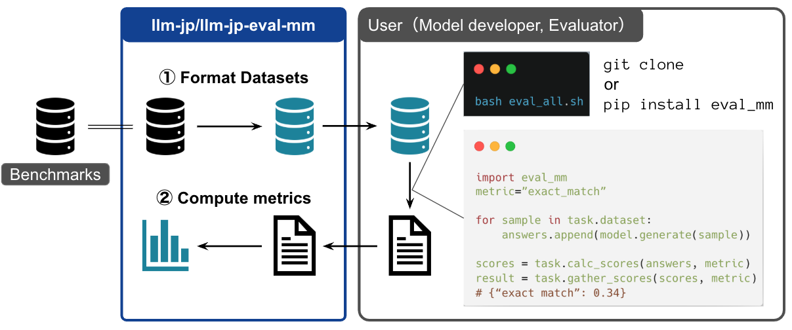

This post introduces [llm-jp-eval-mm](https://github.com/llm-jp/llm-jp-eval-mm), a tool for evaluating the Japanese-language performance of vision-language models, which I am developing together with [Silvia](https://github.com/Silviase) as part of the multimodal working group of LLM-jp.

## llm-jp-eval-mm

<figure>

<figcaption>Overview of llm-jp-eval-mm</figcaption>
</figure>

In recent years, many companies and research institutions have been actively developing vision-language models that can handle both text and images. However, benchmarking infrastructure for Japanese has lagged behind that for English, which made it difficult to evaluate these models properly.

llm-jp-eval-mm was developed to address this: it builds on existing Japanese benchmark tasks so that models can be evaluated on a common foundation. The tool is designed to be more lightweight than existing evaluation tools (e.g., [lmms-eval](https://github.com/EvolvingLMMs-Lab/lmms-eval)), which makes it easy to add new models and benchmark tasks.

### Available Tasks

The following tasks are currently available.

Japanese tasks

- [Japanese Heron Bench](https://huggingface.co/datasets/turing-motors/Japanese-Heron-Bench)
- [JA-VG-VQA500](https://huggingface.co/datasets/SakanaAI/JA-VG-VQA-500)
- [JA-VLM-Bench-In-the-Wild](https://huggingface.co/datasets/SakanaAI/JA-VLM-Bench-In-the-Wild)
- [JA-Multi-Image-VQA](https://huggingface.co/datasets/SakanaAI/JA-Multi-Image-VQA)
- [JDocQA](https://huggingface.co/datasets/shunk031/JDocQA)
- [JMMMU](https://huggingface.co/datasets/JMMMU/JMMMU)

English tasks

- [MMMU](https://huggingface.co/datasets/MMMU/MMMU)
- [LLaVA-Bench-In-the-Wild](https://huggingface.co/datasets/lmms-lab/llava-bench-in-the-wild)

## Usage

### Installation

The tool uses `uv`, a modern Python package manager, and you can set up the environment with the following command.

```bash
uv sync
```

### Evaluation

For example, to evaluate the model `llava-hf/llava-1.5-7b-hf` on the `japanese-heron-bench` task, follow these steps.

1. Install the required dependencies

```bash
uv sync --group normal
```

1. Run the evaluation

The following command specifies the model name, task name, evaluation metrics, and so on. Since we evaluate with `llm_as_a_judge` here, an OpenAI model is specified as the judge model (currently, only the Azure OpenAI API is supported).

```bash
uv run --group normal python examples/sample.py \
--model_id llava-hf/llava-1.5-7b-hf \
--task_id japanese-heron-bench  \
--result_dir test  \
--metrics "llm_as_a_judge_heron_bench" \
--judge_model "gpt-4o-2024-05-13" \
--overwrite
```

## Features and Design Choices

### Using uv Dependency Groups

Different vision-language models depend on different libraries, so dependency conflicts are common.
The tool uses `uv`'s [dependency groups](https://docs.astral.sh/uv/concepts/projects/dependencies/#dependency-groups), so by specifying a group name like this

```bash
uv run --group <group name> python
```

you can keep each model's dependencies properly managed.

### Lightweight Design

Evaluating a vision-language model breaks down into three main steps.

1. **Preparing the evaluation dataset** (`Task` class)
2. **Generating model outputs** (`VLM` class)
3. **Computing evaluation scores** (`Scorer` class)

Mapping each step to its own class makes the code easier to reuse and to test.

## Leaderboard

We publish a leaderboard built with llm-jp-eval-mm on the following website.

[https://llm-jp.github.io/llm-jp-eval-mm](https://llm-jp.github.io/llm-jp-eval-mm)

(The website was modeled on the [JMMMU](https://mmmu-japanese-benchmark.github.io/JMMMU/) website. Many thanks to its authors.)

## Conclusion

This post introduced [llm-jp-eval-mm](https://github.com/llm-jp/llm-jp-eval-mm), a tool for evaluating the Japanese-language performance of vision-language models.

Questions, as well as requests to add new tasks or models, are welcome via GitHub Issues and Pull Requests.

Also, [Silvia](https://github.com/Silviase) will present this tool at **NLP2025 in Nagasaki (March 2025)**. Please come by!

## References

- [llm-jp-eval-mm](https://github.com/llm-jp/llm-jp-eval-mm)
- [llm-jp-eval-mm leaderboard](https://llm-jp.github.io/llm-jp-eval-mm)
