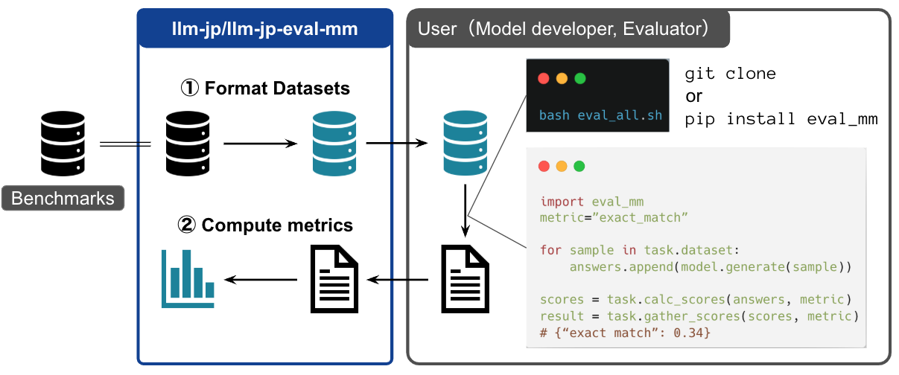

本稿では、LLM勉強会のマルチモーダルWGの活動で[Silvia](https://github.com/Silviase)さんと共同開発している [llm-jp-eval-mm](https://github.com/llm-jp/llm-jp-eval-mm)という、視覚言語モデルの日本語性能を評価するツールを紹介します。

## llm-jp-eval-mm

<figure>

<figcaption>llm-jp-eval-mmの全体像</figcaption>
</figure>

近年、テキストと画像の両方を扱える視覚言語モデルの開発が、多くの企業や研究機関で活発に進められています。しかし、日本語のベンチマーク環境は英語に比べて整備が遅れており、適切な評価を行うのが困難な状況にありました。

そこで、既存の日本語ベンチマークタスクを活用し、共通の基盤でモデル評価を行えるようにするために開発されたのが llm-jp-eval-mm です。本ツールは、既存の評価ツール（例：[lmms-eval](https://github.com/EvolvingLMMs-Lab/lmms-eval)）に比べて軽量に設計されており、モデルやベンチマークタスクの追加が容易になっています。

### 利用可能なタスク

現時点で、以下のタスクが利用できるようになっています。

日本語タスク

- [Japanese Heron Bench](https://huggingface.co/datasets/turing-motors/Japanese-Heron-Bench)
- [JA-VG-VQA500](https://huggingface.co/datasets/SakanaAI/JA-VG-VQA-500)
- [JA-VLM-Bench-In-the-Wild](https://huggingface.co/datasets/SakanaAI/JA-VLM-Bench-In-the-Wild)
- [JA-Multi-Image-VQA](https://huggingface.co/datasets/SakanaAI/JA-Multi-Image-VQA)
- [JDocQA](https://huggingface.co/datasets/shunk031/JDocQA)
- [JMMMU](https://huggingface.co/datasets/JMMMU/JMMMU)

英語タスク

- [MMMU](https://huggingface.co/datasets/MMMU/MMMU)
- [LLaVA-Bench-In-the-Wild](https://huggingface.co/datasets/lmms-lab/llava-bench-in-the-wild)

## 利用例

### インストール

本ツールは、モダンな Python パッケージマネージャー `uv` を利用しており、以下のコマンドで環境を整えることができます。

```bash
uv sync
```

### 評価

例えば、`llava-hf/llava-1.5-7b-hf` というモデルを `japanese-heron-bench` タスクで評価する場合、以下の手順で実行します。

1. 必要な依存関係をインストール

```bash
uv sync --group normal
```

1. 評価の実行

以下のコマンドで、モデル名・タスク名・評価メトリクスなどを指定します。ここでは `llm_as_a_judge` による評価を行うため、評価モデルとして OpenAI のモデルを指定しています (現在は Azure OpenAI API のみに対応)。

```bash
uv run --group normal python examples/sample.py \
--model_id llava-hf/llava-1.5-7b-hf \
--task_id japanese-heron-bench  \
--result_dir test  \
--metrics "llm_as_a_judge_heron_bench" \
--judge_model "gpt-4o-2024-05-13" \
--overwrite
```

## 特徴・工夫点

### uvのdependency groupsの活用

視覚言語モデルごとに依存するライブラリが異なるため、依存関係の衝突が発生しやすい問題があります。
本ツールでは `uv` の [dependency groups](https://docs.astral.sh/uv/concepts/projects/dependencies/#dependency-groups) を利用し

```bash
uv run --group <group name> python
```

のようにグループ名を指定することで、依存ライブラリを適切に管理できます。

### 軽量な設計

視覚言語モデルの評価は、主に以下の3つのステップに分かれます。

1. **評価データセットの準備**（`Task` クラス）
2. **モデルの出力生成**（`VLM` クラス）
3. **評価スコア算出**（`Scorer` クラス）

ステップとクラスを対応付けた設計により、コードの再利用性やテストのしやすさが向上しています。

## リーダーボード

以下のWebサイトにて、llm-jp-eval-mmを用いたリーダーボードを公開しています。

[https://llm-jp.github.io/llm-jp-eval-mm](https://llm-jp.github.io/llm-jp-eval-mm)

(Webサイトは[JMMMU](https://mmmu-japanese-benchmark.github.io/JMMMU/)のサイトを参考にさせていただきました。ありがとうございます。)

## おわりに

本稿では、視覚言語モデルの日本語性能を評価するツール [llm-jp-eval-mm](https://github.com/llm-jp/llm-jp-eval-mm) を紹介しました。

ご質問や、新たなタスク・モデルの追加に関するご要望は、GitHub の Issue や Pull Request でお待ちしております。

また、**NLP2025 in 長崎 (2025年3月)** では [Silvia](https://github.com/Silviase) さんが本ツールについて発表予定です。ぜひお越しください!

## 参考文献

- [llm-jp-eval-mm](https://github.com/llm-jp/llm-jp-eval-mm)
- [llm-jp-eval-mm リーダーボード](https://llm-jp.github.io/llm-jp-eval-mm)
