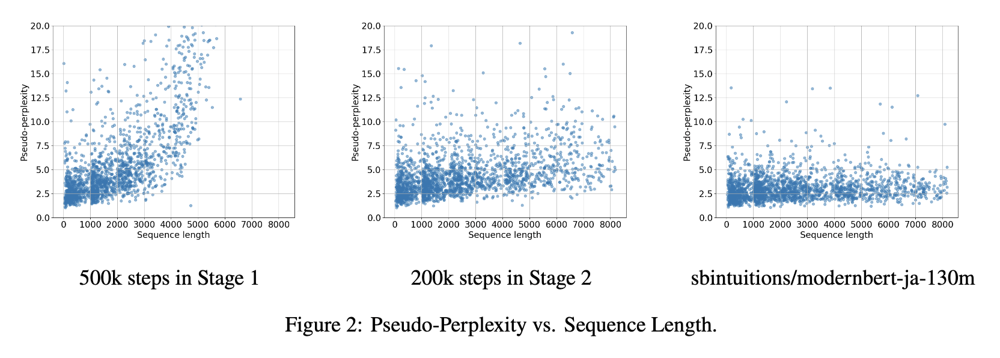
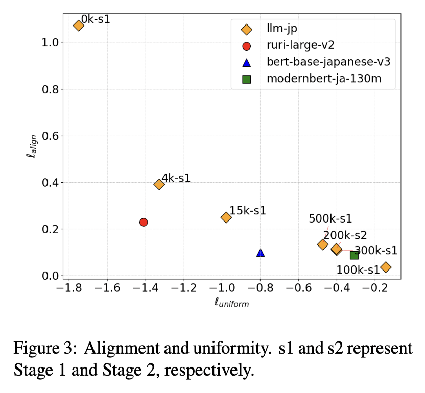

At LLM-jp, where I take part as a research assistant, we have developed [llm-jp-modernbert](https://huggingface.co/llm-jp/llm-jp-modernbert-base), a BERT model trained on a large-scale Japanese corpus with a maximum sequence length of 8192 tokens.

The model is based on [ModernBERT](https://arxiv.org/abs/2412.13663), a BERT model that incorporates techniques used in recent LLMs such as RoPE and FlashAttention, and uses [llm-jp-tokenizer v3](https://github.com/llm-jp/llm-jp-tokenizer) as its tokenizer. For training data, we used the Japanese subset (about 0.69T tokens) of llm-jp-corpus-v4, developed by LLMC. llm-jp-corpus-v4 is scheduled to be released in the future.

In evaluations on JGLUE subtasks, the model did not outperform existing models. However, evaluations with fill-in-the-blank tasks showed that it reflects recent information and has learned general knowledge well, possibly because llm-jp-corpus-v4 contains recent corpora.
We also used intermediate training checkpoints to evaluate the effect of extending the context length with the pseudo-perplexity used in the [NeoBERT](https://arxiv.org/abs/2502.19587) paper, and analyzed how sentence embeddings behave during training.

<figure>
  
  <figcaption>Pseudo-perplexity experiment</figcaption>
</figure>

<figure>
  
  <figcaption>Sentence embedding experiment</figcaption>
</figure>

For details on how the model was trained and on the evaluation and analysis results, please see our technical paper on arXiv.

The released resources are as follows.

- Model: [https://huggingface.co/llm-jp/llm-jp-modernbert-base](https://huggingface.co/llm-jp/llm-jp-modernbert-base)
- Code: [https://github.com/llm-jp/llm-jp-modernbert](https://github.com/llm-jp/llm-jp-modernbert)
  - Includes training code that supports large-scale datasets, and the code for the evaluations and analyses in the technical paper.
- Technical paper: [llm-jp-modernbert: A ModernBERT Model Trained on a Large-Scale Japanese Corpus with Long Context Length](https://arxiv.org/abs/2504.15544)

## References

- Warner et al., Smarter, Better, Faster, Longer: A Modern Bidirectional Encoder for Fast, Memory Efficient, and Long Context Finetuning and Inference, [https://arxiv.org/abs/2412.13663](https://arxiv.org/abs/2412.13663)
- Breton et al., NeoBERT: A Next-Generation BERT, [https://arxiv.org/abs/2502.19587](https://arxiv.org/abs/2502.19587)
