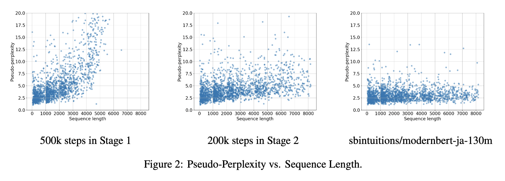
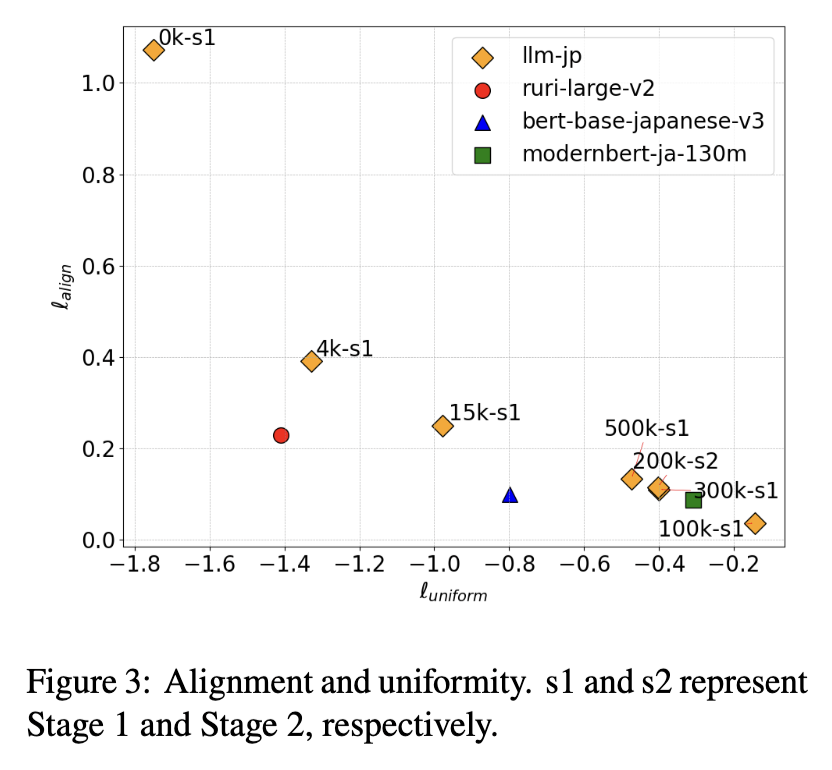

この度、リサーチアシスタントとして参加しているLLM勉強会にて、大規模日本語コーパスで学習された最大トークン長8192のBERTモデルである[llm-jp-modernbert](https://huggingface.co/llm-jp/llm-jp-modernbert-base)を開発しました。

このモデルは、RoPEやFlashAttentionなど最新のLLMに用いられている技術を取り入れたBERTモデルの[ModernBERT](https://arxiv.org/abs/2412.13663)をベースとし、トークナイザには[llm-jp-tokenizer v3](https://github.com/llm-jp/llm-jp-tokenizer)を用いています。学習データは、LLMCで開発された llm-jp-corpus-v4 の日本語サブセット (約0.69Tトークン) を用いました。なお、llm-jp-corpus-v4は今後公開される予定です。

JGLUEのサブタスクを用いた評価では既存モデルを上回りませんでしたが、穴埋め問題を用いた評価では、最新のコーパスが含まれたllm-jp-corpus-v4を用いたためか、最新の情報を反映したり、一般常識を上手く学習できていることがわかりました。
また、学習中のチェックポイントを活用して、コンテキスト長を伸ばした効果を[NeoBERT](https://arxiv.org/abs/2502.19587)の論文で用いられている疑似パープレキシティで評価したり、学習中の文埋め込みの挙動を分析しました。

<figure>
  
  <figcaption>疑似パープレキシティの実験</figcaption>
</figure>

<figure>
  
  <figcaption>文埋め込みの実験</figcaption>
</figure>

モデルの学習方法及び評価分析結果についてはarXivのテクニカルペーパーをご覧ください。

公開リソースはこちらです。

- モデル: [https://huggingface.co/llm-jp/llm-jp-modernbert-base](https://huggingface.co/llm-jp/llm-jp-modernbert-base)
- コード: [https://github.com/llm-jp/llm-jp-modernbert](https://github.com/llm-jp/llm-jp-modernbert)
  - 大規模データセットの学習に対応した学習コードと、テクニカルペーパーで行なった評価分析コードが含まれています。
- テクニカルペーパー: [llm-jp-modernbert: A ModernBERT Model Trained on a Large-Scale Japanese Corpus with Long Context Length](https://arxiv.org/abs/2504.15544)

## 参考文献

- Warner et al., Smarter, Better, Faster, Longer: A Modern Bidirectional Encoder for Fast, Memory Efficient, and Long Context Finetuning and Inference, [https://arxiv.org/abs/2412.13663](https://arxiv.org/abs/2412.13663)
- Breton et al., NeoBERT: A Next-Generation BERT, [https://arxiv.org/abs/2502.19587](https://arxiv.org/abs/2502.19587)
