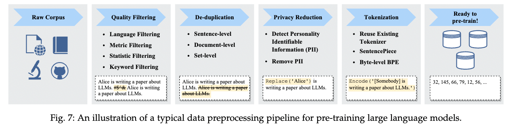
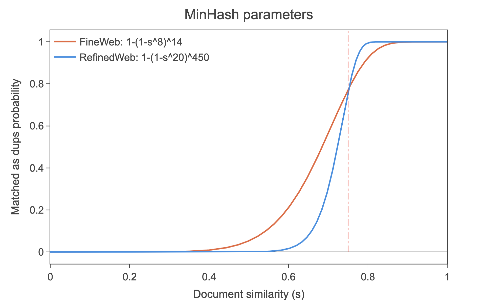

When building corpora for large language models, deduplicating the text data is considered an important step for improving performance and reducing privacy risks.
For this reason, corpus construction pipelines for large language models often include a De-duplication step (see the figure below).

<figure>
  
  <figcaption>Source: Wayne Xin Zhao et al. (2023), “A Survey of Large Language Models”</figcaption>
</figure>

Recent corpora for large language models range from hundreds of gigabytes to several terabytes, which makes deduplication computationally expensive. [MinHash](https://en.wikipedia.org/wiki/MinHash) is therefore commonly used as an efficient deduplication method. MinHash is a probabilistic method for efficiently estimating the similarity (the Jaccard index) between pairs of texts.

This post explains the basic idea and method of MinHash, and how to reduce the number of comparisons.

## Defining Duplication Between Text Pairs

When deduplicating the texts in a corpus, how you define a duplicate matters. The simplest approach is to treat only exact matches as duplicates. In real text data, however, the same content is often expressed differently, so exact matching alone may not be enough. A common approach is therefore to compute the similarity between texts and treat texts whose similarity is above a certain threshold as duplicates.

Text similarity can be measured with the [Jaccard index](https://en.wikipedia.org/wiki/Jaccard_index), [edit distance](https://en.wikipedia.org/wiki/Edit_distance), [cosine similarity](https://en.wikipedia.org/wiki/Cosine_similarity), and so on. Since MinHash, the topic of this post, is a similarity method based on the Jaccard index, we focus on the Jaccard index here.

## The Jaccard Index

The Jaccard index is a measure of similarity between two sets $A,B$, defined as follows.

$
J(A, B) = \frac{|A \cap B|}{|A \cup B|}
$

A nice property of the Jaccard index is the following.

- $0 \le J(A,B) \le 1$, where it is 0 when the intersection of $A, B$ is empty and 1 when $A=B$

In other words, when the elements of the two sets match exactly, the Jaccard index is 1. Conversely, when the two sets have no elements in common, the Jaccard index is 0.

To use the Jaccard index for the similarity of a text pair, we first convert each text into a set. Ways to do this include splitting the string into n-grams (e.g. "I have a pen" -> {"I hav", "have a", "ve a ", "e a p", " a pe", "a pen"}) and splitting it into words (e.g. "I have a pen" -> {"I", "have", "a", "pen"}).

As an example, let's compute the Jaccard index between “I have a pen” and “I have an apple”. Here we convert each text into a set by splitting it into words.

A = {”I”, “have”, “a”, “pen”}, B = {”I”, “have”, ”an”, ”apple”}

The Jaccard index is then

$$J(A, B) = \frac{\|A \cap B\|}{\|A \cup B\|} = \frac{\|{\text{”I”, “have”}}\|}{\|{\text{”I”, “have”, “a”, “pen”, “an”, “apple”}}\|} = \frac{2}{6} = \frac{1}{3}$$

## Computational Cost of the Jaccard Index

The Jaccard index can be implemented in Python as follows.

```python
def jaccard_similarity(A: set, B: set) -> float:
    intersection = len(A & B)
    union = len(A | B)
    return intersection / union
```

According to the [CPython documentation](https://wiki.python.org/moin/TimeComplexity), intersection has an average time complexity of $O(\min(len(A), len(B)))$ and a worst-case time complexity of $O(len(A) * len(B))$, while union has both an average and worst-case time complexity of $O(len(A) + len(B))$.
The average time complexity of the Jaccard index is therefore $O(len(A) + len(B))$, which is proportional to the length of the texts.
This makes the computation expensive for long texts, so computing a large number of Jaccard indices, as in deduplicating a large corpus, takes a very long time.

MinHash, a probabilistic method for efficiently estimating the Jaccard index, solves this problem.

## MinHash

MinHash is a probabilistic method for efficiently estimating the Jaccard index of sets $A,B$. The MinHash algorithm is as follows.

1. Convert each element of sets $A,B$ into a hash value with a hash function $h$. $$h(A) = \{h(a_1), h(a_2), ..., h(a_n)\}, h(B) = \{h(b_1), h(b_2), ..., h(b_m)\}$$
2. Take the minimum (the minhash) of the hash values of each of $A,B$. $h_{min}(A) = \min(h(A)), h_{min}(B) = \min(h(B))$
3. Then $P(h_{min}(A) = h_{min}(B)) = J(A, B)$ holds.

Let's consider why the probability that the minhashes of $A,B$ match equals the Jaccard index.

Let $$A=\{a,b,c,d\}, B =\{a, e\}$$.
Then $$A\cup B = \{a,b,c,d,e\}, A\cap B = \{a\}$$.

Now we compute the hash value of each element with the hash function $h$: $$h(A) = \{h(a), h(b), h(c), h(d)\}, h(B) = \{h(a), h(e)\}$$.
Here, there are as many distinct hash values as there are elements in $A \cup B$.

Therefore, for $\forall x \in A \cup B$, the probability that the hash value $h(x)$ is the minimum of $h(A\cup B)$ is $$\frac{1}{\|A \cup B\|}$$.

Moreover, $min(h(A)) = min(h(B))$ holds only when the minimum among the elements of $A \cup B$ belongs to $A \cap B$. The probability of this is $$\frac{\|A \cap B\|}{\|A \cup B\|}$$.

Therefore, $P(h_{min}(A) = h_{min}(B)) = J(A, B)$ holds.

From the above, we see that the probability that the minhashes of sets $$A,B$$ match
equals the Jaccard index.
This means that we can estimate the Jaccard index by computing the minhash of each set in advance and comparing them.

However, a single minhash pair is not enough to estimate a probability, so we use multiple hash functions, compute the fraction of minhashes that match, and use that as the estimate of the Jaccard index.
That is, using $k$ hash functions, we set $J(A, B) \approx \frac{1}{k} \sum_{i=1}^{k} I(h_i(A) = h_i(B))$.
The larger $k$ is, the more accurate the estimate.

## Computational Cost of MinHash

If $k$ minhashes have been computed in advance, the time complexity of computing the Jaccard index of two sets is $O(k)$.

Computing the minhash itself ($min(h(A))$), however, takes $O(\|A\|)$. Using minhashes just to compute a single similarity is therefore not efficient.

On the other hand, suppose there are many texts $T_1, \dots, T_n$ and queries $q_1, \dots, q_m$ whose similarity to them we want to compute. If we compute the minhashes of $T_1, \dots, T_n$ in advance, the time complexity of computing the similarity between a query $q$ and $T_1, \dots, T_n$ is $O(n \times k)$. When there are many queries, the cost of precomputing the minhashes of $T_1, \dots, T_n$ becomes negligible, so MinHash lets us compute similarities quickly. Deduplicating a large corpus requires computing the similarity of every pair of texts, which makes MinHash very useful.

## Reducing the Number of Minhash Comparisons

MinHash estimates the Jaccard index by comparing $k$ minhashes. Comparing $k$ minhashes, however, requires $k$ comparisons. Since an accurate estimate of the Jaccard index requires a large $k$, the number of comparisons grows. To reduce the number of comparisons at the expense of accuracy, the minhashes are divided into buckets. The bucketing method is described below.

Let the number of minhashes be $k = b * r$, and divide the $k$ minhashes into $r$ buckets. Each bucket holds $b$ minhashes.
We then concatenate the minhashes within each bucket.

Next, after dividing the minhashes of the two sets $A,B$ into buckets, we compare whether each pair of corresponding buckets matches. This reduces the number of comparisons to $r$.

Then, for sets $d_i,d_j$ with $Jaccard(d_i,d_j)=s$, the probability that at least one of the $r$ buckets matches is as follows.

$$
P(d_i,d_j\mid Jaccard(d_i,d_j)=s) = 1-(1-s^b)^r
$$

Derivation: The probability that all $b$ minhashes in a bucket match is $s^b$. So the probability that a bucket does not match is $(1-s^b)$. The probability that none of the $r$ buckets match is $(1-s^b)^r$. So the probability that at least one of the $r$ buckets matches is $1 - (1-s^b)^r$. ■

In this way, by comparing in coarse units called buckets and treating a pair as duplicates if at least one bucket matches, we can reduce the number of comparisons. However, there is a chance of missing a duplicate (a false negative) and of wrongly judging a pair to match (a false positive).
By tuning the bucket size and the number of buckets, we can adjust the trade-off between computational cost and accuracy.

Below is an example of the MinHash parameters used for the corpus [FineWeb](https://huggingface.co/spaces/HuggingFaceFW/blogpost-fineweb-v1). You can see that the larger the similarity $s$, the higher the probability that a bucket matches.

<figure>
  
  <figcaption>Source: <a href="https://huggingface.co/spaces/HuggingFaceFW/blogpost-fineweb-v1">FineWeb blog</a></figcaption>
</figure>

Thus, dividing the $k$ minhashes into buckets reduces the number of comparisons.

## Summary and Thoughts

MinHash is built on the interesting idea that the Jaccard index can be estimated by comparing minhashes, and the algorithm itself turned out to be very simple.

While looking into MinHash, I found that [Okanohara-san](https://tech.preferred.jp/ja/blog/minhash/) and [Akiba-san](https://www.slideshare.net/slideshow/minhash/35256156) had published an article and slides on MinHash about ten years ago, which shows that it is a long-established method. It is interesting that it is attracting a lot of attention again now.

Also, in developing large language models, attention tends to go to pretraining and fine-tuning, but corpus construction, which has to handle large-scale data, relies on parallel processing over many CPU cores and on classical algorithms such as MinHash and clustering. I found it an interesting field where knowledge from computer science can be applied broadly.

## References

- Broder, [On the resemblance and containment of documents](https://www.cs.princeton.edu/courses/archive/spring13/cos598C/broder97resemblance.pdf)

This is the original MinHash paper.

- Leskovec et al., [Mining of Massive Datasets - Chapter 3 Finding Similar Items](http://infolab.stanford.edu/~ullman/mmds/ch3n.pdf#page=10.28)
- Lee et al., [Deduplicating Training Data Makes Language Models Better](https://arxiv.org/abs/2107.06499)
- Kandpal et al., [Deduplicating Training Data Mitigates Privacy Risks in Language Models](https://arxiv.org/abs/2202.06539)
- [FineWeb: decanting the web for the finest text data at scale](https://huggingface.co/spaces/HuggingFaceFW/blogpost-fineweb-v1)

A blog post by the Hugging Face team packed with insights on building large-scale corpora. It includes extensive discussion of de-duplication.
