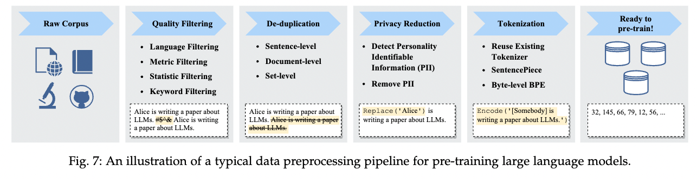
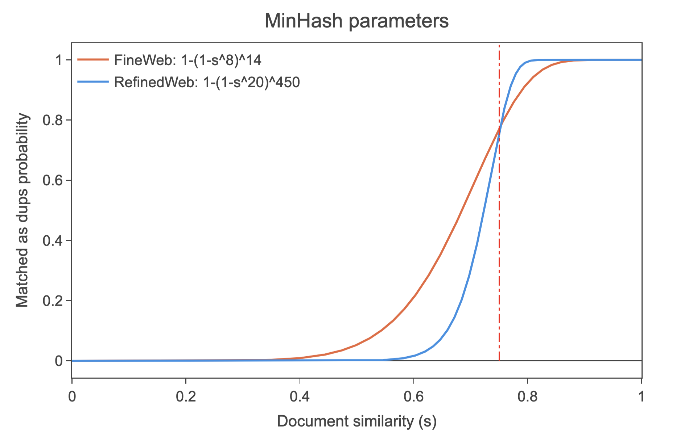

大規模言語モデルのコーパス構築において、テキストデータの重複除去は、性能の向上やプライバシーリスクの低減に重要な処理と考えられています。
そのため、大規模言語モデルのコーパス構築のフローにDe-duplicationのステップが含まれていることが多いです (以下の図参照)。

<figure>
  
  <figcaption>出典: Wayne Xin Zhao et al. (2023), “A Survey of Large Language Models”</figcaption>
</figure>

最近の大規模言語モデルのコーパスのサイズは数百GBから数TBにも及ぶため、重複除去は計算コストが高い処理となります。そこで、効率的な重複除去手法として[MinHash](https://en.wikipedia.org/wiki/MinHash)がよく用いられています。MinHashはテキスト対同士の類似度(Jaccard係数)を効率的に推定する確率的手法です。

本稿では、MinHashの基本的なアイデアと方法、比較回数の削減方法について説明します。

## テキスト対の重複の定義

コーパスに含まれるテキストの重複除去を行う上で、重複をどのように定義するかが重要です。最も単純な方法は、テキストの完全一致を重複とみなす方法です。しかし、実際のテキストデータには、同じ内容であっても、表現が異なる場合が多く、完全一致だけでは不十分な場合があります。そのため、テキストの類似度を計算し、一定の閾値以上の類似度を持つテキストを重複とみなす方法が用いられます。

テキストの類似度の計算方法には、[Jaccard係数](https://en.wikipedia.org/wiki/Jaccard_index)や[編集距離](https://en.wikipedia.org/wiki/Edit_distance)、[コサイン類似度](https://en.wikipedia.org/wiki/Cosine_similarity)などが考えられますが、今回取り上げるMinHashは、Jaccard係数に基づいた類似度計算手法であるため、ここではJaccard係数について説明します。

## Jaccard係数

Jaccard係数は、2つの集合$A,B$の類似度を測る指標の1つで、以下の式で定義されます。

$
J(A, B) = \frac{|A \cap B|}{|A \cup B|}
$

Jaccard係数の良い性質として、以下が挙げられます。

- $0 \le J(A,B) \le 1$、ただし、0の時は$A, B$ の積集合が空、1の時は、$A=B$

つまり、集合同士の要素が完全に一致する場合、Jaccard係数は1になります。逆に、2つの集合の要素が全く一致しない場合、Jaccard係数は0になります。

Jaccard係数をテキスト対の類似度計算に用いる場合は、テキストを集合に変換してから計算します。テキストを集合に変換する方法としては、例えば、文字列をn-gramに分割する方法(e.g. "I have a pen" -> {"I hav", "have a", "ve a ", "e a p", " a pe", "a pen"})や、単語に分割する方法(e.g. "I have a pen" -> {"I", "have", "a", "pen"})があります。

例として、“I have a pen”と“I have an apple”のJaccard係数を計算してみましょう。今回はテキストを単語に分割して集合に変換します。

A = {”I”, “have”, “a”, “pen”}, B = {”I”, “have”, ”an”, ”apple”}

この時のJaccard係数は、

$$J(A, B) = \frac{\|A \cap B\|}{\|A \cup B\|} = \frac{\|{\text{”I”, “have”}}\|}{\|{\text{”I”, “have”, “a”, “pen”, “an”, “apple”}}\|} = \frac{2}{6} = \frac{1}{3}$$

となります。

## Jaccard係数の計算量

Jaccard係数は、Pythonで以下のように実装できます。

```python
def jaccard_similarity(A: set, B: set) -> float:
    intersection = len(A & B)
    union = len(A | B)
    return intersection / union
```

[CPythonのdocument](https://wiki.python.org/moin/TimeComplexity) を見ると、intersectionの平均時間計算量は$O(\min(len(A), len(B)))$、最悪時間計算量は$O(len(A) * len(B))$ であり、unionの平均時間計算量、最悪時間計算量はどちらも$O(len(A) + len(B))$ です。
よって、Jaccard係数の平均時間計算量は$O(len(A) + len(B))$ となり、テキストの長さに比例します。
これは、テキストが長い場合に計算コストが高くなるため、大規模なコーパスの重複除去などで大量にJaccard係数を計算する場合、非常に時間がかかることになります。

MinHashは、Jaccard係数を効率的に推定する確率的手法であり、この問題を解決します。

## MinHash

MinHashは、集合$A,B$のJaccard係数を効率的に推定する確率的手法です。MinHashのアルゴリズムは以下の通りです。

1. 集合$A,B$の各要素をハッシュ関数$h$でハッシュ値に変換する。$$h(A) = \{h(a_1), h(a_2), ..., h(a_n)\}, h(B) = \{h(b_1), h(b_2), ..., h(b_m)\}$$
2. 集合$A,B$のハッシュ値のうち、最小値(minhash)を取得する。$h_{min}(A) = \min(h(A)), h_{min}(B) = \min(h(B))$
3. この時、$P(h_{min}(A) = h_{min}(B)) = J(A, B)$ が成り立つ。

なぜ $A,B$ のminhashが一致する確率がJaccard係数と等しいか考えてみます。

$$A=\{a,b,c,d\}, B =\{a, e\}$$ とします。
この時、$$A\cup B = \{a,b,c,d,e\}, A\cap B = \{a\}$$ です。

ここで、ハッシュ関数$h$を用いて各要素のハッシュ値を計算します。$$h(A) = \{h(a), h(b), h(c), h(d)\}, h(B) = \{h(a), h(e)\}$$ です。
この時、ハッシュ値は $A \cup B$ の要素分だけ現れます。

よって、$\forall x \in A \cup B$ のハッシュ値 $h(x)$ が $h(A\cup B)$ で最小値となる確率は $$\frac{1}{\|A \cup B\|}$$ です。

また、$min(h(A)) = min(h(B))$となるのは、$A \cup B$ の要素のうち、$A \cap B$ の要素が最小値となる時に限ります。この確率は、$$\frac{\|A \cap B\|}{\|A \cup B\|}$$ です。

よって、$P(h_{min}(A) = h_{min}(B)) = J(A, B)$ が成り立ちます。

以上から、ある集合$$A,B$$のminhashが一致する確率は、
Jaccard係数と等しいことがわかります。
この結果から、各集合のminhashを計算しておき、それらを比較することで、Jaccard係数を推定することができます。

ただ、一つのminhash対のみでは確率値を推定することができないため、複数のハッシュ関数を用いてminhashが一致する割合を計算し、それをJaccard係数の推定値とします。
すなわち、$k$個のハッシュ関数を用いて、$J(A, B) \approx \frac{1}{k} \sum_{i=1}^{k} I(h_i(A) = h_i(B))$ とします。
$k$の値が大きいほど、推定が正確になります。

## MinHashの計算量

あらかじめ$k$個のminhashが計算されている場合、2つの集合のJaccard係数を計算する時間計算量は$O(k)$ です。

ただし、minhashの計算自体($min(h(A))$)には、$O(\|A\|)$ かかります。そのため、一回の類似度計算をするためだけにminhashを使うのは効率的ではありません。

逆に、テキスト$T_1, \dots, T_n$が大量にあって、それらとの類似度を計算するクエリ$q_1, \dots, q_m$がある場合、$T_1, \dots, T_n$のminhashを計算しておけば、クエリ$q$と$T_1, \dots, T_n$の類似度を計算する時間計算量は$O(n \times k)$ です。クエリ数が多い場合は、$T_1, \dots, T_n$のminhashの前計算が無視できるため、MinHashを使うことで高速に類似度を計算することができます。大規模コーパスの重複除去ではテキスト全対の類似度を計算する必要があるため、MinHashは非常に有用となります。

## minhashの比較回数を減らす方法

MinHashでは、$k$個のminhashの比較を行うことで、Jaccard係数を推定します。しかし、$k$個のminhashを比較するためには、$k$回の比較が必要となります。Jaccard係数の推定を正確に行うためには、$k$が大きい必要があるため、比較回数が多くなります。正確性を犠牲として比較回数を減らすために、minhashをバケットに分ける方法が用いられます。以下に、バケットに分ける方法について説明します。

minhashの数$k = b * r$ として、$k$個のminhashを、$r$個のバケットに分けます。一つのバケットには、$b$個のminhashが入ります。
さらに、バケットのminhashを連結します。

そして、2つの集合$A,B$のminhashをバケットに分けた後、それぞれのバケットが一致するかを比較します。これにより比較回数は$r$回になります。

この時、集合 $d_i,d_j$ が $Jaccard(d_i,d_j)=s$ の時、$r$個のバケットが一つ以上一致する確率は以下となります。

$$
P(d_i,d_j\mid Jaccard(d_i,d_j)=s) = 1-(1-s^b)^r
$$

導出: 1つのバケットに入る$b$個のminhashが全て一致する確率は $s^b$。よって、バケットが一致しない確率は $(1-s^b)$。$r$個のバケット全てが一致しない確率は $(1-s^b)^r$。よって、$r$個のバケットのいずれか一つ以上が一致する確率は $1 - (1-s^b)^r$ となる。■

このように、バケットという大まかな単位で比較し、一つ以上のバケットが一致したら重複とみなすことで、比較回数を減らすことができます。ただし、見逃しをする可能性(false negative)や、誤って一致と判定してしまう可能性(false positive)があります。
バケットのサイズ、バケットの数を調整することで、計算量と正確性のトレードオフを調整することができます。

以下は、[FineWeb](https://huggingface.co/spaces/HuggingFaceFW/blogpost-fineweb-v1) というコーパスにおいて用いられたMinHashのパラメータの例です。類似度$s$が大きいほどバケットが一致する確率が高くなることがわかります。

<figure>
  
  <figcaption>出典: <a href="https://huggingface.co/spaces/HuggingFaceFW/blogpost-fineweb-v1">FineWeb blog</a></figcaption>
</figure>

このように$k$ 個のminhashをバケットに分割することで、比較回数を減らすことができます。

## まとめと感想

MinHashは、Jaccard係数の計算をminhashの比較で推定できるという面白いアイデアで、アルゴリズム自体も非常にシンプルであることがわかりました。

MinHashについて調べてみると、約十年ほど前に、[岡野原さん](https://tech.preferred.jp/ja/blog/minhash/)や[秋葉さん](https://www.slideshare.net/slideshow/minhash/35256156)がMinHashに関する記事やスライドをuploadされており、長い間使われている手法であることがわかりました。今再び大きな注目を浴びているのは面白いですね。

また、大規模言語モデルの開発においては、事前学習、ファインチューニングの部分に目が行きがちですが、コーパス構築の部分は、大規模データを扱うために、大量のCPUコアを用いた並行処理やMinHashやクラスタリングなどの古典的なアルゴリズムが用いられており、コンピュータサイエンスの知見が広く活かせる面白い分野だと感じました。

## 参考文献

- Broder, [On the resemblance and containment of documents](https://www.cs.princeton.edu/courses/archive/spring13/cos598C/broder97resemblance.pdf)

こちらはMinHashの元論文です。

- Leskovec et al., [Mining of Massive Datasets - Chapter 3 Finding Similar Items](http://infolab.stanford.edu/~ullman/mmds/ch3n.pdf#page=10.28)
- Lee et al., [Deduplicating Training Data Makes Language Models Better](https://arxiv.org/abs/2107.06499)
- Kandpal et al., [Deduplicating Training Data Mitigates Privacy Risks in Language Models](https://arxiv.org/abs/2202.06539)
- [FineWeb: decanting the web for the finest text data at scale](https://huggingface.co/spaces/HuggingFaceFW/blogpost-fineweb-v1)

大規模コーパス構築の知見が詰まったHuggingFaceチームによるブログです。De-duplicationの議論がたくさん述べられています。
