I recently attended [NAACL](https://2025.naacl.org/), one of the top international conferences in natural language processing, held in Albuquerque from April 30 to May 2, 2025.
This post is a record of my time at NAACL 2025.

This trip was both my first time abroad and my first time attending a top international conference. I hope to share plenty of experiences that only a first-timer would have.

I presented a poster of a paper accepted to the Student Research Workshop (SRW). For the content of the paper, please see [Developing Japanese CLIP Models Leveraging an Open-weight LLM for Large-scale Dataset Translation](https://aclanthology.org/2025.naacl-srw.15/).

## Albuquerque

[Albuquerque](https://ja.wikipedia.org/wiki/%E3%82%A2%E3%83%AB%E3%83%90%E3%82%AB%E3%83%BC%E3%82%AD) is a city in the US state of New Mexico, which borders Mexico. It sits at the foot of the Rocky Mountains, and the Rio Grande flows through the middle of the city.
Its climate is a semi-arid steppe climate.
Its population is about 550,000, comparable to Himeji in Japan. The city's history goes back to before the founding of the United States.
I was told that its crime rate is among the ten worst in the United States.

## Getting to Albuquerque

I left Kyoto on the morning of April 29 and flew to Albuquerque via Itami, Haneda, and Dallas.

<figure>
  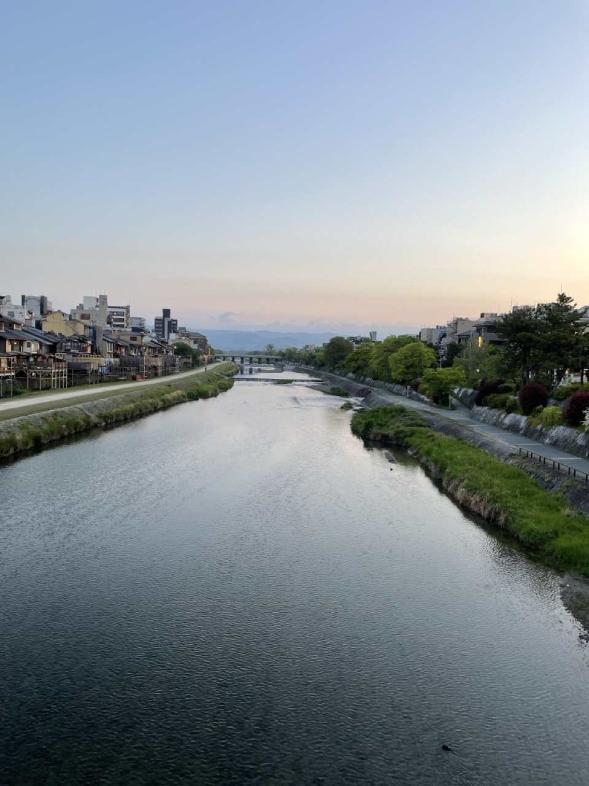
  <figcaption>Saying goodbye to the Kamo River</figcaption>
</figure>

On the flight from Haneda to Dallas, I chatted with the person sitting next to me, who lives in Arizona. They had been visiting Oita to see their Japanese uncle, and had apparently been to Japan as many as ten times. They told me all sorts of things about the area around Albuquerque. They seemed to be a car enthusiast.

Meals were served on the international flight. Since it was JAL food, it suited Japanese tastes and was very good.

From the sky over the US, I could see desert-like land and fields irrigated by [center pivot](https://ja.wikipedia.org/wiki/%E3%82%BB%E3%83%B3%E3%82%BF%E3%83%BC%E3%83%94%E3%83%9C%E3%83%83%E3%83%88) systems.

<figure>
  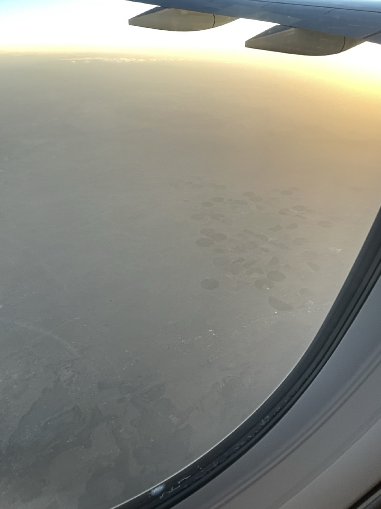
  <figcaption>Fields irrigated by center pivots</figcaption>
</figure>

When we arrived at Dallas airport, I walked toward the exit with the person from Arizona. As soon as we landed, they started jogging off somewhere, and I wondered what was going on; it seems they wanted to cut down their wait at customs. I ended up waiting in line for about an hour and a half.
At customs, they checked the purpose and length of my trip and my return boarding pass, and also took my fingerprints. I got through without any problems, but every now and then someone was taken to a separate room.

Inside Dallas airport there was a convenience store, where I bought some water. This was my first purchase abroad. I paid with Visa contactless without any issues. A 500 ml bottle of water cost an unbelievable 4 dollars, but it tasted no different from water in Japan.

<figure>
  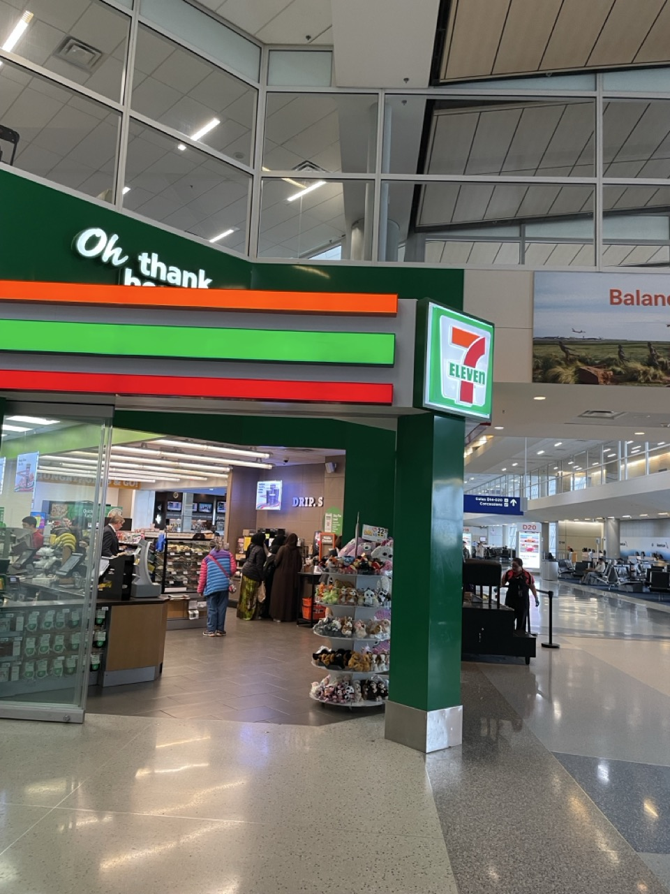
  <figcaption>Convenience store</figcaption>
</figure>

At the airport, I also ran into NAACL attendees at the gate for Albuquerque.
It was a fun experience that you only get at an international conference where many researchers gather in one place.

## From Albuquerque Airport to the Venue

After arriving at Albuquerque airport, I walked to the venue, the convention center, so that I could experience the actual streets of the city. Google Maps said it would take about an hour and a half on foot.
Since I had heard the area was unsafe, I stayed alert to my surroundings as I walked.
That said, the roads in Albuquerque are very wide and you can see far around you, so it did not actually feel that dangerous.

<figure>
  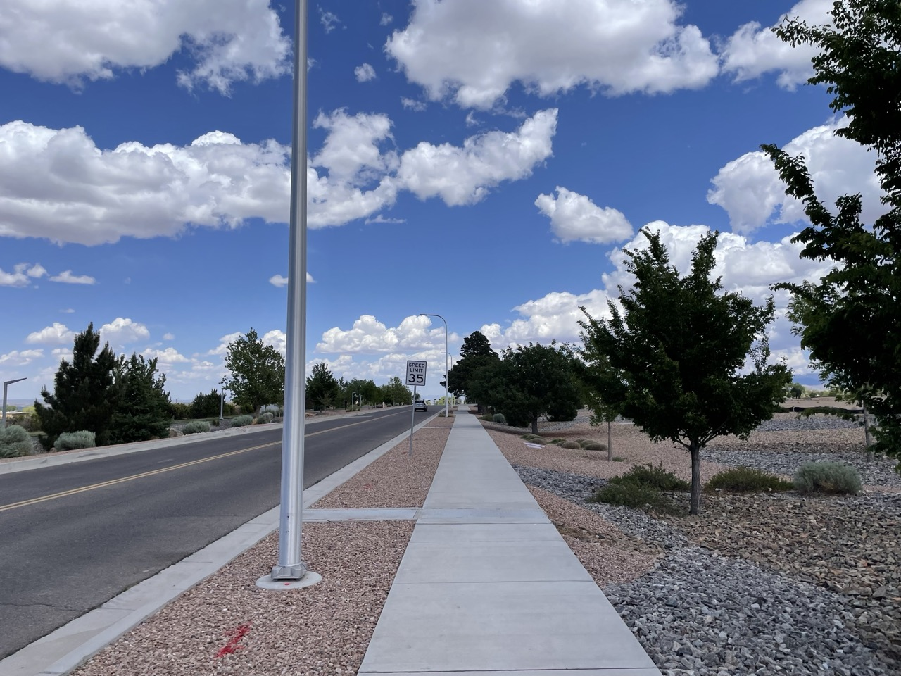
  <figcaption>The road in front of the airport</figcaption>
</figure>

The first thing I encountered was a pedestrian signal. Unlike in Japan, it seemed you have to press a button when you want to cross.
The red signal shows a raised hand, a design that could easily trick Japanese people, who are taught to raise their hand when crossing at a crosswalk, into mistaking red for green.

  

    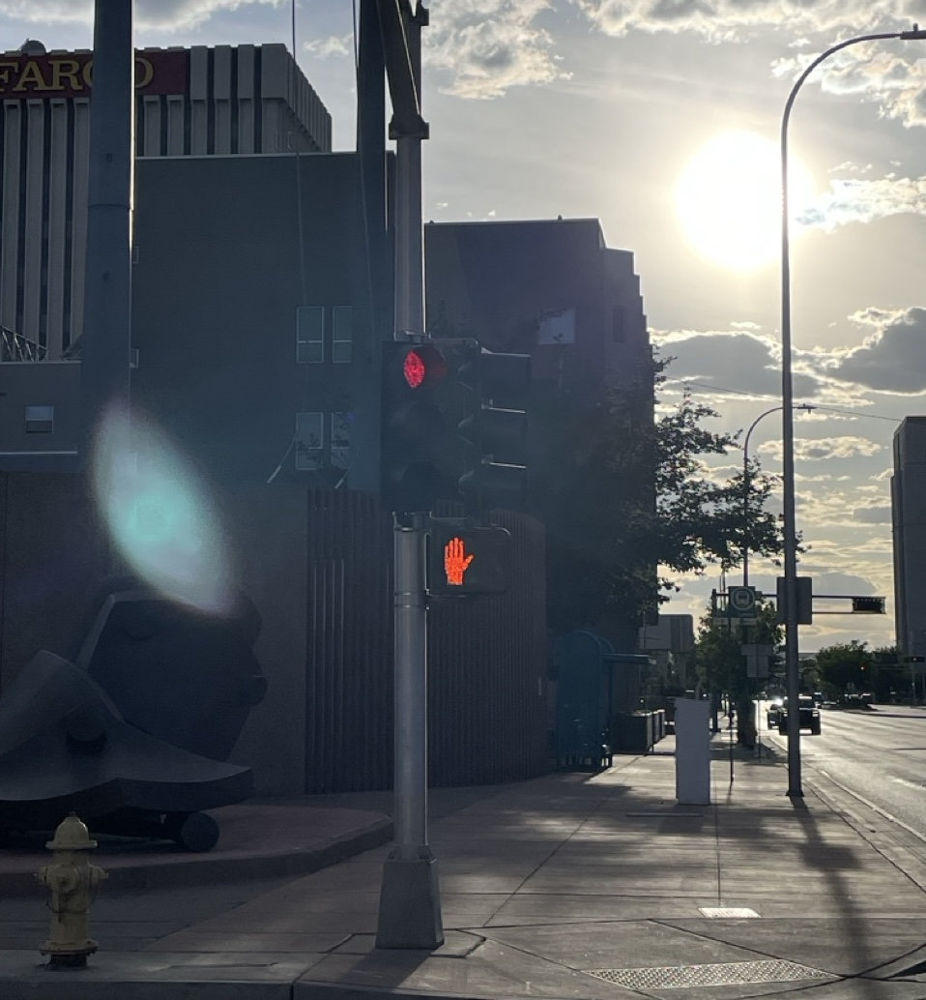
    
Red signal.

  

  

    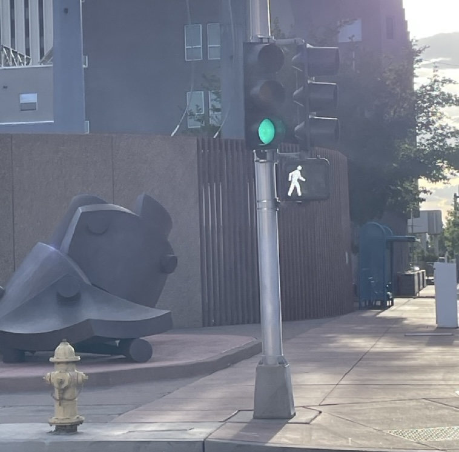
    
Green signal. Go, go!

  

  

    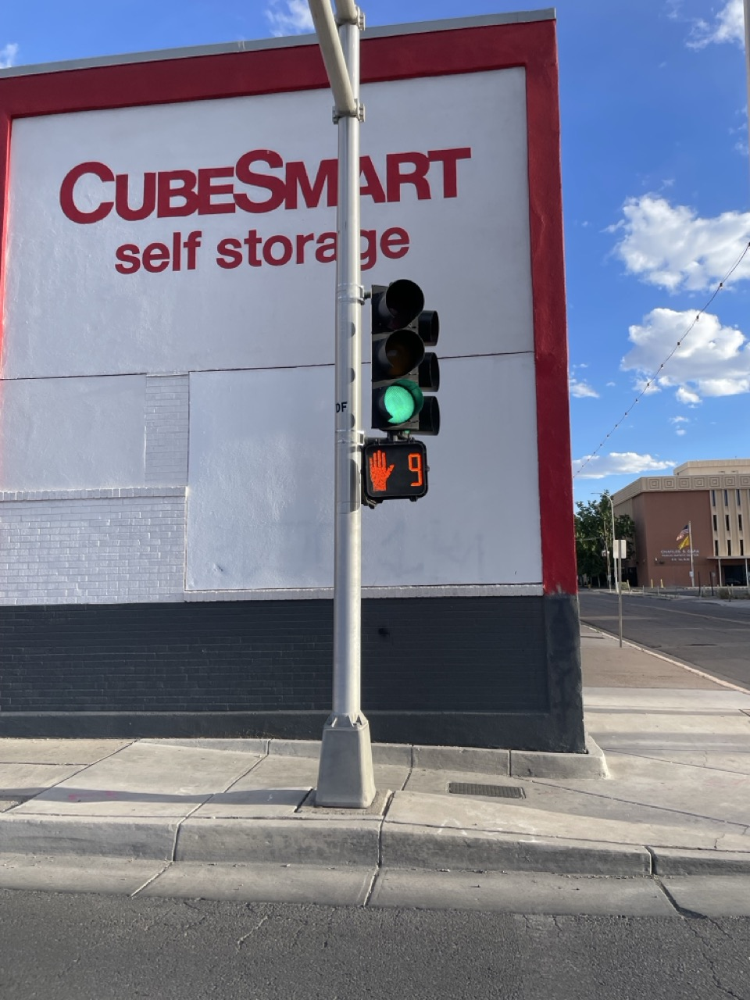
    
Five seconds until red.

  

Having safely crossed, I kept walking steadily along the road.
I was surprised by how wide the roads were, and by how heavy the car traffic was while there were almost no pedestrians.
There were also shops selling a mysterious leaf, as common as convenience stores.

<figure>
  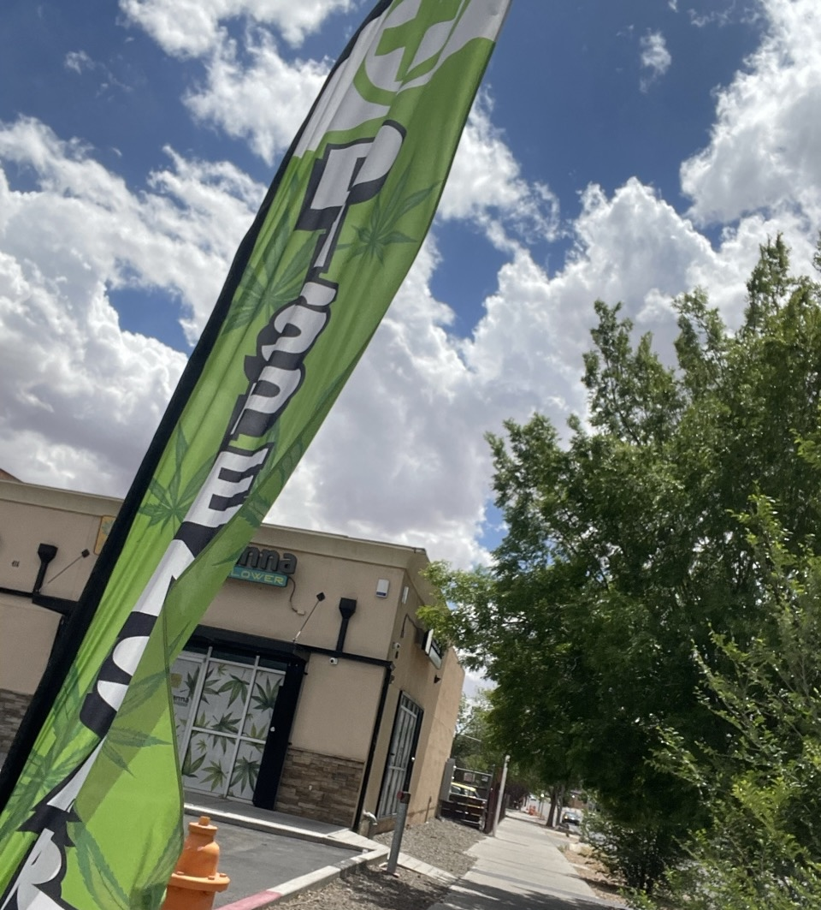
  <figcaption>A shop selling a mysterious leaf</figcaption>
</figure>

Along the way, I also saw people who seemed to be homeless. When I did, I tried to pass by at a quick pace.

As I kept going, I wandered into a residential area. Many of the houses looked as if they were made of earth. These seem to be traditional buildings made of a material called [adobe](https://ja.wikipedia.org/wiki/%E3%82%A2%E3%83%89%E3%83%99). The uniform look was really nice.
There was a large trash bin in front of each house.
It seems that, unlike in Japan, there are no designated garbage collection points for each area. I also saw homeless people rummaging through these bins.

Along the way, I happened upon the University of New Mexico. Walking around campus, I saw many students enjoying campus life, and I got a little taste of what studying abroad might feel like.
With so many students around, I could walk around the campus without being too much on guard.

<figure>
  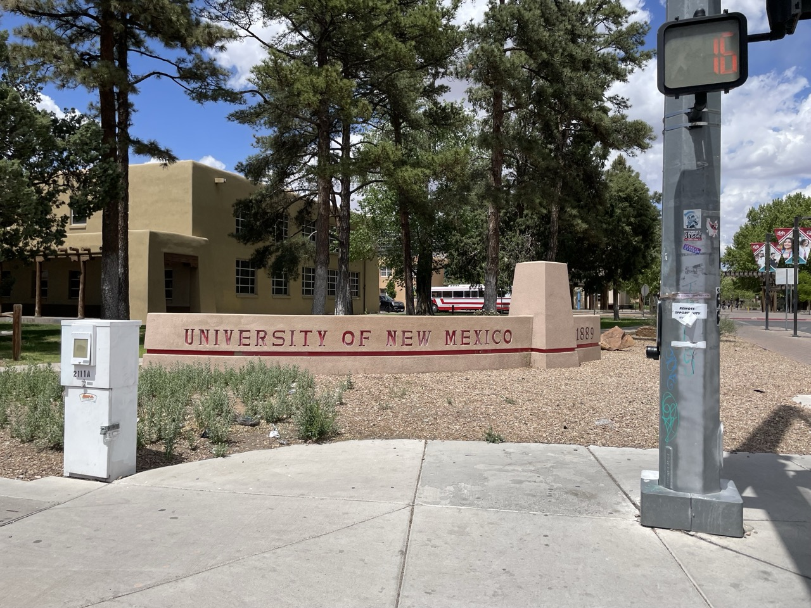
  <figcaption>University of New Mexico</figcaption>
</figure>

Once I reached the convention center, I had lunch. I tried a hamburger at [Stackers Burger](https://maps.app.goo.gl/wTZBeyDhtMERzeDJ6?g_st=com.google.maps.preview.copy), which seemed to have good ratings on Google Maps. It had a very spicy flavor and authentic meat, and it was delicious. Maybe it was too spicy, or maybe it was the fatigue from the trip, but my hands felt a bit numb; still, it was the best hamburger I have ever had.
When I finished and went to return my tray, a customer who had just come in suddenly took it from me... or so I thought, but they were actually returning it for me. It was a moment that made me feel the kindness of the locals.

<figure>
  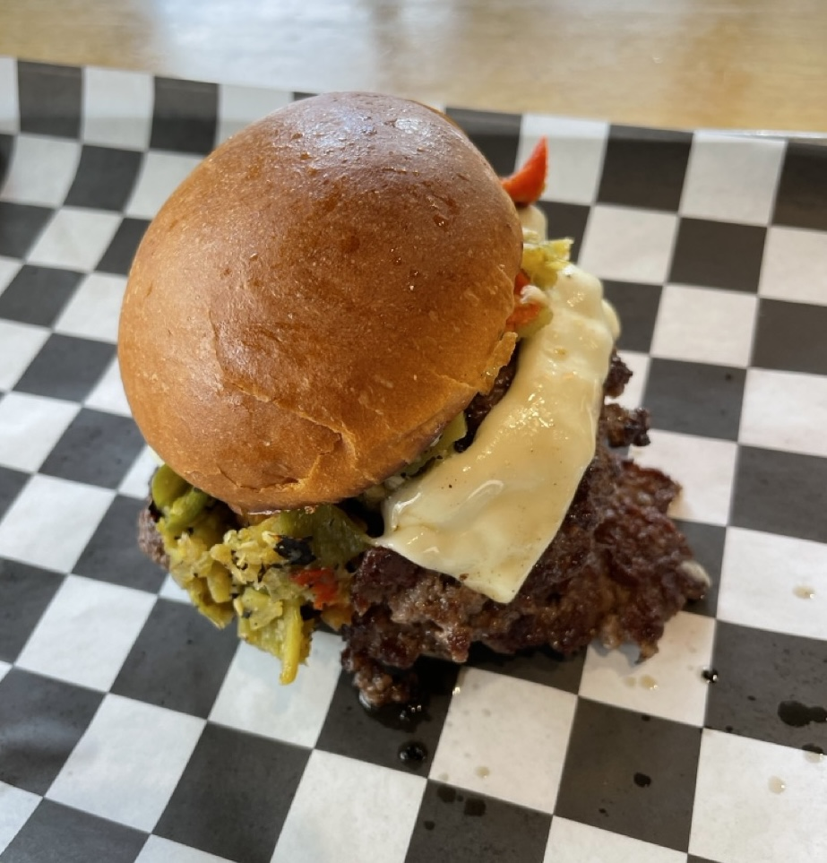
  <figcaption>A hamburger at Stackers Burger</figcaption>
</figure>

## Main Conference Day 1

The conference began. I was able to talk with many researchers at the poster sessions and in the break areas.
Because the poster area and the break area were in the same large hall, I could talk with someone in the break area and then meet them again at their poster to hear about their work, which was fun.

<figure>
  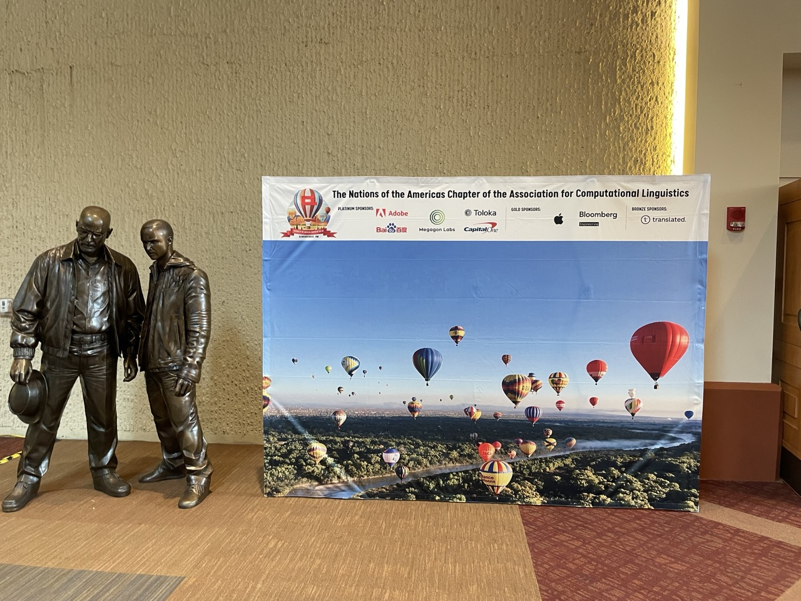
  <figcaption>The NAACL 2025 venue</figcaption>
</figure>

At the venue, many people asked for my LinkedIn account as a way to exchange contacts. It was the first time I realized how widespread LinkedIn is among researchers overseas. On the other hand, X (Twitter) did not seem to be used much.

In the afternoon, I gave my poster presentation. One of the people who listened told me that reporting negative results is also very valuable, which made me happy.
Although SRW is a workshop, we presented alongside the main conference poster sessions, so I got to experience the atmosphere of a real international conference.

## Main Conference Day 2

I attended the keynote by [Mike Lewis](https://scholar.google.com/citations?user=SnQnQicAAAAJ&hl=en) from Meta. The talk was about LLM pretraining, and what stuck with me was his recommendation that, when predicting downstream task performance during pretraining, you should use negative log likelihood rather than measuring accuracy on benchmark tasks.

<figure>
  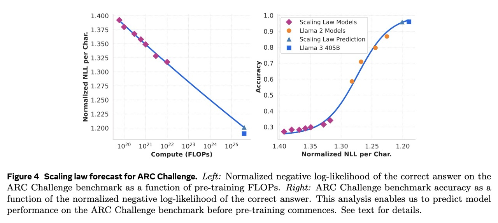
  <figcaption>From The Llama 3 Herd of Models</figcaption>
</figure>

After that, I managed to talk to [Graham Neubig](https://www.phontron.com/) from CMU, who had joined the SRW faculty session event. I learned a lot about the earliest days of [OpenHands](https://github.com/All-Hands-AI/OpenHands), and at the end he gave me an All Hands sticker.

During the lunch break, I went to Old Town, a famous spot in Albuquerque about a 30-minute walk from the venue. In Old Town I saw lots of adobe architecture, and I visited the Albuquerque Museum and the New Mexico Museum of Natural History and Science. They were very large for the price, and I came away satisfied.

  <figure style="margin: 0; min-width: 200px; max-width: 45%;">
    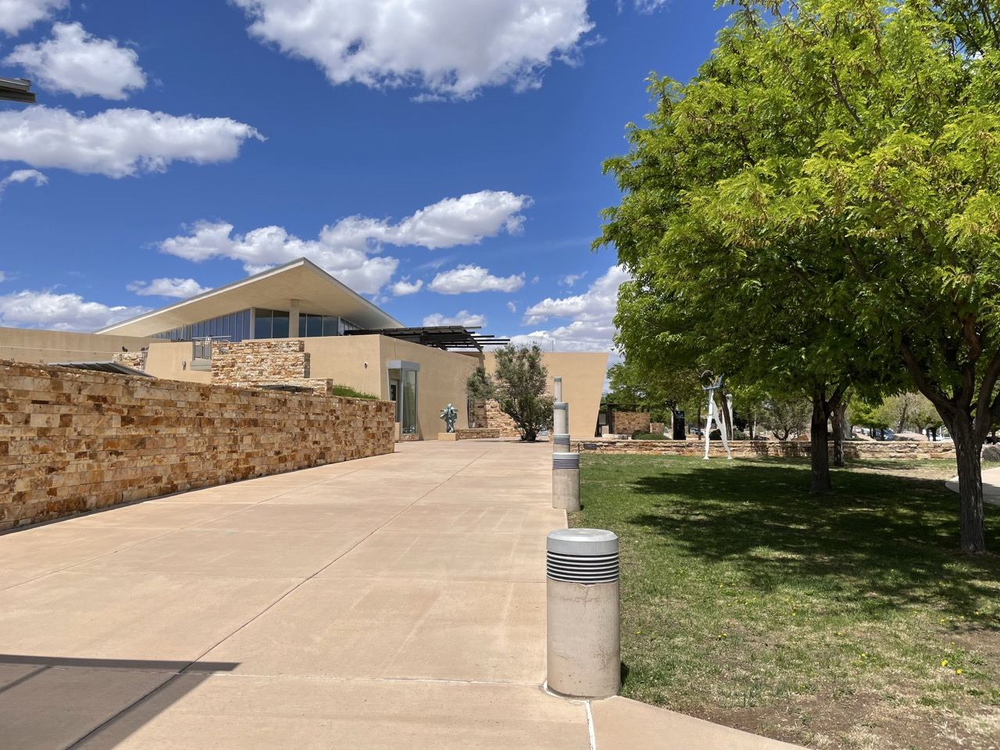
    <figcaption style="margin-top: 5px;">Albuquerque Museum</figcaption>
  </figure>

  <figure style="margin: 0; min-width: 200px; max-width: 45%;">
    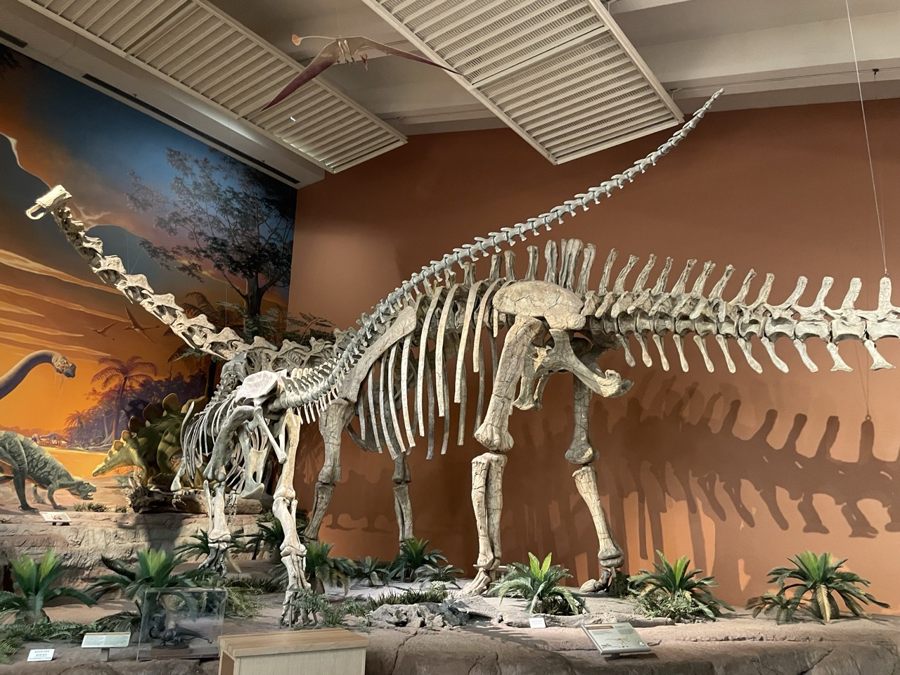
    <figcaption style="margin-top: 5px;">New Mexico Museum of Natural History and Science</figcaption>
  </figure>

On the way back from Old Town, I also stopped by a local grocery store. It was basically like those in Japan, but all the food came in big sizes.

<figure>
  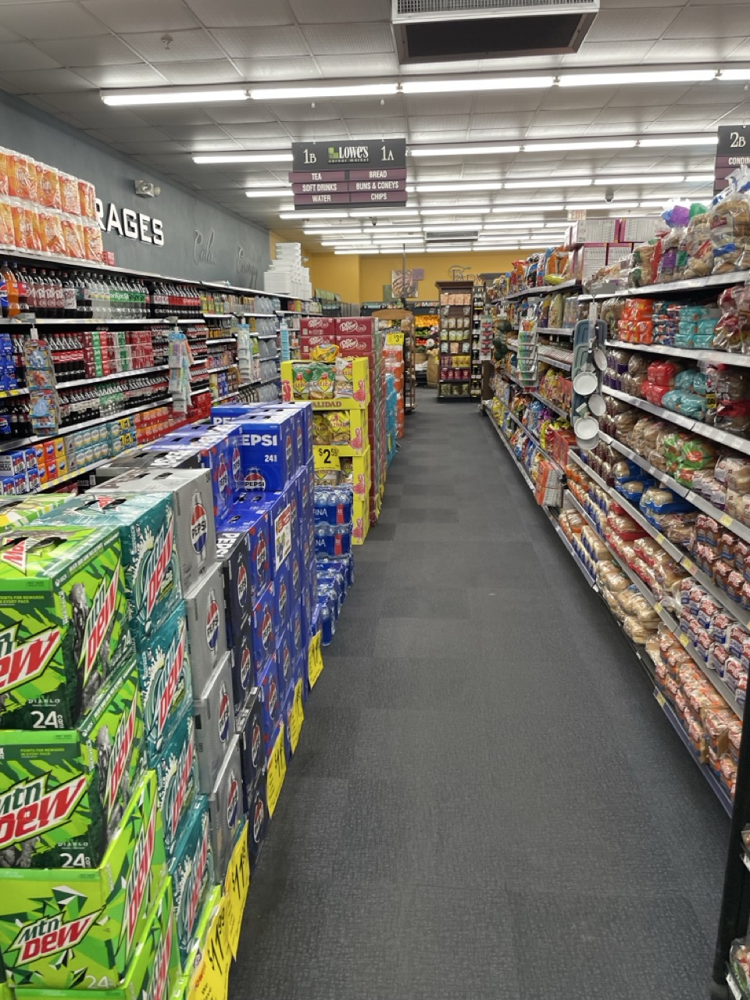
  <figcaption>A local grocery store</figcaption>
</figure>

At an evening session called ROUTE66, there were Native American dances and booming music, and I could feel the tradition and history of the place.

## Main Conference Day 3

On the last day of the main conference, I attended the poster session, the best paper awards, and the closing. During the closing, promotional videos were shown for the venues of ACL, EMNLP, and AACL. They seemed to have a completely different atmosphere from Albuquerque, and it made me feel that what I experienced on this trip was just one side of the many international conferences out there. I want to keep attending international conferences.

## Heading Home

In the afternoon of the third day of the main conference, I headed to Albuquerque airport and flew back to Japan. I took a bus from the venue to the airport, and it was free.
On the way back, I went through four airports: Albuquerque, New York (JFK), Haneda, and Itami.
It was quite a roundabout route, so the trip took about 24 hours in total.

I had about a four-hour layover at the New York airport, so I explored the areas around Jamaica Station and Howard Beach Station, each just one hop from the airport by train. Jamaica Station was quite scary: the passages were narrow and poorly lit, with many homeless people.
Howard Beach Station, on the other hand, was in a quiet residential area with a winding river and beautiful streets.

## Overall Impressions

### Albuquerque

Thanks to the steppe climate, it was sunny the whole time I was there, and the temperature was just right, so it was very pleasant. Seeing the blue sky from my window when I woke up in the morning felt especially good.

I had heard that Albuquerque is unsafe, but on this trip it did not feel that dangerous. Maybe it helped that the roads are wide and you can see the sky all around, so I could keep a wide view of my surroundings. Still, I saw many signs around town saying "No Weapon", which kept reminding me that guns are always around.

### How Well Known Kyoto Is

While I was going around listening to posters, someone saw my name tag and told me they had been to Kyoto last year for a conference called SIGDIAL, and that Kyoto was amazing. I felt that conversations like this are an advantage of coming from Kyoto.
On the other hand, some people had never heard of Kyoto.

### English

As for English, I could communicate without problems in most situations. However, when someone suddenly spoke to me, for example at security or in shops, my brain was not in English mode and I often could not catch what they said.
I learned that even in these cases, saying "Sorry?" often gets people to rephrase things more simply.
Also, when people explained their posters to me, interrupting now and then to check my understanding helped me follow along.

After actually coming to the US, I also felt that "Hello" and "Thank you" are the most important English expressions.
Saying "Hello" shows that you are not a dangerous person. Staff greet you with "Hello" in many places, such as restaurants and museums, so I think it is good to be ready to respond.
I also made a conscious effort to say "Thank you" whenever someone did something for me. The locals almost always responded to "Thank you" with a smile and something like "Sure", which felt really nice.

### Hotel

American hotels had a few drawbacks for Japanese travelers.
First, there were no toothbrushes, razors, or slippers, which Japanese hotels almost always provide.
Also, the hot tap water at the sink was slightly cloudy.
On top of that, on the last day the hotel toilet clogged and overflowed.
I had thought from the first day that there was a lot of water in the toilet bowl, and it seems that was foreshadowing.
Luckily, I was not charged anything extra. Maybe it happens all the time.

### The Three Sacred Treasures of Traveling Abroad

What I felt on this trip is that as long as you have three things, your passport, your boarding pass, and your smartphone, you can probably manage.
I needed my passport as ID before airport security, at customs, and at hotel check-in. I used my smartphone for Google Maps, transit directions, communication, and Visa contactless payments.
Visa contactless worked everywhere, so I never once needed cash.

## Summary

It was my first time abroad and my first top international conference, but I did not run into any major trouble and gained a great deal of experience.
I hope this post will be helpful for anyone planning to attend an international conference.

## English Expressions I Picked Up on This Trip

- Customs: 税関 (customs)
- Ground transportation: 地上の交通手段 (transportation on the ground; I saw this a lot at airports)
- Security check: 保安検査 (security check)
- Baggage claim: 手荷物受取所 (baggage claim)
- Boarding gate: 搭乗口 (boarding gate)
- Boarding pass: 搭乗券 (boarding pass)
- Rear door: 後ろのドア (rear door)
- The toilet is clogged: トイレが詰まる (the toilet gets clogged)
- The toilet is overflowing: トイレが水で溢れる (the toilet overflows with water)
