このたび、2025年4月30日-5月2日にかけてアルバカーキで開催された、自然言語処理分野のトップ国際会議の一つである[NAACL](https://2025.naacl.org/)に参加しました。
本稿では、NAACL2025の参加記録を記します。

今回の旅は、私自身初めての海外渡航かつ、初めてのトップ国際会議の参加でした。初めてならではの体験を多く提供できればと思います。

なお、私はStudent Research Workshop (SRW) に採択された論文をポスター発表しました。今回発表した論文の内容については[Developing Japanese CLIP Models Leveraging an Open-weight LLM for Large-scale Dataset Translation](https://aclanthology.org/2025.naacl-srw.15/)を参照してください。

## アルバカーキ

[アルバカーキ](https://ja.wikipedia.org/wiki/%E3%82%A2%E3%83%AB%E3%83%90%E3%82%AB%E3%83%BC%E3%82%AD)は、メキシコと国境を接するアメリカニューメキシコ州の都市です。ロッキー山脈の麓に位置し、街の中央をリオグランデ川が流れています。
気候帯は、乾燥帯のステップ気候です。
人口は約55万人で、日本の姫路市に匹敵します。アメリカ建国以前からの歴史がある都市です。
なお、治安はアメリカの中でもトップ10に入るほど悪いということです。

## アルバカーキまでの道のり

4月29日朝に京都を出発し、伊丹、羽田、ダラスを経由してアルバカーキまで向かいました。

<figure>
  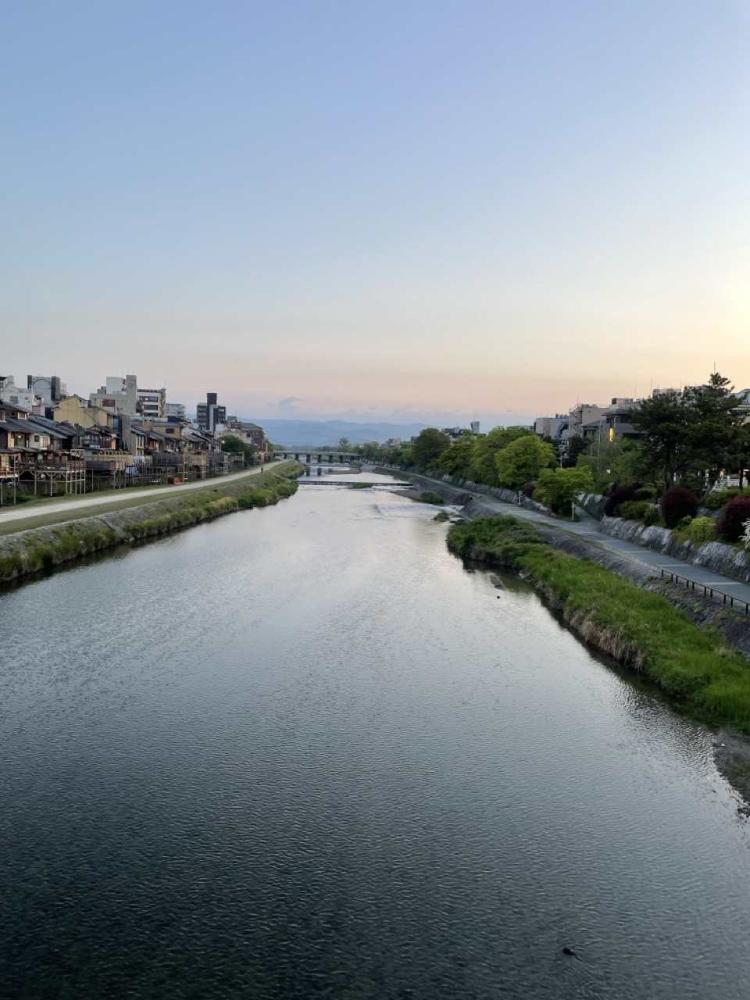
  <figcaption>鴨川との別れ</figcaption>
</figure>

羽田-ダラス間では、隣の席に座っていたアリゾナ在住の方とお話しました。日本人の叔父に会いに大分に訪れていたということでした。なんと日本に10回も訪れたことがあるとのこと。アルバカーキ近辺のことを色々教えてもらいました。車が好きそうな方でした。

国際便ではご飯が出ました。JALの提供する食事ということで、日本人の味覚にあった味になっており、とても美味しかったです。

アメリカ上空からは、砂漠のような土地と、[センターピボット](https://ja.wikipedia.org/wiki/%E3%82%BB%E3%83%B3%E3%82%BF%E3%83%BC%E3%83%94%E3%83%9C%E3%83%83%E3%83%88)方式の畑が見えました。

<figure>
  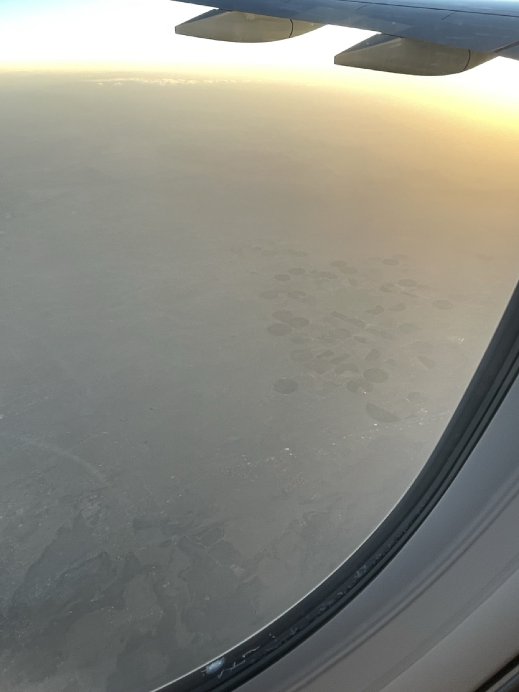
  <figcaption>センターピボット方式の畑</figcaption>
</figure>

ダラス空港に着くと、アリゾナ在住の方と一緒に出口に向かいました。空港に着くやいなや小走りでどこかに向かい始めたのでどうしたのかと思ったら、税関の待ち時間を少なくするためのようです。私は1時間30分ほど並びました。
税関では、旅の目的、期間、帰りの搭乗券の確認のほか、指紋の登録が行われました。私は特に問題なく通過できましたが、たまに個室に連れて行かれている人がいました。

ダラス空港に着くと、空港内にコンビニがあり、水を買いました。これが海外での初めての物品購入となりました。Visaタッチ決済によって問題なく支払えました。500mlの水が4ドルという信じがたい値段でしたが、味は特に日本と変わりませんでした。

<figure>
  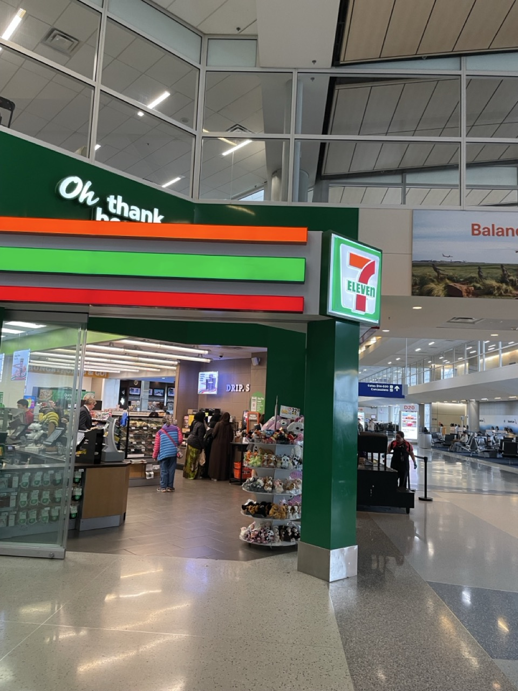
  <figcaption>コンビニ</figcaption>
</figure>

また、空港ではアルバカーキに向かう搭乗口でNAACLの参加者と遭遇しました。
たくさんの研究者が一堂に会する国際会議ならではの体験でとてもおもしろかったです。

## アルバカーキ空港から会場まで

アルバカーキ空港に着くと、会場であるコンベンションセンターまで、実際の街並みを体験するために歩いて向かいました。Googleマップでは徒歩で1時間30分ほどと表示されていました。
治安が悪いとのことだったので、周囲を警戒しながら歩きました。
ただ、アルバカーキの道はとても広く、視野が広いため、体感としてはそれほど危険な印象は受けませんでした。

<figure>
  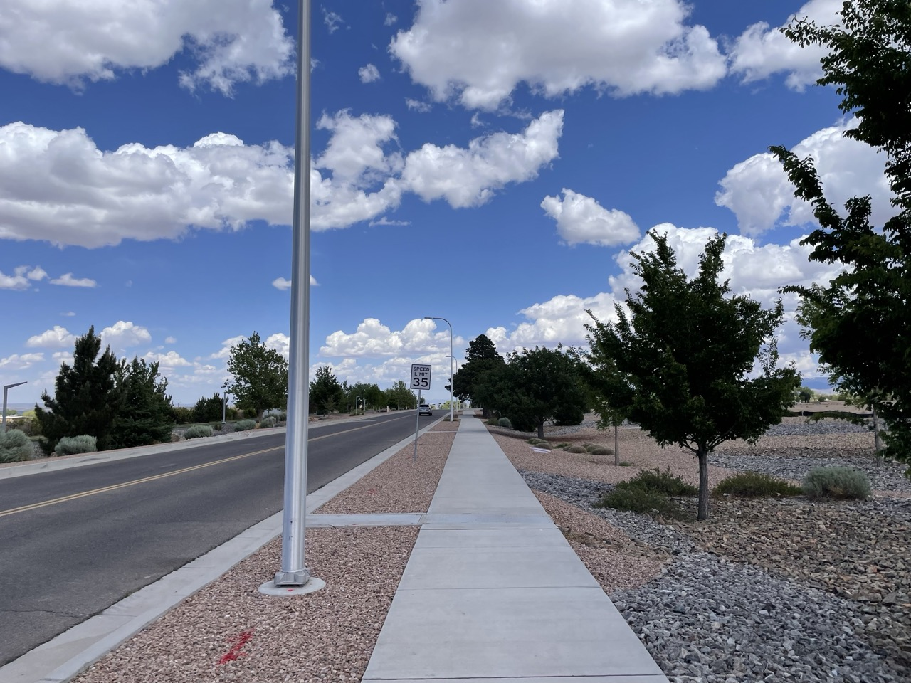
  <figcaption>空港前の道路</figcaption>
</figure>

まず最初に現れたのは、歩行者信号です。日本とは違い、歩行者が歩行したいタイミングでボタンを押す必要があるようでした。
赤信号が手を挙げるような表示になっており、横断歩道は手を挙げて渡ると教え込まれた日本人にとっては赤信号を青と誤解してしまうようなデザインでした。

  

    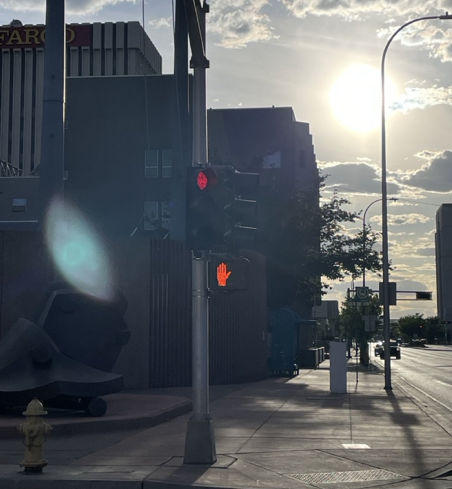
    
赤信号。

  

  

    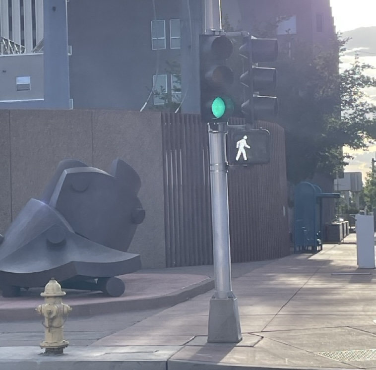
    
青信号。ダッシュ！

  

  

    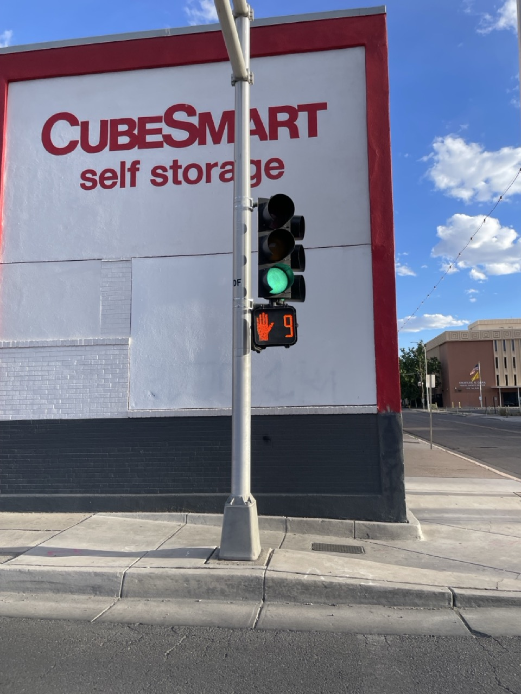
    
赤信号まであと五秒。

  

無事に信号を渡ることができると、道路を淡々と歩いていきました。
道路の幅が広いこと、自動車の交通量がとても多い一方で、歩行者はほとんどいないことに驚きました。
また、謎の草を販売する店がコンビニ感覚で存在していました。

<figure>
  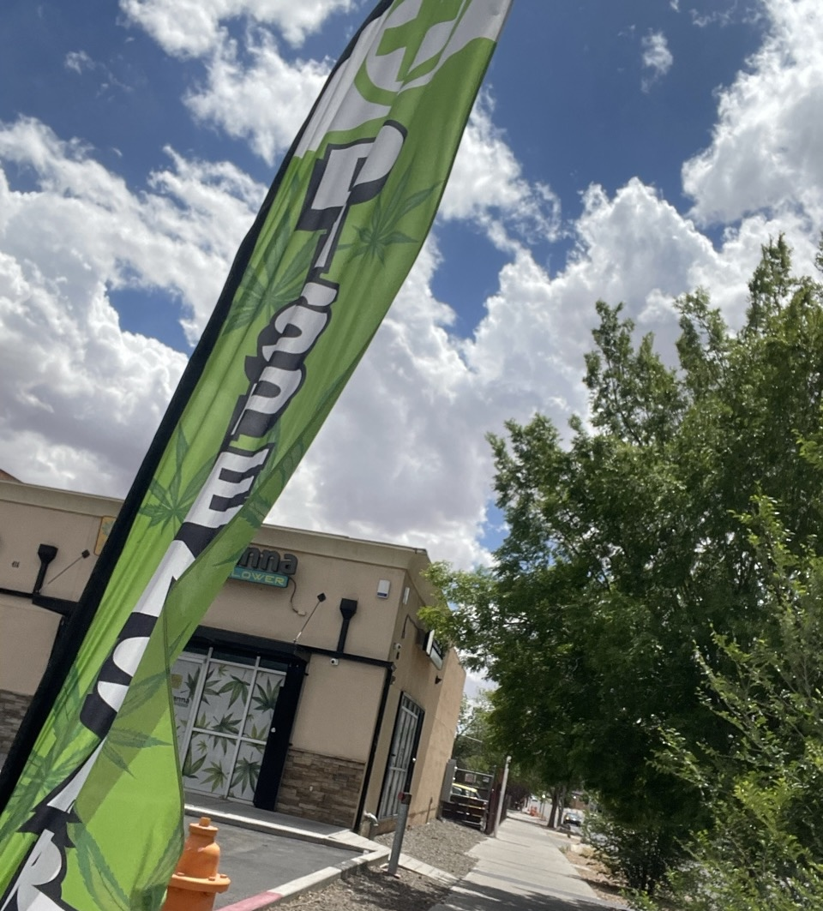
  <figcaption>謎の草販売店</figcaption>
</figure>

道中には、ホームレスのような方も見かけました。そのような方を見かけた場合は、小走りで通り過ぎるようにしました。

そのまま進んでいくと、住宅街に迷い込みました。多くの家が土でできたような外見をしていました。これは[アドベ](https://ja.wikipedia.org/wiki/%E3%82%A2%E3%83%89%E3%83%99)と呼ばれる建材でできた伝統的な建物のようです。統一感があってとても良かったです。
各家の前には大きなゴミ箱が置かれていました。
日本のようにゴミを出す場所がエリアごとに決まっているわけではないようです。このゴミ箱がホームレスの方に漁られている風景も見かけました。

道中で、ニューメキシコ大学に鉢合わせました。大学内を歩いてみると、多くの学生がキャンパスライフを楽しんでいました。ちょっとした留学気分を味わうことができました。
大学内は学生が多く、警戒心をそれほど持たずに歩くことができました。

<figure>
  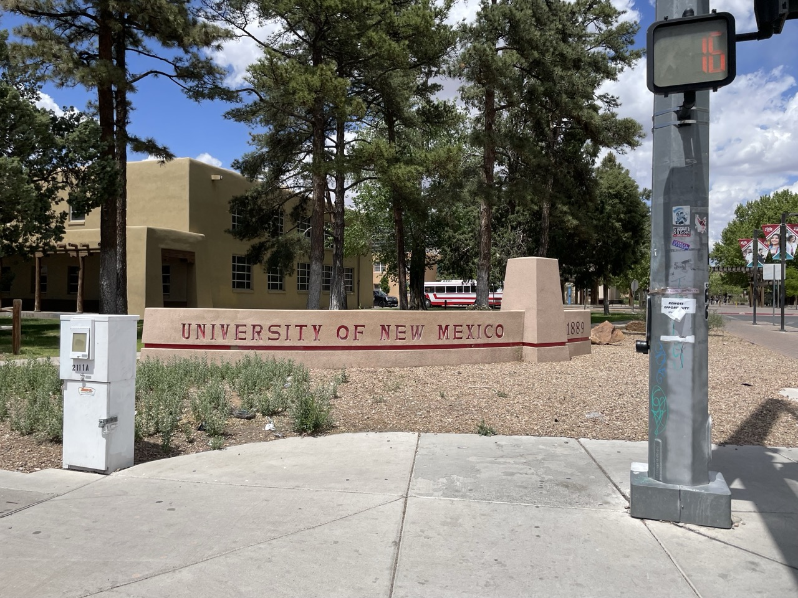
  <figcaption>ニューメキシコ大学</figcaption>
</figure>

コンベンションセンターに着いたら、お昼ご飯を食べました。Googleマップの評価が高そうな[Stackers Burger](https://maps.app.goo.gl/wTZBeyDhtMERzeDJ6?g_st=com.google.maps.preview.copy)でハンバーガーを食べてみました。非常にスパイシーな風味で、肉が本格的でとても美味しかったです。スパイシーすぎるのか、旅の疲れからか、手が痺れるような感覚がありましたが、今まで食べたハンバーガーで一番美味しかったです。
食べ終わってお盆を返そうとしたところ、入店してきたお客さんに突然お盆を取られた...と思ったら、代わりに返却してくれました。現地の方の優しさを感じる出来事でした。

<figure>
  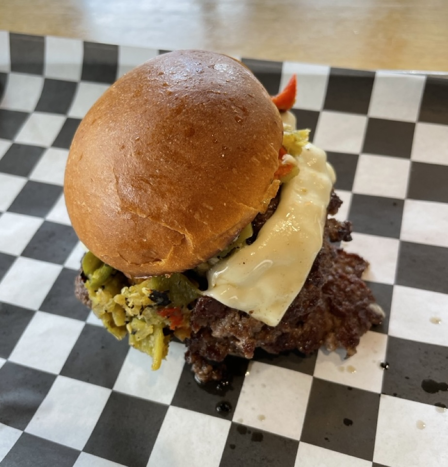
  <figcaption>Stackers Burgerのハンバーガー</figcaption>
</figure>

## 本会議1日目

会議が始まりました。ポスターセッションや休憩場所で、多くの研究者と話すことができました。
大きな部屋の中にポスター会場と休憩場所が併設されていたことから、休憩場所で話した人に、その後ポスターで再会して聞くということができて面白かったです。

<figure>
  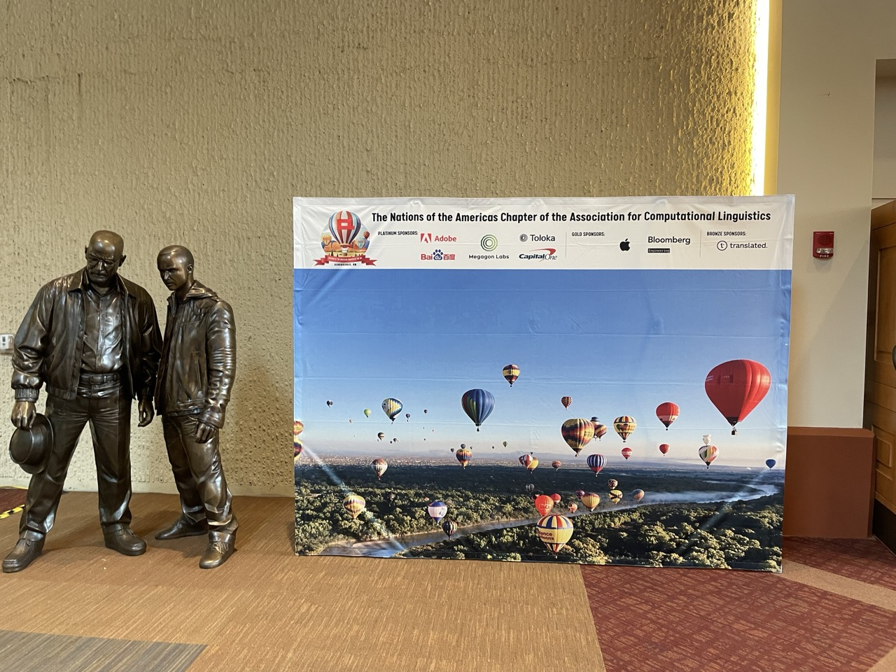
  <figcaption>NAACL2025会場</figcaption>
</figure>

会場では、多くの人にLinkedInのアカウントを連絡先交換として聞かれました。海外の研究者にLinkedInが普及していることを初めて知りました。逆にX (Twitter)はあまり使われていないようでした。

午後には、自身のポスター発表をしました。発表を聞いてくれた人の一人が、ネガティブリザルトも報告することはとても価値があると言ってくださり、嬉しかったです。
SRWはワークショップではありますが、本会議のポスターセッションと混じって発表することができ、本格的な国際会議の雰囲気を味わうことができました。

## 本会議2日目

メタの[Mike Lewis](https://scholar.google.com/citations?user=SnQnQicAAAAJ&hl=en)さんによるキーノートを聞きました。LLMの事前学習に関するプレゼンであり、事前学習中に学習後のダウンストリームタスクの性能を予測する際、ベンチマークタスクのaccuracyを測るのではなく、Negative Log Likelihoodを用いるのがおすすめと言っていたのが印象的でした。

<figure>
  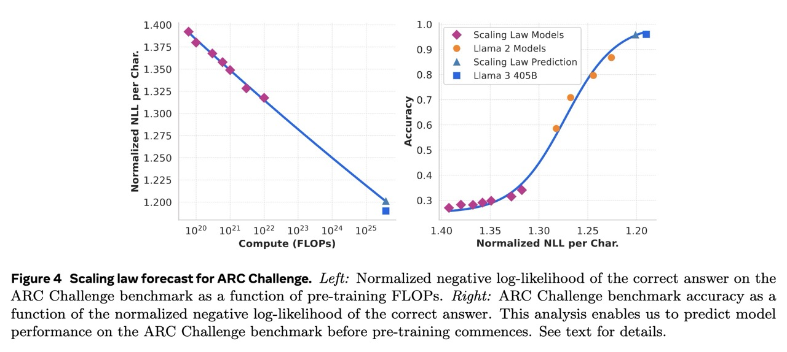
  <figcaption>The Llama 3 Herd of Modelsより引用</figcaption>
</figure>

その後、SRWのFaculty sessionのイベントに参加されていたCMUの[Graham Neubig](https://www.phontron.com/)さんに話しかけることに成功しました。[OpenHands](https://github.com/All-Hands-AI/OpenHands)の最初期のことを色々知ることができ、最後にはAll Handsのシールをいただきました。

お昼休憩では、会場から歩いて30分のところにある、アルバカーキの名所、オールドタウンに行きました。オールドタウンでは、アドベ建築がたくさん見られたほか、Albuquerque Museum、New Mexico Museum of Natural History and Scienceを訪れました。値段の割に規模がとても大きく、満足感がありました。

  <figure style="margin: 0; min-width: 200px; max-width: 45%;">
    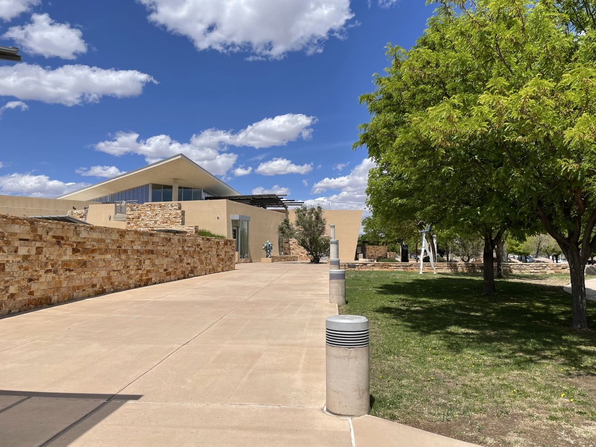
    <figcaption style="margin-top: 5px;">Albuquerque Museum</figcaption>
  </figure>

  <figure style="margin: 0; min-width: 200px; max-width: 45%;">
    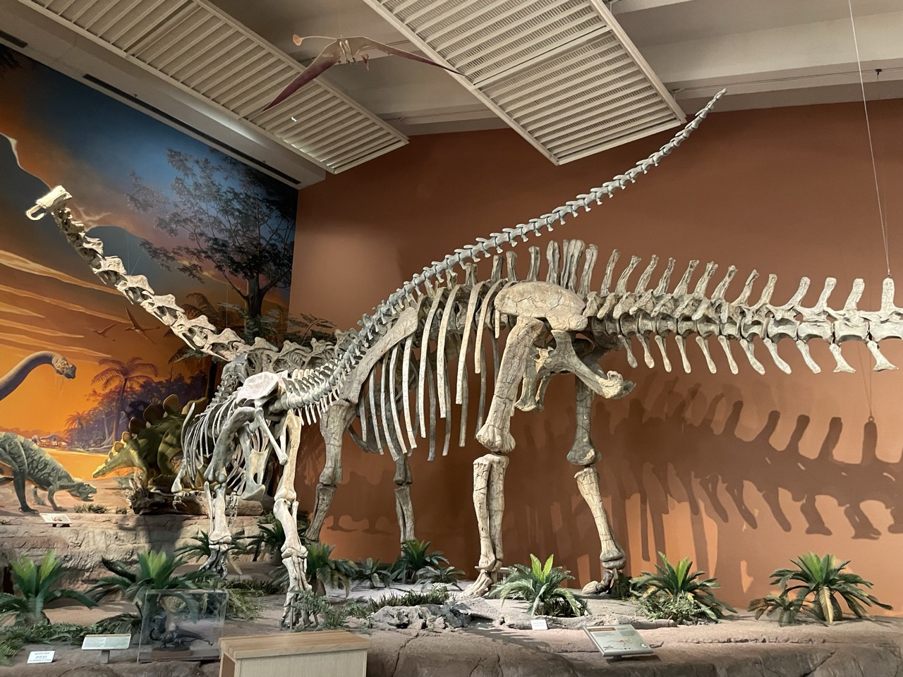
    <figcaption style="margin-top: 5px;">New Mexico Museum of Natural History and Science</figcaption>
  </figure>

オールドタウンの帰路では、現地の食料品店にも立ち寄ってみました。基本的には日本と同じ感じですが、食料のサイズがどれも大きかったです。

<figure>
  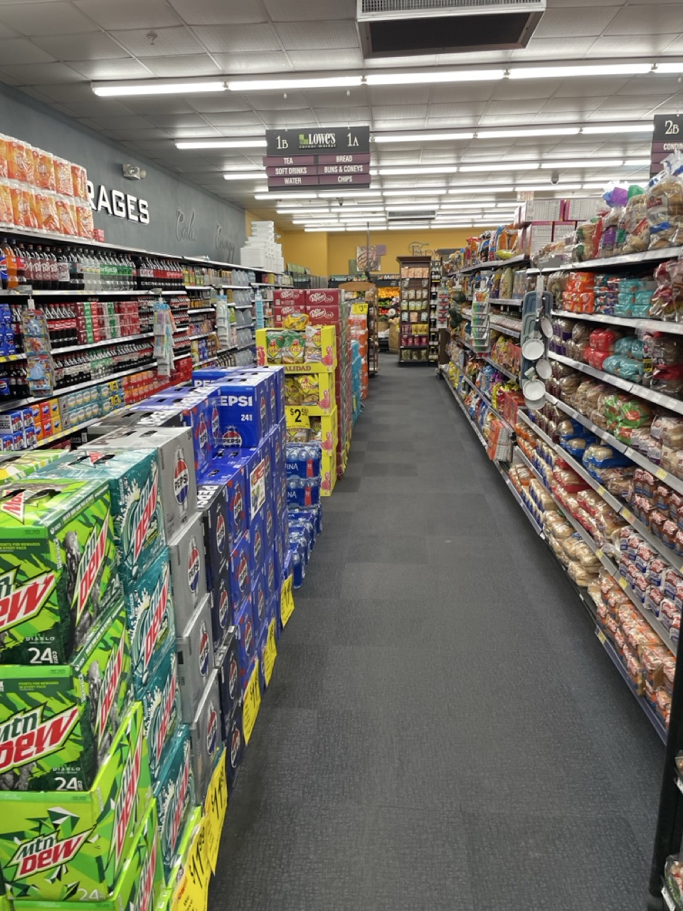
  <figcaption>現地の食料品店</figcaption>
</figure>

夜に行われたROUTE66というセッションでは、ネイティブアメリカンの民族踊りや爆音の音楽が流れており、伝統、歴史を感じることができました。

## 本会議3日目

本会議最終日では、ポスター発表とベストペーパーアワード、クロージングを聴きました。クロージングでは、ACLやEMNLP、AACLの開催地の宣伝ムービーが流れていました。今回の開催地のアルバカーキとは全く異なる雰囲気のようで、今回の旅の経験は、数ある国際会議の一側面に過ぎないのだと感じました。これからも国際会議に参加していきたいです。

## 帰国の途

本会議3日目の午後にアルバカーキ空港へ向かい、日本に帰りました。会場からアルバカーキ空港へは、バスを使いました。なんと無料でした。
帰りは、アルバカーキ、ニューヨーク (JFK)、羽田、伊丹の4つの空港を経由して帰国しました。
かなり遠回りなルートであったため、合計24時間ほどかかりました。

ニューヨーク空港では4時間ほどの空きがあったため、空港の電車から1-hopで行くことのできるジャマイカ駅、Howard Beach駅周辺を散策しました。ジャマイカ駅は、日当たりが悪く狭い通路にホームレスが多くいたため、かなり恐怖を感じました。
一方で、Howard Beach駅は閑静な住宅街であり、くねくねと川が流れており、美しい街並みでした。

## 全体の感想

### アルバカーキ

ステップ気候ということもあり、滞在中はいつも晴れており、ちょうど良い気温でとても過ごしやすかったです。特に朝起きた時に窓から見える青空はとても気持ちが良かったです。

アルバカーキは治安が悪いということでしたが、今回の旅では、それほど危険な印象は受けませんでした。道幅が広く、空が見渡せるため、視野を広く持つことができた点が良かったのかもしれません。ただ、街中の看板には「No Weapon」と書かれた標識を多く見かけ、常に銃の存在を意識させられました。

### 京都の知名度

ポスターを聞いて回っていると、ネームプレートを見て、去年SIGDIALという学会で京都に行ったが京都は最高だったよと話しかけられました。このような会話が生まれることに、京都という地の利を感じました。
一方で京都を聞いたことがないという人もいました。

### 英語

英語については、多くの場面において問題なくコミュニケーションできました。ただ、保安検査やお店などで突然話しかけてくる場合、頭が英語モードになっておらず、聞き取れないことが多々ありました。
このような場合でも、「Sorry?」と言うとわかりやすく言い換えてくれることもわかりました。
また、ポスターの説明では、途中で自分の理解を確認するためにインタラプトを入れると理解が捗りました。

また、実際にアメリカに来てみて、「Hello」と「Thank you」は最も重要な英語表現だと感じました。
「Hello」と言うことで、自身は危険な人ではないことを示すことができます。飲食店やミュージアムなど、様々な場面で店員が「Hello」と声をかけてくれるので、それに応じる用意をしておくのが良いと思いました。
また、「Thank you」は、何かをしてもらったときに意識的に言うことを心がけました。現地の人はほぼ必ず「Thank you」に対して「Sure」などと笑顔で返答してくれて、とても気持ちが良かったです。

### ホテル

アメリカのホテルは日本人にとっていくつかの難点がありました。
まず、日本のホテルだとほぼ必ずおいてある、歯ブラシ・カミソリ・スリッパがありませんでした。
また、洗面所の温かいお湯から出る水道水がやや濁っていました。
さらに、最終日にホテルのトイレの水がつまって水が溢れるというトラブルがありました。
初日からトイレの便器の水の量が多いと思っていましたが、伏線だったようです。
特に追加料金を請求されることがなかったのは幸いでした。もしかしたら日常茶飯事なのかもしれません。

### 海外旅行三種の神器

今回の旅で感じたのは、パスポート、搭乗券、スマホの3つがあればなんとかなりそうだということです。
パスポートは、空港における保安検査前、税関、ホテルのチェックイン時に身分証明書として必要でした。また、スマホはGoogleマップや乗換案内、連絡手段、Visaタッチ決済に用いました。
現地ではどこでもVisaタッチ決済が使えたため、現金が必要なケースは皆無でした。

## まとめ

初めての海外渡航、トップ国際会議参加でしたが、大きなトラブルに遭遇することもなく、非常に多くの経験を得ることができました。
この記事が、今後国際会議に参加される方の参考になれば幸いです。

## 今回の旅で得た英語表現

- Customs: 税関
- Ground transportation: 地上の交通手段 (空港でよく見かけました)
- Security check: 保安検査
- Baggage claim: 手荷物受取所
- Boarding gate: 搭乗口
- Boarding pass: 搭乗券
- Rear door: 後ろのドア
- The toilet is clogged: トイレが詰まる
- The toilet is overflowing: トイレが水で溢れる
