## Introduction

Deep learning has achieved dramatic performance gains in many applications, such as large language models and image recognition.

However, much about the principles of deep learning remains a mystery.

One example is that DNNs generalize well even though they have more parameters than training examples (over parametrization). This contradicts the bias-variance tradeoff that classical statistical learning theory relies on. The phenomenon is known as [double descent](https://arxiv.org/abs/1812.11118).

<figure>
  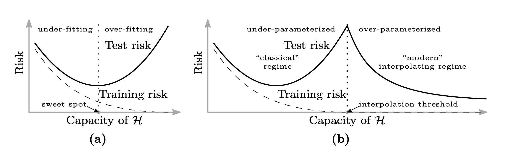
  <figcaption>Source: <a href="https://arxiv.org/abs/1812.11118"> Belkin et al. "Reconciling modern machine learning practice and the bias-variance trade-off", 2018</a></figcaption>
</figure>

Another mystery is why training deep networks works so well. Optimizing a function such as a DNN is usually a non-convex optimization problem, and finding the optimum is hard. In practice, however, we obtain very good solutions.

The theory of deep learning is studied in order to solve mysteries like these.

The theory of deep learning has several areas:

- Expressivity: the expressive power of DNN models
- Generalization: generalization performance on unseen data
- Optimization: why optimization works well
- etc

For expressivity, useful results such as the [Universal approximation theorem](https://en.wikipedia.org/wiki/Universal_approximation_theorem) have been proven. On the other hand, our understanding of generalization and optimization is still limited.
Much research is actively trying to deepen this understanding by analyzing the dynamics of training (Learning Dynamics).

This post introduces Neural Tangent Kernel (NTK) theory, which underpins research focused on the dynamics of training. The structure of this post draws heavily on [“Some Math behind Neural Tangent Kernel”](https://lilianweng.github.io/posts/2022-09-08-ntk/).

NOTE: NTK theory is becoming a basic tool in deep learning research beyond the theory of deep learning itself. For example, it is used to explain arithmetic on model parameters such as ["Editing Models with Task Arithmetic"](https://arxiv.org/abs/2212.04089) [[Ortiz-Jimenez et al. 2023]](https://arxiv.org/abs/2305.12827).

## Dynamics of $\theta, f(x;\theta)$ and the definition of the Neural Tangent Kernel (NTK)

The key quantities in training dynamics are the model parameters $\theta \in R^P$ and the output $f(x;\theta)\in F: R \times R^P \to R$. For simplicity, the model's input and output are each one-dimensional. With the epoch denoted by $t$, $\theta, f(x;\theta)$ evolve over time $t$.

Here we derive the differential equations that $\theta, f(x;\theta)$ follow during training.

Suppose we are given training data $\mathcal{D} =\{(x^i,y^i)\}^N_{i=1}$. The loss is then defined as follows.

$$
L(\theta) := \frac{1}{N}\sum^N_i l(f(x^i;\theta),y^i)
$$

Applying the chain rule as follows,

$$
\frac{dl(f(x;\theta))}{d\theta_i}=\frac{dl}{df} \frac{df}{d\theta_i}
$$

we can compute the gradient of the loss $L(\theta)$ as below, where $\nabla_\theta L(\theta):=(\frac{\partial L}{\partial\theta_1}, \dots,\frac{\partial L}{\partial\theta_P})$ and P is the total number of parameters.

$$
\nabla_\theta L(\theta) = \frac{1}{N}\sum^N_i \nabla_\theta f(x^i;\theta)\frac{dl(f,y^i)}{df}
$$

Next, consider the time derivative of the parameters.

In gradient descent, the parameters are normally updated as follows. Throughout this post we assume Full Batch Gradient Descent.

$$
\theta_{t+1} = \theta_t - \eta\nabla_\theta L(\theta)
$$

Taking the step size to be small, we obtain the following differential equation for the parameters (Gradient Flow).

$$
\begin{split}
\frac{d\theta}{dt} &= - \eta\nabla_\theta L(\theta)\\
&= -\eta \frac{1}{N}\sum^N_i \nabla_\theta f(x^i;\theta)\frac{dl(f,y^i)}{df}
\end{split}
$$

Using this, we further obtain a differential equation for $f(x;\theta)$.

$$
\begin{split}
\frac{df(x;\theta)}{dt}
&= \sum_i\frac{df(x;\theta)}{d\theta_i}\frac{d\theta_i}{dt}\\
&=  \nabla_\theta f(x;\theta) (-\eta \nabla_\theta L(\theta)^\top)\\
&= - \frac{\eta}{N}\sum^N_i\nabla_\theta f(x;\theta) \nabla_\theta f(x^i;\theta)^\top \frac{dl(f,y^i)}{df}\\
&= -\frac{\eta}{N}\sum^N_i K(x,x^i; \theta) \frac{dl(f,y^i)}{df}
\end{split}
$$

where

$$
K(x,x';\theta) := \nabla_\theta f(x;\theta)\nabla_\theta f(x';\theta)^\top
$$

This $K(x,x';\theta)$ is called the Neural Tangent Kernel (NTK).

The NTK is computed as follows.

$$
K(x,x';\theta) = \sum^P_p \frac{\partial f(x;\theta)}{\partial \theta_p}\frac{\partial f(x';\theta)}{\partial \theta_p}
$$

The NTK then

- is a mapping $K:R\times R \times R^P \to R$, and
- satisfies $K(x,x';\theta) = K(x',x;\theta)$.

Thus the NTK is an important factor governing the time evolution of the model output $f(x;\theta)$, and it is used in the theory of deep learning to analyze training dynamics.

For the following sections, we define:
$$f(X;\theta):=(f(x_1;\theta),\dots,f(x_n;\theta))^\top$$

$$
K(x,X;\theta) := \nabla_\theta f(x;\theta) \nabla_\theta f(X;\theta)^\top
$$

The output size is (1 × P) × (P × N) = (1 × N).

$$K(X,X) := \nabla_\theta f(X;\theta) \nabla_\theta f(X;\theta)^\top$$

The output size is (N × P) × (P × N) = (N × N).

## The NTK of an infinitely wide DNN stays constant throughout training

Here we introduce a surprising theorem about the NTK.

[[Jacot et al. 2018]](https://arxiv.org/abs/1806.07572) showed that the following theorem holds under several assumptions (constraints such as the ntk parametrization, the activation function, and the learning rate).

> When the hidden layers of a fully connected DNN are infinitely wide (with $n_l$ the dimension of the weights of layer $l$, $n_1, \dots , n_{L-1} \to \infty$), the NTK $K^l_\infty(x,x';\theta)$ defined by the output $f^l(x;\theta)$ of each layer does not depend on the weights $\theta$. That is, it can be written as $K^l_\infty(x,x')$ and is determined solely by the inputs $x,x'$, the depth, the activation function, and the variance of the parameter initialization.

This is a remarkable result. To appreciate how surprising it is, let us look again at the definition of $K(x,x';\theta)$.

$$
K(x,x';\theta) := \nabla_\theta f(x;\theta)\nabla_\theta f(x';\theta)^\top
$$

It is defined as the inner product of the gradients, with respect to the parameters, of the model outputs for inputs $x, x'$, and this value normally depends on the parameter values, which change during training.

However, when every layer is infinitely wide ($n_1, \dots , n_L \to \infty$), $K_\infty(x,x';\theta)$ is constant regardless of the parameters $\theta$.

In other words, for a model whose layers are infinitely wide, the NTK value is already determined at initialization, $K_0(x,x')$, independently of the weights, and it stays constant even as the weights change during training. Put differently again, the NTK is an invariant during training.

Invariants have long been valuable for analyzing complex objects. In physics, for example, many theorems have been derived by focusing on energy, which is constant in time $t$.

This hints at why the NTK, which becomes an invariant in the idealized setting of infinite width, is important in the theory of deep learning.

## Dynamics of $f(x;\theta)$ during training

What can we say from the theorem in the previous section? Let us look at the differential equation that $f(x;\theta)$ follows.

$$
\frac{df(x;\theta)}{dt}
= -\frac{\eta}{N}\sum^N_i K(x,x^i; \theta) \frac{dl(f,y^i)}{df}
$$

In the infinite-width limit, since $K(x,x^i;\theta) = K^L_\infty(x,x^i)$, this becomes:

$$
\frac{df(x;\theta)}{dt}
= -\frac{\eta}{N}\sum^N_i K^L_\infty(x,x^i) \frac{dl(f,y^i)}{df}
$$

x, X, and Y are constant during training, and the NTK is now also constant, so the right-hand side has become simpler.

Furthermore, when the loss function is MSE, that is, $L(\theta) = \frac{1}{2N}\|f(X; \theta) - Y\|^2$, we have $\nabla_f L(\theta) = \frac{1}{N}(f(X;\theta) - Y )$, so

$$
\frac{df(x;\theta)}{dt}
= - \eta K_\infty(x,X)  (f(X;\theta) - Y )
$$

which is a simplified form (absorbing the factor $\frac{1}{N}$ into the learning rate $\eta$). Further, letting $g(X;\theta) := f(X;\theta) - Y$, since $X, Y$ are constant,

$$
\frac{dg(X;\theta)}{dt} = -\eta K_\infty(X,X) g(X;\theta)
$$

This is a standard solvable ordinary differential equation, and it can be solved as follows, where $C$ is a constant.

$$
g(X;\theta) = \exp({-\eta K_\infty(X,X) t})C
$$

Hence

$$
f(X;\theta) =  \exp({-\eta K_\infty (X,X)t})C + Y
$$

Also, at $t=0$, $C = f(\theta(0)) - Y$, so

$$
f(X;\theta(t)) =\exp({-\eta K_\infty(X,X) t}) ( f(X;\theta(0)) - Y) + Y
$$

For an arbitrary input $x$, the solution can also be written explicitly as follows.

$$
f(x;\theta(t)) = f(x;\theta(0)) + K_\infty(x,X)K_\infty(X,X)^{-1}(I-\exp{(-\eta K_\infty(X,X)t)})(Y-f(X;\theta(0)))
$$

Indeed, differentiating with respect to t gives

$$
\frac{df(x;\theta(t))}{dt} =  -\eta K_\infty(x,X) \exp{(-\eta K_\infty(X,X)t)}(f(X;\theta(0))-Y)
$$

Substituting $f(X;\theta(0))-Y = \exp{(-\eta K_\infty(X,X) t)}^{-1}(f(X;\theta(t))-Y)
$ into this equation and rearranging,

$$
\frac{df(x;\theta(t))}{dt} =  -\eta K_\infty(x,X)(f(X;\theta(t))-Y)
$$

we recover the original differential equation.

In this way, we have obtained the output $f(x;\theta)$ at time $t$ analytically.

As a result, $f(x;\theta(t))$ can be computed without running gradient descent, just by computing $K_\infty = K_0$ and $f(\theta(0))$.

The assumptions that the NTK is invariant and the loss is MSE lead to a very interesting result.

### An infinitely wide DNN is a linear model in its parameters during training

Changing the subject, suppose that when $d\theta:=\theta(t)-\theta(0)$ is small, the model $f(x;\theta(t))$ at time $t$ can be approximated to first order by a Taylor expansion in the parameters $\theta$ around the initial value $\theta(0)$.

$$
f^{lin}(x;\theta(t)) \approx f(x;\theta(0)) + \nabla_\theta f(x;\theta(0)) (\theta(t) - \theta(0))^\top
$$

Here, $f(\theta(t))$ is linear in $\theta(t)$.

Under this approximation, if t is small, the gradient descent update rule gives

$$
\theta(t)-\theta(0)  = - \eta\nabla_\theta L(\theta(0)) = -\eta \frac{1}{N}\sum^N_i \nabla_\theta f(x^i;\theta(0))\frac{dl(f,y^i)}{df}

$$

and substituting this into $f^{lin}(x;\theta(t))$ gives

$$
f^{lin}(x;\theta(t)) - f(x;\theta(0)) = \nabla_\theta f(x;\theta(0)) (-\eta \frac{1}{N}\sum^N_i \nabla_\theta f(x^i;\theta(0))\frac{dl(f,y^i)}{df})^\top
$$

Taking t small and rearranging,

$$
\begin{split}
\frac{df^{lin}(\theta(t))}{dt} &= -\eta \frac{1}{N}\sum^N_i \nabla_\theta f(x;\theta(0))\nabla_\theta f(x^i;\theta(0))^\top  \frac{dl(f,y^i)}{df}\\
&= -\eta \frac{1}{N}\sum^N_i K(x,x^i;\theta(0))\nabla_f l(f,y^i)
\end{split}
$$

From the above, the NTK in the differential equation that $f^{lin}(\theta(t))$ follows is constant at $K(\theta(0))$.

This equation matches the differential equation for the infinite-width case derived in the previous section:

$$
\frac{df(x;\theta)}{dt}
= -\frac{\eta}{N}\sum^N_i K^L_\infty(x,x^i) \nabla_f l(f,y^i)

$$

[[Lee et al. 2019]](https://arxiv.org/abs/1902.06720) showed that in the infinite-width limit, $f(\theta(t))$ during training can be expressed as a linear model obtained by a first-order approximation around the initial parameters. This result also means that the parameter search stays near the initialization, which suggests a connection to implicit regularization, which implicitly constrains the degrees of freedom of DNN models.

## Numerical experiments

Here we test how well NTK theory holds at finite width.
The experiments can be reproduced from the following repository.

- [https://github.com/speed1313/ntk](https://github.com/speed1313/ntk)

The implementation uses JAX. JAX provides two functions for computing Jacobians: `jax.jacfwd()` and `jax.jacrev()`. Both give the same result, but their internal implementations differ: `jacfwd()` is efficient for tall matrices and `jacrev()` for wide matrices [[JAX doc](https://jax.readthedocs.io/en/latest/notebooks/autodiff_cookbook.html#jacobians-and-hessians-using-jacfwd-and-jacrev)]. The Jacobian here is a wide matrix, with more parameter dimensions than output dimensions, so `jacrev()` is the right choice.
However, since the output here is a scalar, `jax.grad()` is sufficient.

The setup is as follows: number of hidden layers depth=5, width of each layer width={10,100,1000}, one-dimensional input and output, learning rate $\eta = 0.001$, and 20000 epochs. As for batches, NTK theory assumes full batch, but in practice mini-batches are common, so we ran experiments with the batch size set to 1, 5, and 10.

For simplicity, the training data consists of the following N=10 points.

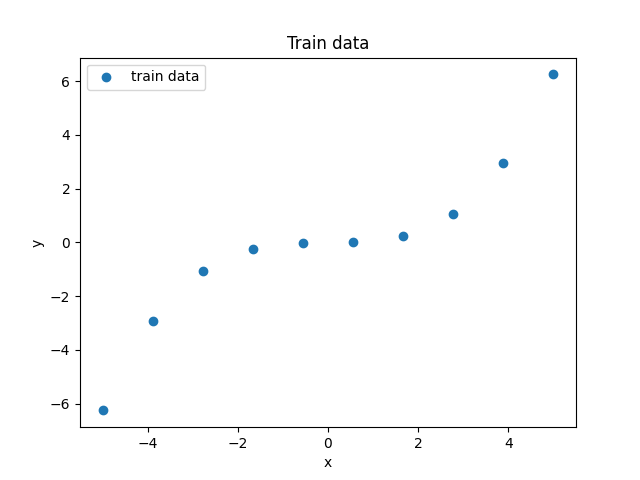

In these experiments, we use the following three metrics to measure training dynamics.

- Change in the parameters from their initial values during training

We measure how much the parameters change from their initial values during training using the following formula.

$$
\frac{||\theta(t) - \theta(0)||_2}{||\theta(0)||_2}
$$

- Change in the NTK from its initial value during training

We measure how much the NTK changes from its initial value during training using the following formula.

$$
\frac{||K(x_{0},x_{0};\theta(t)) - K(x_{0},x_{0};\theta(0))||_2}{||K(x_{0},x_{0};\theta(0))||_2}
$$

For simplicity, both arguments of the NTK are $x_{0}$.

- Change in the loss during training

We measure the loss $L(\theta)$.

### Results

- Batch = 1

<table>
<tr>
<td>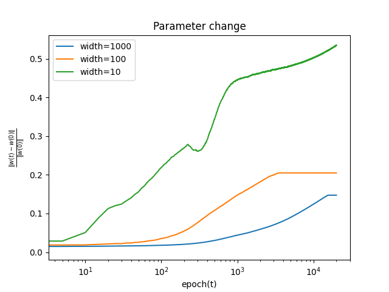</td>
<td>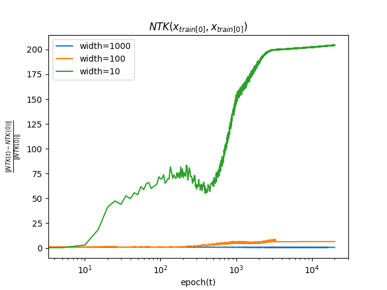</td>
<td>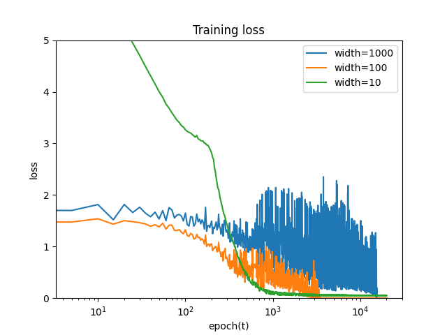</td>
</tr>
</table>

- Batch = 5

<table>
<tr>
<td>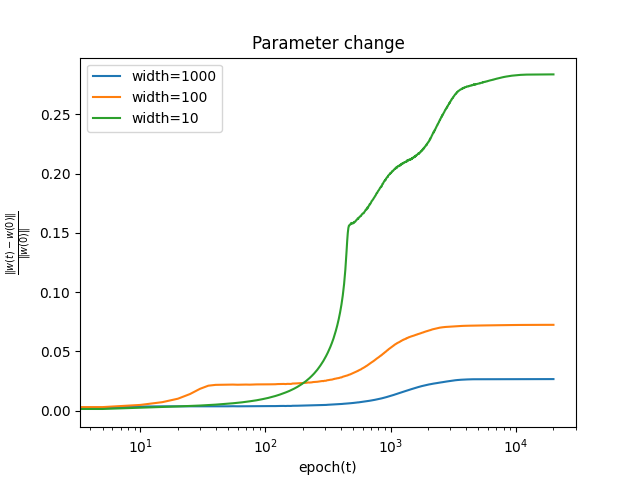</td>
<td>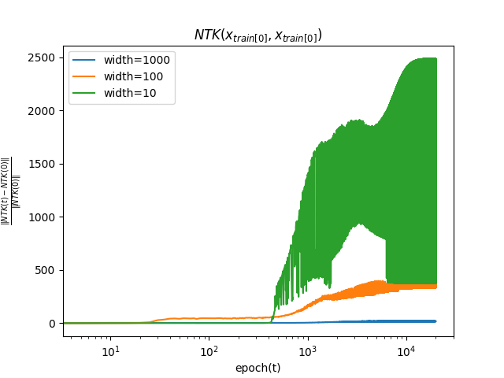</td>
<td>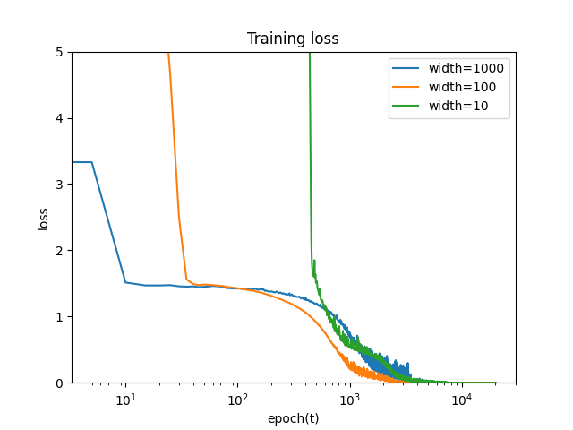</td>
</tr>
</table>

- Batch = 10

<table>
<tr>
<td>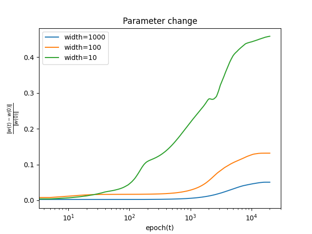</td>
<td>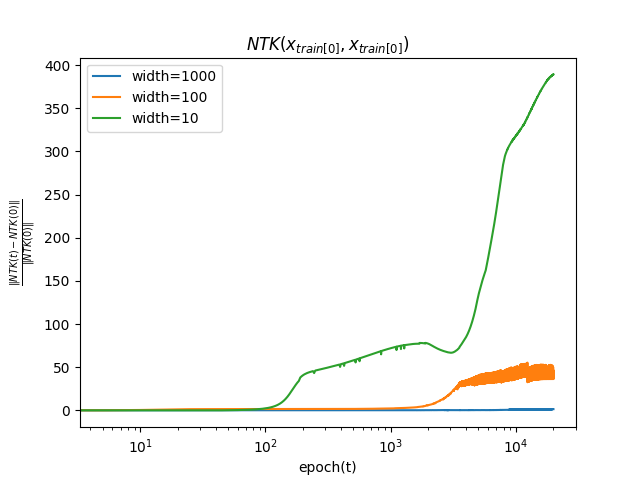</td>
<td>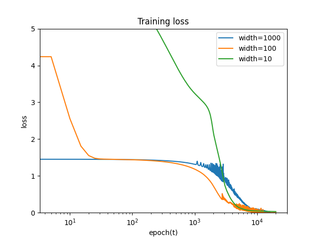</td>
</tr>
</table>

Regardless of the batch size, the wider the network, the smaller the change in the parameters from their initial values. This is consistent with the fact that, at infinite width, the model can be approximated by a linear model during training.
The NTK likewise changes less from its initial value as the width grows. This is consistent with the fact that, at infinite width, the NTK does not change during training.

## Afterword

Research on the theory of deep learning is close to the way physics works: it uses theory to uncover mysteries that come from experimental facts, and it looks at behavior in limits. It feels like analyzing a complex system, and I find it fun.

That said, what I introduced here assumes full-batch training, $\theta(t)$ following gradient flow, and simple fully connected models, a setting far from practice.

Going forward, I would like to survey and work on research that relaxes these assumptions, as well as settings where theoretical research can be put to practical use.

## References

- [“Some Math behind Neural Tangent Kernel”](https://lilianweng.github.io/posts/2022-09-08-ntk/), Lil’Log.
- Belkin et al. [“Reconciling modern machine learning practice and the bias-variance trade-off.”](https://arxiv.org/abs/1812.11118) 2019
- Jacot et al. [“Neural Tangent Kernel: Convergence and Generalization in Neural Networks.”](https://arxiv.org/abs/1806.07572) NeurIPS 2018.
- [“Understanding the Neural Tangent Kernel.”](https://rajatvd.github.io/NTK/) Rajat’s Blog.
- Lee & Xiao et al. [“Wide Neural Networks of Any Depth Evolve as Linear Models Under Gradient Descent.”](https://arxiv.org/abs/1902.06720) NeurIPS 2019.
- [深層学習 改訂第２版 (機械学習プロフェッショナルシリーズ)](https://amzn.to/48jz99f) (Deep Learning, 2nd revised edition, Machine Learning Professional Series), Okatani
- [情報幾何学の新展開 (SGCライブラリ)](https://amzn.to/3RDB6pO) (New Developments in Information Geometry, SGC Library), Amari
  - Covers topics such as the NTK and double descent.
  - The introductory chapter on the history of AI research is very interesting, written from the unique perspective of Professor Amari, who has been active since the earliest days of AI.
- [深層学習理論のフロンティア (2023)](https://speakerdeck.com/taiji_suzuki/shen-ceng-xue-xi-li-lun-nohuronteia-2023) (Frontiers of Deep Learning Theory, 2023), Suzuki
- [深層学習の原理に迫る](https://amzn.to/48HR6Oj) (Approaching the Principles of Deep Learning), Imaizumi
  - A pocket-sized book giving a broad overview of the theory of deep learning.
- Experiment repository: [https://github.com/speed1313/ntk](https://github.com/speed1313/ntk)
