## はじめに

深層学習は大規模言語モデルや画像認識など、多くの応用において飛躍的な性能を上げている。

しかしながら、深層学習の原理には謎が多い。

謎の例として、DNNは訓練データ数よりパラメータ数の方が多い(over parametrization)モデルでありながら、汎化性能が高いという現象がある。これは従来の統計的学習理論で考えられていた bias-variance tradeoff の法則に反する。この現象は[double descent](https://arxiv.org/abs/1812.11118) として知られている。

<figure>
  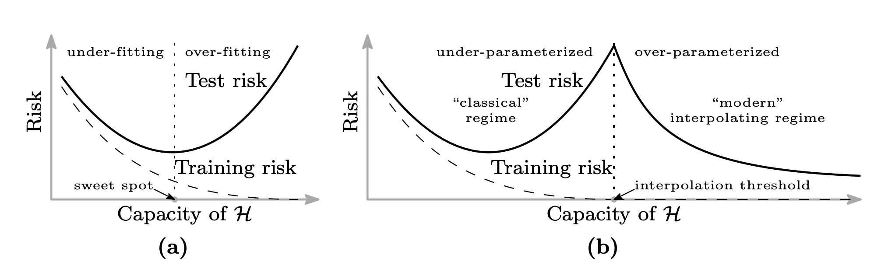
  <figcaption>出典: <a href="https://arxiv.org/abs/1812.11118"> Belkin et al. "Reconciling modern machine learning practice and the bias-variance trade-off", 2018</a></figcaption>
</figure>

他の例として、深層学習の学習がなぜうまくいくかという謎がある。通常、DNNモデルのような関数の最適化は非凸最適化問題であり、最適解を見つけることは難しい。しかし、現実的には非常に良い解が得られる。

このような謎を解明すべく、深層学習理論(theory of deep learning)が研究されている。

深層学習理論はいくつかの分野がある。

- 表現能力: DNNモデルの表現能力
- 汎化能力: 未知データに対する汎化性能
- 最適化能力: 最適化がうまくいく理由
- etc

表現能力については、普遍性定理([Universal approximation theorem](https://en.wikipedia.org/wiki/Universal_approximation_theorem)) 等の有用な定理が示されてきた。その一方で、汎化能力や最適化能力についての理解はまだまだである。
これらについて学習中のダイナミクス(Learning Dynamics)を解析することで理解を深めようとする研究が盛んに行われている。

本稿では、学習中のダイナミクスに着目した研究の礎となっている Neural Tangent Kernel (NTK) 理論を紹介する。構成については[“Some Math behind Neural Tangent Kernel”](https://lilianweng.github.io/posts/2022-09-08-ntk/) を大いに参考にした。

NOTE: NTK理論は、深層学習理論の研究を超えて、["Editing Models with Task Arithmetic"](https://arxiv.org/abs/2212.04089)等のモデルパラメータの算術における説明に使われるなど[[Ortiz-Jimenez et al. 2023]](https://arxiv.org/abs/2305.12827)、深層学習研究における基本ツールとなりつつあります。

## $\theta, f(x;\theta)$ のダイナミクスとNeural Tangent Kernel (NTK) の定義

学習中のダイナミクスにおいて重要なものが、モデルのパラメータ$\theta \in R^P$、出力$f(x;\theta)\in F: R \times R^P \to R$である。簡単のためモデルの入出力の次元はそれぞれ1次元とした。$\theta, f(x;\theta)$ はエポックを$t$とした時、$t$によって時間発展する。

ここでは、$\theta, f(x;\theta)$ が学習中に従う微分方程式を導出する。

訓練データ$\mathcal{D} =\{(x^i,y^i)\}^N_{i=1}$が与えられるとする。この時、損失は以下のように定義される。

$$
L(\theta) := \frac{1}{N}\sum^N_i l(f(x^i;\theta),y^i)
$$

ここで、以下のような微分の連鎖律を適用すると、

$$
\frac{dl(f(x;\theta))}{d\theta_i}=\frac{dl}{df} \frac{df}{d\theta_i}
$$

以下のように損失$L(\theta)$の勾配が計算できる。ただし$\nabla_\theta L(\theta):=(\frac{\partial L}{\partial\theta_1}, \dots,\frac{\partial L}{\partial\theta_P})$、Pはパラメータの総数とする。

$$
\nabla_\theta L(\theta) = \frac{1}{N}\sum^N_i \nabla_\theta f(x^i;\theta)\frac{dl(f,y^i)}{df}
$$

続いて、パラメータの時間微分を考える。

通常、勾配降下法は、以下のようにパラメータが更新される。ただし本稿では全体を通してFull Batch Gradient Descentとする。

$$
\theta_{t+1} = \theta_t - \eta\nabla_\theta L(\theta)
$$

更新の幅を小さくした時、以下のようにパラメータに関する微分方程式が得られる(Gradient Flow)。

$$
\begin{split}
\frac{d\theta}{dt} &= - \eta\nabla_\theta L(\theta)\\
&= -\eta \frac{1}{N}\sum^N_i \nabla_\theta f(x^i;\theta)\frac{dl(f,y^i)}{df}
\end{split}
$$

さらに、これを用いて$f(x;\theta)$ に関する微分方程式が得られる。

$$
\begin{split}
\frac{df(x;\theta)}{dt}
&= \sum_i\frac{df(x;\theta)}{d\theta_i}\frac{d\theta_i}{dt}\\
&=  \nabla_\theta f(x;\theta) (-\eta \nabla_\theta L(\theta)^\top)\\
&= - \frac{\eta}{N}\sum^N_i\nabla_\theta f(x;\theta) \nabla_\theta f(x^i;\theta)^\top \frac{dl(f,y^i)}{df}\\
&= -\frac{\eta}{N}\sum^N_i K(x,x^i; \theta) \frac{dl(f,y^i)}{df}
\end{split}
$$

ただし、

$$
K(x,x';\theta) := \nabla_\theta f(x;\theta)\nabla_\theta f(x';\theta)^\top
$$

この$K(x,x';\theta)$ をNeural Tangent Kernel (NTK) と呼ぶ。

なお、NTKは以下のように計算される。

$$
K(x,x';\theta) = \sum^P_p \frac{\partial f(x;\theta)}{\partial \theta_p}\frac{\partial f(x';\theta)}{\partial \theta_p}
$$

この時、NTKは

- $K:R\times R \times R^P \to R$という写像であり、
- $K(x,x';\theta) = K(x',x;\theta)$

である。

このように、NTKはモデルの出力$f(x;\theta)$の時間発展を左右する重要なfactorであり、深層学習理論において学習中のダイナミクスを解析するのに用いられている。

次節以降のため、以下のように定義しておく。
$$f(X;\theta):=(f(x_1;\theta),\dots,f(x_n;\theta))^\top$$

$$
K(x,X;\theta) := \nabla_\theta f(x;\theta) \nabla_\theta f(X;\theta)^\top
$$

なお、出力のサイズは、(1 × P) × (P × N) = (1 × N)

$$K(X,X) := \nabla_\theta f(X;\theta) \nabla_\theta f(X;\theta)^\top$$

なお、出力のサイズは、(N × P) × (P × N) = (N × N)

## 無限の幅のDNNのNTKは学習中ずっとconstant

ここでは、NTKに関する驚きの定理を紹介する。

[[Jacot et al. 2018]](https://arxiv.org/abs/1806.07572) は、いくつかの仮定(ntk parametrization, activation function, learning rate等の制約)のもとで以下の定理が成り立つことを示した。

> Fully-ConnectedなDNNの中間層の幅を無限とした時(各層$l$の重みの次元数を$n_l$とした時、$n_1, \dots , n_{L-1} \to \infty$)、各層の出力$f^l(x;\theta)$で定義されるNTK $K^l_\infty(x,x';\theta)$は重み$\theta$ に依存しない。すなわち$K^l_\infty(x,x')$と表すことができ、入力$x,x'$と、層の深さ、activation function、パラメータの初期化の分散のみから定まる。

なんとも驚きの結果である。驚きを感じるために、$K(x,x';\theta)$ の定義をもう一度振り返ってみよう。

$$
K(x,x';\theta) := \nabla_\theta f(x;\theta)\nabla_\theta f(x';\theta)^\top
$$

$x, x'$ を入力としたときのモデルの出力のパラメータに関する勾配の内積で定義されており、この値は、通常、学習中変化するパラメータの値に依存する。

しかし、各層の幅を無限とした時($n_1, \dots , n_L \to \infty$)、$K_\infty(x,x';\theta)$はパラメータ$\theta$によらず一定となる。

すなわち、各層の幅が無限なモデルは、初期化時$K_0(x,x')$からすでに重みに依存せず値が定まり、学習中に重みが変化してもNTKの値は変わらず一定である。さらに言い換えれば、モデルの学習中、NTKは不変量となる。

不変量は古来より複雑な対象物を解析する際に重宝されてきた。例えば物理学では時間$t$に一定なエネルギーに着目し様々な定理を導いてきた。

幅が無限という理想的な状況で不変量となるNTKが、深層学習理論において重要な理由が垣間見える。

## 学習中の$f(x;\theta)$ のダイナミクスについて

前章の定理から何が言えるだろうか。$f(x;\theta)$ が従う微分方程式を見てみよう。

$$
\frac{df(x;\theta)}{dt}
= -\frac{\eta}{N}\sum^N_i K(x,x^i; \theta) \frac{dl(f,y^i)}{df}
$$

幅を無限にした時、$K(x,x^i;\theta) = K^L_\infty(x,x^i)$より以下のようになる。

$$
\frac{df(x;\theta)}{dt}
= -\frac{\eta}{N}\sum^N_i K^L_\infty(x,x^i) \frac{dl(f,y^i)}{df}
$$

x, X, Yは学習中定数であり、NTKはこの時定数であり、右辺が簡単になった。

さらに、損失関数がMSE、すなわち $L(\theta) = \frac{1}{2N}\|f(X; \theta) - Y\|^2$の時、$\nabla_f L(\theta) = \frac{1}{N}(f(X;\theta) - Y )$より

$$
\frac{df(x;\theta)}{dt}
= - \eta K_\infty(x,X)  (f(X;\theta) - Y )
$$

と簡略化できる (係数$\frac{1}{N}$は学習率$\eta$に含めて表記した)。さらに、$g(X;\theta) := f(X;\theta) - Y$ とすると、$X, Y$ は定数より

$$
\frac{dg(X;\theta)}{dt} = -\eta K_\infty(X,X) g(X;\theta)
$$

これは典型的な解ける形の常微分方程式であり以下のように解ける。ただし$C$ は定数。

$$
g(X;\theta) = \exp({-\eta K_\infty(X,X) t})C
$$

よって

$$
f(X;\theta) =  \exp({-\eta K_\infty (X,X)t})C + Y
$$

また、$t=0$の時、$C = f(\theta(0)) - Y$ より

$$
f(X;\theta(t)) =\exp({-\eta K_\infty(X,X) t}) ( f(X;\theta(0)) - Y) + Y
$$

任意の入力$x$についても以下のように陽に解ける。

$$
f(x;\theta(t)) = f(x;\theta(0)) + K_\infty(x,X)K_\infty(X,X)^{-1}(I-\exp{(-\eta K_\infty(X,X)t)})(Y-f(X;\theta(0)))
$$

実際にtで微分すると

$$
\frac{df(x;\theta(t))}{dt} =  -\eta K_\infty(x,X) \exp{(-\eta K_\infty(X,X)t)}(f(X;\theta(0))-Y)
$$

この式に、$f(X;\theta(0))-Y = \exp{(-\eta K_\infty(X,X) t)}^{-1}(f(X;\theta(t))-Y)
$を代入して、整理すると

$$
\frac{df(x;\theta(t))}{dt} =  -\eta K_\infty(x,X)(f(X;\theta(t))-Y)
$$

よって元の微分方程式が得られた。

以上のように、時刻$t$における出力$f(x;\theta)$ が解析的に得られた。

この結果、$f(x;\theta(t))$ は、Gradient Descentをせずとも、$K_\infty = K_0$と$f(\theta(0))$ を計算することで計算できる。

NTKが不変量、損失がMSEという仮定から非常に面白い結果が生まれた。

### 無限の幅のDNNは学習中パラメータに関して線形モデル

話を変えて、時刻$t$におけるモデル$f(x;\theta(t))$ を$d\theta:=\theta(t)-\theta(0)$が小さい時、パラメータ$\theta$ に関して、初期値$\theta(0)$ 周りでテイラー展開をして1次近似できるものとしてみよう。

$$
f^{lin}(x;\theta(t)) \approx f(x;\theta(0)) + \nabla_\theta f(x;\theta(0)) (\theta(t) - \theta(0))^\top
$$

この時、$f(\theta(t))$ は$\theta(t)$ に関して線形である。

このように近似した時、tが小さければGradient Descentの更新式から

$$
\theta(t)-\theta(0)  = - \eta\nabla_\theta L(\theta(0)) = -\eta \frac{1}{N}\sum^N_i \nabla_\theta f(x^i;\theta(0))\frac{dl(f,y^i)}{df}

$$

であり、$f^{lin}(x;\theta(t))$に代入すると、

$$
f^{lin}(x;\theta(t)) - f(x;\theta(0)) = \nabla_\theta f(x;\theta(0)) (-\eta \frac{1}{N}\sum^N_i \nabla_\theta f(x^i;\theta(0))\frac{dl(f,y^i)}{df})^\top
$$

tを小さくして整理すると、

$$
\begin{split}
\frac{df^{lin}(\theta(t))}{dt} &= -\eta \frac{1}{N}\sum^N_i \nabla_\theta f(x;\theta(0))\nabla_\theta f(x^i;\theta(0))^\top  \frac{dl(f,y^i)}{df}\\
&= -\eta \frac{1}{N}\sum^N_i K(x,x^i;\theta(0))\nabla_f l(f,y^i)
\end{split}
$$

以上から、$f^{lin}(\theta(t))$ の従う微分方程式のNTKは$K(\theta(0))$ で一定になる。

この方程式は、前章で導出した、幅を無限にした時の微分方程式

$$
\frac{df(x;\theta)}{dt}
= -\frac{\eta}{N}\sum^N_i K^L_\infty(x,x^i) \nabla_f l(f,y^i)

$$

と一致している。

[[Lee et al. 2019]](https://arxiv.org/abs/1902.06720) は幅が無限の時、学習中の$f(\theta(t))$は初期パラメータ周りで一次近似した線形モデルとして表されることを示した。この結果は、パラメータの探索が初期値まわりにとどまることも意味しており、DNNモデルの自由度を暗黙的に制約する暗黙的正則化との繋がりが示唆される。

## 数値実験

ここでは、NTKの理論が有限幅において、どの程度成り立つか実験する。
本実装は以下のリポジトリから再現できる。

- [https://github.com/speed1313/ntk](https://github.com/speed1313/ntk)

実装はJAXを用いた。JAXはヤコビアンを計算する関数として`jax.jacfwd()`、`jax.jacrev()` の二つが用意されている。どちらも同じ計算結果になるが、内部の実装が異なっており、`jacfwd()` はTallな行列、`jacrev()` はWideな行列に効果的である[[JAX doc](https://jax.readthedocs.io/en/latest/notebooks/autodiff_cookbook.html#jacobians-and-hessians-using-jacfwd-and-jacrev)]。今回のヤコビアンは出力の次元数よりパラメータの次元数の方が大きいWideな行列であるため、`jacrev()` が適している。
ただし今回は出力がスカラーであるため、`jax.grad()`でよい。

設定としては、中間層の数depth=5、各層の幅width={10,100,1000}、入力、出力を1次元、learning rate $\eta = 0.001$、epoch数を20000とする。バッチサイズについては、NTK理論はFull Batchを仮定していたが、現実的にはMini Batchを使うことが多いため、バッチサイズを1, 5, 10と変えて実験した。

訓練データは簡単のため以下のようなN=10の点とする。

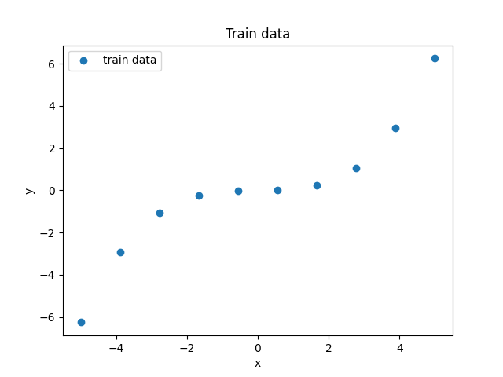

本実験では、学習中のダイナミクスを測る指標として以下の３つを用いる。

- 学習中のパラメータの初期値からの変化量

学習中にパラメータが初期値からどの程度変化するか、以下の式を用いて測る。

$$
\frac{||\theta(t) - \theta(0)||_2}{||\theta(0)||_2}
$$

- 学習中のNTKの初期値からの変化量

学習中にNTKが初期値からどの程度変化するか、以下の式を用いて測る。

$$
\frac{||K(x_{0},x_{0};\theta(t)) - K(x_{0},x_{0};\theta(0))||_2}{||K(x_{0},x_{0};\theta(0))||_2}
$$

簡単のためNTKの引数は$x_{0}$同士としている。

- 学習中の損失の変化

損失$L(\theta)$を測る。

### 結果

- Batch = 1

<table>
<tr>
<td>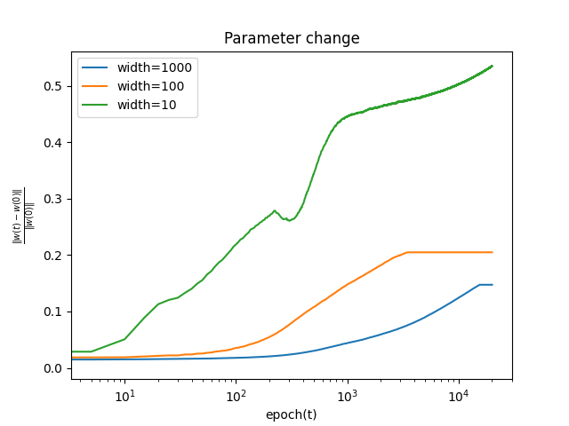</td>
<td>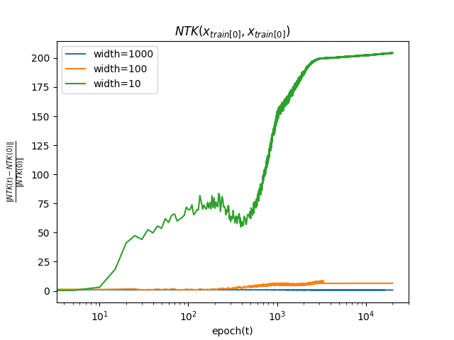</td>
<td>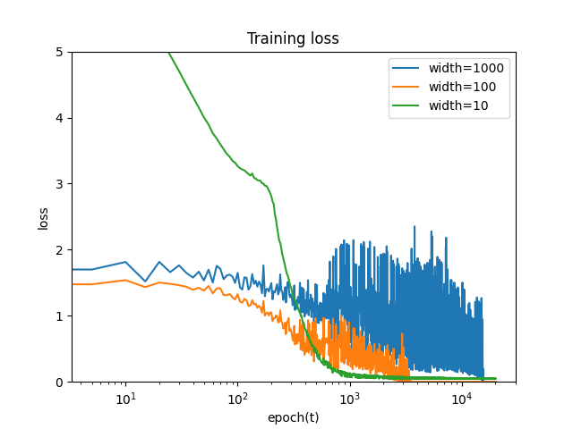</td>
</tr>
</table>

- Batch = 5

<table>
<tr>
<td>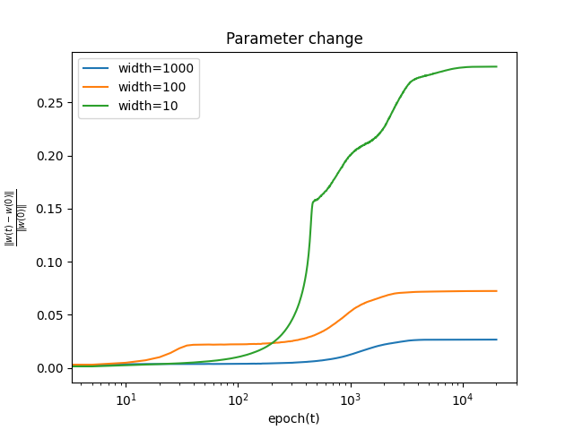</td>
<td>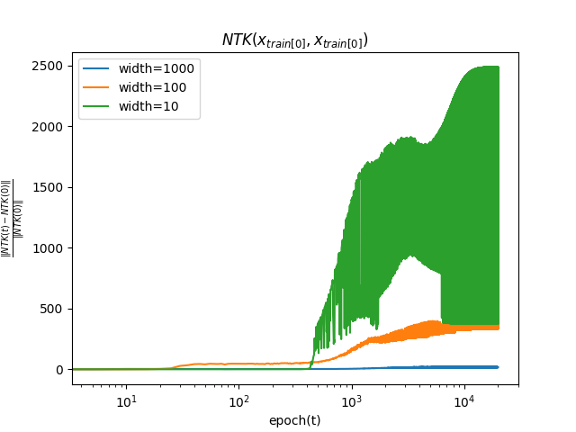</td>
<td>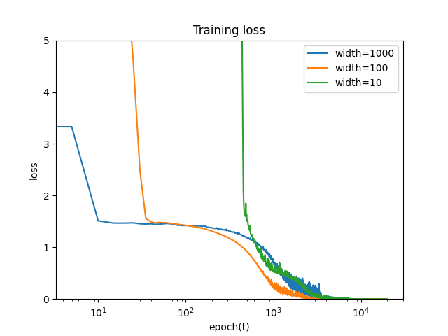</td>
</tr>
</table>

- Batch = 10

<table>
<tr>
<td>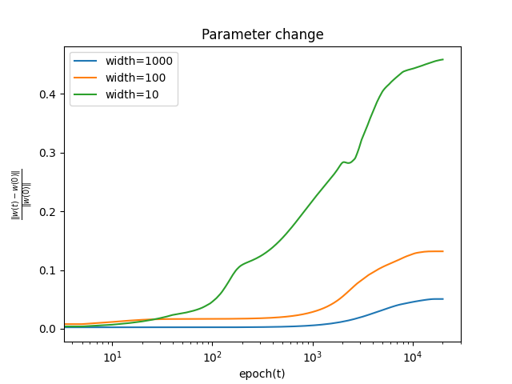</td>
<td>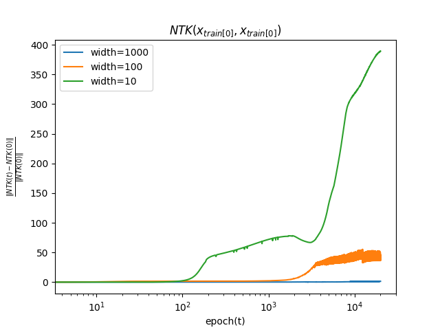</td>
<td>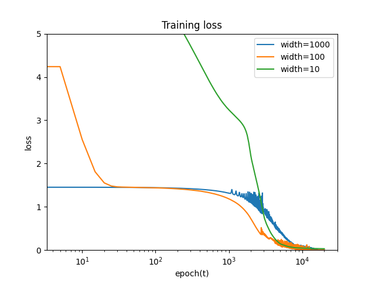</td>
</tr>
</table>

バッチサイズによらず、パラメータの初期値からの変化は幅が大きいほど小さいことがわかる。これは、無限幅において、学習中に線形モデルで近似できることと整合性がある。
NTKについても、幅が大きいほど初期値からの変化は小さいことがわかる。これは、無限幅において、NTKが学習中に変化しないことと整合性がある。

## あとがき

深層学習理論の研究は、実験的な事実から得た謎を理論で暴いていく流れや極限における挙動を見るといった点が物理の作法に近く、複雑なシステムを解析していく感じで面白いです。

なお、今回紹介した内容は、Full Batchを用いることや、$\theta(t)$がGradient Flowに従うこと、Fully-Connectedなシンプルなモデルを仮定しており、現実と離れた設定でした。

今後は仮定を緩めた研究や、理論研究から応用に活かす設定についてサーベイ、研究していきたいです。

## 参考文献

- [“Some Math behind Neural Tangent Kernel”](https://lilianweng.github.io/posts/2022-09-08-ntk/), Lil’Log.
- Belkin et al. [“Reconciling modern machine learning practice and the bias-variance trade-off.”](https://arxiv.org/abs/1812.11118) 2019
- Jacot et al. [“Neural Tangent Kernel: Convergence and Generalization in Neural Networks.”](https://arxiv.org/abs/1806.07572) NeurIPS 2018.
- [“Understanding the Neural Tangent Kernel.”](https://rajatvd.github.io/NTK/) Rajat’s Blog.
- Lee & Xiao et al. [“Wide Neural Networks of Any Depth Evolve as Linear Models Under Gradient Descent.”](https://arxiv.org/abs/1902.06720) NeurIPS 2019.
- [深層学習 改訂第２版 (機械学習プロフェッショナルシリーズ)](https://amzn.to/48jz99f)、岡谷
- [情報幾何学の新展開 (SGCライブラリ)](https://amzn.to/3RDB6pO)、甘利
  - NTKやDouble Descent等を扱っている。
  - 序章では、AI研究の歴史について、AIの最初期から活躍された甘利先生ならではの視点で解説していてとても面白いです。
- [深層学習理論のフロンティア (2023)](https://speakerdeck.com/taiji_suzuki/shen-ceng-xue-xi-li-lun-nohuronteia-2023)、鈴木
- [深層学習の原理に迫る](https://amzn.to/48HR6Oj)、今泉
  - 深層学習理論を幅広く解説している新書です。
- 実験リポジトリ: [https://github.com/speed1313/ntk](https://github.com/speed1313/ntk)
