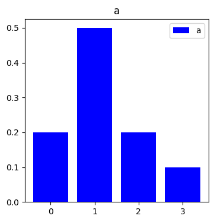
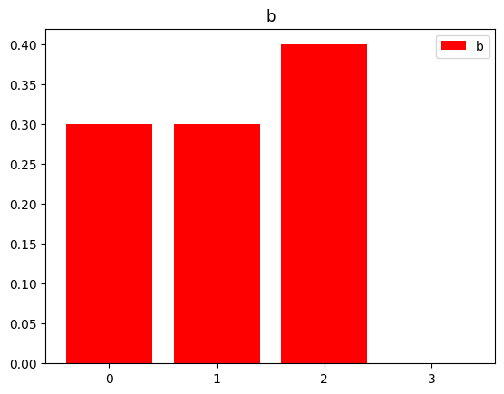
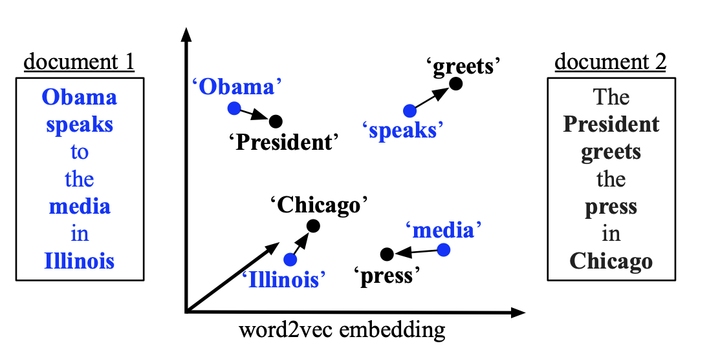
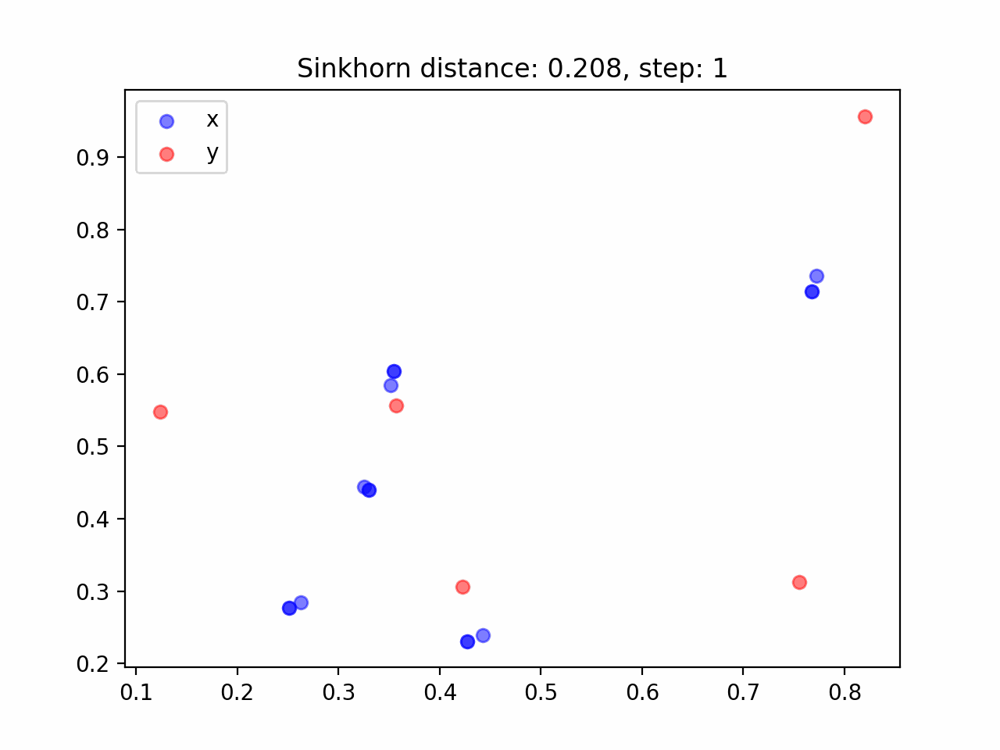

This post on optimal transport draws heavily on the following:

- [「なんでも微分する」, 佐藤竜馬](https://speakerdeck.com/joisino/he-demowei-fen-suru) ("Differentiate Everything", Ryoma Sato)
- 最適輸送の理論とアルゴリズム, 佐藤竜馬, 講談社 (Theory and Algorithms of Optimal Transport, Ryoma Sato, Kodansha)

The figures in this post can be reproduced with the repository below. The implementation uses [JAX](https://github.com/google/jax).

[https://github.com/speed1313/optimal-transport](https://github.com/speed1313/optimal-transport)

## Optimal Transport

Optimal transport is a method for computing the most efficient plan, and its total cost, for transporting cargo from point cloud A to point cloud B.

For example, suppose we have points $x_i, y_j$, where $x_i$ has weight $a_i, y_j$ has weight $b_j$. With the cost $C(x_i,y_j) = \|x_i - y_j\|_2$, optimal transport asks how to move $x_i$ to $y_j$ so that the total cost is as small as possible.

### Optimal Transport Between Probability Distributions

As an example, consider the optimal transport problem between the following probability distributions a and b.





```python
a = np.array([0.2, 0.5, 0.2, 0.1])
b = np.array([0.3, 0.3, 0.4, 0.0])
C = np.array([
    [0, 2, 2, 2],
    [2, 0, 1, 2],
    [2, 1, 0, 2],
    [2, 2, 2, 0]]
) # C[i][j]: cost of transporting one unit of mass from i to j
```

Given the probability distributions a and b and the cost function C(i,j) above, we treat the values $a_i$, $b_j$ as amounts of sand and consider moving the sand piles of a in the optimal way so that the distribution of a matches the distribution of b.

Solving the optimal transport problem with the Sinkhorn algorithm gives the transport matrix P shown below.

In the figure, the y-axis corresponds to the indices of a and the x-axis to the indices of b. $P_{ij}$ represents how much of the sand at $a_i$ is transported to $b_j$.

](./p_matrix.png)

[https://github.com/speed1313/optimal-transport/blob/main/src/optimal_transport/sinkhorn.py](https://github.com/speed1313/optimal-transport/blob/main/src/optimal_transport/sinkhorn.py)

Let's look at it in more detail.

All of the sand at $a_0$ is transported to $b_0$, the entry of b with the lowest transport cost.

Most of the sand at $a_1$ goes to $b_1$, and the remaining sand is transported to $b_0, b_2$.

All of the sand at $a_2$ is transported to $b_2$.

The sand at $a_3$ is transported to $b_0, b_2$.

By computing the optimal transport cost in this way, we can compute a distance between probability distributions.

### Optimal Transport Between Point Clouds

As the next example, consider two-dimensional point clouds A and B, each with uniform weights.

Point cloud A consists of 5 points and point cloud B of 3 points, with weights $a_i = 1/5, b_j=1/3$, respectively.

Let the coordinates of the points in A and B be $\bf{x}_i, \bf{y}_j$, and let the cost be $C(i,j) = \| \bf{x}_i - \bf{y}_j \|_2$.

The figure below shows the result of optimal transport using the Sinkhorn algorithm. The opacity of each line between points represents the transported amount $P_{ij}$.

We can see that the plan transports mass to points that are as close as possible.

](./point_cloud.png)

[https://github.com/speed1313/optimal-transport/blob/main/src/optimal_transport/sinkhorn.py](https://github.com/speed1313/optimal-transport/blob/main/src/optimal_transport/sinkhorn.py)

### Applications of Optimal Transport

- Measuring the distance between probability distributions a and b
- Measuring the distance between point clouds a and b.
- Measuring the distance between sentences a and b (Word Mover’s Distance (WMD)): treat the words in each sentence as vectors and perform optimal transport between the two sets of vectors

<figure>
  
  <figcaption>Source: <a href="https://proceedings.mlr.press/v37/kusnerb15.html"> Matt Kusner+, From Word Embeddings To Document Distances, 2015</a></figcaption>
</figure>

## Formulating the Optimal Transport Problem

Given points $x_i, y_j$, the weight $a_i$ of $x_i$, the weight $b_j$ of $y_j$, the cost $C(x_i,y_j)$ of transporting one unit of mass from $x_i$ to $y_j$, and the transported amount $P_{ij}$, the optimal transport problem is formulated as the following linear optimization problem.

$$
\begin{gathered}
OT(a,b,C) := \underset{P\in R^{n*m}}{\min} \sum^n_i \sum^m_j C(x_i,y_j)P_{ij}\\
s.t. \\
P_{ij} \geq 0 \\
\sum^m_j P_{ij} = \bf{a}_i \\
\sum^n_i P_{ij} = \bf{b}_j
\end{gathered}
$$

The optimal transport problem is to find the optimal transport cost by varying the entries of $P$ subject to the three constraints at the bottom.

The optimal solution of this problem is the optimal transport plan $P_{ij}$, and the optimal value is the optimal transport cost $d = \sum^n_i \sum^m_j C(x_i,y_j)P_{ij}$.

The last two constraints can also be written as follows.

$$
\begin{gathered}
1_m \in R^m, 1_n \in R^n\\
P1_m = \bf{a} \\
P^\top 1_n = \bf{b}
\end{gathered}
$$

This can be seen from

$$
\begin{gathered}
(P1_m)_{i} = \sum^m_k P_{ik} = \bf{a}_i\\
(P^\top 1_n)_{j} = \sum^n_k P^\top_{jk} = \sum^n_k P_{kj} = \bf{b}_j
\end{gathered}
$$

These constraints mean that the row sums of P are $a_i,$ and the column sums are $b_j$, which enforces conservation of the transported mass.

## Wasserstein Distance

A special case of the optimal transport cost.

When the cost $C_{ij}$ is a distance between points (one that satisfies the axioms of a metric), the optimal transport cost $d(\bf{a}, \bf{b})$ satisfies the axioms of a metric.

In this way, when the optimal transport cost satisfies special conditions, it becomes a distance, called the Wasserstein distance.

## Optimal Transport with Entropic Regularization

$$
\begin{gathered}
OT_\epsilon(a,b,C) := \underset{P\in R^{n*m}}{\min} \sum_{ij} P_{ij} C_{ij} - \epsilon H(P)\\
H(P) := - \sum_{ij}P_{ij}(\log{P_{ij}} - 1)
\end{gathered}
$$

We add the entropic regularization term $-\epsilon H(P)$, changing the problem to be solved.

This makes the problem easier to optimize, and it can be solved by iterative matrix computations with the Sinkhorn algorithm.

This also makes $OT_{\epsilon} (a,b, C)$ differentiable with respect to its inputs.

## The Sinkhorn Algorithm

The Sinkhorn algorithm is an algorithm for solving the entropy-regularized optimal transport problem.

An implementation in JAX is shown below.

```python
def Sinkhorn(a: jnp.ndarray, b: jnp.ndarray, x: jnp.ndarray, y: jnp.ndarray
                            , eps: float)->(float, jnp.ndarray):
    C = jnp.zeros((n, m)) # Cost Matrix
    for i in range(n):
        for j in range(m):
            C = C.at[i,j].set(jnp.linalg.norm(x[i] - y[j]))
    K = jnp.exp(- C / eps) # Gibbs kernel
    u = jnp.ones(n)
    v = jnp.ones(m)
    for i in range(100):
        v = v.at[:].set(b / (K.T @ u))
        u = u.at[:].set(a / (K @ v))
    P = u.reshape(n, 1) * K * v.reshape(1, m)
    d = (C * P).sum()
    return d, P
```

Since the Sinkhorn algorithm consists only of differentiable operations, we can obtain gradients with automatic differentiation.

Because it is differentiable, we can, for example, move point cloud A toward point cloud B with gradient descent.

Specifically, we take the positions X of A as parameters and the optimal transport cost d as the cost function L, compute $dL/dX$, and repeat $X ← X - \epsilon * dL/dX$ to move point cloud A toward point cloud B.

With JAX, gradient descent can be implemented as follows.

```python
grad_x = jax.grad(lambda x: Sinkhorn(a, b, x, y, eps)[0])(x)
x -= 0.1 * grad_x
```

The figure below shows the result.

Rather than each point moving to its nearest neighbor, the points move while taking the overall relationships into account, as if making way for one another.

<figure>
  
  <figcaption><a href="https://github.com/speed1313/optimal-transport/blob/main/src/optimal_transport/gradientflow.py">https://github.com/speed1313/optimal-transport/blob/main/src/optimal_transport/gradientflow.py</a></figcaption>
</figure>

## Wasserstein Barycenter

Given multiple probability distributions, optimal transport gives a distribution that serves as their barycenter.

A generalization of k-means clustering.

As an application, in ensemble learning it can be used to combine the predictive distributions output by multiple models into one.

## References

- [最適輸送の理論とアルゴリズム, 佐藤竜馬, 講談社](https://amzn.to/3MuwGjc) (Theory and Algorithms of Optimal Transport, Ryoma Sato, Kodansha)
  - [Official repository](https://github.com/joisino/otbook)
- [NLP2022 チュートリアル４「最適輸送と自然言語処理」横井祥先生（東北大学）](https://youtu.be/vlCjNbVSyOc?si=JLVrXd3bAozhefAj) (NLP2022 Tutorial 4, "Optimal Transport and Natural Language Processing", Sho Yokoi, Tohoku University)
- [「なんでも微分する」, 佐藤竜馬](https://speakerdeck.com/joisino/he-demowei-fen-suru) ("Differentiate Everything", Ryoma Sato)
- [「最適輸送の解き方」, 佐藤竜馬](https://speakerdeck.com/joisino/zui-shi-shu-song-nojie-kifang) ("How to Solve Optimal Transport", Ryoma Sato)
