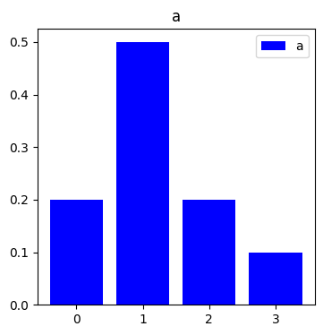
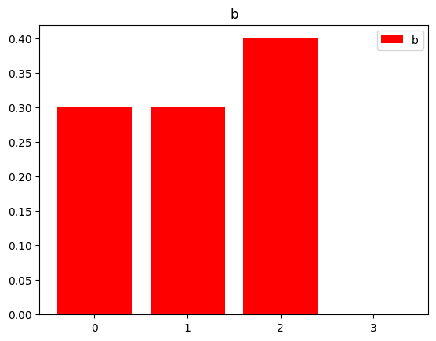
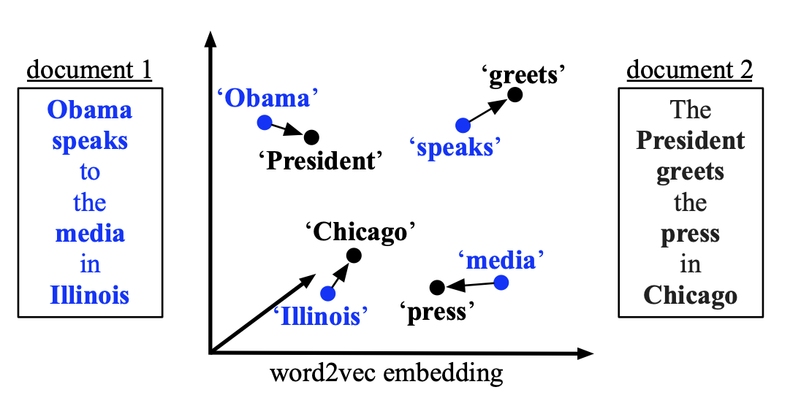
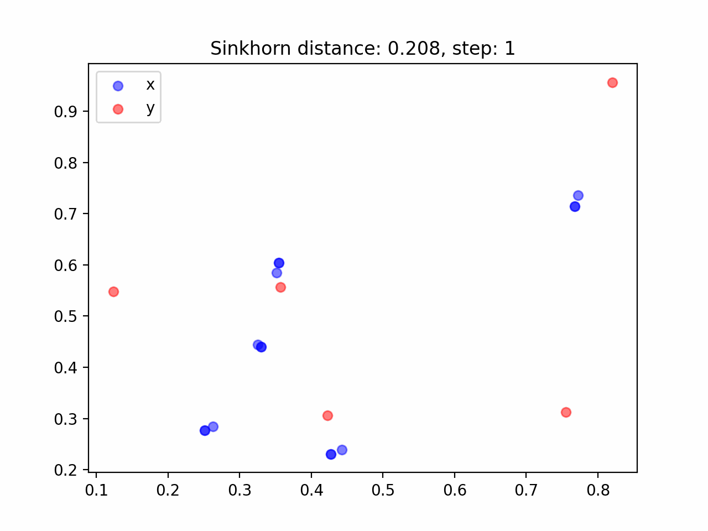

本稿は、最適輸送について

- [「なんでも微分する」、佐藤竜馬](https://speakerdeck.com/joisino/he-demowei-fen-suru)
- 最適輸送の理論とアルゴリズム、佐藤竜馬、講談社

を大いに参考にしてまとめたものである。

本稿で示す図については、以下のリポジトリで再現できる。なお、実装においては[JAX](https://github.com/google/jax)を用いた。

[https://github.com/speed1313/optimal-transport](https://github.com/speed1313/optimal-transport)

## 最適輸送

最適輸送とは、点群Aから点群Bへの荷物の輸送を最も効率的に行うプランと総コストを計算する手法である。

例えば、点群$x_i, y_j$があり、$x_i$の重みが$a_i, y_j$の重みが$b_j$である時、コスト$C(x_i,y_j) = \|x_i - y_j\|_2$ としてなるべく総コストが小さくなるように$x_i$を$y_j$に移すにはどう輸送すれば良いかを考えるのが最適輸送で行うことだ。

### 確率分布間の最適輸送問題

例として以下の確率分布a, b同士の最適輸送問題を考える。





```python
a = np.array([0.2, 0.5, 0.2, 0.1])
b = np.array([0.3, 0.3, 0.4, 0.0])
C = np.array([
    [0, 2, 2, 2],
    [2, 0, 1, 2],
    [2, 1, 0, 2],
    [2, 2, 2, 0]]
) # C[i][j]: iからjへ1単位の質量を輸送するコスト
```

上記の確率分布a, bおよびコスト関数C(i,j)があった時、$a_i$、$b_j$の値を砂の量として、aの分布をbの分布に一致するようにaの砂山を最適な方法で輸送することを考える。

シンクホーンアルゴリズムを用いて最適輸送問題を解くと、下図の輸送行列Pが得られる。

下図は、y軸がa, x軸がbのindexに対応している。$P_{ij}$は$a_i$の砂を$b_j$にどれだけ輸送するかを表している。

](./p_matrix.png)

[https://github.com/speed1313/optimal-transport/blob/main/src/optimal_transport/sinkhorn.py](https://github.com/speed1313/optimal-transport/blob/main/src/optimal_transport/sinkhorn.py)

より詳しく見てみよう。

$a_0$の砂はbのうち最も輸送コストが小さい$b_0$に全て輸送する。

$a_1$の砂は$b_1$に多く輸送しつつ、余った残りの砂を$b_0, b_2$に輸送する。

$a_2$の砂は$b_2$に全て輸送する。

$a_3$の砂は$b_0, b_2$に輸送される。

以上のようにして最適な輸送コストを求めることで、確率分布同士の距離を計算することができる。

### 点群間の最適輸送問題

次の例として、二次元上の点群A,Bがそれぞれ一様分布の重みとした場合を考える。

点群Aは5つの点、点群Bは3つの点で構成され、重みはそれぞれ$a_i = 1/5, b_j=1/3$ である。

点群A,Bの各点の座標は$\bf{x}_i, \bf{y}_j$とし、コスト$C(i,j) = \| \bf{x}_i - \bf{y}_j \|_2$とする。

シンクホーンアルゴリズムを用いた最適輸送の結果が下図である。点同士の線の濃さを輸送量$P_{ij}$で表した。

なるべく近い点に輸送されるようなプランになっていることがわかる。

](./point_cloud.png)

[https://github.com/speed1313/optimal-transport/blob/main/src/optimal_transport/sinkhorn.py](https://github.com/speed1313/optimal-transport/blob/main/src/optimal_transport/sinkhorn.py)

### 最適輸送の応用例

- 確率分布a,b同士の距離を測る
- 点群a,b同士の距離を測る。
- 文a,b同士の距離を測る(Word Mover’s Distance (WMD)) - 文に含まれる単語をベクトルとし、ベクトルの集合とベクトルの集合同士で最適輸送をする

<figure>
  
  <figcaption>出典: <a href="https://proceedings.mlr.press/v37/kusnerb15.html"> Matt Kusner+, From Word Embeddings To Document Distances, 2015</a></figcaption>
</figure>

## 最適輸送問題の定式化

点群$x_i, y_j$、$x_i$の重みを$a_i$、$y_j$の重みを$b_j$、$x_i$から$y_j$に1単位の質量を輸送するコストを$C(x_i,y_j)$、輸送量を$P_{ij}$ とした時、最適輸送問題は以下のように線形最適化問題として定式化される。

$$
\begin{gathered}
OT(a,b,C) := \underset{P\in R^{n*m}}{\min} \sum^n_i \sum^m_j C(x_i,y_j)P_{ij}\\
s.t. \\
P_{ij} \geq 0 \\
\sum^m_j P_{ij} = \bf{a}_i \\
\sum^n_i P_{ij} = \bf{b}_j
\end{gathered}
$$

下3つの式の制約のもとで$P$の各値を動かして最適な輸送コストを求めるのが最適輸送問題だ。

上記の問題の最適解が最適輸送プラン$P_{ij}$であり、最適値が最適輸送コスト$d = \sum^n_i \sum^m_j C(x_i,y_j)P_{ij}$となる。

なお、下段2つの式は以下のようにも書ける。

$$
\begin{gathered}
1_m \in R^m, 1_n \in R^n\\
P1_m = \bf{a} \\
P^\top 1_n = \bf{b}
\end{gathered}
$$

これは、

$$
\begin{gathered}
(P1_m)_{i} = \sum^m_k P_{ik} = \bf{a}_i\\
(P^\top 1_n)_{j} = \sum^n_k P^\top_{jk} = \sum^n_k P_{kj} = \bf{b}_j
\end{gathered}
$$

となることからもわかる。

Pの行方向に足したものが$a_i,$ 列方向に足したものが$b_j$になることを意味し、この式によって輸送量が保存されることを課している。

## ワッサースタイン距離

最適輸送コストの特殊ケース。

コスト$C_{ij}$が点間の距離(距離の公理を満たすもの)になっているとき、最適輸送コスト$d(\bf{a}, \bf{b})$は距離の公理を満たす。

このように、最適輸送コストが特別な条件を満たした場合に、最適輸送コストは距離となり、ワッサースタイン距離と呼ばれる。

## エントロピー正則化付き最適輸送問題

$$
\begin{gathered}
OT_\epsilon(a,b,C) := \underset{P\in R^{n*m}}{\min} \sum_{ij} P_{ij} C_{ij} - \epsilon H(P)\\
H(P) := - \sum_{ij}P_{ij}(\log{P_{ij}} - 1)
\end{gathered}
$$

エントロピー正則化 $-\epsilon H(P)$ を加え、解くべき問題を変える。

これにより最適化がしやすい問題となり、シンクホーンアルゴリズムで行列の反復計算で最適化問題が解けるようになる。

これにより$OT_{\epsilon} (a,b, C)$が入力に対して微分可能になる。

## シンクホーンアルゴリズム

シンクホーンアルゴリズムは、エントロピー正則化付き最適輸送を解くためのアルゴリズムである。

JAXによる実装を以下に示す。

```python
def Sinkhorn(a: jnp.ndarray, b: jnp.ndarray, x: jnp.ndarray, y: jnp.ndarray
                            , eps: float)->(float, jnp.ndarray):
    C = jnp.zeros((n, m)) # Cost Matrix
    for i in range(n):
        for j in range(m):
            C = C.at[i,j].set(jnp.linalg.norm(x[i] - y[j]))
    K = jnp.exp(- C / eps) # ギブスカーネル
    u = jnp.ones(n)
    v = jnp.ones(m)
    for i in range(100):
        v = v.at[:].set(b / (K.T @ u))
        u = u.at[:].set(a / (K @ v))
    P = u.reshape(n, 1) * K * v.reshape(1, m)
    d = (C * P).sum()
    return d, P
```

シンクホーンアルゴリズムは微分可能な演算のみで構成されているため、自動微分を用いることで微分値が得られる。

微分可能であるために、例えば点群Aを点群Bに近づける処理を勾配降下法によって行える。

具体的には、Aの位置Xをパラメータ、コスト関数Lを最適輸送コストdとして$dL/dX$を計算し、$X ← X - \epsilon * dL/dX$を繰り返していくことで点群Aを点群Bに近づける。

JAXを用いる場合、以下のようにして勾配降下法が実現できる。

```python
grad_x = jax.grad(lambda x: Sinkhorn(a, b, x, y, eps)[0])(x)
x -= 0.1 * grad_x
```

実際に行った結果が下図である。

各点がそれぞれすぐ近くの点に移るのではなく、全体の関係性を考慮して、いわば譲り合って移動していることがわかる。

<figure>
  
  <figcaption><a href="https://github.com/speed1313/optimal-transport/blob/main/src/optimal_transport/gradientflow.py">https://github.com/speed1313/optimal-transport/blob/main/src/optimal_transport/gradientflow.py</a></figcaption>
</figure>

## ワッサースタイン重心

複数の確率分布が与えられた時、その重心となる分布を最適輸送によって与える。

K-means Clusteringの一般化。

応用として、アンサンブル学習において、複数モデルの出力した予測分布を一つにまとめることに使える。

## 参考文献

- [最適輸送の理論とアルゴリズム、佐藤竜馬、講談社](https://amzn.to/3MuwGjc)
  - [公式リポジトリ](https://github.com/joisino/otbook)
- [NLP2022 チュートリアル４「最適輸送と自然言語処理」横井祥先生（東北大学）](https://youtu.be/vlCjNbVSyOc?si=JLVrXd3bAozhefAj)
- [「なんでも微分する」、佐藤竜馬](https://speakerdeck.com/joisino/he-demowei-fen-suru)
- [「最適輸送の解き方」、佐藤竜馬](https://speakerdeck.com/joisino/zui-shi-shu-song-nojie-kifang)
