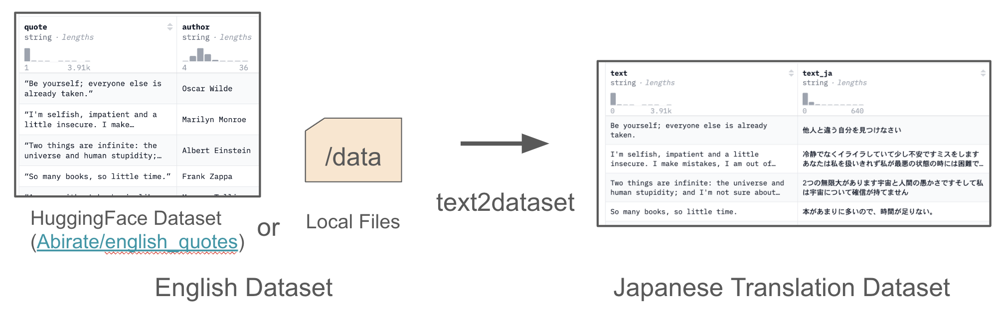
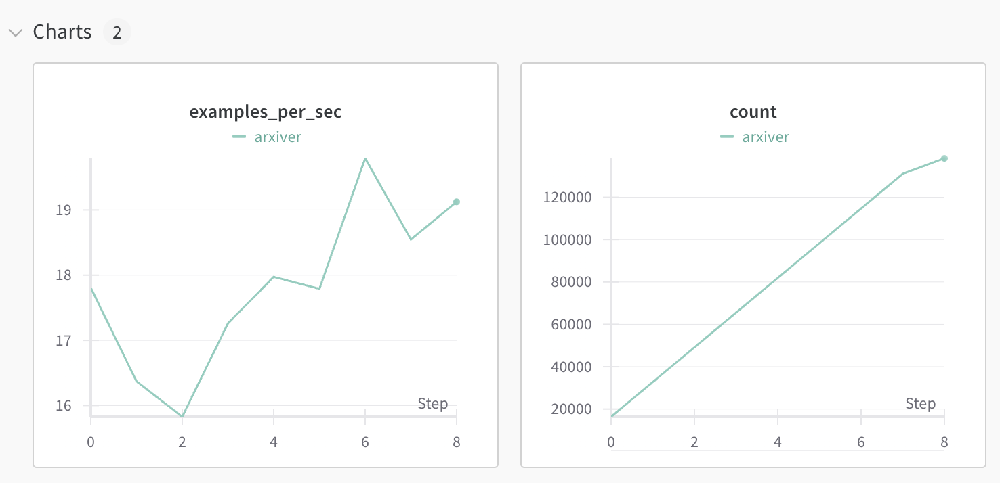
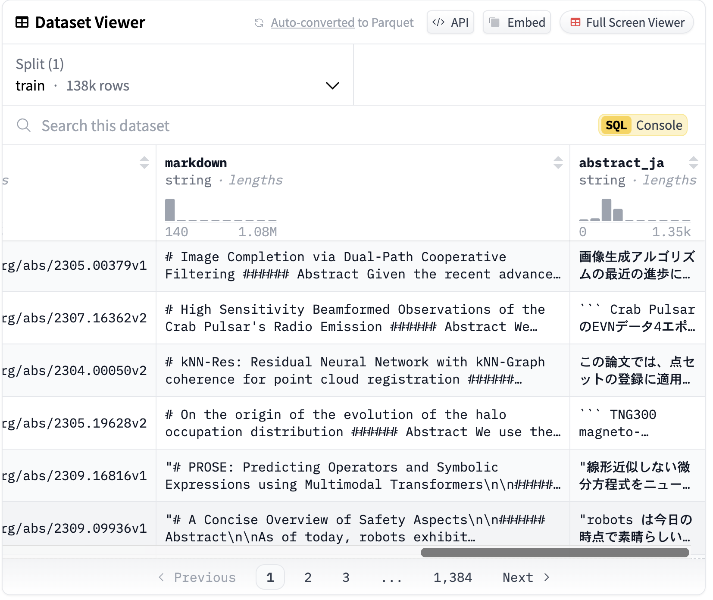

This post introduces [text2dataset](https://github.com/llm-jp/text2dataset), a tool developed as part of the activities of the Multimodal WG of LLM-jp.

text2dataset is a tool that makes it easy to build Japanese translated datasets from English datasets, using the LLM inference library [vLLM](https://github.com/vllm-project/vllm).

<figure>
    
    <figcaption>Overview of <a href="https://github.com/llm-jp/text2dataset">text2dataset</a> </figcaption>
</figure>

text2dataset comes with handy features such as wandb logging, checkpointing and resuming, and custom prompt templates, which make it well suited to translating large-scale datasets.

Below, I describe the background behind text2dataset, its features in detail, and an example of its use.

## Background

There are far fewer Japanese datasets than English ones, so we often end up building new Japanese datasets. A common approach is to translate the English data that is abundant on the internet into Japanese.

For example, [JMMMU](https://mmmu-japanese-benchmark.github.io/JMMMU/), the Japanese version of the multimodal evaluation dataset [MMMU](https://huggingface.co/datasets/MMMU/MMMU), was created by hiring university students to translate the MMMU data into Japanese.

Besides human translation, one can also translate using APIs such as DeepL or the OpenAI API.

However, these translation methods come with cost and licensing issues.

For example, DeepL offers highly accurate translation, but as of 2024/10/23 it costs 2,500 yen per million characters, which is expensive for translating large datasets. The OpenAI API has inexpensive models such as GPT-4o-mini (1M output tokens: $0.600, as of 2024/10/23), but the OpenAI API [Terms of Use](https://openai.com/policies/terms-of-use/) contain an ambiguous clause prohibiting the use of outputs to develop models that compete with OpenAI. Interpretations differ as to whether GPT-4 outputs can be used for model development, so caution is needed.

In short, translation by humans or through APIs suffers from cost and licensing issues.

Recently, however, it has become feasible to translate large amounts of data using open LLMs such as Llama and Gemma. Because open LLMs can be run freely in a local environment, there are no API fees, which keeps costs down. In addition, many models are released under permissive licenses, so they can be used flexibly.

Against this background, I developed text2dataset as a tool for converting English datasets into Japanese datasets using open LLMs.

## text2dataset

As shown below, text2dataset lets you create a dataset in which English data has been translated into Japanese with an open LLM, simply by specifying a Hugging Face dataset path (e.g. [Abirate/english_quotes](https://huggingface.co/datasets/Abirate/english_quotes)) or a local file path in a format that the Hugging Face datasets library's `load_dataset()` function can read.

<figure>
    
    <figcaption>Overview of text2dataset </figcaption>
</figure>

### The core technology of text2dataset: vLLM

text2dataset uses [vLLM](https://github.com/vllm-project/vllm) to translate large datasets quickly.

vLLM is a library for fast, memory-efficient LLM inference. There are many LLM inference libraries, such as [Transformers](https://github.com/huggingface/transformers) and [Ollama](https://github.com/ollama/ollama), but vLLM stands out in its ability to process large amounts of data quickly.

One of the technologies behind this speed is PagedAttention. PagedAttention borrows the concept of paging from operating systems to manage memory more efficiently, which allows larger batch sizes and thus higher throughput.

By adopting PagedAttention, vLLM is reported to eliminate the KV cache memory waste found in conventional inference libraries and to improve throughput by 2 to 4 times.

For details, see the [official vLLM blog](https://blog.vllm.ai/2023/06/20/vllm.html).

### Handy features of text2dataset

text2dataset provides features that are useful when translating large-scale data.

#### Wandb logging

[Wandb](https://wandb.ai/home) is a very rich logging library with a web UI, and one of the most widely used logging libraries in machine learning.

text2dataset can log metrics such as the number of inferences per second and the total number of inferences to Wandb, as shown below.

<figure>
    
    <figcaption>Wandb logging </figcaption>
</figure>

#### Custom prompt templates

By changing the instruction prompt via a custom prompt template, you can use text2dataset for tasks other than translation (paraphrasing, summarization, etc.).

By default, the following prompt template is provided.

`config/prompt.yaml`

```yaml
prompt: |
  You are an excellent English-Japanese translator. Please translate the following sentence into Japanese.
  You must output only the translation.
  Sentence: {passage}
  Translation:
```

By preparing a prompt template for paraphrasing, you can also use text2dataset for paraphrasing tasks.

`config/paraphrase.yaml`

```yaml
prompt: |
  Please paraphrase the following text in English while preserving its original meaning. Ensure that the paraphrase is clear, natural, and well-structured. You must only output the paraphrase.
  Sentence: {passage}
  Paraphrase:
```

#### Checkpointing and resuming

A common problem in large-scale data processing is that the program stops partway through and the results so far are lost.

When you specify a shard size, text2dataset saves the processing state to a dedicated file called `state.jsonl`, together with the results, at the end of each shard. Using state.jsonl, it can skip data that has already been processed and resume from where it left off.

## Example

Here, we translate the 138K entries in the abstract column of [neuralwork/arxiver](https://huggingface.co/datasets/neuralwork/arxiver), a dataset of arXiv papers, using the [google/gemma-2-2b-it](https://huggingface.co/google/gemma-2-2b-it) model.

This can be run with a command like the following.

```bash
$ python src/text2dataset/main.py \
    --model_id google/gemma-2-2b-it \
    --batch_size 16384 \
    --input_path neuralwork/arxiver \
    --source_column abstract \
    --target_column abstract_ja \
    --push_to_hub True \
    --push_to_hub_path speed/arxiver_ja \
    --output_dir data/arxiver_ja \
    --output_format json \
    --use_wandb True \
    --wandb_run_name arxiver
```

After running it, a dataset like the following is generated.

<figure>
    
    <figcaption> <a href="https://huggingface.co/datasets/speed/arxiver_ja">speed/arxiver_ja</a> </figcaption>
</figure>

The `abstract_ja` column contains the Japanese translations of the abstract data. In this example, 138K abstracts were translated in 2.5 hours on a single A100 GPU. You can view the resulting dataset here: [speed/arxiver_ja](https://huggingface.co/datasets/speed/arxiver_ja)

## Conclusion

In this post, I introduced [text2dataset](https://github.com/llm-jp/text2dataset), a tool for translating datasets with open LLMs.

If you want to put together a Japanese dataset quickly, please give it a try.

When using it, please pay close attention to the licenses of the source data and of the model used for translation.

If you have any questions or requests, feel free to open an issue on GitHub or leave a comment below.

## References

- text2dataset, [https://github.com/llm-jp/text2dataset](https://github.com/llm-jp/text2dataset)
- vllm, [https://github.com/vllm-project/vllm](https://github.com/vllm-project/vllm)
- img2dataset, [https://github.com/rom1504/img2dataset](https://github.com/rom1504/img2dataset)
- Abirate/english_quotes, [https://huggingface.co/datasets/Abirate/english_quotes](https://huggingface.co/datasets/Abirate/english_quotes)
- neuralwork/arxiver, [https://huggingface.co/datasets/neuralwork/arxiver](https://huggingface.co/datasets/neuralwork/arxiver)
- deepl, [https://www.deepl.com/en/pro#developer](https://www.deepl.com/en/pro#developer)
- openai api, [https://openai.com/api/pricing/](https://openai.com/api/pricing/)
