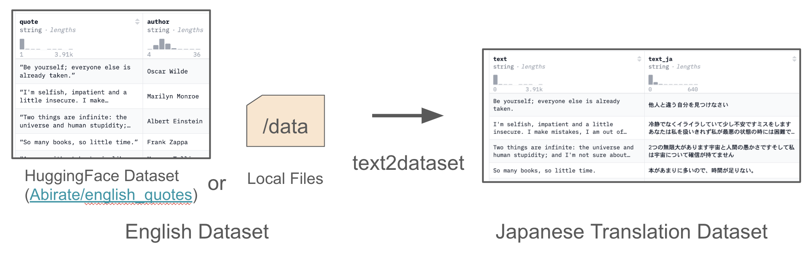
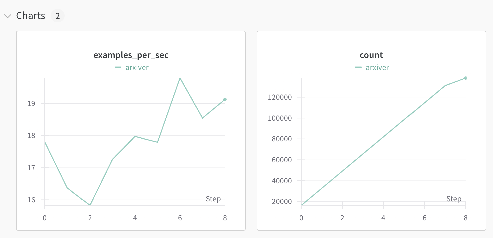
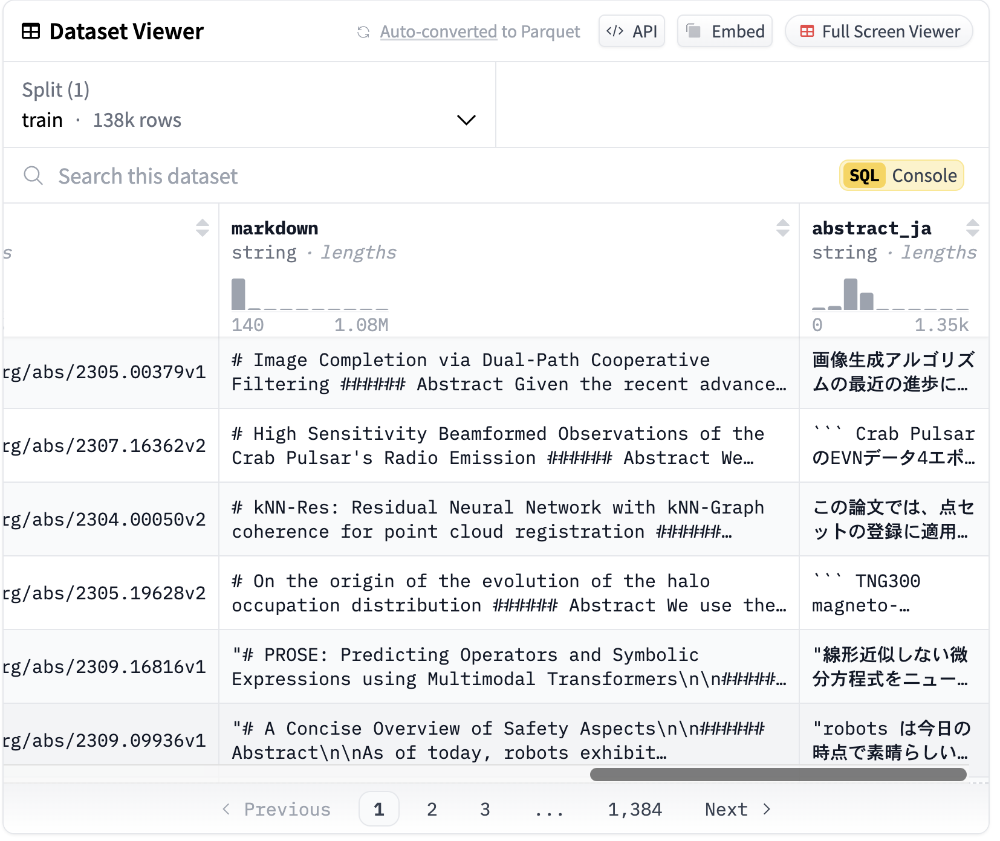

本稿では、LLM勉強会のマルチモーダルWGの活動で開発した[text2dataset](https://github.com/llm-jp/text2dataset)というツールを紹介します。

text2datasetは、[vLLM](https://github.com/vllm-project/vllm)というLLMの推論ライブラリを用いて、英語データセットをもとに日本語翻訳データセットを簡単に構築できるツールです。

<figure>
    
    <figcaption>Overview of <a href="https://github.com/llm-jp/text2dataset">text2dataset</a> </figcaption>
</figure>

text2datasetには、wandbロギング、チェックポイント & 再開、カスタムプロンプトテンプレートといった便利機能があり、大規模なデータセットの翻訳に適しています。

以下では、text2datasetを開発した背景、機能の詳細、利用例を述べていきます。

## 背景

日本語データセットは英語データセットに比べて少なく、新たに日本語データセットを構築することが多々あります。その際、インターネット上に豊富に存在する英語データを日本語に翻訳する方法がよく用いられます。

例えば、マルチモーダルモデルの評価データセットの[MMMU](https://huggingface.co/datasets/MMMU/MMMU) の日本語版である[JMMMU](https://mmmu-japanese-benchmark.github.io/JMMMU/) は、大学生を雇ってMMMUのデータを日本語に翻訳するアプローチが取られています。

人間による翻訳に加えて、DeepLやOpenAI APIなどのAPIを用いた翻訳方法も考えられます。

しかし、これらの翻訳方法はコストやライセンスの問題があります。

例えば、DeepLは高精度な翻訳が可能ですが、2024/10/23 現在で百万文字あたり2,500円であり、大規模なデータセットを翻訳するには高額です。また、OpenAI APIを用いる場合、GPT-4o-miniのような安価なモデルがありますが、(1M token output: $0.600 (2024/10/23 現在)) OpenAI APIの[利用規約](https://openai.com/policies/terms-of-use/)では、出力をOpenAIと競合するモデルの開発に使用することを禁止するという曖昧な記述があります。GPT-4の出力をモデル開発に利用できるかについては解釈が分かれており、利用には注意が必要です。

このように、人間やAPIを用いた翻訳方法は、コストやライセンスの問題を抱えています。

しかし最近では、LlamaやGemmaなどのオープンLLMを用いて大量のデータを翻訳するという手段が取れるようになってきました。オープンLLMはローカル環境で自由に動かせるため、API使用料が不要になり、コストを抑えられます。さらに、ライセンスの緩いモデルも多く提供されており、柔軟に活用できます。

こうした背景をもとに、オープンLLMを用いて英語データセットを日本語データセットに変換するツールとして開発したのがtext2datasetです。

## text2dataset

text2datasetは、以下のように、HuggingFace のデータセットパス (e.g. [Abirate/english_quotes](https://huggingface.co/datasets/Abirate/english_quotes)) や、HuggingFace datasetsライブラリの`load_dataset()`関数で読み込める形式のローカルファイルパスを指定することで、英語データをオープンLLMを用いて日本語に翻訳したデータセットを作成できます。

<figure>
    
    <figcaption>Overview of text2dataset </figcaption>
</figure>

### text2datasetのコア技術: vLLM

text2datasetは、[vLLM](https://github.com/vllm-project/vllm)を用いて大規模データセットの翻訳を高速に行います。

vLLMは、高速かつメモリ効率の良いLLM推論が行えるライブラリです。LLMの推論ライブラリには[Transformers](https://github.com/huggingface/transformers)や[Ollama](https://github.com/ollama/ollama)など多く存在しますが、vLLMは特に大量のデータを高速に処理できる点で優れています。

この高速処理を支える技術の一つが、PagedAttentionです。PagedAttentionは、OSのページングの概念を取り入れてメモリ管理を効率化し、バッチサイズを大きくすることでスループットを向上させる技術です。

vLLMはPagedAttentionを採用することで、従来の推論ライブラリにおけるKVキャッシュのメモリ浪費問題を解消し、スループットを2〜4倍に向上させたと報告されています。

詳細は[vLLM公式ブログ](https://blog.vllm.ai/2023/06/20/vllm.html)をご覧ください。

### text2datasetの便利機能

text2datasetは、大規模データを翻訳する際に便利な機能を備えています。

#### Wandb ロギング

[Wandb](https://wandb.ai/home)はWeb UIを活用した非常にリッチなロギングライブラリで、機械学習分野で最も広く使用されているロギングライブラリの一つです。

text2datasetでは、以下のように1秒ごとの推論数や、合計推論数をWandbでロギングすることができます。

<figure>
    
    <figcaption>Wandb ロギング </figcaption>
</figure>

#### カスタムプロンプトテンプレート

text2datasetは、カスタムプロンプトテンプレートによって指示プロンプトを変更することで翻訳以外のタスク(言い換え、要約、etc)に活用できます。

デフォルトでは、以下のようなプロンプトテンプレートが用意されています。

`config/prompt.yaml`

```yaml
prompt: |
  You are an excellent English-Japanese translator. Please translate the following sentence into Japanese.
  You must output only the translation.
  Sentence: {passage}
  Translation:
```

言い換え用のプロンプトテンプレートを用意することで、言い換えタスクにもtext2datasetを活用できます。

`config/paraphrase.yaml`

```yaml
prompt: |
  Please paraphrase the following text in English while preserving its original meaning. Ensure that the paraphrase is clear, natural, and well-structured. You must only output the paraphrase.
  Sentence: {passage}
  Paraphrase:
```

#### チェックポイント & 再開

大規模なデータ処理を行う際に問題となるのが、プログラムが途中で停止し、これまでの結果が失われてしまうことです。

text2datasetでは、シャードサイズを指定することで、各シャードの処理終了時に処理結果とともに、処理状態を`state.jsonl` という専用ファイルに保存します。state.jsonlを利用することで、すでに処理されたデータをスキップし、続きから再開することができます。

## 利用例

ここでは、Arxivの論文データセットである[neuralwork/arxiver](https://huggingface.co/datasets/neuralwork/arxiver)の abstract コラムデータ138K件を [google/gemma-2-2b-it](https://huggingface.co/google/gemma-2-2b-it) モデルで翻訳することにします。

以下のようなコマンドで実行できます。

```bash
$ python src/text2dataset/main.py \
    --model_id google/gemma-2-2b-it \
    --batch_size 16384 \
    --input_path neuralwork/arxiver \
    --source_column abstract \
    --target_column abstract_ja \
    --push_to_hub True \
    --push_to_hub_path speed/arxiver_ja \
    --output_dir data/arxiver_ja \
    --output_format json \
    --use_wandb True \
    --wandb_run_name arxiver
```

実行後、以下のようなデータセットが生成されます。

<figure>
    
    <figcaption> <a href="https://huggingface.co/datasets/speed/arxiver_ja">speed/arxiver_ja</a> </figcaption>
</figure>

`abstract_ja` コラムにabstractデータの日本語翻訳が生成されています。この例では、138K のabstractが、A100 GPU 1台を用いて2.5時間で翻訳されました。作成されたデータセットはこちらで確認できます: [speed/arxiver_ja](https://huggingface.co/datasets/speed/arxiver_ja)

## おわりに

本稿では、オープンLLMを用いたデータセット翻訳ツールである[text2dataset](https://github.com/llm-jp/text2dataset)を紹介しました。

日本語データセットを素早く用意してみたい方は、ぜひお試しください。

ご利用の際には翻訳元のデータや翻訳に用いるモデルのライセンスには十分注意してください。

ご質問やご要望がありましたらGitHubのissueや以下のコメント欄にてお待ちしております。

## 参考文献

- text2dataset, [https://github.com/llm-jp/text2dataset](https://github.com/llm-jp/text2dataset)
- vllm, [https://github.com/vllm-project/vllm](https://github.com/vllm-project/vllm)
- img2dataset, [https://github.com/rom1504/img2dataset](https://github.com/rom1504/img2dataset)
- Abirate/english_quotes, [https://huggingface.co/datasets/Abirate/english_quotes](https://huggingface.co/datasets/Abirate/english_quotes)
- neuralwork/arxiver, [https://huggingface.co/datasets/neuralwork/arxiver](https://huggingface.co/datasets/neuralwork/arxiver)
- deepl, [https://www.deepl.com/en/pro#developer](https://www.deepl.com/en/pro#developer)
- openai api, [https://openai.com/api/pricing/](https://openai.com/api/pricing/)
